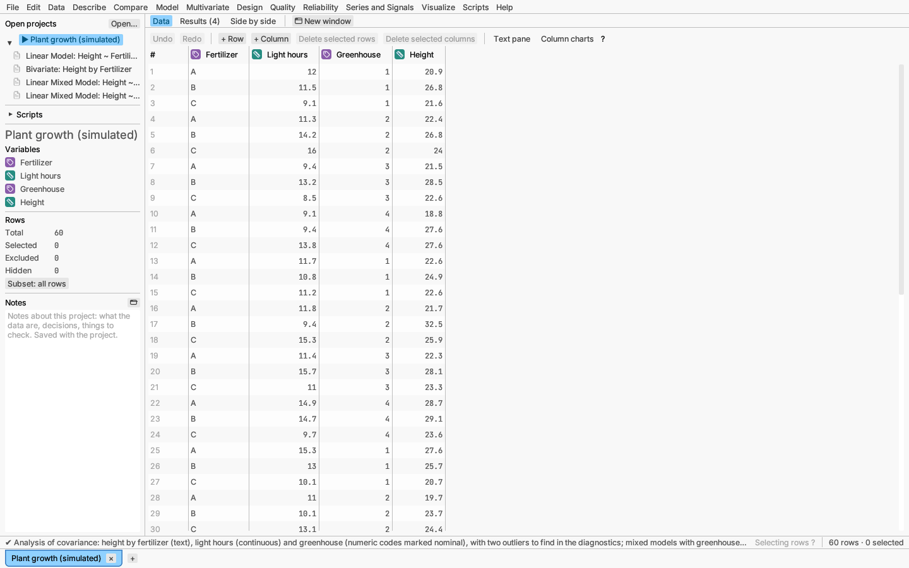
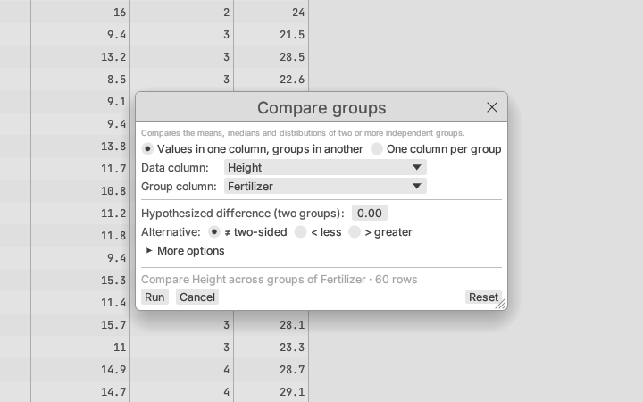
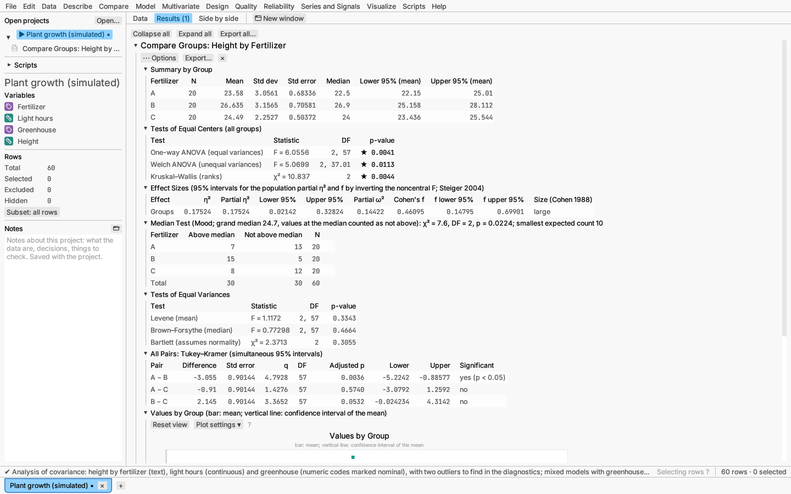

# Your first five minutes

This walk-through uses a sample table of plant heights, so you do not need
any data of your own.

1. **Open the sample.** Choose **File ▸ Open sample data ▸ Models ▸ Plant
   growth**. The table opens, with its columns listed on the left. Like
   most samples it comes with a few reports already made; you will make
   your own.

   

2. **Ask a question.** Do the fertilizers grow plants of different
   heights? That is a comparison of groups, so choose **Compare ▸ Two or
   more groups…**.
3. **Fill in the dialog.** Choose `Height` as the data column and
   `Fertilizer` as the group column. The grey line near the bottom of the
   dialog says what will run, or what is still missing. Click **Run**.

   

4. **Read the report.** The report appears at the top of the results,
   beside the table (the **Results** tab above shows the reports alone). The
   *Summary by Group* table gives each fertilizer's average height. The
   *Tests of Equal Centers* table asks whether those averages differ by
   more than chance: a small *p-value* (below 0.05, marked ★) says they
   do. Further down, *All Pairs* says which fertilizers differ from which,
   and a plot shows every plant's height by group. See the
   [Glossary](glossary.md) for the words in the report.

   

5. **Explore.** Scroll down to the plot and drag a box around the tallest
   plants. The same rows are highlighted in the table beside the report.
6. **Keep it.** Choose **File ▸ Save project as…**. A project file keeps
   the data, your reports and what you selected, and reopens exactly as you
   left it.

That is the pattern for every analysis: open data, choose a menu item,
fill in the dialog, read the report.
