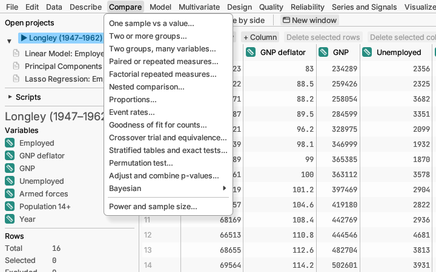

# Compare

Testing whether there is a real difference: between a group and a target,
between groups, or before and after. Each report gives the size of the
difference with a confidence interval and a p-value (see the
[Glossary](../glossary.md)).

**One sample vs a value…** asks whether a column's average (or median, or
spread) differs from a target, such as "do our bags weigh 500 g on
average?". It can also show that a value is *close enough* to a target
(equivalence). *Try it:* sample *Michelson light speed*.
[More detail](../../../manual/src/analyses/compare.md#one-sample-vs-a-value)

**Two or more groups…** compares a measurement across groups, such as
three suppliers or two teaching methods. It runs the usual tests (t test,
analysis of variance) and versions that do not assume a bell curve, checks
whether the groups are equally spread, and says which pairs of groups
differ. *Try it:* sample *Silicon resistivity* or *Plant growth*.
[More detail](../../../manual/src/analyses/compare.md#two-or-more-groups)

**Two groups, many variables…** runs the same two-group test on many
columns at once, such as thirty genes measured in treated and untreated
samples. With many tests some p-values are small by chance, so it also
gives adjusted p-values and a volcano plot (size of difference against
significance) that picks out the columns worth a closer look. *Try it:*
sample *Gene screen*.
[More detail](../../../manual/src/analyses/compare.md#two-groups-many-variables)

**Paired or repeated measures…** is for the same people or items measured
more than once, such as before and after a treatment. Pairing removes the
differences between individuals, so it finds smaller effects. *Try it:*
sample *Sleep drug trial*.
[More detail](../../../manual/src/analyses/compare.md#paired-or-repeated-measures)

**Factorial repeated measures…** is for people or items measured under
every combination of two or three conditions (task and cue, time and
dose), possibly in separate groups such as age groups. It tests each
condition, each group and their combinations, checks the assumption of
equal spread with corrections when it fails, and can test one factor
within each level of another. *Try it:* sample *Reaction times by task and
cue*.
[More detail](../../../manual/src/analyses/compare.md#factorial-repeated-measures)

**Nested comparison…** compares groups when each subject gives several
measurements, such as several cells from each mouse. It counts subjects,
not measurements, so the test is not fooled by many measurements of a few
subjects, and shows how much the subjects differ. *Try it:* sample
*Dendrite lengths per mouse*.
[More detail](../../../manual/src/analyses/compare.md#nested-comparison)

**Proportions…** compares percentages, such as pass rates or survey "yes"
answers, against a target or between groups. *Try it:* sample *Customer
churn*. [More detail](../../../manual/src/analyses/compare.md#proportions)

**Event rates…** compares how often events happen per unit of time or
exposure, such as accidents per thousand hours.
[More detail](../../../manual/src/analyses/compare.md#event-rates)

**Goodness of fit for counts…** checks whether counts in categories match
expected proportions (are the dice fair?), or whether counts follow a
Poisson pattern. *Try it:* sample *Horse-kick deaths*.
[More detail](../../../manual/src/analyses/compare.md#goodness-of-fit-for-counts)

**Crossover trial and equivalence…** analyses a study in which each
subject gets both treatments in turn, and checks whether two products are
equivalent (for example, a generic medicine). *Try it:* sample
*Bioequivalence crossover*.
[More detail](../../../manual/src/analyses/compare.md#crossover-trial-and-equivalence)

**Stratified tables and exact tests…** compares yes/no outcomes between
two groups across several strata (such as clinics), and gives exact tests
for small tables of counts. *Try it:* sample *Multi-centre trial*.
[More detail](../../../manual/src/analyses/compare.md#stratified-tables-and-exact-tests)

**Permutation test…** compares two groups, or tests a correlation, by
shuffling the data many times instead of assuming a bell curve. A good
choice for small or oddly shaped samples. *Try it:* sample *Repair times*.
[More detail](../../../manual/src/analyses/resampling.md)

**Adjust and combine p-values…** takes a column of p-values from tests
you have already run (one per row) and adjusts them for the number of
tests, by the usual methods (Bonferroni, Holm, false discovery rate and
others). It also combines them into one overall test: is there any effect
at all? *Try it:* sample *Trial endpoints*.
[More detail](../../../manual/src/analyses/compare.md#adjust-and-combine-p-values)

The **Bayesian** submenu (also under Model) holds four analyses that
describe what the data say as probabilities, starting from a stated prior
belief, instead of p-values.

**Bayesian estimation…** gives the likely range of a mean, a proportion
or an event rate (or of the difference between two groups) as a
probability distribution, and answers questions such as "how likely is the
new treatment to be better by at least 5 points?". When a group had no
events, the average of a ratio does not exist and shows as —; read the
median and the intervals instead. *Try it:* sample
*Response rates by site*.
[More detail](../../../manual/src/analyses/bayesian.md#bayesian-estimation)

**Bayes factor tests…** weigh the evidence for a difference or a
correlation against the evidence for none. Unlike a p-value, a Bayes factor
can also show that there is probably *no* effect. *Try it:* sample *Stroop
reaction times*.
[More detail](../../../manual/src/analyses/bayesian.md#bayes-factor-tests)

**Bayesian linear model or ANOVA…** compares every combination of the
chosen effects and says how likely each effect is to matter.
[More detail](../../../manual/src/analyses/bayesian.md#bayesian-linear-model-or-anova)

**Bayesian regression or hierarchical model…** fits regression models
(including yes/no outcomes and counts) for grouped data, such as patients
within hospitals, by simulation, and checks that the simulation worked.
*Try it:* sample *Eight schools*.
[More detail](../../../manual/src/analyses/bayesian.md#bayesian-regression-or-hierarchical-model)

**Power and sample size…** helps you plan before collecting data: how many
measurements you need to detect a difference of a given size, or how
likely a planned study is to find it. It also tells you how many values a
tolerance interval needs, including one that assumes nothing about the
shape of the data. It uses no data (any open table will do, even a new
empty one).
[More detail](../../../manual/src/analyses/compare.md#power-and-sample-size)
