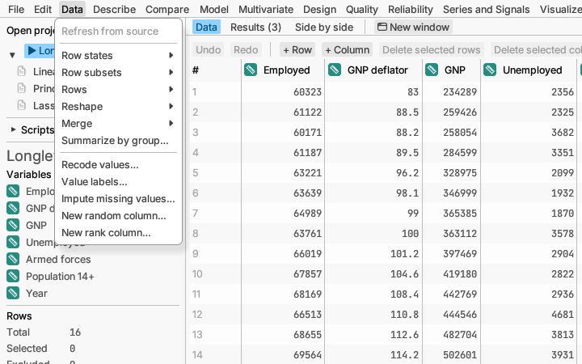

# Data

Reshaping, tidying and choosing which rows to use.

**Refresh from source** reloads a table that came from a database or the
web, so it shows the latest data.

## Row states

A row can be *selected* (highlighted everywhere), *excluded* (left out of
analyses but kept in the table) or *hidden* (left out of plots). Use these
to set aside a suspect value without deleting it.

**Select all rows**, **Clear selection** and **Invert selection** change
which rows are selected.

**Exclude selected rows from analyses** leaves the selected rows out of
every report, which updates at once. **Include selected rows in analyses**
and **Include all rows in analyses** bring them back. **Select excluded
rows** shows you which rows are excluded.

**Hide selected rows in plots**, **Show selected rows in plots** and
**Show all rows in plots** do the same for plots only.

**Colour and marker by column…** gives every row a colour, and a marker
shape, from its value in a column you pick, such as one colour and shape
per treatment group. Plots that are not already grouped then draw the rows
that way and name the groups in their key. **Clear row colours and
markers** takes them off again.

More detail: [Row states: select, exclude, hide](../../../manual/src/data/row-states.md).

## Row subsets

A *row subset* is a named set of rows you can switch to, such as "Men",
"Batch 3" or "After the change". While one is active, every report and
plot uses only its rows; switch back to **All rows** to use them all.

**Save selection as subset…** names the selected rows. The menu then lists
**All rows** and each saved subset with its row count; pick one to make it
active. With a subset active you can also **Select the subset's rows**,
**Replace with the selection**, **Rename subset…** or **Delete subset**.
The same menu opens from the *Subset* line under the row counts in the
sidebar.

More detail: [Row subsets](../../../manual/src/data/row-states.md#row-subsets).

## Rows

**Sort…** puts the rows in order of one or more columns.

**Remove duplicates…** keeps the first of each set of repeated rows (you
can undo it, or make a new table instead).

**Subset and sample…** makes a new table of some of the rows: the selected
ones, the ones matching a condition, or a random sample.

**Use row as column names** turns the row you clicked into the column
names, for a table whose names ended up as its first row of values. Undo
puts the row back.

## Reshape

**Stack columns…** turns several side-by-side columns (say, a column per
month) into one long column with a label saying where each value came
from. **Unstack by label…** does the reverse. **Transpose…** swaps rows
and columns.

**Distance matrix…** makes a new table of how different every pair of rows
is, by a measure you choose (Gower handles a mix of numbers and
categories). Use it for **Principal coordinates…**, **Dimension
reduction…** or **Clustering…**.

## Merge

**Combine rows…** puts tables with the same columns one under the other.
**Join…** matches rows of two tables on a shared key column (such as a
customer number) and puts their columns side by side.

## Other tools

**Summarize by group…** makes a new table of statistics (counts, means
and so on) for each group, such as the average height per fertilizer.

**Recode values…** changes values or merges categories, for example
turning "NY", "N.Y." and "New York" into one spelling.

**Value labels…** gives names to codes, such as 1 = Female and 2 = Male.
The table keeps the numbers, but the grid, reports and plots show the
names. The **Stored values** button above the grid shows the numbers again.

**Impute missing values…** fills gaps in the data with sensible estimates,
so methods that need complete rows can use more of them. Its *multiple
imputation* methods make several filled-in copies instead, stacked in a new
table; analyses of that table combine the copies, so their results allow
for not knowing the missing values.

**New random column…** adds a column of random numbers from a chosen
distribution, for simulations or random assignment.

**New rank column…** adds a column numbering the values of a column from
smallest (1) to largest, optionally within each group, with a choice of
how equal values are numbered (shared average, lowest, highest, no gaps,
or in row order).

More detail: [Table operations](../../../manual/src/data/table-operations.md),
[Rank columns](../../../manual/src/data/editing.md#rank-columns),
[Missing values and imputation](../../../manual/src/data/missing-values.md),
[Multiple imputation](../../../manual/src/data/multiple-imputation.md).
