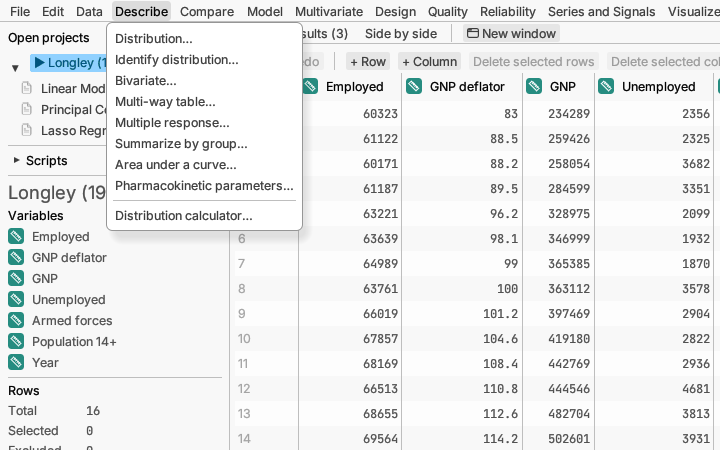

# Describe

Getting to know your data before testing anything: what is typical, how
spread out it is, what shape it has.

**Distribution…** describes one column at a time. For measurements you
get the average, spread and percentiles, a histogram, a box plot and a
check of whether the values follow a bell curve. For categories you get
counts and percentages. This is usually the first thing to run on new
data. *Try it:* sample *Michelson light speed*.
[More detail](../../../manual/src/analyses/describe.md#distribution)

If some values are only known to be below a limit (lab results reported as
"< 2", called non-detects) or above one, choose how they are marked under
*Censored values* in the same dialog. The report then estimates the
distribution and its percentiles without pretending those values are exact.
*Try it:* sample *Well water arsenic*.
[More detail](../../../manual/src/analyses/describe.md#censored-values-and-detection-limits)

**Identify distribution…** tries fourteen common distribution shapes
(normal, lognormal, Weibull and others) on one column and ranks how well
each fits. Useful when you need to know the shape, for example before
working out how often a part will fall out of specification. *Try it:*
sample *Seal strength*.
[More detail](../../../manual/src/analyses/describe.md#identify-distribution)

**Bivariate…** looks at two columns together: a scatter plot and the
correlation for two measurements (for a fitted line, use **Model ▸ Linear
model…**), a
side-by-side comparison for a measurement and a category, or a table of
counts for two categories. *Try it:* sample *Norris calibration*.
[More detail](../../../manual/src/analyses/describe.md#bivariate)

**Multi-way table…** counts rows by several categories at once (for
example, outcome by treatment within each clinic), with percentages,
subtotals and averages. *Try it:* sample *Multi-centre trial*.
[More detail](../../../manual/src/analyses/describe.md#multi-way-table)

**Multiple response…** counts the answers to a "tick all that apply"
question, such as "How did you hear about us?". The answers can be in one
column as lists (Email; Phone) or in one yes/no column per choice. You see
how many people ticked each choice, and, with a group column such as age
group, whether the groups tick choices differently. *Try it:* sample
*Visitor survey*.
[More detail](../../../manual/src/analyses/describe.md#multiple-response)

**Summarize by group…** makes a table of counts, means and other
statistics for each group; it is the same command as **Data ▸ Summarize
by group…**.

**Area under a curve…** measures the area under measurements taken over
time (or dose, or wavelength), such as a drug's concentration in the blood
after a dose. It joins the average at each time with straight lines, gives
the area above a baseline with its margin of error, and finds the peaks.
It can also save the measurements rescaled to 0–100% or as a share of the
total. *Try it:* sample *Plasma concentration*.
[More detail](../../../manual/src/analyses/describe.md#area-under-a-curve)

**Pharmacokinetic parameters…** summarises how a drug's concentration in
the blood rises and falls after a dose, for each subject: the peak and when
it happens, the area under the curve, the half-life, and (given the dose)
clearance and volume, then averages them by treatment. *Try it:* sample
*PK profiles*.
[More detail](../../../manual/src/analyses/describe.md#pharmacokinetic-parameters)

**Distribution calculator…** works out probabilities from a named
distribution, using no data from the table, such as "what share of a normal
distribution lies above 2?". It draws the curve and shades the area.
[More detail](../../../manual/src/analyses/describe.md#distribution-calculator)
