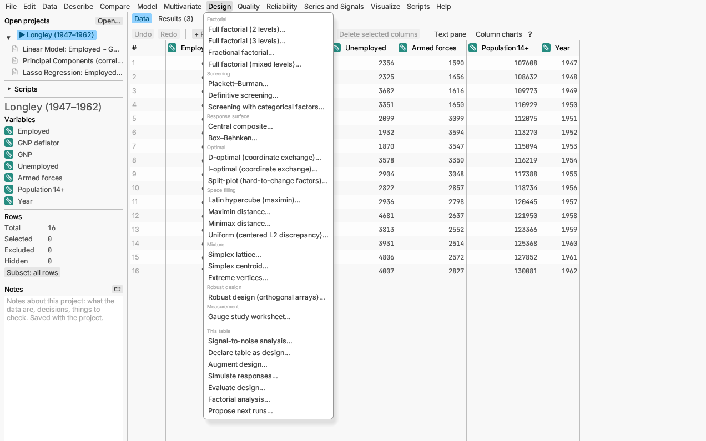

# Design

Planning an experiment: which combinations of settings to run so that a
small number of runs tells you as much as possible. Each design item makes
a new table listing the runs in a random order, with an empty column for
each result. You need no data to start. Run the experiment, type in the
results, then analyse them with **Model ▸ Linear model…**, **Response
surface**, **Mixture model** or **Several responses** (a split-plot design
fills in **Model ▸ Mixed model…** for you). The items under *This table*
work on a table you already have.

More detail on everything here: [Design](../../../manual/src/analyses/design.md) in the Reference
Manual.

## Factorial and screening designs

**Full factorial (2 levels)…** tries every combination of a low and a high
setting of each factor. Clear and simple for up to about five factors.

**Full factorial (3 levels)…** does the same with low, middle and high
settings, which shows curvature.

**Fractional factorial…** runs a well-chosen fraction of the full set (say
16 runs instead of 64), giving up some information on interactions.

**Full factorial (mixed levels)…** allows a different number of settings
per factor (for example, 3 machines × 2 temperatures × 4 materials).

**Plackett–Burman…** and **Definitive screening…** check many factors in
very few runs, to find the handful that matter. Definitive screening also
spots curvature; you can add a few extra runs or center runs, and compare
the choices, for a more reliable answer.

**Screening with categorical factors…** does the same when some factors
are categories, such as three suppliers or two machines, mixed with
numeric ones.

## Response surface designs

**Central composite…** and **Box–Behnken…** are designs for fitting a
curved model and finding the best settings, once you know which factors
matter. Analyse them with **Model ▸ Response surface (second-order
model)…**.

## Custom designs

**D-optimal (coordinate exchange)…** and **I-optimal (coordinate
exchange)…** build a design for exactly the model, number of runs and
restrictions you have, when no standard design fits. D-optimal is best for
estimating effects, I-optimal for predicting.

**Split-plot (hard-to-change factors)…** is for experiments where one
factor, such as an oven temperature, is slow to change, so runs are
grouped by it.

## Space-filling designs

For computer simulations and other experiments with no random error, these
spread the runs evenly through the region: **Latin hypercube
(maximin)…**, **Maximin distance…**, **Minimax distance…** and **Uniform
(centered L2 discrepancy)…**. *Try it:* sample *Borehole water flow*.

## Mixture

For recipes whose ingredients add up to 100%: **Simplex lattice…** and
**Simplex centroid…** cover the whole range of blends, and **Extreme
vertices…** handles lower and upper limits on each ingredient. Analyse
them with **Model ▸ Mixture model…**.

## Robust design

**Robust design (orthogonal arrays)…** plans an experiment to find
settings that work well despite noise you cannot control, such as
humidity. **Signal-to-noise analysis…** analyses it. *Try it:* sample
*Moulding shrinkage*.

## Measurement

**Gauge study worksheet…** makes the run sheet for a measurement-system
study: which operator measures which part, and when. (Also on the Quality
menu.)

## This table

**Declare table as design…** tells the app that a table you already have
is an experiment, so it can check it and analyse it like one.

**Augment design…** adds runs to an existing design, for example to
untangle effects that were mixed up or to add a curved term. For a
split-plot design it can add new whole plots.

**Simulate responses…** makes up results for a design from random
effects, a few of them large, so you can practise the analysis and see
whether the design finds them before you run the experiment.

**Evaluate design…** shows how good a design is before you run it: how
precisely it estimates each effect and which effects are mixed up.
*Try it:* sample *Design comparison*.

**Factorial analysis…** analyses a two-level experiment, including one
with no repeated runs, and shows which effects stand out from the noise.
*Try it:* sample *Filtration rate*.

**Propose next runs…** looks at the runs you have made so far and suggests
the next few to try, where the best result is most likely to be found. Add
them to the table, run them, type in the results and ask again, round after
round. *Try it:* sample *Reaction yield (simulated)*.
[More detail](../../../manual/src/analyses/gaussian-processes.md#proposing-the-next-runs)
