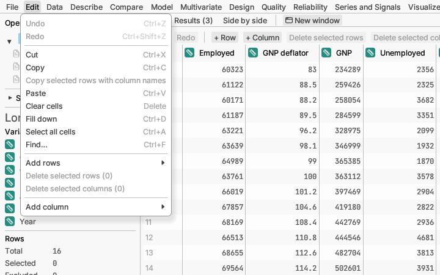

# Edit

Changing the values in the table, much as you would in a spreadsheet.
Click a cell and start typing, or double-click it, to change it. A value
too long for its cell opens in a larger box so you can see all of it.

## Undo and the clipboard

**Undo** and **Redo** step back and forward through your edits (the last
500 are kept).

**Cut**, **Copy** and **Paste** move cells to and from other programs,
such as a spreadsheet. **Copy selected rows with column names** copies
whole selected rows with a header line, ready to paste elsewhere.

**Clear cells** empties the selected cells, leaving them missing.

**Fill down** copies the top cell of a selection into the cells below it.

**Select all cells** selects the whole table.

**Find…** searches the table for a value.

More detail: [Editing the data grid](../../../manual/src/data/editing.md),
[Copying and pasting](../../../manual/src/data/clipboard.md).

## Rows and columns

**Add rows** adds empty rows at the end: set **How many**, then click
**Add row at the end** (it says "Add 5 rows at the end" when you ask for
five). The grid's **+ Row** button opens the same choice, and can also
insert the rows above or below the rows you selected (or the cell you
clicked). In the grid, pressing Enter on the last row also adds a row.

**Delete selected rows** removes the selected rows (the number in brackets
says how many). **Delete selected columns** does the same for the columns
whose headings you clicked. You can undo either.

**Add column** adds a new column holding **Numbers**, **Text** or
**Dates**. Change **How many** at the top to add several at once, and type
a **Name** if you like (several columns are numbered: Rep 1, Rep 2, …).
One undo removes everything you added. The grid's **+ Column** button
offers the same, and can also insert the columns to the left or right of
the columns you selected (or the cell you clicked), including a formula
column. A **Formula…** column is worked out from other columns (for
example, weight divided by height squared) and updates itself when the
data change. Under the formula, **Reads as** shows it written as maths,
with fraction bars, powers and square-root signs, so you can check it. **Random values…** opens the same dialog as **Data ▸ New
random column…**.

More detail: [Formula columns](../../../manual/src/reference/formulas.md),
[Dates and times](../../../manual/src/data/dates.md).
