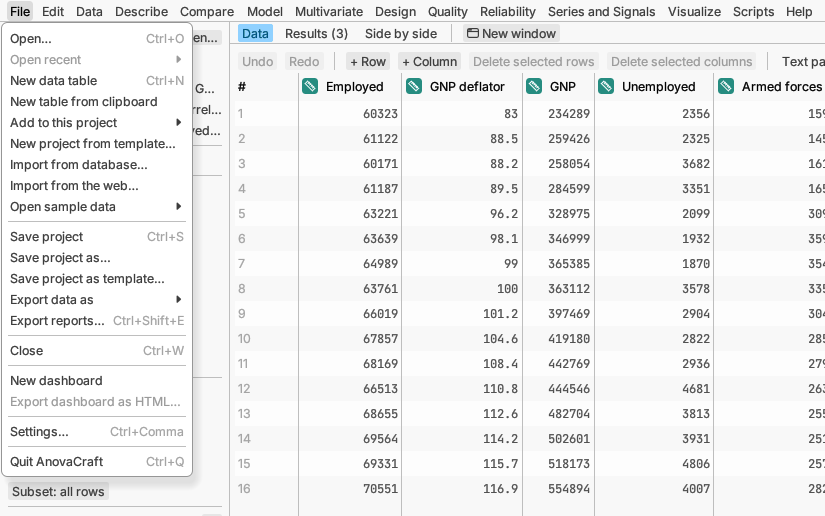

# File

Opening, saving and sharing your work.

## Opening data

**Open…** opens a data file or a saved project. It reads comma- and
tab-separated text, JSON, and spreadsheet workbooks (Excel and
OpenDocument; each sheet becomes its own table). You can also drag files
onto the window. Text files and workbooks first show a preview of their
cells, where you click the cell where the table starts (its first column
name) if it does not start in the top-left corner, choose the sheets to
open, and press **Open**. Pictures (PNG, JPEG, TIFF, BMP) open as a table
with one row per pixel: its position `x` and `y` and its brightness, or
red, green and blue. A large picture asks whether to shrink it, cut out a
part, or keep every pixel. New data opens showing just the table; no
analysis runs until you pick one from a menu. Saved projects and sample
data open with their reports, as they were saved.

**Open recent** lists the files you opened lately.

**New data table** starts an empty table to type into, like a fresh
spreadsheet.

**New table from clipboard** makes a table from cells you copied in a
spreadsheet. The same preview shows first; if the first copied line holds
names, they become the column names.

**Add to this project** puts a new table into the project you are working
in instead of starting a project of its own: an **Empty table**, a
**Table from clipboard**, or a **Data file…**. The data file preview also has
a box, *Add to the open project*, that does the same for any file you open.

**New project from template…** builds a template's reports, graphs and
dashboards on new data: an open table, a data file, or every data file in a
folder (each becomes a table of one new project). Columns with the same
names match by themselves; for the others you choose which column stands in.

**Import from database…** reads the result of a database query (SQLite
files, PostgreSQL, MySQL or MariaDB servers). Passwords are never saved.

**Import from the web…** downloads JSON or CSV data, or a table on a web
page, from a web address.

**Open sample data** has dozens of small example tables, grouped by topic.
Each one is chosen to show off a kind of analysis and most open with a
report already made, so they are the quickest way to learn.

More detail: [Documents, files and projects](../../../manual/src/data/documents.md),
[The Open Data dialog](../../../manual/src/data/open-data.md),
[Data from databases and the web](../../../manual/src/data/external-data.md),
[Sample data](../../../manual/src/getting-started/sample-data.md).

## Saving and sharing

**Save project** and **Save project as…** save everything in one
`.acraft` project file: the tables, your reports and their settings, and
which rows are selected or excluded. Reopening the project rebuilds every
report exactly.

**Save project as template…** saves the project's reports, graphs,
dashboards, scripts and plot styles without the data, as a `.acrafttemplate`
file, so you can build the same reports on next month's data with **New
project from template…**.

**Export data as** saves just the table, without reports, for other
programs: **Comma-separated (.csv)** or **Tab-separated (.tsv)** text,
**JSON rows (.json)**, or an **Excel workbook (.xlsx)**. Tick **Write
value labels** to write names (Female, Male) instead of the codes behind
them. **Image (PNG or 16-bit TIFF)…** turns a column back into a grey
picture, placing each row by its x and y columns.

**Export reports…** saves reports as a document to read or send: PDF, Word,
PowerPoint, a web page, Markdown or an Excel workbook. **Export all…** at
the top of the results does the same.

**Close** closes the current table (you are asked first if it has unsaved
changes). In a project of several tables it reads *Remove table from
project*, beside *Close project*.

More detail: [Saving plots and results](../../../manual/src/reports/exporting.md).

## Dashboards

**New dashboard** makes a page of report tiles and notes from the
project's tables, with filters that every tile follows. Good for a summary
you look at again and again.

**Export dashboard as HTML…** saves a dashboard as a web page anyone can
open in a browser.

Removing a dashboard asks first, and **Edit ▸ Undo** brings it back.

More detail: [Dashboards](../../../manual/src/reports/dashboards.md).

## The app itself

**Settings…** changes the colour scheme (light, dark, or follow the system), the text size,
how long the pointer rests on something before its explanation pops up, how numbers and p-values are shown in reports, whether the
getting-started tips appear, and whether simple files open without the
preview.

**Quit AnovaCraft** closes the app, asking first about unsaved work.

More detail: [Settings](../../../manual/src/getting-started/settings.md).
