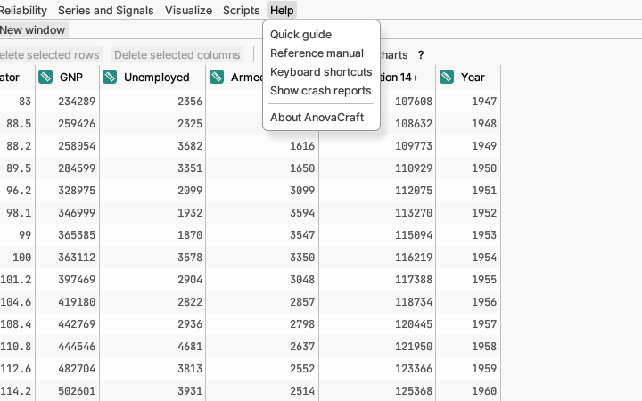

# Help

**Quick guide** opens this guide as a PDF in your computer's PDF viewer
(Preview on a Mac, your default PDF app on Windows or Linux). The guide is
built into AnovaCraft, so it needs no internet connection and always matches
the version you have.

**Reference manual** opens the
[Reference Manual](../../../manual/src/SUMMARY.md) the same way: a PDF that
describes every option, report section and method in detail. Its contents
page and bookmarks link to every chapter.

**Keyboard shortcuts** lists every shortcut key.

**Show crash reports** opens the folder where AnovaCraft writes a short
report each time it stops on an internal error. If you report a problem,
attach the newest file there.

If AnovaCraft ever closes unexpectedly, your work is not lost: every couple
of minutes it keeps a copy of each project with unsaved changes, and the next
time it starts it offers **Restore unsaved work**. Click **Restore** to open
the copies (save them to keep the changes), **Discard** to delete them, or
**Decide later** to be asked again next time.

**About AnovaCraft** shows the version number and AnovaCraft's licence
(Apache 2.0 or MIT, whichever you prefer), with links to both manuals and to
their pages online, and a note that it is an independent project. Its **Open-source licences** button lists the fonts,
icons, data and software libraries AnovaCraft is built with, with each one's
copyright notice and licence.
