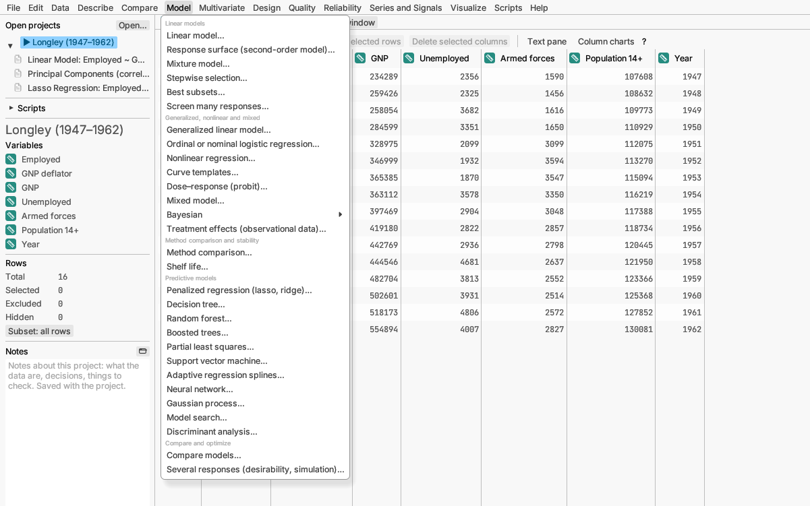

# Model

Explaining or predicting one column (the *response*) from others (the
*predictors* or *factors*). A model is an equation; the report says how
well it fits, which predictors matter, and lets you try "what if"
settings.

## Linear models

**Linear model…** is the workhorse. It explains a measurement from one or
more other columns, which can be measurements or categories, and from
their combinations. The report gives the equation, how much of the
variation it explains (R²), which predictors matter, a plot of the fit, and a
Response Explorer where you drag each factor's setting and watch the
prediction change. Plots of what is left over (residuals) are in the
report's ⋯ Options menu.
Analysis of variance and covariance are linear models too. Under *More
options* a measured predictor can bend (a spline term), and the report's
⋯ Options can compare one factor's levels at each level of another
(comparisons within slices) or each group's slope. *Try it:*
sample *Longley economy*. [More detail](../../../manual/src/analyses/linear-models.md#linear-model)

**Response surface (second-order model)…** fits a curved model with
squared terms and finds the settings that give the highest or lowest
response, with coloured contour maps of the surface. Used after a designed
experiment. *Try it:* sample *Reaction yield*.
[More detail](../../../manual/src/analyses/linear-models.md#response-surface)

**Mixture model…** is for blends whose ingredients add up to 100%, such as
a recipe or an alloy, and draws the triangle plot of the blend.
*Try it:* sample *Yarn elongation*.
[More detail](../../../manual/src/analyses/linear-models.md#mixture-model)

**Stepwise selection…** chooses which of many candidate predictors to keep,
adding or dropping one at a time. Tick *Several responses* to run a
separate search for each of several responses and explore them together.
*Try it:* sample *Hald cement*.
[More detail](../../../manual/src/analyses/linear-models.md#stepwise-selection)

**Best subsets…** fits every combination of the candidate predictors and
lists the best model of each size, so you can weigh simplicity against
fit. *Try it:* sample *Hald cement*.
[More detail](../../../manual/src/analyses/linear-models.md#best-subsets)

**Screen many responses…** fits the same model to many response columns
at once, such as the counts of thousands of genes against a treatment, and
lists which responses the factors affect, with p-values adjusted so that
few of those listed are false alarms. A volcano plot shows each response's
effect against its strength of evidence; any response's full report opens
from ⋯ Options. *Try it:* sample *Transcript counts*.
[More detail](../../../manual/src/analyses/linear-models.md#screening-many-responses)

## Generalized, nonlinear and mixed

**Generalized linear model…** handles responses a linear model cannot:
yes/no outcomes (logistic regression), counts (Poisson regression), and
positive skewed measurements. *Try it:* sample *Customer churn*.
[More detail](../../../manual/src/analyses/other-models.md#generalized-linear-model)

**Ordinal or nominal logistic regression…** predicts a category with more
than two levels: ordered ones, such as a rating from poor to excellent, or
unordered ones, such as the way people travel to work. *Try it:* samples
*Service ratings* and *Commute modes*.
[More detail](../../../manual/src/analyses/other-models.md#ordinal-and-nominal-logistic-regression)

**Nonlinear regression…** fits a curve whose shape you choose, such as
growth that levels off, a dose–response curve or a peak. It can also fit
several groups at once and test whether they differ, read unknown samples
off a standard curve, set aside outliers, and fit a rate equation
(differential equation). *Try it:* samples *Seedling growth*, *Compound
potency*, *Assay standard curve* and *Substrate depletion*.
[More detail](../../../manual/src/analyses/nonlinear-regression.md)

**Curve templates…** fits a ready-made curve for a laboratory assay: an
immunoassay standard curve, receptor binding, enzyme kinetics and
inhibition, a dose–response curve, or growth, decay and survival. Choose
the kind of experiment and the template, then your columns; the starting
values come from your data. Besides the fit, the report gives what the
assay needs, such as Ki, kcat, EC50 or a half-life, a check of the
standards against acceptance limits with unknown samples read off the
curve, or the best-supported inhibition mechanism. *Try it:* samples
*ELISA plate*, *Enzyme inhibition*, *Antagonist shift*, *Potency assay*
and the other curve template samples.
[More detail](../../../manual/src/analyses/curve-templates.md)

**Dose–response (probit)…** finds the dose that affects a given share of
subjects, such as the dose that kills half the insects. *Try it:* sample
*Rotenone*. [More detail](../../../manual/src/analyses/dose-response-and-agreement.md#doseresponse-probit-analysis)

**Treatment effects (observational data)…** estimates what a treatment
did when it was not given at random, by comparing treated and untreated
rows that were alike before treatment (matching or weighting on each row's
chance of being treated). It shows whether the groups were made alike
(balance), the effect with its interval, and the effect within subgroups.
*Try it:* sample *Cardiac rehabilitation*.
[More detail](../../../manual/src/analyses/treatment-effects.md)

**Mixed model…** is a linear model for grouped data, such as several
measurements per patient or per batch, where the groups are a sample from
a larger population. It also handles ordered ratings (choose the
*Ordinal* family), rows that stand for several observations (*Frequency*) or
count more than others (*Weight*), groups whose scatter differs (*Residual
variance differs by*) and robust standard errors. *Try it:* sample
*Furnace coatings*, or *Wine bitterness* for ratings.
[More detail](../../../manual/src/analyses/other-models.md#mixed-model)

The **Bayesian** submenu is also under Compare: **Bayesian estimation…**,
**Bayes factor tests…**, **Bayesian linear model or ANOVA…** (every
combination of effects compared, with how likely each effect is to matter)
and **Bayesian regression or hierarchical model…** (regression for grouped
data, such as patients within hospitals, fitted by simulation; *try it:*
sample *Eight schools*). See [Compare](compare.md) and the
[Reference Manual](../../../manual/src/analyses/bayesian.md).

## Method comparison and stability

**Method comparison…** checks whether two measuring methods agree, allowing
for error in both. If one method rises while the other falls, the report
notes that the robust (Passing–Bablok) line cannot give a full range for
its slope. *Try it:* sample *Glucose methods*.
[More detail](../../../manual/src/analyses/dose-response-and-agreement.md#method-comparison)

**Shelf life…** estimates how long a product stays within specification
from stability-test data. With only two test times per batch it cannot
check whether batches degrade at different rates, so it assumes they do not
and says so. If your batches are a sample of future production, choose
*Batches are: A random sample of batches* for a shelf life a new batch can be
expected to meet. *Try it:* sample *Tablet stability*, or *Capsule stability*
for random lots.
[More detail](../../../manual/src/analyses/dose-response-and-agreement.md#shelf-life)

## Predictive models

These aim to predict well rather than to explain. Most hold back part of
the data to check predictions honestly (validation).

**Penalized regression (lasso, ridge)…** is a linear model that shrinks
weak predictors toward zero, which helps when there are many predictors.
The lasso can drop predictors entirely. *Try it:* sample *Longley
economy*. [More detail](../../../manual/src/analyses/other-models.md#penalized-regression)

**Decision tree…** splits the data into groups with simple rules ("income
above 40,000 and fewer than two loans"), drawn as a tree that is easy to
explain. *Try it:* sample *Loan applications*.
[More detail](../../../manual/src/analyses/decision-trees.md)

**Random forest…** averages hundreds of trees for better predictions and
ranks the predictors by importance. *Try it:* sample *Loan applications*.
[More detail](../../../manual/src/analyses/forests-and-boosting.md#random-forest)

**Boosted trees…** builds trees one after another, each fixing the
mistakes of the ones before. Often the most accurate of the tree methods.
*Try it:* sample *Loan applications*.
[More detail](../../../manual/src/analyses/forests-and-boosting.md#boosted-trees)

**Partial least squares…** predicts from very many related columns, such
as the readings of a spectrum, by first combining them into a few
summaries. *Try it:* sample *Fuel spectra*. [More detail](../../../manual/src/analyses/pls.md)

**Support vector machine…** separates classes (or predicts a measurement)
with a flexible boundary. *Try it:* sample *Pump sensors*.
[More detail](../../../manual/src/analyses/svm.md)

**Adaptive regression splines…** builds a model from straight-line pieces
with bends, finding curves and interactions on its own. *Try it:* sample
*Fuel consumption*. [More detail](../../../manual/src/analyses/mars.md)

**Neural network…** learns a flexible prediction from layers of simple
units, which can capture curves and interactions no one specified. It
checks itself on held-back rows to avoid memorizing the data. *Try it:*
sample *Polymer batches (simulated)*.
[More detail](../../../manual/src/analyses/neural-networks.md)

**Gaussian process…** fits a smooth surface through a measured response and
says how sure it is everywhere: sure near your runs, less sure between and
beyond them. It suits small experiments and computer simulations. *Try it:*
sample *Reaction yield (simulated)*.
[More detail](../../../manual/src/analyses/gaussian-processes.md)

**Discriminant analysis…** assigns rows to known groups from their
measurements, such as telling honey's origin from its chemistry. (Also on
the Multivariate menu.) *Try it:* sample *Honey origins*.
[More detail](../../../manual/src/analyses/multivariate.md#discriminant-analysis)

## Compare and optimize

**Compare models…** puts the predictions of several saved models side by
side, with measures of accuracy, to pick the best. *Try it:* sample *Loan
applications*. [More detail](../../../manual/src/analyses/model-comparison.md)

**Model search…** fits every suitable predictive model to one response,
ranks them by how well they predict the held-back rows, and opens the
winner's full report. A quick way to find a good starting model.
*Try it:* sample *Polymer batches (simulated)*.
[More detail](../../../manual/src/analyses/model-search.md)

**Several responses (desirability, simulation)…** handles several
responses at once (with the same terms for all, or each response's own
terms chosen stepwise), finds settings that balance all your goals, and
simulates how variation in the settings spreads to the results. *Try it:*
sample *Coating formulation*. [More detail](../../../manual/src/analyses/several-responses.md)
