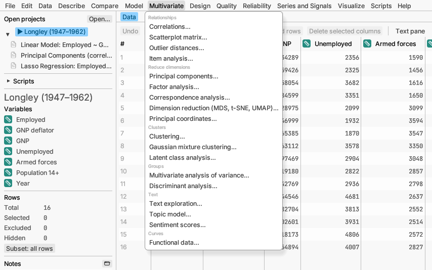

# Multivariate

Looking at many columns at once: how they move together, how to sum them
up in a few numbers, and how rows fall into groups.

## Relationships

**Correlations…** measures how strongly each pair of columns moves
together, from −1 to +1, as a table and a colour-coded map. *Try it:*
sample *Flower measurements*.
[More detail](../../../manual/src/analyses/multivariate.md#correlations)

**Scatterplot matrix…** draws a scatter plot for every pair of columns in
one grid, so patterns and odd rows stand out.
[More detail](../../../manual/src/analyses/multivariate.md#scatterplot-matrix)

**Outlier distances…** finds rows that are unusual in their combination
of values, even when no single value looks odd.
[More detail](../../../manual/src/analyses/multivariate.md#outlier-distances)

**Item analysis…** checks whether the questions of a questionnaire or test
measure the same thing consistently (Cronbach's alpha). *Try it:* sample
*Course evaluation*. [More detail](../../../manual/src/analyses/multivariate.md#item-analysis)

## Reduce dimensions

**Principal components…** combines many related columns into a few new
ones that keep most of the information, and plots rows and columns on
them. *Try it:* sample *Flower measurements*.
[More detail](../../../manual/src/analyses/multivariate.md#principal-components)

**Factor analysis…** looks for a few hidden traits behind many observed
scores, such as verbal and numerical ability behind a set of tests.
*Try it:* sample *Ability tests*.
[More detail](../../../manual/src/analyses/multivariate.md#factor-analysis)

**Correspondence analysis…** draws a map of a table of counts, placing
categories that go together close to each other. *Try it:* sample
*Customer survey*. [More detail](../../../manual/src/analyses/multivariate.md#correspondence-analysis)

**Dimension reduction (MDS, t-SNE, UMAP)…** draws a two-dimensional map in
which similar rows sit close together, from many columns or from a table
of distances. *Try it:* samples *Expression profiles* and *Town
distances*. [More detail](../../../manual/src/analyses/multivariate.md#dimension-reduction)

**Principal coordinates…** draws a map of the rows from any measure of how
different they are, including one for a mix of numbers and categories
(Gower), or from a table of distances, and shows how much of the
differences each axis captures. *Try it:* samples *Shrub traits* and *Town
distances*.
[More detail](../../../manual/src/analyses/multivariate.md#principal-coordinates)

## Clusters

**Clustering…** sorts rows into groups of similar rows, either a chosen
number of groups (k-means) or a family tree of groups (hierarchical).
Not sure how many groups? k-means can compare several numbers of groups
and suggest one. If you already have a guess at the group centers, type
them in (or read them from a table) and k-means starts from there. The
family tree can also use other distances, such as Gower for columns that
mix numbers and categories, or a table of distances.
[More detail](../../../manual/src/analyses/multivariate.md#clustering)

**Gaussian mixture clustering…** finds groups that may overlap and have
different shapes, and gives each row a probability of belonging to each.
*Try it:* sample *Cell populations*.
[More detail](../../../manual/src/analyses/multivariate.md#gaussian-mixture-clustering)

**Latent class analysis…** finds hidden groups from yes/no or category
answers, such as types of patients from a symptom checklist. *Try it:*
sample *Symptom checklist*.
[More detail](../../../manual/src/analyses/multivariate.md#latent-class-analysis)

## Groups

**Multivariate analysis of variance…** compares groups on several
measurements at once. *Try it:* sample *Plastic film*.
[More detail](../../../manual/src/analyses/multivariate.md#multivariate-analysis-of-variance)

**Discriminant analysis…** learns how known groups differ and assigns new
rows to a group. *Try it:* sample *Honey origins*.
[More detail](../../../manual/src/analyses/multivariate.md#discriminant-analysis)

## Curves

**Functional data…** treats each row group's readings over time (or
another scale) as one smooth curve, such as a temperature profile per
batch. It smooths the curves, can line up their peaks, finds the main ways
they differ from each other, and can relate those to factors such as
settings in an experiment. *Try it:* sample *Exotherm profiles*.
[More detail](../../../manual/src/analyses/multivariate.md#functional-data)

## Text

**Text exploration…** breaks a column of free text (comments, reviews,
notes) into words and short phrases, counts how often each appears, and
shows the most common terms in a table and a word cloud. It can also find
the main themes behind the wording and save them as columns for other
analyses. *Try it:* sample *Espresso machine reviews*.
[More detail](../../../manual/src/analyses/text-analysis.md#text-exploration)

**Topic model…** finds a chosen number of topics, each a set of words that
tend to appear together, and says how much of each document belongs to
each topic. *Try it:* sample *Espresso machine reviews*.
[More detail](../../../manual/src/analyses/text-analysis.md#topic-model)

**Sentiment scores…** scores each document from negative to positive using
a word list that also handles "not" and "very", and compares the scores
across groups. *Try it:* sample *Espresso machine reviews*.
[More detail](../../../manual/src/analyses/text-analysis.md#sentiment-scores)
