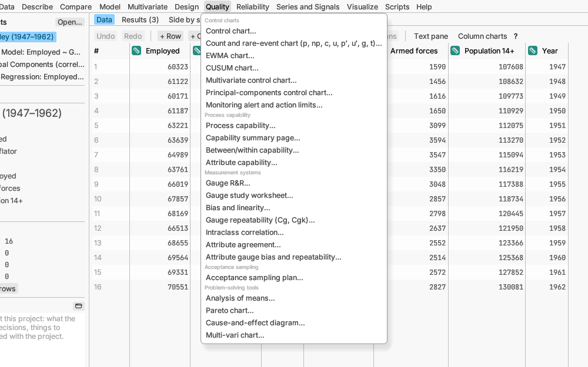

# Quality

Keeping a process stable, checking it meets its specifications, and making
sure your measurements can be trusted.

## Control charts

A control chart plots a measurement in time order with limits showing how
far a stable process normally wanders. Points outside the limits, or
unusual runs of points, are flagged for a look.

**Control chart…** is the standard chart for measurements: individual
values, or averages and ranges of small samples. It can show different
limits for each phase of a process (before and after a change), draw the
limits at another number of σ, show only the latest points, or use limits
saved from an earlier period. *Try it:* sample *Fill weights*. [More detail](../../../manual/src/analyses/quality.md#control-charts)

**Count and rare-event chart (p, np, c, u, p′, u′, g, t)…** charts counts
instead of measurements: the share of defective items, the number of
defects, or the time between rare events. For defects per area or length
(u charts) the size can be a fraction, such as 2.5 m² of panel. *Try it:*
sample *Daily inspection*. [More detail](../../../manual/src/analyses/quality.md#count-and-rare-event-charts)

**EWMA chart…** and **CUSUM chart…** catch small, lasting shifts sooner
than a standard chart, by building up evidence over several points.
[More detail](../../../manual/src/analyses/quality.md#ewma-and-cusum-charts)

**Multivariate control chart…** watches several related measurements in
one chart. *Try it:* sample *Bottle filling*.
[More detail](../../../manual/src/analyses/quality.md#multivariate-control-charts)

**Principal-components control chart…** watches many related
measurements, such as a machine's sensors, through a few summary patterns
learnt from a period of normal running. One chart shows rows that go
unusually far along those patterns; a second shows rows that break them.
*Try it:* sample *Reactor sensors*.
[More detail](../../../manual/src/analyses/quality.md#principal-components-control-chart)

**Monitoring alert and action limits…** sets alert and action levels for
environmental monitoring (colony counts, positive plates or particle
counts) from your own data, and charts each location against them with
early warnings. *Try it:* sample *Clean-room monitoring*.
[More detail](../../../manual/src/analyses/quality.md#environmental-monitoring-limits)

## Process capability

**Process capability…** compares the process spread with its
specification limits and reports indices such as Cpk and the expected
share out of specification. It can also compare groups such as machines
or shifts side by side, and add a column saying whether each value is in
specification. *Try it:* sample *Fill weights*.
[More detail](../../../manual/src/analyses/quality.md#process-capability)

**Capability summary page…** puts capability, control charts and plots for
one measurement on a single page. *Try it:* sample *Tablet hardness*.
[More detail](../../../manual/src/analyses/quality.md#capability-summary-page)

**Between/within capability…** is capability for processes made in
batches, separating the variation between batches from the variation
within them. *Try it:* sample *Coating batches*.
[More detail](../../../manual/src/analyses/quality.md#betweenwithin-capability)

**Attribute capability…** is capability for pass/fail or defect-count
data. *Try it:* sample *Supplier lots*.
[More detail](../../../manual/src/analyses/quality.md#attribute-capability)

## Measurement systems

Before trusting a measurement, check the gauge that takes it.

**Gauge R&R…** splits measurement variation into repeatability (the same
person measuring again) and reproducibility (different people), and
compares it with the part-to-part variation. *Try it:* sample *Gauge
study*. [More detail](../../../manual/src/analyses/quality.md#gauge-rr)

**Gauge study worksheet…** makes the run sheet for such a study. (Also on
the Design menu.)

**Bias and linearity…** checks whether a gauge reads too high or too low,
and whether that changes across its range. *Try it:* sample *Gauge
linearity*. [More detail](../../../manual/src/analyses/quality.md#bias-and-linearity)

**Gauge repeatability (Cg, Cgk)…** checks a gauge by measuring one master
part many times. It can also check whether readings depend on the side
the gauge approaches from (hysteresis) and whether they creep over time
(drift). *Try it:* sample *Gauge repeatability*.
[More detail](../../../manual/src/analyses/quality.md#gauge-repeatability-cg-cgk)

**Intraclass correlation…** measures how consistently different raters or
instruments score the same items.
[More detail](../../../manual/src/analyses/quality.md#intraclass-correlation)

**Attribute agreement…** checks how well inspectors agree with each other,
with themselves and with the right answer when they grade items by eye.
*Try it:* sample *Visual inspection*.
[More detail](../../../manual/src/analyses/quality.md#attribute-agreement)

**Attribute gauge bias and repeatability…** checks a go/no-go gauge.
*Try it:* sample *Go/no-go gauge*.
[More detail](../../../manual/src/analyses/quality.md#attribute-gauge-bias-and-repeatability)

## Acceptance sampling

**Acceptance sampling plan…** works out how many items to inspect from a
lot, and how many failures to allow, to accept good lots and reject bad
ones. *Try it:* sample *Supplier lots*.
[More detail](../../../manual/src/analyses/quality.md#acceptance-sampling-plans)

## Problem-solving tools

**Analysis of means…** compares each group's average with the overall
average on a chart, flagging groups that stand out. *Try it:* sample
*Heat treatment*. [More detail](../../../manual/src/analyses/quality.md#analysis-of-means)

**Pareto chart…** ranks problem types from most to least common, so you
can tackle the big few first. *Try it:* sample *Solder defects*.
[More detail](../../../manual/src/analyses/quality.md#pareto-charts)

**Cause-and-effect diagram…** draws a fishbone diagram of possible causes.
[More detail](../../../manual/src/analyses/quality.md#cause-and-effect-diagrams)

**Multi-vari chart…** shows at a glance where variation comes from: within
a part, between parts or over time. *Try it:* sample *Shaft diameters*.
[More detail](../../../manual/src/analyses/quality.md#multi-vari-charts)
