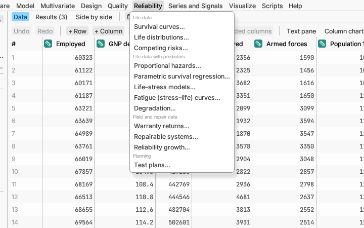

# Reliability

How long things last, and when they fail. Life data are special because
some units are often still working when the study ends (*censored*): we
know they lasted at least that long. These methods use those rows too.

## Life data

**Survival curves…** draws the share of units (or patients) still
surviving over time, and tests whether groups survive differently (or
get steadily better or worse across ordered groups), with the number
still at risk listed under the plot.
*Try it:* sample *Leukemia remission*.
[More detail](../../../manual/src/analyses/reliability.md#survival-curves)

**Life distributions…** fits a life distribution, such as Weibull or
lognormal, to failure times, and estimates things like the time by which
10% will have failed. *Try it:* sample *Bearing life test*.
[More detail](../../../manual/src/analyses/reliability.md#life-distributions)

**Competing risks…** handles units that can fail in more than one way,
estimating the chance of each kind of failure. *Try it:* sample *Pump
failure modes*. [More detail](../../../manual/src/analyses/reliability.md#competing-risks)

## Life data with predictors

**Proportional hazards…** and **Parametric survival regression…** relate
survival to other columns (treatment, age, temperature): which ones
shorten or lengthen life, and by how much. *Try it:* samples *Leukemia
with covariates* and *Capacitor life test*.
[More detail](../../../manual/src/analyses/reliability.md#proportional-hazards)

**Life–stress models…** uses tests run at high stress (heat, voltage) to
predict life at normal use. *Try it:* sample *Device-A accelerated life
test*. [More detail](../../../manual/src/analyses/reliability.md#lifestress-models)

**Fatigue (stress–life) curves…** fits the curve of cycles to failure
against stress from fatigue tests, counting specimens that never broke
(run-outs), and gives the stress a part can take for a given number of
cycles. *Try it:* sample *Steel fatigue*.
[More detail](../../../manual/src/analyses/reliability.md#fatigue-stresslife-curves)

**Degradation…** predicts failure times from measurements that wear down
over time, before anything has actually failed. *Try it:* sample *Laser
degradation*. [More detail](../../../manual/src/analyses/reliability.md#degradation)

## Field and repair data

**Warranty returns…** forecasts future returns from the sales and returns
recorded so far. *Try it:* sample *Monthly warranty returns*.
[More detail](../../../manual/src/analyses/reliability.md#warranty-returns)

**Repairable systems…** analyses machines that are repaired and put back
into service: are repairs becoming more or less frequent? *Try it:* sample
*Pump repairs*. [More detail](../../../manual/src/analyses/reliability.md#repairable-systems)

**Reliability growth…** tracks whether a product under development is
failing less often as fixes go in. *Try it:* sample *Prototype failures*.
[More detail](../../../manual/src/analyses/reliability.md#reliability-growth)

## Planning

**Test plans…** works out how many units to test, and for how long, to
demonstrate a reliability target. It uses no data (any open table will do,
even a new empty one).
[More detail](../../../manual/src/analyses/reliability.md#test-plans)
