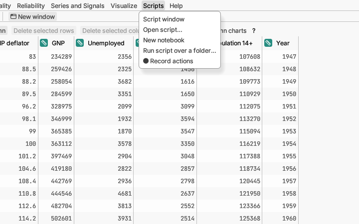

# Scripts

Repeating work automatically. Scripts are written in Rhai, a small
programming language. You do not need to write one to use the app;
recording is the easy way in.

**Script window** opens an editor where you can write and run scripts
that work on your open tables.

The editor helps as you type: it suggests function and column names
(press Tab to accept), highlights the matching bracket, folds long blocks
away (the ⊟ marks in the margin) and finds and replaces text (**Find…**).

**Open script…** loads a script file into the Script window.

**New notebook** starts a notebook in the current table's project: a page
of notes and small pieces of script, each run on its own with its results
shown right under it. It is a good way to keep a worked analysis with your
notes. Notebooks are saved with the project.

**Notebooks** lists the project's notebooks so you can open one again (it
appears once a project has a notebook).

**Run script over a folder…** runs one script on every data file in a
folder and collects the results in a table, for example to analyse each
month's file the same way.

**Record actions** writes down what you do from now on (opening tables,
edits, analyses and their options) as a script that repeats it. To stop,
choose **Stop recording**, which takes its place in the menu; the script
appears in the Script window.

More detail: [Scripting and recording](../../../manual/src/reference/scripting.md).
