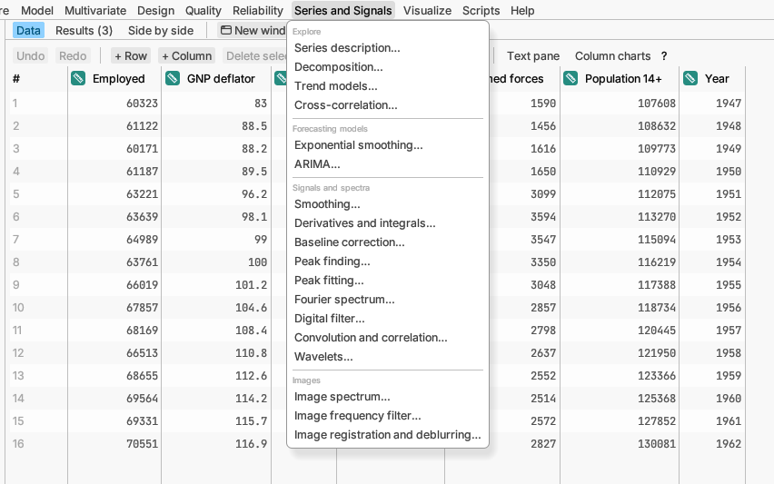

# Series and Signals

Data recorded in order: series over time (daily sales, monthly demand),
signals sampled along an axis (spectra, vibration traces) and images.
Describe the pattern, forecast what comes next, filter out noise and find
the frequencies hidden in the data. The rows must be in time (or x)
order.

## Explore

**Series description…** plots the series and shows how each value relates
to earlier ones (autocorrelation), which reveals trends and seasonal
cycles. *Try it:* sample *Monthly electricity demand*.
[More detail](../../../manual/src/analyses/time-series.md#series-description)

**Decomposition…** splits a series into trend, seasonal pattern and what
is left over. *Try it:* sample *Monthly electricity demand*.
[More detail](../../../manual/src/analyses/time-series.md#decomposition)

**Trend models…** fits a straight line or curve through time, such as an
S-shaped adoption curve, and extends it. *Try it:* sample *Product
adoption*. [More detail](../../../manual/src/analyses/time-series.md#trend-models)

**Cross-correlation…** finds whether one series leads another, such as
advertising spend leading sales by two weeks. *Try it:* sample
*Advertising and sales*.
[More detail](../../../manual/src/analyses/time-series.md#cross-correlation)

## Forecasting models

**Exponential smoothing…** forecasts by weighting recent values most, with
trend and seasonal parts if needed. It can pick the best form for you.
*Try it:* sample *Hotel occupancy*.
[More detail](../../../manual/src/analyses/time-series.md#exponential-smoothing)

**ARIMA…** is a flexible family of forecasting models built from a
series' own past values and past errors; it can also search for the best
model automatically. It can also use another column that drives the
series, such as fuel feed driving a kiln's temperature, and forecast from
planned values of it. *Try it:* samples *Reactor temperature* and *Kiln
fuel feed*.
[More detail](../../../manual/src/analyses/time-series.md#arima)

## Signals and spectra

**Smoothing…** irons out the noise in a signal measured point by point,
such as a sensor trace, and draws the raw and smoothed signals together.
*Try it:* sample *Machine vibration*.
[More detail](../../../manual/src/analyses/signals.md#smoothing)

**Derivatives and integrals…** gives the rate of change and the running
total (area under the curve) of y against x, and can resample the curve at
evenly spaced x. *Try it:* sample *Machine vibration*, where integrating
acceleration gives velocity.
[More detail](../../../manual/src/analyses/signals.md#derivatives-and-integrals)

**Baseline correction…** removes the slowly varying background under a
spectrum or chromatogram so the peaks sit on zero. *Try it:* sample
*Raman bands*.
[More detail](../../../manual/src/analyses/signals.md#baseline-correction)

**Peak finding…** lists the peaks that stand out from the noise, with
their positions, heights, widths and areas. *Try it:* sample *ECG-like
signal*, where the peaks are the heartbeats.
[More detail](../../../manual/src/analyses/signals.md#peak-finding)

**Peak fitting…** separates peaks that overlap by fitting a peak shape to
each, gives their centres, heights, widths and areas with standard errors,
and says how many peaks the data support. With many curves it fits them all
and makes one table. *Try it:* sample *Raman bands*.
[More detail](../../../manual/src/analyses/signals.md#peak-fitting)

For signals recorded many times a second (sound, vibration, sensors). Give
an x (time) column or the number of samples per second, and a group column
if several runs are stacked in one column.

**Fourier spectrum…** shows which frequencies a signal is made of, such as
a 50 Hz hum, lists the strongest ones, and can draw a spectrogram of how
they change over time. *Try it:* sample *Test bench signals*.
[More detail](../../../manual/src/analyses/signal-processing.md#fourier-spectrum)

**Digital filter…** keeps or removes a range of frequencies: smooth away
fast noise, take out slow drift, or cut one interfering frequency, and
save the result as a column. *Try it:* sample *Test bench signals*.
[More detail](../../../manual/src/analyses/signal-processing.md#digital-filter)

**Convolution and correlation…** finds the delay at which two signals
match best, finds repeating patterns in one signal, smooths or un-blurs a
signal with a kernel column, or traces its envelope. *Try it:* sample *Test
bench signals*.
[More detail](../../../manual/src/analyses/signal-processing.md#convolution-and-correlation)

**Wavelets…** splits a signal into detail at each scale, removes noise
while keeping sharp steps, and draws a scalogram of which frequencies are
present at each moment. *Try it:* sample *Test bench signals*.
[More detail](../../../manual/src/analyses/signal-processing.md#wavelets)

## Images

For pictures opened as data (one row per pixel, with x and y columns):
microscope and camera images, surface scans, scanned prints.

**Image spectrum…** shows the repeating patterns in an image as bright
spots in its 2-D spectrum, lists the strongest with their spacing and
direction, and shows how detail falls off from coarse to fine. Radial
profiles cut the spectrum along the directions you type (across and up
the image by default), so a pattern that runs one way shows as peaks in one
profile and not the other. *Try it:*
sample *Machined surface scan*.
[More detail](../../../manual/src/analyses/image-processing.md#image-spectrum)

**Image frequency filter…** smooths or sharpens an image, removes slow
shading, or notches out a regular pattern such as tool marks, and saves the
filtered image as a column. *Try it:* sample *Machined surface scan*, where
removing the tool marks reveals a pit.
[More detail](../../../manual/src/analyses/image-processing.md#image-frequency-filter)

**Image registration and deblurring…** sharpens an image blurred by a
known amount, finds how far a second image is shifted and lines it up, or
shows the image's 2-D autocorrelation. *Try it:* sample *Blurred and
shifted scene*.
[More detail](../../../manual/src/analyses/image-processing.md#image-registration-and-deblurring)
