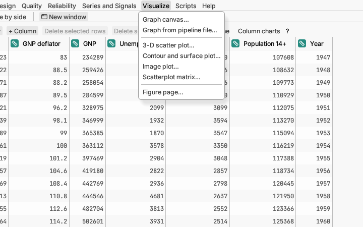

# Visualize

Building your own graphs. (Every analysis draws its own plots too; this
menu is for pictures you design yourself.)

**Graph canvas…** opens a blank graph. Drag columns onto the X and Y
shelves, and onto colour, size or panel shelves to split the picture by
group. Then add layers such as points, lines, box plots, histograms or a
fitted curve. Points you select are highlighted everywhere, as in reports.
You can also drop a column straight onto the graph: while you drag, the
edges and centre light up (bottom for the horizontal axis, left for the
vertical axis, top and right to split into panels, centre for colour).
The **Row filter** can step through a column one level at a time, with a
**▶ Play** button, to watch the graph change level by level.
The canvas's **Chart** list also offers pie and donut charts, radar,
polar and ternary charts, wind roses, waterfall charts, ridgeline plots and
vector fields; a lollipop chart is a choice in the bars layer's settings.
*Try it:* samples *Harbour weather*, *Household budget* and *Soil texture*.

Put a column on the **Right axis** shelf to draw it against a second scale
on the right. **Plot settings** can leave gaps in an axis (axis breaks,
each piece with its own scale and share of the axis if you like) and takes
titles with simple math, such as `x_1`, `x^2`, `\alpha` or
`\frac{a}{b}`. **Reference lines…** (in Plot settings, the plot's
right-click menu, or at the end of the canvas's Chart row) draws lines
across a plot at a value you type or at the mean, median, a percentile,
mean ± some SDs or control-chart limits, which move when the data change.
It also shades bands, such as a specification range, behind the data.
[More detail](../../../manual/src/reports/graph-canvas.md)

On the canvas, the **Chart** list also offers ready-made pictures: a
*clustered heat map* (a grid of colored cells with similar rows and columns
put together), an *estimation plot* (how far each group's average is from a
reference group, with a range of plausible values), and *Sankey*, *chord*
and *network* diagrams of flows between categories. The *Brackets* layer
marks which groups differ, with p-values or stars (its **…** menu picks
which pairs to show, the star cut-offs and an "ns" label); the *Hulls* layer draws
an outline around each group of points. *Try them:* samples *Reading
trial*, *Parcel flows* and *Regional climate*.

Right-click a graph to **add text, an arrow, a line or a rectangle**; drag
it to move it, double-click to edit it, or click it and nudge it with the
arrow keys. **Drawing order** (at the end of the layers) puts one layer in
front of another, and **Edit key…** renames, hides or reorders the entries
of the key.

**Graph from pipeline file…** rebuilds a graph you saved earlier, on the
current table, as long as it has columns of the same names. Handy for
making the same chart every month.

**Scatterplot matrix…** draws a scatter plot for every pair of the
columns you choose; it is the same command as in the Multivariate menu.

**3-D scatter plot…** places rows in a box by three columns; drag to turn
it. *Try it:* sample *Hillside survey*.
[More detail](../../../manual/src/reports/plots-3d.md)

**Contour and surface plot…** draws a map of one column over two others,
as a coloured contour map or a 3-D surface. The plot's **Plot settings**
choose the colours (or plain lines). *Try it:* sample *Hillside survey*.
[More detail](../../../manual/src/reports/plots-3d.md)

**Image plot…** shows a column as a picture, one coloured square per row
placed by its x and y columns: the way to look at a table opened from an
image file. Drag a box over part of the picture to select those rows.
[More detail](../../../manual/src/reports/image-plot.md)

**Figure page…** puts several plots on one page for a paper or poster,
lettered A, B, C. Right-click a plot and choose **Add to figure page** to
add it, then set the page size (in millimetres or inches) and the number of
columns, and save the page as one picture or PDF. *Try it:* sample
*Longley*, with its quantile plot and scree plot.
[More detail](../../../manual/src/reports/figure-page.md)
