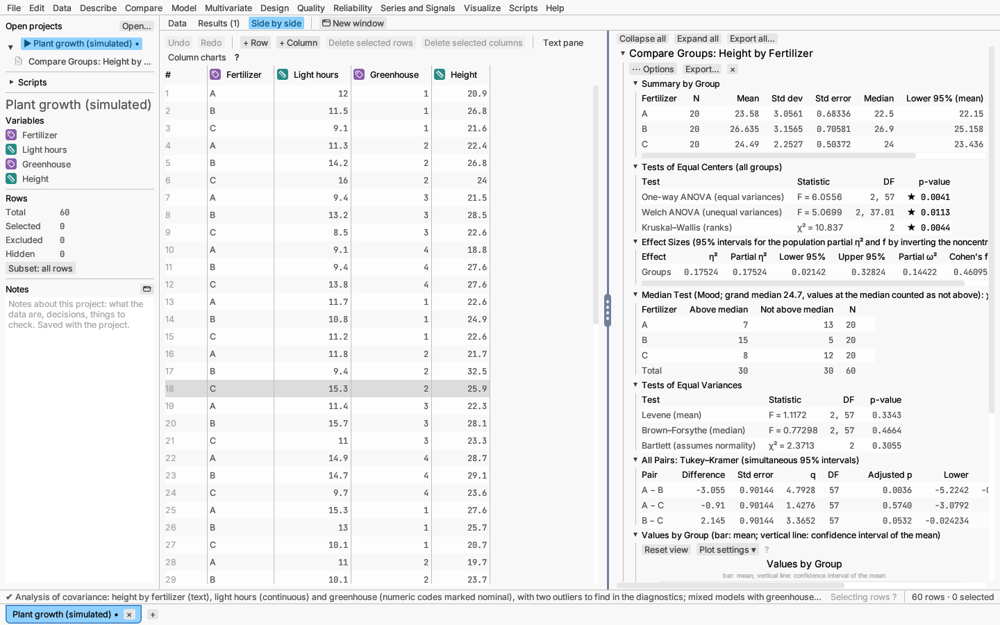

# Finding your way around

When nothing is open, the window shows the **start page**: buttons to make
a new table, open a file, import or paste data; your recent projects with
their notes; six cards for common tasks ("What do you want to do?"; with
no table open, a card first asks you to open a file, start an empty table
or pick a sample, then opens its dialog); and
links to the sample data and the manuals, with a tip of the day.

- **Menu bar** (top). Every command lives here, grouped by what you want to
  do. The [Menus](menus/file.md) chapter goes through them one by one.
- **Sidebar** (left). Your open tables, each with its reports and graphs
  listed under it (click one to go to it), then the columns of the current
  table. To tidy a project, right-click its name ▸ **New folder** and drag
  tables, reports or dashboards onto the folder; click a folder to bring
  its windows to the front. The small icon beside each column says what kind of values it
  holds: a ruler for measurements, a tag for categories, a numbered list for
  ordered categories. Under the columns, the row counts say how many rows
  there are and how many are selected or left out of analyses. Below them,
  **Notes** is a free-text box saved with the project, for reminders about
  where the data came from or what you found.
- **Workspace** (middle). Three tabs along the top: **Data** shows the
  table, **Results** shows the reports, and **Side by side** shows both.
- **Table tabs** (very bottom). One tab per open table. Click to switch, × to
  close.
- **Status bar** (just above the table tabs). What just happened, and a reminder of how
  to select rows in plots.

## A few habits that help

- **Hover over things.** Most buttons and menu items explain themselves in
  a tooltip.
- **Right-click things.** Columns, report sections and plots all have menus
  of their own: rename a column, save a plot as a picture, copy a table.
- **Put a plot in a document or slide.** Right-click the plot and choose
  **Copy plot**, then paste: it arrives as a sharp picture (on a Mac, as a
  vector PDF). **Save plot as…** lets you set its size on paper (for
  example 89 mm, one journal column), a serif font, bigger text or a clear
  background; the plot remembers those choices.
- **Fold what you are not reading.** Click any report heading to fold it
  away; **Collapse all** folds everything.
- **Undo.** ⌘Z (Ctrl+Z on Windows and Linux) undoes edits to the table.
- **Resize plots.** Drag the strip under a plot to make it taller, the
  strip on its right edge to make it wider, or the corner for both.
  Double-click the strip to go back to the usual size.
- **Change how a plot's axes look.** **Plot settings ▾** above each plot
  sets ranges, ticks, grid lines and titles. Its **Ticks** group turns tick
  marks inward or outward and lets you write your own tick labels (type
  `\pi` for π); **Spine** moves an axis line away from the data. You can
  also double-click a number on an axis to rename it, or right-click the
  axis ▸ **Edit tick label…**. On scatter plots, **Axis breaks** ▸ **Leave
  out** cuts a stretch out of an axis, so a few far-off values don't squash
  the rest; **Add a break** cuts another, and **Segments and marks** puts a
  piece on a log scale or gives it a fixed share of the axis.
- **Give plots the same look.** Right-click a plot you have formatted and
  choose **Copy plot style**, then right-click another plot ▸ **Paste plot
  style**: tick what goes across (ranges, ticks and grid, font and size,
  colours and markers, reference lines, key) and paste onto that plot,
  every plot in the report, or every plot in the project.
- **The ⋯ Options button** on each report adds or removes extra tables
  and plots without running the analysis again. Its **Duplicate on another
  table…** puts the same report, with its look, on another open table.
- **Drop a column on an axis.** Drag a column from the variables list onto
  the axis of a report's plot that shows the analysed column, and the
  report re-runs on the new column.
- **Filter one report.** ⋯ Options ▸ Filter rows… narrows a report to
  chosen rows; its **Filter panel** can **Step through** a column one level
  at a time, or play the levels like a slide show.
- **Look for ▾ at the bottom of a list.** It means the list goes on:
  scroll to see more choices. A scroll bar beside a list, report or table
  also means there is more to see.

On a Mac, shortcuts use ⌘; on Windows and Linux they use Ctrl.
**Help ▸ Keyboard shortcuts** lists them all.
