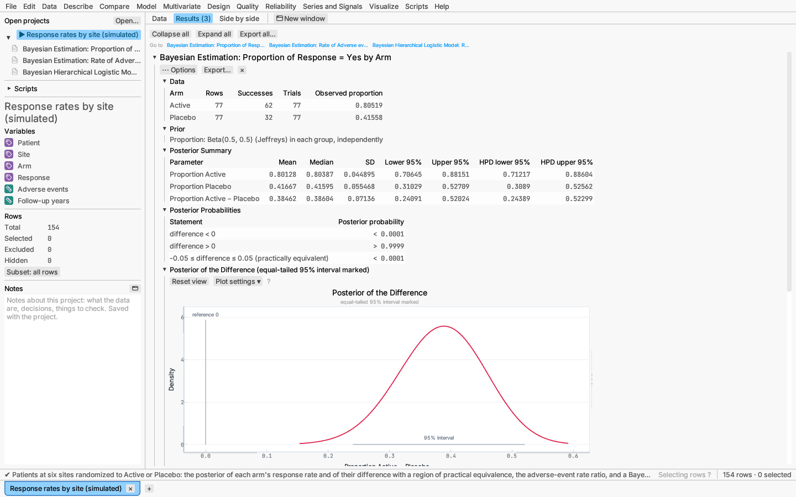
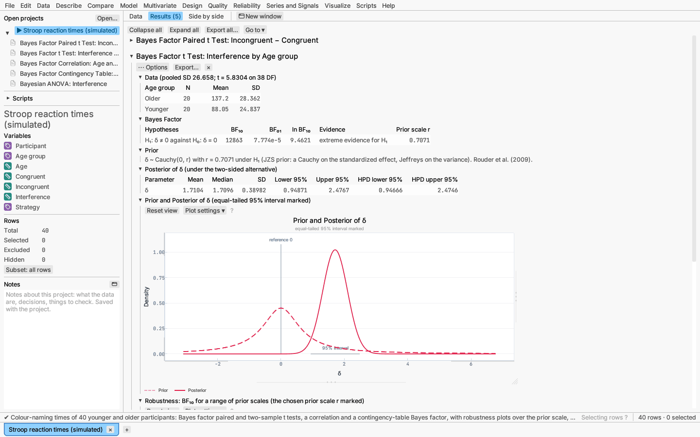
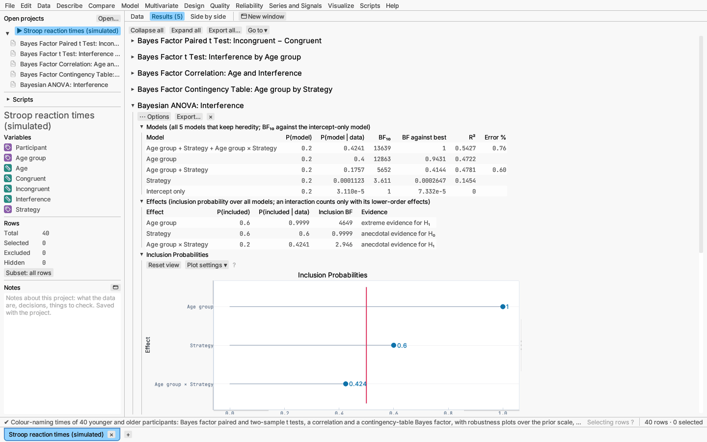
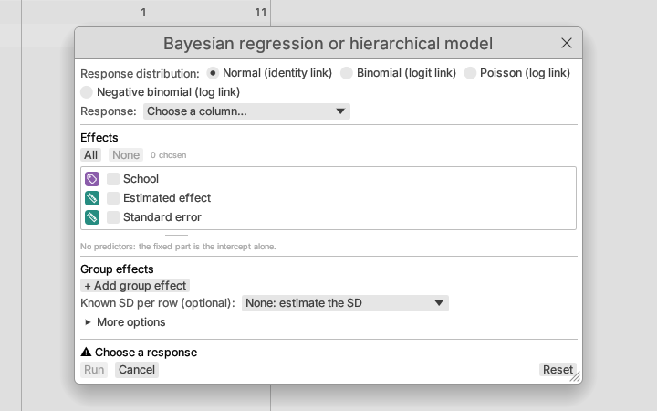
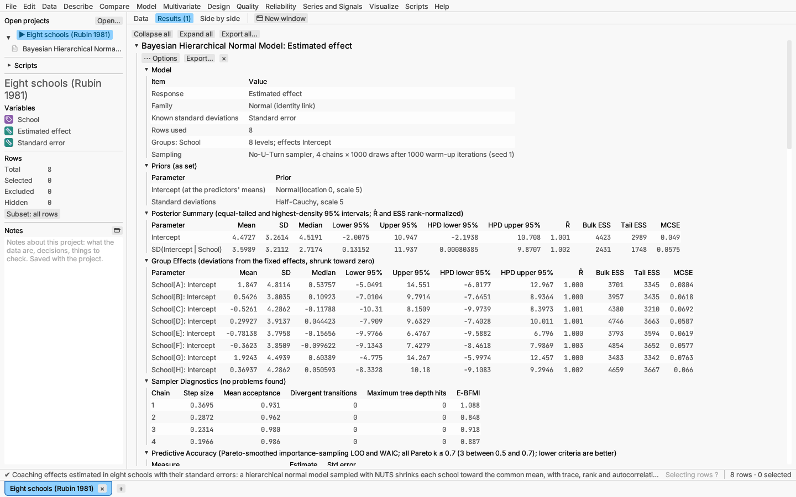
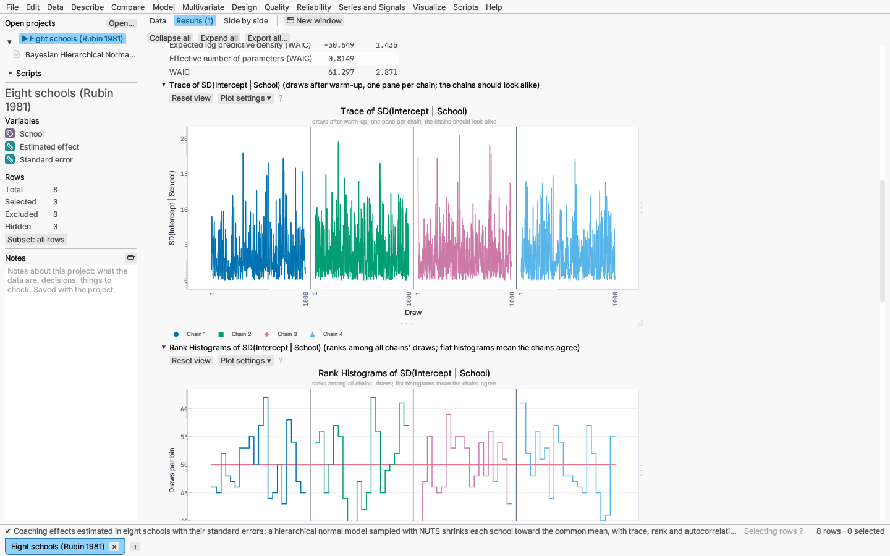

# Bayesian analysis

The **Bayesian** submenu, listed under both **Compare** and **Model**, holds
four analyses that describe what the data say about a quantity as a
probability distribution (the *posterior*), given a stated *prior*:

| Menu item | What it does |
|---|---|
| **Bayesian estimation…** | Posterior of a mean, proportion or event rate; one group, two groups or paired columns. Closed form, no simulation. |
| **Bayes factor tests…** | Evidence for an effect against no effect: one-sample, paired and two-sample t tests, a correlation, a contingency table. |
| **Bayesian linear model or ANOVA…** | Every model that keeps heredity compared by Bayes factors; inclusion probabilities and model-averaged estimates. |
| **Bayesian regression or hierarchical model…** | Normal, logistic, Poisson or negative binomial regression with group effects, sampled by Markov chain Monte Carlo (MCMC). |

Every report opens with what was analysed and the prior used, and every
setting it shows can be changed from its **⋯ Options** menu (the report
updates as you change it) or in full with **Edit analysis…**.

## Reading a posterior summary

Each estimated quantity gets one row:

- **Mean, SD and median** of the posterior.
- **Equal-tailed interval** (the central 95% by default): 2.5% of the
  posterior lies below it and 2.5% above.
- **HPD interval** (highest posterior density): the shortest interval holding
  the same probability. It differs from the equal-tailed one when the
  posterior is skewed, as for a rate, a ratio or a standard deviation.

The mean and SD of a ratio or odds ratio do not always exist. When the
second group has no events, its posterior puts so much weight near zero that
the average of 1 ÷ (its proportion or rate) is infinite; the same happens to
an odds ratio when every trial in the first group succeeds. The table then
shows — for the mean and SD, with a note, while the median and both
intervals are still defined and are the numbers to report.

Unlike a confidence interval, a 95% credible interval *is* a 95% probability
statement about the quantity, given the model and the prior. Change the level
under **More options** or in the report's options.

## Bayesian estimation

Choose what to estimate and the design:

- **Mean** of values: one group, two groups (difference of means), or two
  paired columns (mean of their difference). With the default prior the
  posterior of a mean is a Student t centred on the sample mean, so its
  interval equals the classical t interval. For two groups, **Assume equal
  variances** pools the SDs; otherwise the posterior of the difference is the
  Behrens–Fisher distribution (Box & Tiao 1973), the difference of the two
  groups' t posteriors.
- **Proportion** of an outcome column (choose the **Event**; by default the
  second value in sorted order), with an optional **Frequency** column, or
  successes out of a **Trials per row** column. Two groups are compared by
  their **difference**, **ratio** or **odds ratio**.
- **Event rate**: counts with an optional **Exposure per row** column (for
  example years of follow-up). Two groups are compared by their rate ratio,
  whose posterior is an exact scaled F distribution.

**Priors.** The default is Jeffreys' prior: Beta(½, ½) for a proportion,
Gamma(½, 0) for a rate and 1/σ² for a normal mean. A proportion or rate can
instead take the flat prior (Beta(1, 1), Gamma(1, 0)) or an **informative**
beta or gamma prior given by its mean and SD. A mean's informative prior is a
prior mean worth a chosen number of observations.

**Report sections:**

- **Data**: counts, totals or sample statistics per group.
- **Prior** and **Posterior Summary** (for two groups, each group and the
  contrast).
- **Posterior Probabilities**: the probability that the quantity (or
  contrast) is above and below the reference value (one group: 0 for a
  mean, ½ for a proportion, 1 for a rate, or a value you set), and, with a
  **region of practical equivalence** (ROPE), the probability of lying
  inside it. A ROPE states which values count as no practical difference,
  such as proportions within ±0.05. With a proper (informative) prior the
  heading also gives the Bayes factor against the reference value, by the
  Savage–Dickey density ratio (prior density ÷ posterior density there).
- **Prior and posterior density** plot, with the credible interval marked and
  the prior as a dashed band; for two groups the groups' posteriors overlaid.

*Try it:* sample *Response rates by site (simulated)* (two proportions with a
ROPE; the rate ratio of adverse events).

## Bayes factor tests

A Bayes factor BF₁₀ is how many times more likely the data are under the
alternative (an effect) than under the null (no effect); BF₀₁ = 1/BF₁₀.
Values above 1 favour the alternative and below 1 the null, so unlike a
p-value a Bayes factor can show evidence *for* no effect. The report labels
its size (anecdotal, moderate, strong, very strong, extreme; Lee &
Wagenmakers 2013).

| Test | Prior on the effect | Settings |
|---|---|---|
| One-sample, paired and two-sample t | Cauchy on the standardized effect δ with scale r (JZS; Rouder et al. 2009); r = √2⁄2 is "medium" | hypothesized mean (one sample), alternative (two-sided, δ > 0, δ < 0) |
| Correlation | stretched beta on ρ with width κ (Ly, Verhagen & Wagenmakers 2016); κ = 1 is uniform | alternative (two-sided, ρ > 0, ρ < 0) |
| Contingency table | Dirichlet with concentration a on the cell probabilities (Gunel & Dickey 1974) | how the table was collected: nothing fixed (Poisson), grand total fixed, row totals fixed, column totals fixed |

The t tests also give the posterior of δ (median and credible interval). The
**Robustness** plot shows BF₁₀ across a range of prior scales with the chosen
one marked, so you can see whether the conclusion depends on the prior. A
one-sided alternative uses the same prior folded onto one side.

The contingency-table report gives the Bayes factor under all four sampling
plans, marking the chosen one; they usually agree in direction but not in
size.

*Try it:* sample *Stroop reaction times (simulated)* (paired, two-sample,
correlation and contingency-table tests).

## Bayesian linear model or ANOVA

Choose a numeric response and predictors, then the effects (interactions and
powers bring in the effects they are built from). Categorical factors are
coded with orthonormal contrasts, so every level effect has the same prior.

**Prior** (Rouder et al. 2012; Liang et al. 2008): a flat prior on the
intercept and 1/σ² on the residual variance; the continuous effects of a
model together get a Zellner–Siow (Cauchy) g-prior with scale r (√2⁄4 is
"medium"), or a hyper-g prior with parameter a; each categorical effect gets
its own g with scale ½. Models start equally likely, or with a beta-binomial
prior on how many effects they contain: each model size gets the same total
probability, shared equally by the models of that size that keep heredity.
The prior is the same whether the models are all fitted (up to 14 effects)
or sampled by MC³ (more).

**Report sections:**

- **Models**: every model that keeps heredity (the best 20 shown), with its
  Bayes factor against the intercept-only model, against the best model, and
  its posterior probability. With one continuous block the Bayes factors are
  exact one-dimensional integrals; models with several categorical effects
  use importance sampling over the g's, with its error shown.
- **Effects**: each effect's prior and posterior inclusion probability and
  inclusion Bayes factor, and a plot of the inclusion probabilities. When the
  posterior probability is 1 to the precision of the arithmetic the factor
  shows as > 1e12.
- **Model-averaged estimates** (each coefficient averaged over the models,
  zero in the models without it) and **estimates in the best model**, with
  credible intervals.

**Fit only the full model** skips the comparison. The title is *Bayesian
ANOVA* when every effect is categorical.

*Try it:* sample *Stroop reaction times (simulated)* (interference by age
group and strategy, with their interaction).

## Bayesian regression or hierarchical model

Choose the **response distribution** (normal, binomial with a logit link,
Poisson or negative binomial with a log link), the response, the effects, and
any number of **group effects**: a grouping column (optionally nested in
another), with an intercept and slopes of continuous columns that vary by
level. Group effects are independent normals whose SDs are estimated from
the data, which pulls (*shrinks*) small or noisy groups toward the overall
fit. Options:

- **Binomial:** a two-valued response (the second value is the event) or
  successes out of a trials column.
- **Offset** (non-normal families), such as the log of exposure time.
- **Known SD per row** (normal only): each row's standard error, for a
  meta-analysis; no residual SD is estimated.

**Priors** (under More options), weakly informative by default:
coefficients Normal(0, 2.5), the intercept Normal centred at the response's
mean with scale 2.5, and SDs Exponential with mean 1, all scaled to the data
(multiplied by the response's SD for a normal model, divided by each
predictor's SD). Coefficients may instead have a Student t or Cauchy prior,
the intercept a fixed centre, and the SDs a half-normal, half-t (3 DF) or
half-Cauchy prior. Turn off **Scale the priors to the data** to use the
scales as given.

**Sampler.** The No-U-Turn sampler (Hoffman & Gelman 2014) with step-size
and diagonal mass-matrix adaptation runs 4 chains in parallel, each with 1000
warm-up and 1000 kept draws, from a fixed seed so the report reproduces
exactly. Raise the **target acceptance** towards 0.99 when the report warns
of divergent transitions.

**Report sections:**

- **Model** and **Priors** (the actual scales after autoscaling).
- **Posterior Summary** of the coefficients, SDs and dispersion, with R̂,
  bulk and tail effective sample sizes (rank-normalized; Vehtari et al. 2021)
  and Monte Carlo standard errors.
- **Group Effects**: each level's deviation from the fixed effects.
- **Sampler Diagnostics** per chain (step size, mean acceptance, divergent
  transitions, maximum tree depth hits, E-BFMI) and **Sampler Warnings** in
  plain words: divergent transitions, R̂ above 1.01, fewer than 100
  effective draws per chain, or E-BFMI below 0.3.
- **Predictive Accuracy**: PSIS-LOO and WAIC (Vehtari, Gelman & Gabry 2017)
  with their standard errors, and how many rows have a Pareto k above 0.7
  (whose LOO terms are unreliable).
- **Coefficient intervals** plot, and for one parameter (chosen in the
  report's options): a **trace** plot per chain, **rank** histograms per
  chain (flat when the chains agree), the **autocorrelation**, and its
  posterior density.
- **Posterior predictive check**: the observed distribution of the response
  against the range of datasets simulated from the posterior.

*Try it:* sample *Eight schools (Rubin 1981)* (the classic hierarchical
normal model with known standard errors); *Response rates by site
(simulated)* (a logistic model with a random intercept per site).

## Scripting

Each analysis runs from a script with `t.analyze(name, #{...})`, using the
same keys as the project file: `"bayesian-estimation"`, `"bayes-factor"`,
`"bayesian-linear-model"` and `"bayesian-model"`. See the
[scripting reference](../reference/scripting.md).

## References

- Box, G. E. P. & Tiao, G. C. (1973). *Bayesian Inference in Statistical
  Analysis*. Addison-Wesley.
- Gelman, A. et al. (2013). *Bayesian Data Analysis*, 3rd ed. CRC Press.
- Gunel, E. & Dickey, J. (1974). Bayes factors for independence in
  contingency tables. *Biometrika* 61, 545–557.
- Hoffman, M. D. & Gelman, A. (2014). The No-U-Turn sampler. *Journal of
  Machine Learning Research* 15, 1593–1623.
- Liang, F., Paulo, R., Molina, G., Clyde, M. A. & Berger, J. O. (2008).
  Mixtures of g priors for Bayesian variable selection. *JASA* 103, 410–423.
- Ly, A., Verhagen, J. & Wagenmakers, E.-J. (2016). Harold Jeffreys's
  default Bayes factor hypothesis tests. *J. Math. Psych.* 72, 19–32.
- Rouder, J. N., Speckman, P. L., Sun, D., Morey, R. D. & Iverson, G. (2009).
  Bayesian t tests for accepting and rejecting the null hypothesis.
  *Psychonomic Bulletin & Review* 16, 225–237.
- Rouder, J. N., Morey, R. D., Speckman, P. L. & Province, J. M. (2012).
  Default Bayes factors for ANOVA designs. *J. Math. Psych.* 56, 356–374.
- Vehtari, A., Gelman, A. & Gabry, J. (2017). Practical Bayesian model
  evaluation using leave-one-out cross-validation and WAIC. *Statistics and
  Computing* 27, 1413–1432.
- Vehtari, A., Gelman, A., Simpson, D., Carpenter, B. & Bürkner, P.-C.
  (2021). Rank-normalization, folding, and localization: an improved R̂.
  *Bayesian Analysis* 16, 667–718.
