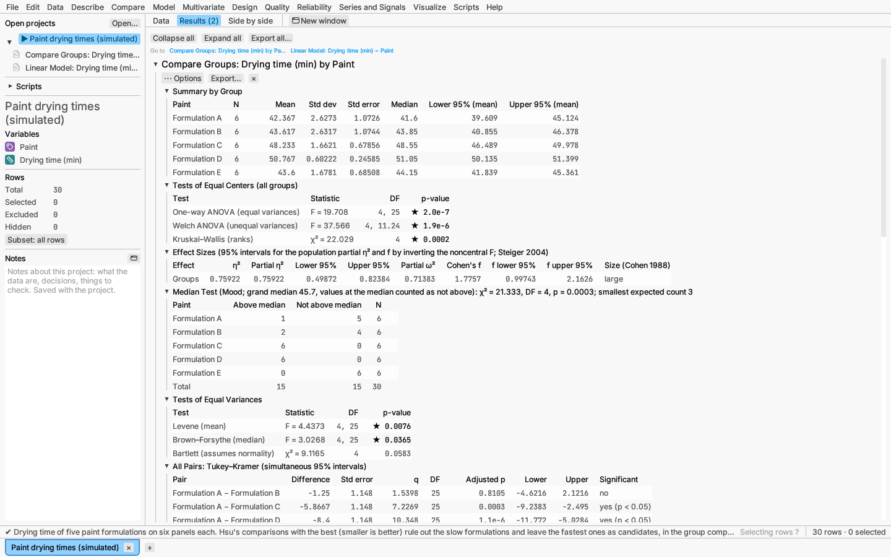
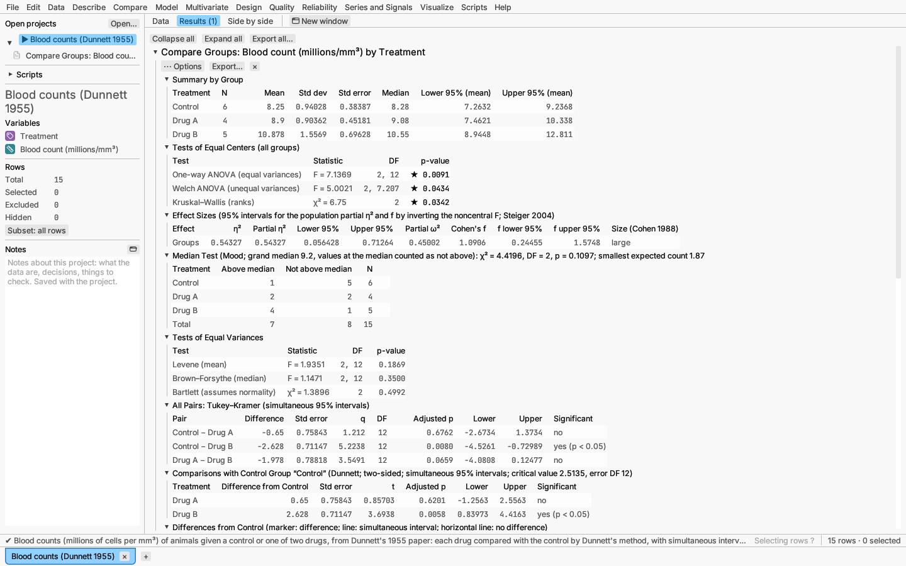
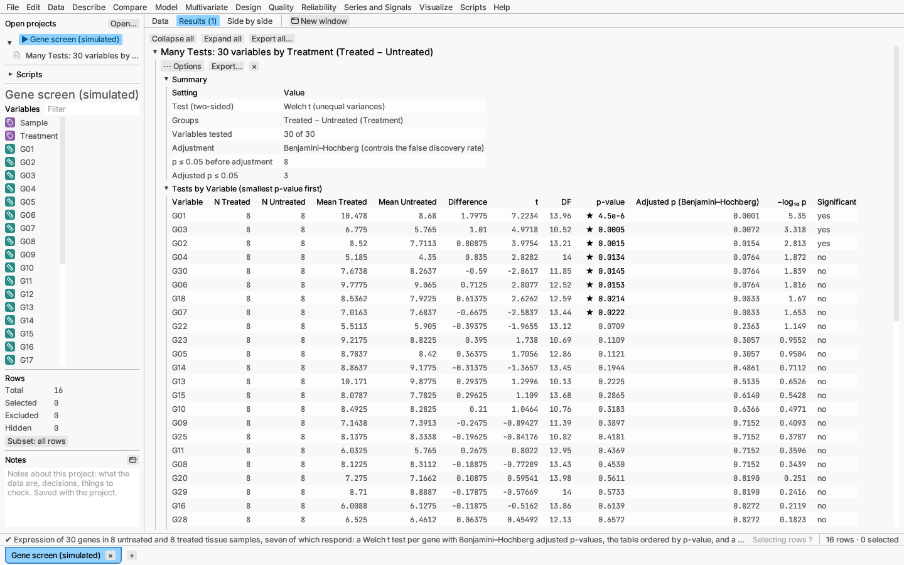
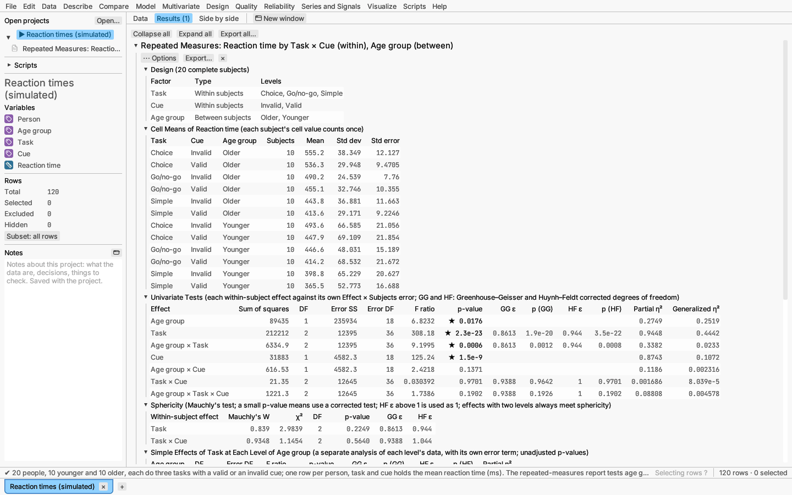
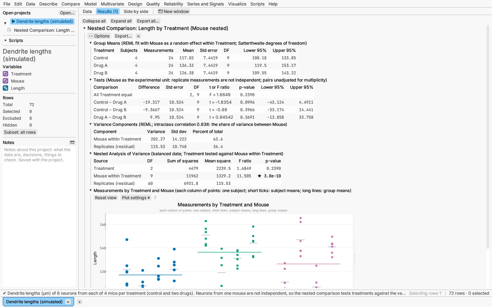
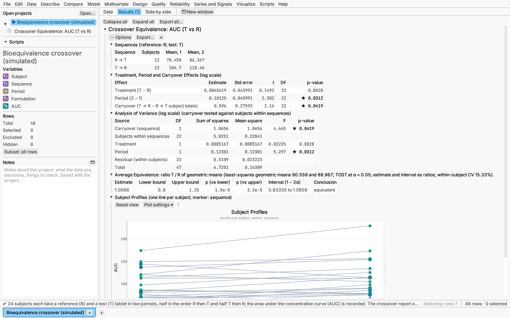
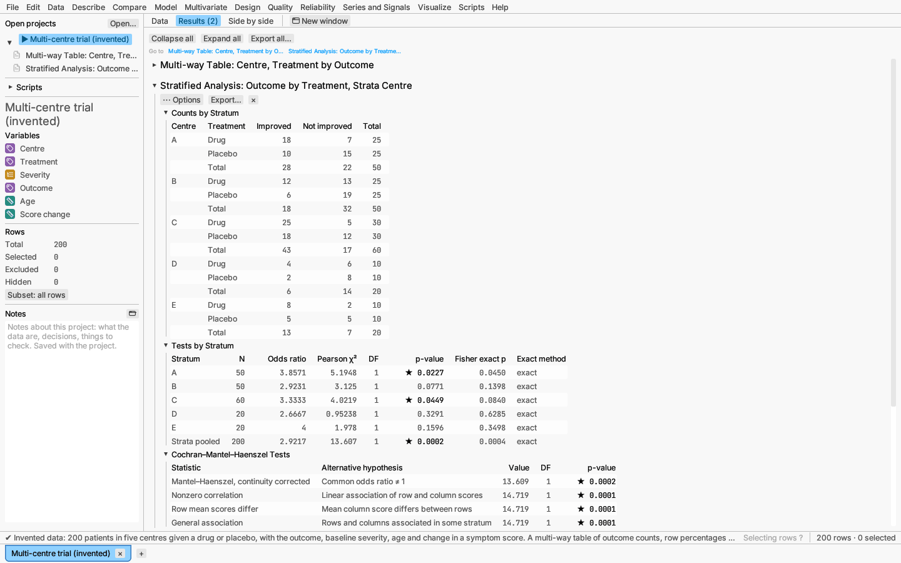
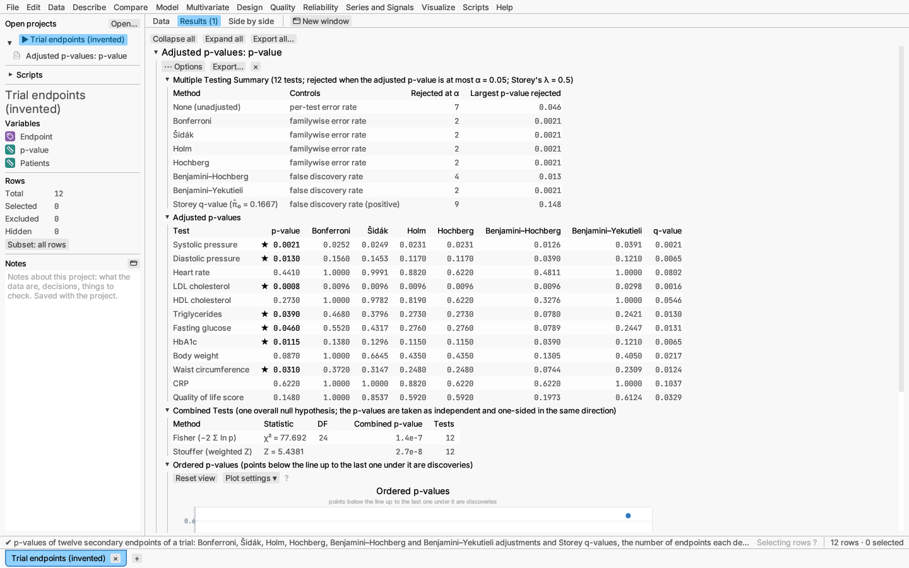

# Compare

The Compare menu holds hypothesis tests and intervals for comparing a sample
with a value, groups with each other, and paired measurements, goodness of
fit for counts, crossover trials and stratified contingency tables, plus
power and sample size, many two-group tests at once, and the adjustment of
p-values for multiple testing. Tests are verified against published textbook
examples, SciPy and R.

## One sample vs a value

One-sample t and z tests, Wilcoxon signed-rank, the sign test, a test of a
standard deviation, and an equivalence test (two one-sided tests, TOST).

*Try it:* Michelson light speed.

## Two or more groups

Data can be stacked (a value column and a group column) or side by side (one
column per group).

- **Tests of location:** pooled and Welch t, Wilcoxon rank-sum
  (Mann–Whitney), one-way and Welch ANOVA, Kruskal–Wallis.
- **Two-sample Kolmogorov–Smirnov** (two groups): the largest gap D between
  the two empirical distribution functions, sensitive to any difference in
  shape, not only location. The p-value is exact for samples whose sizes
  multiply to under 10 000 when there are no ties, and asymptotic otherwise
  (the row says which). A one-sided alternative asks whether the first
  group's values tend to be larger (or smaller).
- **Median test (Mood):** the counts above and not above the grand median in
  each group, with Pearson's χ² test and the smallest expected count (with a
  warning below 1). Choose how values equal to the median count: as not
  above (the default), as above, or left out.
- **Equal variances:** variance ratio, Levene, Brown–Forsythe, Bartlett.
- **Effect sizes:** Cohen's d, Hedges' g and Glass's Δ (the difference
  divided by the second group's standard deviation, for when one group is a
  control whose spread is the yardstick). For the one-way ANOVA, the
  **Effect Sizes** section gives η², ω² and Cohen's f, with confidence
  intervals for η² and f from the noncentral F distribution (Steiger 2004).
- **Linear trend** (three or more groups, ticked in the dialog or report
  options): a contrast with equally spaced coefficients across the groups in
  their order, with its estimate, t test and interval, the share of the
  between-group sum of squares it explains, and an F test of departure from
  a straight line. The groups' order is the column's value order.
- **Equivalence:** TOST.
- **Ratio of means** (two groups; **More options** or the report's options):
  the first group's mean divided by the second's, with Fieller's (1954)
  interval and a t test of ratio = 1, both with a pooled variance and with
  unequal variances (Welch–Satterthwaite degrees of freedom; Tamhane &
  Logan 2004). It suits relative effects such as relative potency or
  percent change. The interval is exact for normal data; when the second
  mean is not clearly different from zero the interval is unbounded (one
  or both limits infinite, or the complement of an interval), and the table
  says so.
- **All-pairs comparisons:** Tukey–Kramer (the default), Games–Howell, Holm-adjusted t, Bonferroni,
  Šidák, Holm–Šidák, Fisher's LSD (unadjusted; only after a significant
  overall test), Newman–Keuls (stepwise studentized range; p-values only, no
  intervals), and for unequal variances Tamhane's T2 (Welch t per pair with
  Šidák's adjustment) and Dunnett's T3 (Welch t against the studentized
  maximum modulus), or Dunn's rank test. The intervals use the dialog's confidence level, and the
  *Significant* column marks a pair when its adjusted p-value is below one
  minus that level (p < 0.05 at 95%, p < 0.01 at 99%).
- **Comparisons with a control (Dunnett):** pick a control group in
  **Compare with a control** and every other group is compared with it: the
  difference, its standard error, t, the adjusted p-value and a simultaneous
  interval, with the critical value and error degrees of freedom in the
  heading, and an interval plot of the differences with a line at zero. The
  report's alternative (two-sided, above or below the control) and
  confidence level apply. Up to 100 groups can be compared with a control;
  with more (a grouping column with hundreds of levels) the section says so
  instead of stalling the report.

- **Comparisons with the best (Hsu):** choose whether larger or smaller is
  better. Each group is compared with the best of the *other* groups: the
  table gives the group's mean, its difference from the best other mean, the
  critical value (Dunnett's, with that group as the control) and a
  constrained simultaneous interval, which always includes zero at one end.
  A group whose interval lies at or above zero is **the best**; one whose
  interval lies at or below zero is **not the best**; when the interval
  crosses zero the group **may be the best**. The interval plot shows each
  difference with its interval and a line at zero. The report's confidence
  level applies.

The settings, the control group and the direction of "best" included, can be
changed afterwards from the report's ⋯ Options menu.

*Try it:* Clinic wait times; Silicon resistivity (median test); Blood counts
(comparisons with a control); Paint drying times (comparisons with the best,
smaller is better).

## Two groups, many variables

Compare ▸ Two groups, many variables… runs the same test of two groups on
every chosen column: put the measured columns in the left list and the
grouping column (exactly two values) on the right. Choose the test — Welch t
(the default), pooled t, or the Wilcoxon rank-sum test — and the adjustment
for multiple testing (Benjamini–Hochberg by default; any method of
[Adjust and combine p-values](#adjust-and-combine-p-values)).

- **Summary:** the groups, how many variables were tested, and how many have
  p ≤ α before and after adjustment.
- **Tests by Variable:** one row per column with the group sizes and means,
  the difference of means (or the Hodges–Lehmann shift for the rank-sum
  test), the statistic, degrees of freedom, p-value, adjusted p-value,
  −log₁₀ p and whether the adjusted p-value is at most α. Order the table by
  column order, smallest p-value first or largest difference first (dialog,
  or the report's ⋯ Options menu). A column that cannot be tested (fewer
  than two values in a group) shows why instead.
- **Volcano plot:** the difference against −log₁₀ p, one point per column,
  with a line at p = α and at zero difference. Columns significant after
  adjustment have their own colour and marker and are named (the 25
  smallest p-values).

*Try it:* Gene screen (30 simulated genes, 8 untreated and 8 treated
samples; seven genes really change).

## Paired or repeated measures

Paired t, signed-rank test with the Hodges–Lehmann estimate, sign test;
repeated-measures ANOVA and the Friedman test for three or more
measurements per subject.

With three or more measurements the repeated-measures table also checks
**sphericity** (equal variances of all differences between conditions),
which the F test assumes: **Mauchly's test** gives W, χ², its degrees of
freedom and p-value, and the **Greenhouse–Geisser** and **Huynh–Feldt**
rows repeat the F test with both degrees of freedom multiplied by the ε
estimate (1 when sphericity holds, down to 1/(k − 1)). Huynh–Feldt ε uses
Lecoutre's correction; an estimate above 1 is reported and the test uses 1.
A small Mauchly p-value means read a corrected row; Greenhouse–Geisser is
the more cautious.

With two conditions, **Equivalence test** adds two one-sided tests that the
mean difference lies between the bounds you give. Tick **Test the ratio of
geometric means** for positive data such as concentrations: the test is run
on logs and the estimate, bounds (for example 0.80 and 1.25) and interval are
reported as ratios first / second.

*Try it:* Sleep drug trial.

## Factorial repeated measures

Compare ▸ Factorial repeated measures… analyses designs in which each
subject is measured under every combination of one to three
**within-subject** factors (task × cue, time × dose), optionally with
**between-subject** factors that split the subjects into groups (age group,
treatment): two- and three-way within, between and mixed designs, four
factors at most in all.

The data are stacked: one row per subject and within-subject cell, with a
response column, a subject column and one column per factor. Several rows
for the same subject and cell are averaged; subjects missing a cell are left
out and counted. A between-subject factor must be constant within each
subject. Tick a column in **Within-subject factors** or **Between-subject
factors** (a column ticked in one list leaves the other). Tick **Simple
effects** and choose a factor and the factor at whose levels to test it.

The report shows:

- **Design:** each factor, its type and levels, and how many complete
  subjects were used.
- **Cell means:** subjects, mean, standard deviation and standard error of
  each cell, each subject's cell value counting once.
- **Univariate tests:** every effect and interaction with its own error term
  (between-subject effects against subjects within groups, each
  within-subject effect against its interaction with subjects), the
  F test, the Greenhouse–Geisser and Huynh–Feldt ε and corrected p-values
  for within-subject effects with three or more levels, and partial and
  generalized η² (Olejnik & Algina, 2003). Unbalanced between-subject
  groups use Type III (effect-coded) sums of squares.
- **Sphericity:** Mauchly's test and both ε for each within-subject effect
  with more than one degree of freedom (an effect with two levels always
  meets sphericity).
- **Simple effects:** the test of the chosen factor within the data of each
  level of the other, each analysed separately with its own error term
  (unadjusted p-values).
- **Profile plot:** cell means joined across the first within-subject
  factor, one line per combination of the other factors, over the
  measurements.

The sums of squares, ε estimates and tests are computed from orthonormal
contrasts of each subject's cell values (the multivariate form of the
univariate tests, O'Brien & Kaiser 1985) and match R's `car::Anova` with
Type III hypotheses.

*Try it:* Reaction times by task and cue.

## Nested comparison

Compare ▸ Nested comparison… compares groups when each subject (an animal,
a culture plate, a batch) contributes several measurements. The
measurements of one subject are not independent, so treating them as
separate observations (pseudoreplication) overstates the evidence; the
subject is the experimental unit. Choose the response, the group column
and the subject column; subject labels are read within their group, so
"Mouse 1" in two treatments is two mice. With two groups the analysis is a
**nested t test**, with more a **nested one-way ANOVA**.

The report shows:

- **Group means:** subjects and measurements per group, and the model-based
  mean of each group with its standard error, Satterthwaite degrees of
  freedom and confidence interval.
- **Tests:** the F test that all groups are equal and each pair's
  difference with a t test and interval, from a linear mixed model with
  subjects as a random effect fitted by REML; denominator degrees of
  freedom by Satterthwaite's approximation (as in R's `lmerTest`).
  Pairwise p-values are not adjusted for multiplicity.
- **Variance components:** the variance between subjects within groups and
  between replicates, and the intraclass correlation (the share of variance
  between subjects).
- **Nested analysis of variance:** the classical table with groups tested
  against subjects within groups, shown when every subject has the same
  number of measurements and every group the same number of subjects (it
  then gives the same F test as the mixed model).
- **Plot:** each subject's measurements in a column, with subject and group
  means.

*Try it:* Dendrite lengths per mouse.

## Proportions

Exact binomial test; two-proportion score z test; Pearson and G² tests of
equal proportions across groups; Fisher's exact test; McNemar's test for
paired outcomes.

## Event rates

Exact Poisson tests of a rate and of a ratio of two rates.

## Goodness of fit for counts

Compare ▸ Goodness of fit for counts… tests whether counts follow a
hypothesized distribution, with Pearson's χ² and the likelihood-ratio G².

- **Categories in given proportions:** choose a category column (each row
  one observation, or give a **frequency column**). Leave **Equal
  proportions** ticked, or untick it and enter a proportion or ratio for each
  category (9, 3, 3, 1 for a 9 : 3 : 3 : 1 ratio; they are rescaled to sum
  to 1). Degrees of freedom: categories − 1.
- **Counts from a Poisson distribution:** choose a column of whole-number
  counts. The mean is estimated from the data, and neighbouring counts are
  pooled (from the low end, and into an open upper cell) until each cell
  expects at least the minimum you set (5 by default). Degrees of freedom:
  cells − 2.

The report gives the two tests, a table of observed and expected counts with
each cell's contribution to χ² and its Pearson residual
((observed − expected)/√expected), and a plot of observed and expected counts
per cell. A note warns when cells expect fewer than five.

*Try it:* Horse-kick deaths.

## Crossover trial and equivalence

Compare ▸ Crossover trial and equivalence… analyses a two-period,
two-treatment (2×2) crossover, in which each subject receives a reference and
a test treatment in one of the two orders. The data are stacked: one row per
subject and period, with the response and columns naming the subject, the
period and the treatment. Pick the **reference treatment** (the first in
order by default), whether to compare the **ratio of geometric means** (on
logs, the usual choice for bioequivalence) or the **difference of means**,
the equivalence bounds (0.80 to 1.25 for a ratio) and the level α of each
one-sided test (0.05 gives the usual 90% interval).

The report shows:

- **Sequences:** the subjects and mean responses in each order. Subjects
  without one row for each treatment are left out and counted.
- **Treatment, period and carryover effects:** estimates with standard
  errors, t tests and p-values (Chow & Liu's formulation, from each
  subject's period difference and total).
- **Analysis of variance:** carryover tested against subjects within
  sequences; treatment and period against the within-subject residual.
- **Average equivalence:** the least-squares (geometric) means, the estimate
  and its 1 − 2α interval, the two one-sided p-values and the conclusion; on
  the ratio scale also the within-subject coefficient of variation.
- **Subject profiles:** each subject's two responses joined by a line, with
  a marker shape per sequence.

*Try it:* Bioequivalence crossover.

## Stratified tables and exact tests

Compare ▸ Stratified tables and exact tests… cross-classifies a **Rows**
column (for 2 × 2 tables, the treatment or exposure) by a **Columns** column
(the outcome) within each **stratum** — each combination of the ticked
stratum columns, such as the centres of a multi-centre trial. One row per
observation, or a **Frequency column** of whole-number counts. The levels
and strata are those of the rows counted (not excluded, with every label
and a frequency above zero), so a label found only in excluded rows adds no
empty row, column or stratum. The report gives:

- **Counts by Stratum**, and **Tests by Stratum**: each stratum's size,
  odds ratio (2 × 2 tables), Pearson χ² with its p-value, and **Fisher's
  exact test** for any r × c table (the Freeman–Halton extension: the
  probability, given the margins, of a table no more probable than the one
  observed), plus the same for the table pooled over strata.
- **Cochran–Mantel–Haenszel Tests** of conditional independence across the
  strata: *nonzero correlation* (1 df; ordered rows and columns), *row mean
  scores differ* (r − 1 df; ordered columns) and *general association*
  ((r − 1)(c − 1) df; nominal), and for 2 × 2 tables the Mantel–Haenszel
  test with the continuity correction. Scores are the levels' values when
  every label is a number, otherwise 1, 2, … in level order; the note lists
  them.
- For 2 × 2 tables, the **Common Odds Ratio** — the Mantel–Haenszel
  estimate with the Robins–Breslow–Greenland confidence interval, beside the
  crude odds ratio of the pooled table (a large difference is a sign of
  confounding by the strata) — and **Homogeneity of Odds Ratios**: the
  Breslow–Day test, with and without Tarone's correction (a small p-value
  says the odds ratio differs between strata, so a common one is not a fair
  summary). Odds ratios compare the first column level's odds in the first
  row with the second row, in the levels' natural order.

With no stratum column the report is one table with its Pearson and exact
tests. The exact test uses the network algorithm of Mehta & Patel (1983);
a table too large for it within a fixed amount of work gets a Monte Carlo
estimate from random tables with the same margins instead (10 000 by
default, seeded so that the result repeats), marked *Monte Carlo* with its
standard error in the table and explained in the note. The random tables
are drawn cell by cell (Patefield's algorithm), so even tables with
hundreds of thousands of observations take about a second. A table whose
total count is above 2⁵³ (about 9·10¹⁵, possible with a frequency column)
is beyond exact arithmetic: its row says *exact test not available* and the
note gives the reason, while the rest of the report is unaffected.

**Adjust each stratum's p-values for the false discovery rate** (More
options or ⋯ Options) adds **Tests by Stratum Adjusted for the False
Discovery Rate**: the Pearson (and, when computed, exact) p-value of each
stratum beside its q-value across the strata, by Benjamini–Hochberg,
Benjamini–Yekutieli or Storey's q-values (π̂₀ at λ = 0.5, given in the
heading). With many strata, such as many sites or many subgroups, some
tables come out significant by chance; the q-values keep the expected share
of false findings among those called significant at the chosen level. The
confidence level,
the exact test and the Monte Carlo settings can be changed from the report's
⋯ Options menu.

*Try it:* Multi-centre trial (treatment by outcome, stratified by centre).

## Permutation test

Two groups, paired columns or a correlation tested against every
rearrangement of the data (or random ones, with a seed), without a normal
assumption. See [Resampling](resampling.md).

## Adjust and combine p-values

Compare ▸ Adjust and combine p-values… takes a column of p-values, one test
per row, with an optional column naming the tests. Missing p-values are left
out, and the number of tests m counts the others.

- **Multiple Testing Summary:** for no adjustment and each method, the error
  rate it controls, how many tests are rejected (adjusted p ≤ α) and the
  largest raw p-value rejected.
- **Adjusted p-values:** one row per test with Bonferroni (m·p), Šidák
  (1 − (1 − p)^m), Holm (step-down), Hochberg (step-up), Benjamini–Hochberg
  and Benjamini–Yekutieli (false discovery rate; BY holds under any
  dependence) adjusted p-values, and Storey's q-values. Bonferroni, Šidák,
  Holm and Hochberg control the family-wise error rate.
- **Storey's q-values** estimate the share of true null hypotheses as
  π̂₀ = #{p > λ} / (m(1 − λ)) (λ = 0.5 by default; set it in the dialog) and
  scale the Benjamini–Hochberg values by π̂₀, so they are smaller when many
  tests have real effects.
- **Combined Tests:** one test of the overall null hypothesis that no test
  has an effect. Fisher's method refers −2 Σ ln p to χ² with 2k degrees of
  freedom; Stouffer's method sums the normal scores Φ⁻¹(1 − p), divided by
  √k, or weighted by a column you choose under **More options** (such as
  each test's sample size). Both assume independent, one-sided p-values in
  the same direction.
- **Ordered p-values:** the sorted p-values against their rank with the
  Benjamini–Hochberg line α·i/m.

**Saving:** the report's ⋯ Options menu saves any adjusted p-values or the
q-values as a new column, in the same rows as the p-values. In formulas,
`p_adjust("p", "bh")` gives the same values (see the formula reference).

*Try it:* Trial endpoints (twelve endpoints of a clinical trial, weighted
by the number of patients measured).

## Power and sample size

Compare ▸ Power and sample size… plans a study. Choose a design, then what
to **Solve for** — power, sample size, or the detectable effect — and give
the other two. Designs:

- **Tests:** one-sample t and z, paired t (from the standard deviation of
  each condition and their correlation), two-sample t, one-way ANOVA, one and
  two proportions, one and two Poisson rates (with the exposure per unit),
  one standard deviation, two variances, and equivalence for one or two
  samples.
- **Margins of error** for a mean, a proportion (Wilson interval), a
  standard deviation, or a rate: the probability that the interval's margin
  (half-width) is at most E. Solving for the sample size gives the n that
  reaches the target probability; solving for the effect gives the smallest
  margin reached with that probability.
- **Tolerance intervals** (one- or two-sided, with the proportion covered
  and the confidence): the probability that the interval's content stays
  below a limit P′ — the larger the sample, the closer the interval hugs the
  proportion asked for.
- **Distribution-free tolerance intervals** (no assumption about the
  population's shape): the interval runs between order statistics of the
  sample, leaving *m* of them outside (m = 1 takes the smallest or largest
  value as one limit, m = 2 with two sides takes both extremes). Its
  "power" is the confidence that it covers at least the proportion P,
  the exact binomial sum Σ_{j ≤ n − m} C(n, j) Pʲ(1 − P)ⁿ⁻ʲ (Wilks 1941;
  Guenther 1977). Solving for the sample size gives the smallest n with
  the target confidence (59 for 95% content with 95% confidence and one
  limit, 93 for two); solving for the effect gives the largest proportion
  covered with that confidence.
- **Factorial experiments:** two-level factorial (factors, fraction 1/2^q,
  center points, main effects or with two-factor interactions), screening
  designs (runs per replicate, factors) and general full factorials (levels
  of the factor tested and cells of the other factors). The sample size is
  the number of replicates, and the report also gives the total runs.

Every report plots the power (or probability) against the sample size and
against the effect, with a marker at this study and a line at the target.

*Try it:* Sleep drug trial (how many subjects a follow-up study needs).
