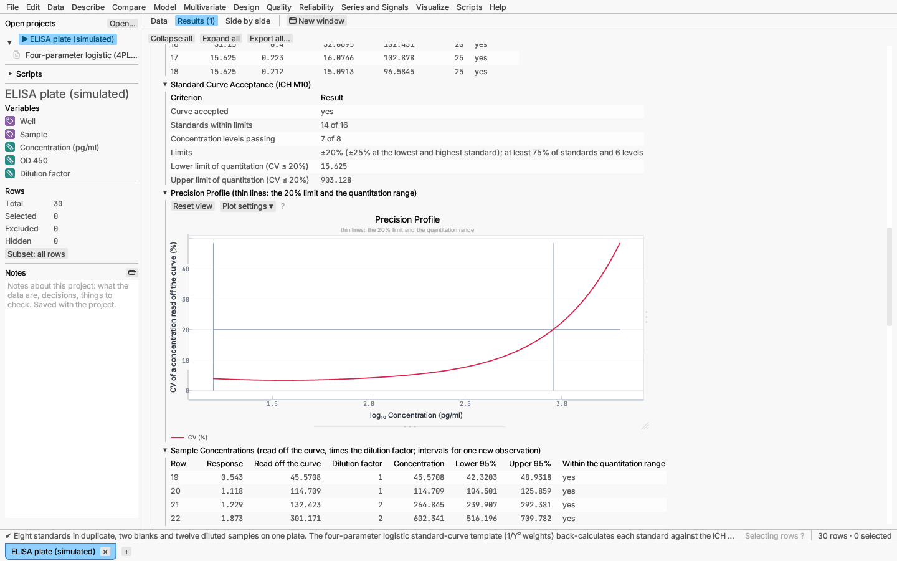
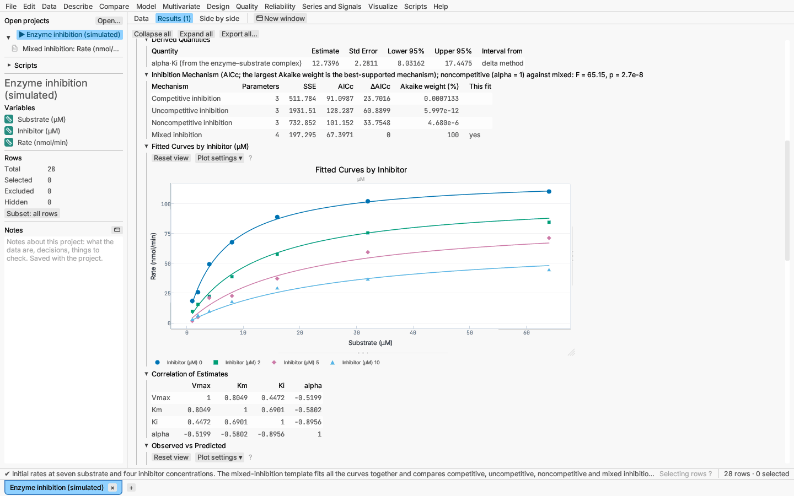
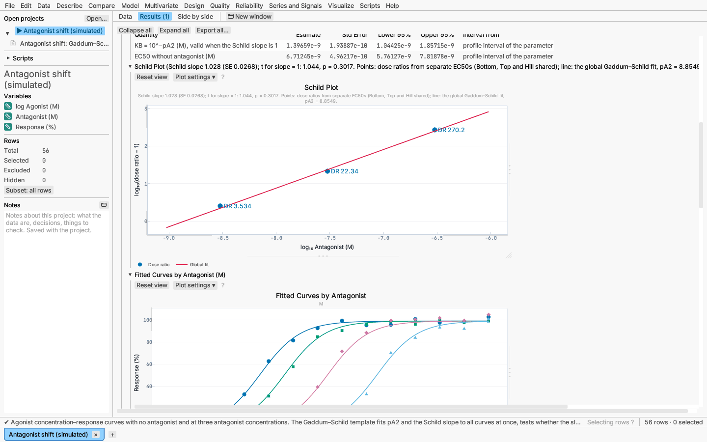

# Model: curve templates

Model ▸ Curve templates… fits a ready-made curve for a common laboratory
assay. Pick the kind of experiment and a template; the dialog shows the
model, asks only for the columns and constants the template needs, and
works out starting values from the data. The fit is an ordinary
[nonlinear regression](nonlinear-regression.md), so its report has every
section that one has (estimates with profile intervals, fitted curve with
bands, residuals, model comparison, inverse prediction, prediction formula),
plus the results the assay calls for: derived quantities such as Ki, kcat,
pEC50 or a half-life with intervals, acceptance checks of a standard curve,
a comparison of inhibition mechanisms, a Schild analysis or a relative
potency.

Templates are named by the standard model names of the literature cited
below. Parameters keep their usual symbols (Kd, Bmax, Vmax, Km, logEC50,
Hill, pA2…).

## Dialog

- **Experiment:** immunoassay standard curves, receptor binding, enzyme
  kinetics, pharmacological dose–response, or growth, decay and survival.
- **Template:** the models of that experiment (table below). The model and
  a sentence on the data layout appear under the choice.
- **Columns:** the **Response** and the **x** column the template names
  (concentration, log concentration, time, dose…). Some templates read a
  second column: the inhibitor concentration (inhibition mechanisms), the
  antagonist concentration (Gaddum–Schild), the radioligand or competitor
  concentration (kinetics), or which rows are total and which nonspecific
  binding (text containing "total", or 1 for total and 0 for nonspecific).
  **Data sets** are optional for most templates (one curve per data set,
  with the parameters shared or not as set below); the operational model
  needs the agonist column and relative potency the preparation column,
  where **Standard preparation** picks the reference (the first data set
  by default). Standard curves take an optional **Dilution factor** column.
- **Constants:** numbers that are not in the data, such as the radioligand
  concentration and its Kd for Cheng–Prusoff, the enzyme concentration for
  kcat, F for ECF, or the starting substrate concentration of a progress
  curve. A required one must be filled in; an optional one only adds the
  derived quantities that need it.
- **Parameters** (collapsed): a start (empty: computed from the data), lower
  and upper bounds (the template's defaults filled in, such as positive
  constants and a fraction between 0 and 1), and, with data sets, whether
  each parameter is shared by all data sets. Equal bounds fix a parameter.
- **More options:** weights (1/Y² by default for 4PL and 5PL standard curves
  and the Arrhenius equation, 1/Y for clonogenic survival, otherwise equal),
  the confidence level, profile intervals, and for standard curves the
  acceptance limits and the CV limit of the quantitation range.

**Edit analysis…** on a template report reopens this dialog with its
settings. Starting values are recomputed from the data.

## Templates

| Experiment | Template | Model | Derived quantities |
|---|---|---|---|
| Standard curves | Four-parameter logistic (4PL) | `Y = D + (A − D) / (1 + (X/C)^B)` | acceptance, quantitation range, sample concentrations |
| | Five-parameter logistic (5PL) | `Y = D + (A − D) / (1 + (X/C)^B)^G` | as 4PL |
| Receptor binding | Saturation, one site | `Y = Bmax·X / (Kd + X)` | |
| | Saturation, total and nonspecific together | total `Bmax·X/(Kd + X) + NS·X + Background`, nonspecific `NS·X + Background` | |
| | Saturation, two sites | `Bmax1·X/(Kd1 + X) + Bmax2·X/(Kd2 + X)` | |
| | Competition, one site | `Bottom + (Top − Bottom) / (1 + 10^(X − logIC50))` | IC50, Ki (Cheng–Prusoff), pKi |
| | Competition, two sites | two IC50s with fraction F | IC50s and Ki of each site |
| | Homologous competition | `Bmax·[L] / ([L] + 10^X + 10^logKd) + NS` | Kd, pKd |
| | Association, one ligand concentration | `Ymax·(1 − exp(−kob·X))` | half-time; kon and Kd given koff |
| | Association, several concentrations | global fit of kon and koff | Kd = koff/kon, dissociation half-life |
| | Dissociation | `(Y0 − NS)·exp(−koff·X) + NS` | half-life |
| | Kinetics of an unlabelled competitor | Motulsky–Mahan, k1 and k2 known | competitor Kd, residence time, half-life |
| Enzyme kinetics | Michaelis–Menten | `Vmax·X / (Km + X)` | kcat = Vmax/[E], kcat/Km |
| | Substrate inhibition | `Vmax·X / (Km + X·(1 + X/Ksi))` | |
| | Allosteric (Hill) | `Vmax·X^h / (Khalf^h + X^h)` | |
| | Competitive, uncompetitive, noncompetitive, mixed inhibition | global fits over substrate and inhibitor | alpha·Ki (mixed); mechanism comparison |
| | Tight-binding inhibition (Morrison) | quadratic in enzyme, inhibitor and apparent Ki | |
| | Progress curve | integrated Michaelis–Menten, `P = S0 − Km·W((S0/Km)·exp((S0 − Vmax·t)/Km))` | kcat given [E] |
| Dose–response | Agonist | `Bottom + (Top − Bottom) / (1 + 10^((logEC50 − X)·Hill))` | EC50, pEC50, ECF |
| | Inhibitor | `Bottom + (Top − Bottom) / (1 + 10^((X − logIC50)·Hill))` | IC50, pIC50, ICF |
| | Bell-shaped, biphasic | two Hill terms | EC50 of each phase |
| | Gaddum–Schild | global fit, EC50 shifted by `1 + ([B]·10^pA2)^SchildSlope` | KB, EC50; Schild plot; slope = 1 test |
| | Operational model of agonism | Black–Leff, τ and KA, global over agonists | KA, τ, log(τ/KA) |
| | Relative potency from parallel curves | common Bottom, Top, Hill; logEC50 per preparation | relative potency; parallelism test |
| Growth, decay, survival | Modified Gompertz | Zwietering form of ln(N/N0) | doubling time |
| | Baranyi–Roberts | lag, maximum rate and plateau | doubling time |
| | One- and two-phase decay, one-phase association, plateau then decay | exponential forms | half-lives, percent fast |
| | Linear-quadratic cell survival | `PE·exp(−(alpha·D + beta·D²))` | alpha/beta, SF2, D10 |
| | Boltzmann | `Bottom + (Top − Bottom) / (1 + exp((V50 − X)/Slope))` | |
| | Arrhenius | `k = exp(lnA − 1000·Ea / (R·T))`, Ea in kJ/mol | A |

## Report

Every template report opens with an **Assay Template** section (the template,
its model and what each parameter means) and a **Derived Quantities** table
(per data set when parameters are not shared). A derived quantity that is a
monotone function of one parameter (EC50 from logEC50, a half-life from a
rate) takes that parameter's profile interval mapped through the function;
others (Ki by Cheng–Prusoff, kcat/Km, alpha·Ki) use the delta method with
the estimates' covariance. Templates with a second column add **Fitted
Curves by** that column. The rest depends on the template:

- **Standard curves:** the standard curve on a log₁₀ concentration axis;
  **Back-Calculated Standards**, each standard read off the curve with its
  recovery against the limit (±20%, ±25% at the lowest and highest
  standard); **Standard Curve Acceptance**: the curve passes when at least
  75% of the standards and at least six concentration levels are within
  their limits (ICH M10 for ligand-binding assays; all four limits can be
  changed), with the lower and upper limits of quantitation; the
  **Precision Profile**, the CV of a concentration read off the curve
  (prediction interval half-width ÷ slope ÷ concentration) across the
  standards' range, whose widest stretch below the CV limit (20% by
  default) is the quantitation range; and **Sample Concentrations**: every
  row with a response but no concentration read off the curve, times its
  dilution factor, with its interval and whether it lies inside the
  quantitation range. Rows with a concentration of zero (blanks) are fitted
  but not back-calculated.

  
- **Inhibition mechanisms:** the four reversible mechanisms fitted to the
  same rows, ranked by AICc with Akaike weights, and the F test of
  noncompetitive (alpha = 1) against mixed inhibition.

  
- **Gaddum–Schild:** the **Schild Plot** of log(dose ratio − 1) against log
  antagonist concentration, the dose ratios coming from separate EC50s
  per antagonist concentration (Bottom, Top and Hill shared), with the
  global fit's line; the test of a Schild slope of 1 is in the title and,
  as an F test, under Model Comparison.

  
- **Relative potency:** each preparation's EC50 against the standard's,
  with its interval from Finney's method on the difference of log EC50s;
  the parallelism test (common Bottom, Top and Hill against separate
  curves) is under Model Comparison.

*Try it:* ELISA plate (simulated), a 4PL standard curve with blanks, eight
standards and twelve diluted samples; Receptor saturation (simulated);
Competition binding (simulated), IC50 and Ki; Enzyme inhibition (simulated),
a mixed inhibitor with the mechanisms compared; Antagonist shift (simulated),
a Schild analysis; Bacterial growth (simulated), Gompertz curves of three
strains; Clonogenic survival (simulated); Potency assay (simulated), a test
lot against a reference.

## Starting values and fitting

Each template computes its starts from the data: plateaus from the smallest
and largest mean responses, a midpoint from where the curve crosses half its
span (interpolated on a log scale for concentrations), rates from the time
to half the change, and for the global models (inhibition, binding kinetics,
Schild) the starts of the simpler one-curve model. Starts are moved inside
the template's bounds. The fit is then the nonlinear regression's
Levenberg–Marquardt least squares with central-difference derivatives.

Every template is checked against an independent fit of the same model with
SciPy's `least_squares` (the validation record, `docs/validation.md` in the
source repository, has the tolerances).

## References

ICH M10 (2022), *Bioanalytical method validation and study sample analysis*;
Findlay & Dillard (2007), *AAPS J* 9(2); Gottschalk & Dunn (2005), *Anal.
Biochem.* 343; Cheng & Prusoff (1973), *Biochem. Pharmacol.* 22; Motulsky &
Mahan (1984), *Mol. Pharmacol.* 25; Hulme & Trevethick (2010), *Br. J.
Pharmacol.* 161; Cornish-Bowden (2012), *Fundamentals of Enzyme Kinetics*;
Morrison (1969), *Biochim. Biophys. Acta* 185; Copeland (2013), *Evaluation
of Enzyme Inhibitors in Drug Discovery*; Arunlakshana & Schild (1959), *Br. J.
Pharmacol.* 14; Lew & Angus (1995), *Trends Pharmacol. Sci.* 16; Black & Leff
(1983), *Proc. R. Soc. B* 220; Finney (1978), *Statistical Method in
Biological Assay*; Zwietering et al. (1990), *Appl. Environ. Microbiol.* 56;
Baranyi & Roberts (1994), *Int. J. Food Microbiol.* 23; Fowler (1989), *Br. J.
Radiol.* 62; Franken et al. (2006), *Nat. Protoc.* 1.
