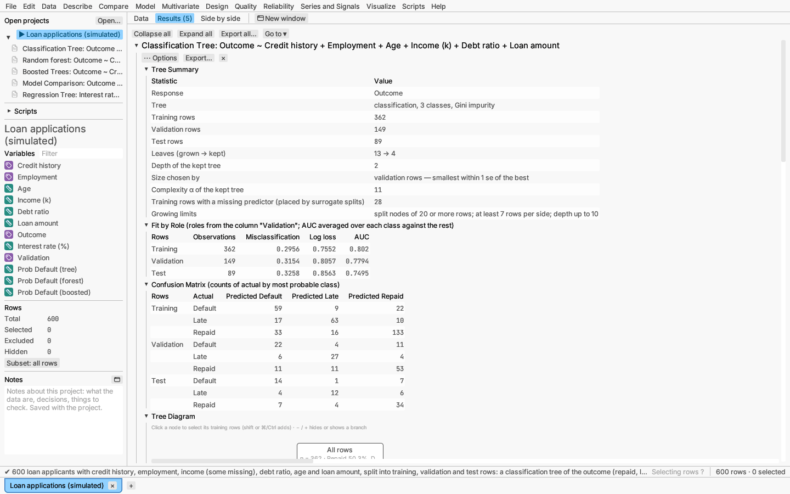

# Model: decision trees and validation

## Decision tree

Model ▸ Decision tree… grows a classification tree for a categorical
response, or a regression tree for a continuous one, following Breiman,
Friedman, Olshen & Stone (1984).

**Growing.** Classification trees split by Gini impurity or entropy;
regression trees by squared error. A categorical predictor splits its levels
into two groups. You set the minimum node and leaf sizes and the maximum
depth.

**Missing values.** Surrogate splits send a row with a missing predictor the
way its best-agreeing other predictor goes, or the majority way.

**Pruning.** Weakest-link cost-complexity pruning. The tree's size is chosen
on validation rows, or by cross-validation when there are none. Choose the
smallest tree within one standard error of the best (the default), the tree
with the lowest held-out error, or no pruning.

**Report:**

- summary, and fit measures for each role (training, validation, test);
- confusion matrix (classification);
- the **tree diagram**: each node shows its rule, count, prediction and a
  bar of class shares. Click a node to select its training rows in every
  view (Shift or ⌘/Ctrl adds). The − / + buttons hide or show a branch;
- variable importance;
- a leaf table with each leaf's full rule;
- held-out error against tree size, and the pruning sequence;
- the prediction formula, the Response Explorer and 3-D profiler.

**Saving:** predicted values, or each class's probability and the most likely
class, as formula columns (nested `if` expressions that route missing values
the same way the tree does). The validation roles can be saved as a column.

*Try it:* Loan applications: a three-class outcome with validation and test
rows, and a regression tree of the interest rate sized by 10-fold
cross-validation.

## Validation and fit measures

Predictive models give each row a **role**:

- **Training** rows fit the model.
- **Validation** rows choose the model's size (for example, how far a tree is
  pruned).
- **Test** rows are kept out of both, for an honest final estimate.

Roles come from:

- a column (values 0/1/2 or Training/Validation/Test);
- a seeded random draw, optionally stratified by the response's classes (or
  its quartiles, for a continuous response), or by whole groups of a column
  so related rows stay together;
- or k-fold cross-validation, used instead of a validation set.

**Fit measures** per role:

- continuous response: RMSE, MAE and R²;
- categorical response: misclassification rate, log loss, AUC (one class
  against the rest, averaged when there are three or more classes) and the
  confusion matrix.

*Verified:* AUC against direct counting of positive–negative pairs and the
trapezoid area under the ROC curve; the pruning sequence of a small tree
against hand computation; saved formulas reproduce every row's prediction,
missing values included.
