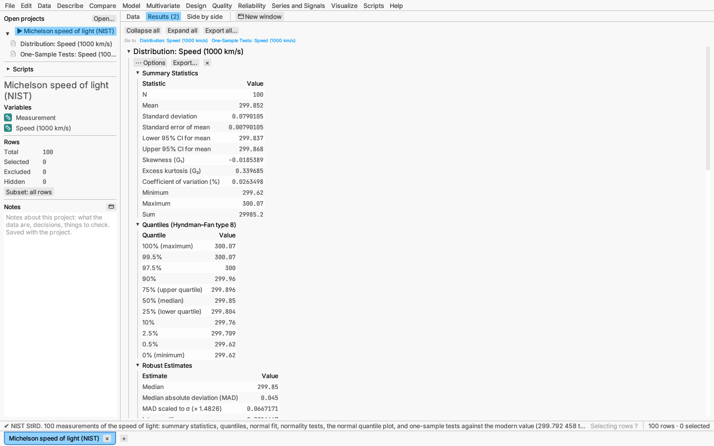
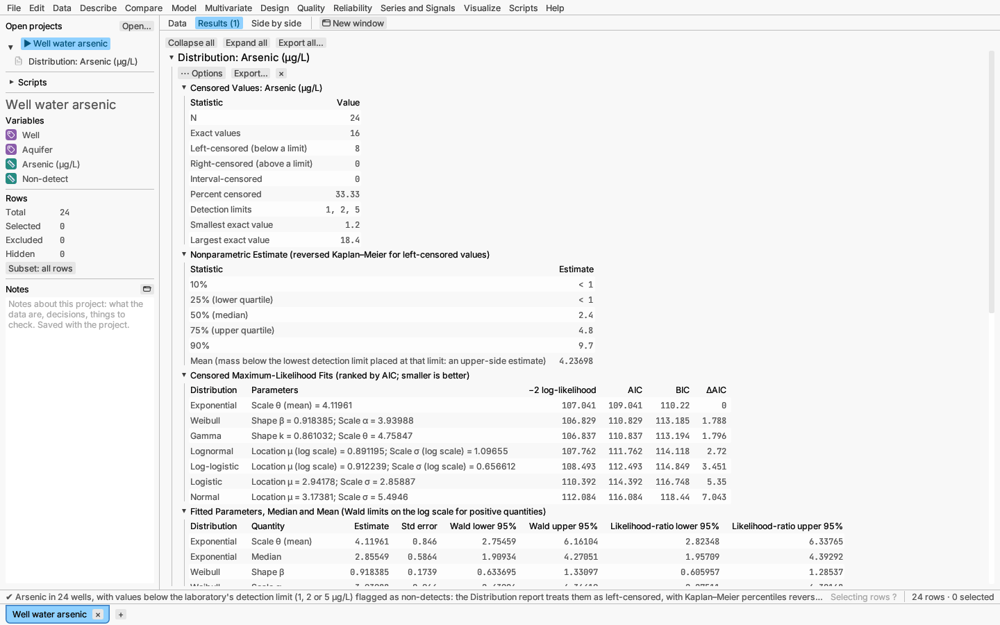
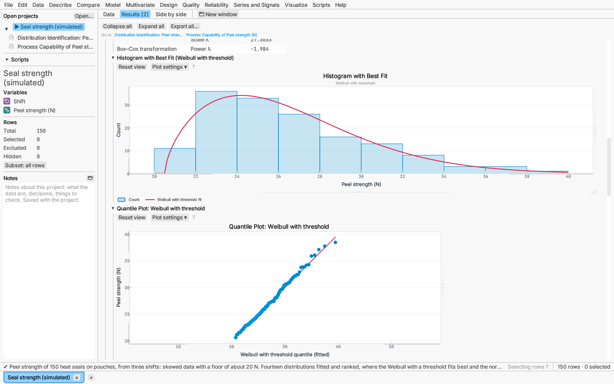
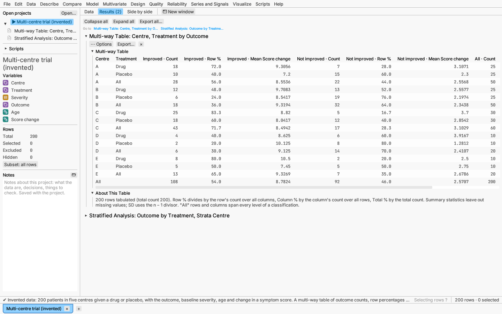
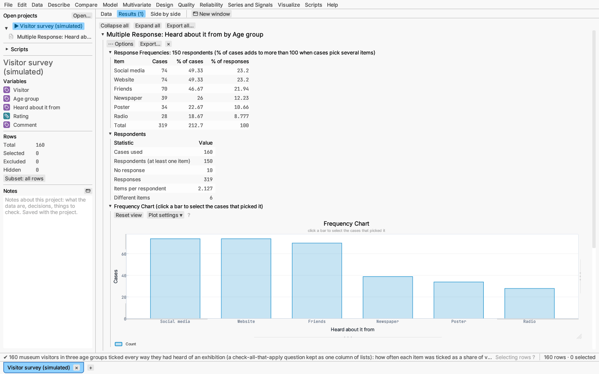
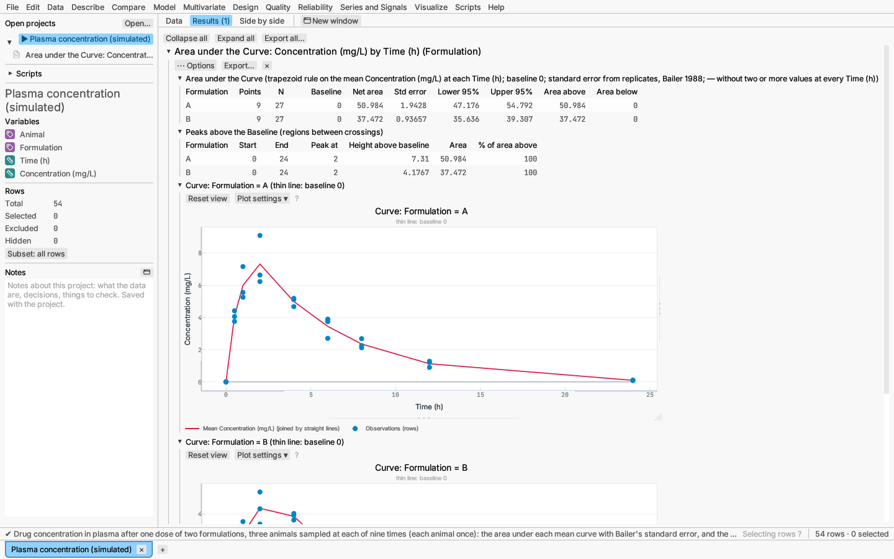
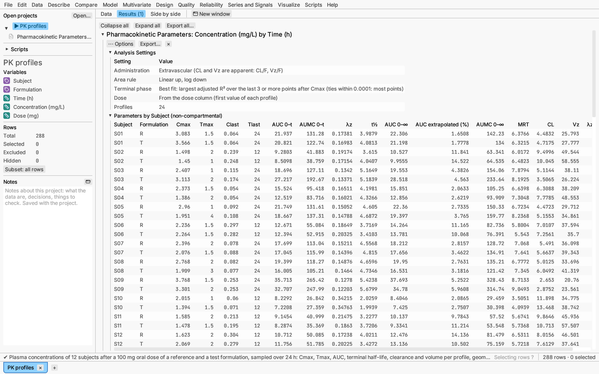
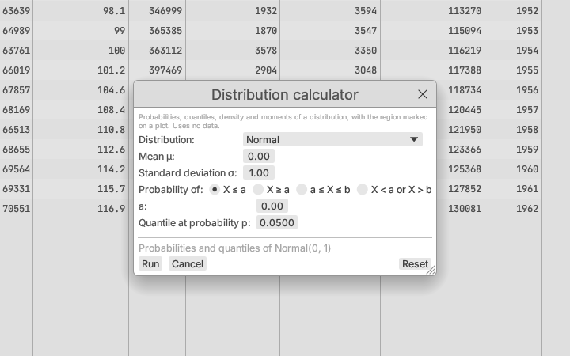

# Describe

The Describe menu summarises one column, the relationship between two, or
several categorical columns at once in a multi-way table.
It also lists [Summarize by group…](../data/table-operations.md#summarize-by-group),
which makes a table of summary statistics for each group.

## Distribution

Describe ▸ Distribution… summarises one column.

**Report:** summary statistics: N, mean, standard deviation, moments,
skewness, excess kurtosis, coefficient of variation and a confidence interval
for the mean.

**Options** (⋯ Options menu):

- **Quantiles** by any of the nine Hyndman–Fan definitions (types 1–9).
- **Robust estimates:** median, MAD, IQR, trimmed and winsorized means.
- **Histogram** and **box plot**.
- **Normal fit** with Shapiro–Wilk and Anderson–Darling tests, and a
  **normal quantile plot**.
- **Box–Cox transformation:** the estimated power, with an option to save the
  transformed column.
- **Tolerance interval:** limits that contain a stated proportion of the
  population (90% by default) with stated confidence (95%). Choose two-sided
  limits or one limit only, and the normal-theory interval (mean ± k × SD,
  with the exact factor k) or the distribution-free interval from order
  statistics. The distribution-free table gives the confidence actually
  achieved, with a note when the sample is too small to reach the one asked
  for. The limits are drawn on the histogram.
- **Outlier tests:** Grubbs' test or Dixon's ratio test for one outlier (at
  either end, the largest value or the smallest), or Rosner's generalized
  ESD test for up to a given number of outliers (a tenth of the values by
  default). Set the significance level, and for Dixon the ratio (chosen by
  sample size unless you pick r10, r11, r21 or r22). The table gives the
  value and row tested, the statistic, critical value and p-value; the
  generalized ESD adds a table of its steps. **Select flagged rows** in the
  options menu selects the outliers in every view. These tests assume the
  other values are normal.
- **Runs tests for randomness:** runs above and below the median (or a value
  you give) and runs up and down, in row order, with the expected number of
  runs and p-values for too few runs (clustering, trend) and too many
  (alternation). Exact p-values are used where they can be computed.
- For categorical columns, a **frequency table** and chart, with the levels
  in natural order (numbers by value, then text), so the cumulative column
  follows an ordinal scale.

Date columns report locations as dates and spreads as lengths of time.

*Try it:* Michelson light speed (tolerance interval); Clinic wait times for
skewed data and Box–Cox; Rosner's measurements (generalized ESD outlier
test); Beam deflection (runs tests).

### Censored values and detection limits

Laboratory results below a detection limit ("non-detects", reported as
"< 2 µg/L") and values known only to lie above a limit or between two
limits are *censored*: dropping them, or replacing them by the limit or
half of it, biases the mean and the spread (Helsel 2012). Under **Censored
values (non-detects and detection limits)** in the Distribution dialog,
choose:

- **A column flags censored values:** the analysed column holds each
  measured value, or for a censored one its limit; a numeric flag column is
  non-zero for censored rows. **Censored values lie** *below* the value
  (left-censored, the usual non-detect, and the default) or *above* it
  (right-censored).
- **Lower and upper ends in two columns:** the analysed column is the lower
  end and a second column the upper end of each value's interval. Equal ends
  are an exact value, an empty lower end a value below the upper end, an
  empty upper end a value above the lower end.

The flag column cannot also be analysed, and the analysed columns must be
numeric. The report replaces the usual sections with:

- **Censored Values:** N, exact values, left-, right- and
  interval-censored values, and the detection limits that occur with how
  often.
- **Nonparametric estimate:** the distribution function without a model.
  With left censoring only it is the Kaplan–Meier estimate on the flipped
  scale (Helsel 2012, ch. 6), and with any other mix Turnbull's (1976)
  self-consistent estimate, which reduces to it. A non-detect "< d" is a
  value strictly below d, so a value detected at d is not counted with it.
  The table gives percentiles (5, 10, 25, 50, 75, 90, 95%) — shown as "< 1"
  when the estimate only says the percentile is below the lowest limit —
  and the mean, restricted to the observed range when the estimate leaves
  mass below the lowest limit.
- **Fits by maximum likelihood**, ranked by AIC: normal, lognormal, Weibull,
  gamma, exponential, logistic and log-logistic. Each censored value
  contributes the probability of its interval, F(d) for a non-detect.
- **Parameter estimates** of each fit with standard errors, and its median
  and mean with intervals.
- **Distribution function plot** (an option): the nonparametric estimate as
  points with the three best fits as curves.
- **Count fits:** when every value and limit is a whole number ≥ 0, Poisson
  and negative binomial (mean μ, size k, variance μ + μ²/k) fits with
  likelihood-ratio limits; a non-detect "< d" counts as 0 … d − 1.

*Verified:* R `fitdistrplus::fitdistcens` (run to a tight tolerance) and
`survival::survfit` on the flipped data; count fits against an independent
SciPy implementation.

*Try it:* Well water arsenic (24 wells, nine non-detects at limits of 1, 2
and 5 µg/L).

## Identify distribution

Describe ▸ Identify distribution… finds which distribution describes one
continuous column. Use it before a capability study or a reliability
calculation on data that are not normal, or simply to learn the shape of a
process.

**Dialog:** choose the column and the distributions to try (all fourteen by
default), whether to also try transformations to normality, and how many
quantile plots to draw.

**Distributions:** normal, lognormal, exponential, Weibull, gamma, logistic,
log-logistic, smallest extreme value and largest extreme value, plus a
**threshold** form of the lognormal, exponential, Weibull, gamma and
log-logistic. A threshold is a lower bound below which no value can fall (a
seal that cannot be weaker than 20 N); the threshold forms also fit data with
zero or negative values. Forms without a threshold need every value to be
positive, and are listed as "not fitted" otherwise; a **Not Fitted** note
under the table says why for each one.

**Report:**

- **Goodness of Fit:** one row per distribution, best first by AIC (Akaike's
  information criterion; smaller is better, and a difference of more than
  about 2 is worth noticing). Each row gives the number of parameters, the
  Anderson–Darling statistic A² and its p-value (a small p-value means the
  distribution does not fit), and for a threshold form the p-value of the
  likelihood-ratio test of the threshold (a small value means the threshold
  is needed). Transformation rows give the normality test of the transformed
  values.
- **Parameter Estimates** for each distribution, in its usual form (for
  example a Weibull's shape β and scale α).
- **Histogram with Best Fit:** the histogram with the best distribution's
  density drawn over it.
- **Quantile plots** for the best fits: each value against the fitted
  distribution's quantile at its rank. Points along the diagonal line mean a
  good fit; a bend at either end shows where the distribution misses the
  tails. Points can be selected and brushed like any plot.
- With transformations on, the **Johnson** transformation (one of the
  bounded SB, lognormal SL or unbounded SU forms, chosen from the data's
  percentiles) and the **Box–Cox** power transformation, each with a normal
  quantile plot of the transformed values.

The p-values for the normal come from a published formula. For every other
distribution they come from simulation: samples drawn from the fitted
distribution are refitted, and the p-value is the share whose A² is at least
the data's. Reports repeat exactly. When no simulated sample fits as badly as
the data, the p-value shows as "< 0.0005".

Only included rows with a value are used; excluding rows re-runs the fits.

*Try it:* Seal strength, where the Weibull with a threshold near 20 N ranks
first and the normal is rejected.

## Bivariate

Describe ▸ Bivariate… looks at two columns. What you get depends on their
measurement levels:

| Columns | Report |
|---|---|
| continuous × continuous | Pearson and Spearman correlations with tests and 95% intervals, covariance, scatter plot |
| categorical × categorical | contingency table with margins and expected counts, Pearson and likelihood-ratio χ² tests, Cramér's V and φ (2×2) with 95% intervals from the noncentral χ² distribution, a warning when expected counts are small |
| continuous × categorical | means by group with intervals, one-way ANOVA, pooled and Welch t (two groups) or Welch ANOVA, tests of equal variances, rank tests, pairwise comparisons of three or more groups, a values-by-group plot |

With three or more groups the report compares every pair of groups with
95% intervals: Tukey–Kramer by default, or Games–Howell (no
equal-variance assumption), Holm-adjusted t, Bonferroni, Šidák,
Holm–Šidák, Fisher's LSD, Newman–Keuls, Tamhane's T2, Dunnett's T3, or
none, chosen from the report's options menu under **Pairwise comparisons**.

**Contingency tables** (two categorical columns) also show:

- **Adjusted residuals**: each cell's (observed − expected) divided by its
  standard error under independence (Agresti 2013, §2.4.5), approximately
  standard normal. Cells beyond ±1.96 carry ▲ (more than independence
  predicts) or ▼ (fewer) and are drawn in stronger ink, so the direction
  never rests on colour alone.
- **Differences of proportions** between every pair of row groups (up to
  10 groups): for each column level (only the second when there are two),
  the difference of the proportions with Newcombe's hybrid-score 95%
  interval (Newcombe 1998, method 10), which stays inside [−1, 1] and
  behaves well with small counts, and a forest plot of the differences.

*Try it:* Customer survey (two categorical columns).

## Multi-way table

Describe ▸ Multi-way table… lays out several categorical columns at once.
The dialog's lists run, left to right: **Continuous columns** (optional
measures summarized in each cell), then the two classifications.
Tick the **Rows** columns and the **Columns** columns in nesting order
(outermost first; the number after a ticked name is its place): with
Centre then Treatment as rows, each centre's rows are split by treatment.
Only combinations that occur in the data get a row or column. Each cell
shows any of:

- **Count**, **Row %** (of the row's count over all columns), **Column %**
  (of the column's count over all rows) and **Total %** (of all rows);
- for each ticked **Continuous column**: N, Mean, SD (n − 1 divisor),
  Median, Min, Max and Sum, leaving out missing values.

**Totals** adds an *All* row and column; **Subtotals of outer levels** adds,
after each outer level's rows (and columns), a row spanning all its inner
levels. A **Frequency column** makes each row count as many times as its
value (summary statistics then weight each value the same way). Rows with an
empty classification are left out and counted in the note under the table.
With column classifications, each heading names the column group and the
statistic, such as *Improved · Count*; with none, the statistic alone.

The statistics and totals can be changed afterwards from the report's
⋯ Options menu. Right-click the table to copy it or save it as a new data
table (see [Saving plots and results](../reports/exporting.md)).

*Try it:* Multi-centre trial (outcome by centre and treatment, with row
percentages and the mean score change).

## Multiple response

Describe ▸ Multiple response… counts the answers to a check-all-that-apply
question ("Which of these do you use? Tick all that apply"), where each
person can pick any number of items. The answers can be kept two ways:

- **One column of lists**: a text column whose cells list the items picked,
  separated by a delimiter (`;` unless you type another; leave it empty to
  treat each cell as one item). Spaces around items are ignored and an item
  listed twice in one cell counts once. An empty cell is a person who picked
  nothing.
- **One column per item**: a column for each item, where a non-zero number,
  *yes*, *true*, *x* or *✓* means picked (anything else, or missing, means
  not). The column names are the items.

**Cross-tab by** (optional) names a group column, such as age group or
region. **Order items** lists them most picked first, or in the order they
were found (first appearance in the lists, or column order).

The report shows:

- **Response Frequencies**: each item's count of cases that picked it, as a
  percentage of cases (respondents who picked at least one item; these
  percentages add to more than 100, because people pick several) and of
  responses (all picks; these add to 100).
- **Respondents**: cases used, respondents, cases with no answer, total
  responses, items per respondent and the number of different items.
- **Frequency Chart**: a bar per item. Click a bar to select the cases that
  picked that item, in the grid and every plot.
- With a group column, **Cross-tabulation**: for each group, how many of
  its respondents picked each item and what percentage that is; and
  **Tests of Marginal Independence**: for each item a 2 × G Pearson χ² test
  of whether the share picking it differs between groups, with
  Bonferroni-adjusted p-values, and the overall Bonferroni test (the
  smallest p-value times the number of items, at most 1). Because one person
  answers for several items, the ordinary χ² test of the whole
  items-by-groups table is not valid; testing each item and adjusting is the
  simple valid alternative (Agresti & Liu 1999; Bilder & Loughin 2004).
  Items picked by everyone or by no one cannot be tested and say so; a note
  marks tests with expected counts below 5.

To filter on one item, make a formula column or a row filter with
`has_item(Heard, "Radio")` (true when the list holds the item), or count
the items with `item_count(Heard)`; see [Formula columns](../reference/formulas.md).

*Try it:* Visitor survey (how 160 museum visitors heard about an
exhibition, by age group).

## Area under a curve

Describe ▸ Area under a curve… takes an x column (time, dose…), a response
column and optionally a column that splits the rows into one curve per
level. The curve joins the mean response at each distinct x with straight
lines (rows with the same x are replicates).

- **Area under the Curve:** for each curve, the number of x values and of
  rows, the baseline, the **net area** (trapezoid rule: area above the
  baseline minus area below it), its standard error and a normal confidence
  interval, and the areas above and below the baseline separately. The
  standard error (Bailer 1988) comes from the variance of the replicates at
  each x, so it needs two or more values at every x and shows — otherwise;
  it suits destructive sampling, where each subject is measured once.
- **Baseline:** a value (0 by default), or the mean of the curve's first
  few points (for example the readings before a dose); a baseline from the
  data adds its own uncertainty to the standard error.
- **Peaks above the Baseline:** each stretch of the curve above the baseline
  (between crossings, found by straight-line interpolation), with where it
  starts and ends, the x and height of its highest point, its area and its
  share of the area above. Peaks lower than a chosen share of the tallest
  can be left out.
- **Curve:** the observations, the mean curve and the baseline, one plot per
  curve (the first 12).

**Saving:** the report's ⋯ Options menu saves the response minus its
curve's baseline, as a percentage of its curve's range (0 at the smallest
value, 100 at the largest) or as a fraction of its curve's total. The
formula functions `subtract_baseline`, `percent_of_range` and
`fraction_of_total` make the same transforms (see the formula reference).

*Verified:* hand calculation of the trapezoid areas, crossings and peaks;
Bailer's standard error against R.

*Try it:* Plasma concentration (two formulations, three animals at each of
nine times).

## Pharmacokinetic parameters

Describe ▸ Pharmacokinetic parameters… summarises concentration–time
profiles without fitting a compartmental model (non-compartmental analysis;
Gibaldi & Perrier 1982, ch. 11; Gabrielsson & Weiner 2016, ch. 2). Data are
long: one row per sample with **subject**, **time** and **concentration**
columns, and optionally a **treatment or period** column (one profile per
subject and level, for crossover studies). Enter concentrations below the
limit of quantification as 0. The **dose** is none (clearance and volume are
then left out), one value for all, or a column (the first value in each
profile). **Administration** is extravascular (oral, subcutaneous…;
clearance and volume are then apparent, CL/F and Vz/F), an intravenous
bolus, or an intravenous infusion of a given duration. Excluded rows and
rows with a missing time or concentration are left out.

For each profile, with times t₁ < … < tₙ and concentrations C₁ … Cₙ (a
missing sample at time 0 counts as C = 0 after extravascular dosing or an
infusion):

- **Cmax**, **Tmax** (first time of the peak), **Clast** and **Tlast** (last
  positive concentration).
- **AUC₀–t and AUMC₀–t** (to Tlast), by the **linear trapezoid**
  ΔAUC = Δt (C₁ + C₂)/2, or **linear up / log down** (the default): where
  the concentration falls and both values are positive,
  ΔAUC = Δt (C₁ − C₂)/ln(C₁/C₂), and for the first moment
  ΔAUMC = Δt (t₁C₁ − t₂C₂)/ln(C₁/C₂) + Δt² (C₁ − C₂)/ln²(C₁/C₂); elsewhere
  the linear rule (ΔAUMC = Δt (t₁C₁ + t₂C₂)/2).
- **λz,** the terminal rate constant: minus the slope of ln C on t over the
  terminal points. *Best fit* (the default) tries the last 3, 4, … positive
  points after Cmax (Cmax excluded), drops fits with λz ≤ 0, takes the
  largest adjusted R² and, among fits within 0.0001 of it, the one with most
  points. *Last k points* uses the last k ≥ 3 positive values, *Times from …
  to …* the positive values in a time range (at least 3). No λz means the
  parameters below are shown as —.
- **t½** = ln 2/λz; **AUC₀–∞** = AUC₀–t + Clast/λz with the **%
  extrapolated**; **AUMC₀–∞** = AUMC₀–t + Clast·Tlast/λz + Clast/λz².
- **MRT** = AUMC₀–∞/AUC₀–∞ (minus half the duration for an infusion).
- With a dose, **CL** = Dose/AUC₀–∞ and **Vz** = Dose/(λz·AUC₀–∞).
- **Intravenous bolus:** C0 is the observed concentration at time 0 if
  positive; otherwise it is back-extrapolated log-linearly from the first
  two positive values when they decline, or set to the first positive value
  when they do not. It enters the areas but not Cmax or the terminal phase.

**Report:**

- *Analysis Settings* — route, area rule, terminal-phase rule, dose and
  number of profiles.
- *Parameters by Subject* — one row per profile (a profile that cannot be analysed, for
  example with no positive concentration, says why).
- *Summary* (by treatment) — for each parameter and treatment: N, the
  **geometric mean** and **geometric CV** = √(exp(s²) − 1), where s is the
  standard deviation of the logs (for concentrations, areas, rate, half-life,
  MRT, CL and Vz), the arithmetic mean, standard deviation, median, minimum
  and maximum.
- *Terminal Phase Regressions* — each profile's λz, intercept, points used, time range,
  R² and adjusted R².
- *Concentration–Time Profiles* and *Profiles on a Log Scale* —
  concentration against time per profile, the second on a log axis with each
  fitted terminal line drawn over its points.

*Verified:* an independent NumPy implementation written from the formulas
(every parameter of the 24 sample profiles under both area rules, to
10⁻¹⁰) and hand-worked closed forms.

*Try it:* PK profiles (12 subjects, reference and test formulations, a
100 mg oral dose).

## Distribution calculator

Describe ▸ Distribution calculator… works with a distribution rather than
data. Choose one of 22 distributions — normal, lognormal, exponential,
gamma, Weibull (the last four with an optional threshold), logistic,
log-logistic, smallest and largest extreme value, uniform, triangular, beta,
t, χ², F, noncentral t, χ² and F, studentized range, binomial, Poisson and
hypergeometric — and its parameters. Then choose a region: X ≤ a, X ≥ a,
a ≤ X ≤ b, or X < a or X > b, and a probability p to invert.

The report gives the parameters with the mean, standard deviation and range
of values; the probability of the region and of its complement, the density
(or, for counts, the probability P(X = x)) at a and b, and the quantiles at p
and 1 − p; and a plot of the density with the region hatched. For the
binomial, Poisson and hypergeometric the plot shows a stick per value, with a
marker on each stick in the region, and the bounds are inclusive at whole
numbers: P(2 ≤ X ≤ 4) includes 2 and 4.
The studentized range needs at least 0.05 degrees of freedom; below that its
probability spreads too thinly to compute.

Extreme arguments give their limiting or exact values rather than a blank:
a value so far out that its square would overflow (such as 10²⁰⁰ for the
normal, t or F) gives probabilities of exactly 0 and 1, and upper-tail
probabilities are computed directly, so a tail of 10⁻¹⁸ keeps its digits
instead of rounding to 0 or to a few times 10⁻¹⁶. Quantiles keep their
relative precision in the tails too (the Cauchy, t with 1 degree of freedom,
at p = 10⁻²⁰) and for very small degrees of freedom, where they can lie near
10⁻²⁰⁰ (χ² with 0.002 degrees of freedom) or 10⁶⁸ (t with 0.01). A variance
larger than the largest representable number (a Weibull shape below about
0.005) is shown as ∞.

Change the settings from the report's ⋯ Options menu and the report updates.
To draw random values from the same distributions, use
[Data ▸ New random column…](../data/editing.md#random-columns).

