# Design

The Design menu creates experimental designs. It works without an open
dataset, because each design opens as a new data table ready for you to add
the responses.

| Submenu | Designs |
|---|---|
| Factorial | 2-level and 3-level full factorials; full factorials with mixed levels; fractional factorials, with their resolution shown |
| Screening | Plackett–Burman; definitive screening designs (with extra runs and center runs); screening with categorical factors |
| Response surface | central composite (rotatable, spherical, face-centered or a custom α) and Box–Behnken |
| Optimal | D-optimal and I-optimal designs built by coordinate exchange, optionally within constraints; split-plot designs for hard-to-change factors |
| Space filling | Latin hypercube (maximin), maximin distance, minimax distance and uniform designs, for computer experiments |
| Mixture | simplex lattice, simplex centroid and extreme vertices |
| Robust design | orthogonal arrays with an inner and outer array |
| Measurement | gauge study worksheet |
| This table (with a table open) | signal-to-noise analysis; declare table as design; augment design; simulate responses; evaluate design; factorial analysis; propose next runs ([sequential optimization](gaussian-processes.md#proposing-the-next-runs)) |

Every design dialog:

- shows a live preview of the runs as you change the settings;
- can add center points (a rotatable central composite design starts with
  Box & Hunter's uniform-precision number for its factorial portion);
- randomizes the run order, with a seed so the order can be reproduced;
- opens the design as a new table with **Create**.

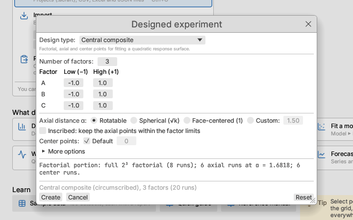

After running the experiment, type the responses into the new table and
analyse it with Model ▸ Linear model, Response surface, Mixture model or
Several responses.

## Full factorials with mixed levels

Design ▸ Full factorial (mixed levels)… crosses factors that each have
their own number of levels, for example a 2 × 3 × 4 design of 24 runs. For
each factor give its lowest and highest setting and the number of levels;
the levels are spaced evenly between them. Factors with named categories
(suppliers, materials) are entered as numbered levels 1, 2, … and the
column can then be recoded or changed to nominal in the grid.

## Definitive screening: extra runs and center runs

A definitive screening design for k factors has 2m + 1 runs, where m is
the smallest even conference-matrix order of at least k (the fold-over of
the matrix, plus one center run). Its main effects are clear of each other,
of two-factor interactions and of quadratic effects, but with few runs to
spare the error estimate and the quadratic effects are weak. Two settings
in the dialog buy precision:

- **Extra runs**: the design is built from a larger conference matrix and
  its extra columns are left out ("fake factors", Jones & Nachtsheim 2013),
  so the runs grow in pairs while the defining properties hold. Asking for
  4 extra runs with 6 factors uses the 8-factor design: 17 runs instead
  of 13.
- **Center runs**: the number of center runs in all (default 1). Each one
  beyond the first adds a pure-error degree of freedom and sharpens the
  quadratic effects.

**Compare run sizes** lists nearby choices (the first few larger orders
with one center run and with your number of center runs) side by side,
your choice in bold:

| Column | Meaning |
|---|---|
| Error df (main effects) | n − 1 − k: degrees of freedom left after fitting the main effects |
| Error df (main + quadratic) | n − 1 − 2k, after the quadratic effects too |
| D-efficiency (main effects, %) | 100 · det(XᵀX)^(1/p) / n for the main-effects model |
| Max \|r\| quadratic | the largest correlation between two quadratic columns: (n − 9)/(3(n − 3)) with one center run |
| Max \|r\| interactions | the largest correlation between two two-factor-interaction columns |
| Mean SE quadratic (σ) | the mean standard error of a quadratic effect in the main-effects-plus-quadratic model, in units of σ |

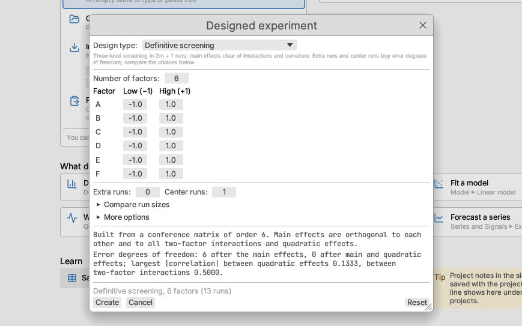

Script: `definitive_screening_design(#{ factors, extra_runs, center_runs })`
and `compare_definitive_screening(#{ factors, extra_runs, center_runs })`.

## Screening with categorical factors

Design ▸ Screening with categorical factors… screens two-level continuous
factors together with categorical ones (suppliers, machines, materials) of
2 to 12 levels. Set each factor's **Type**; a categorical factor has a
number of **Levels**, and its low and high settings do not apply.

The runs are chosen by coordinate exchange to maximize det(XᵀX) for the
main-effects model, or the model with every two-factor interaction too.
Each categorical factor enters through orthonormal (normalized Helmert)
contrasts, so a design that balances every pair of factors, an orthogonal
array, scores 100% D-efficiency; the search reaches the known arrays (for
example a four-level factor with four two-level factors in 8 runs). The
default number of runs is the number of model terms plus 4, rounded up to
a multiple of the levels' least common multiple when that costs at most
half again, so that levels can appear equally often; untick **Default** to
choose. The notes give how often each level runs, the D-efficiency and
ln det(XᵀX).

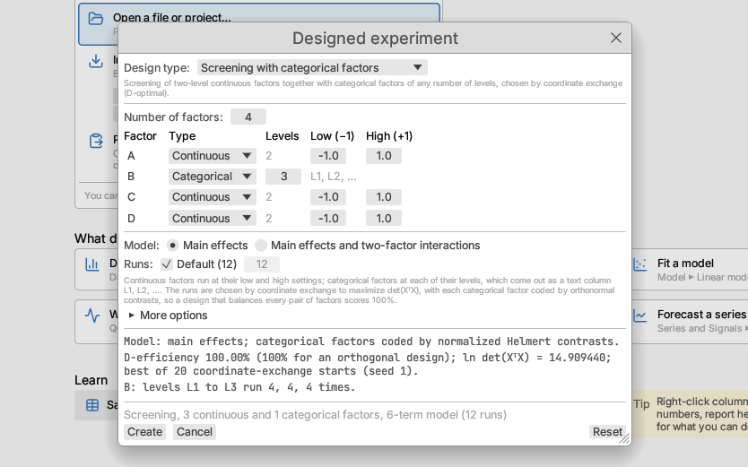

In the new table a categorical factor is a nominal text column with levels
L1, L2, … (rename them with Data ▸ Recode). Script:
`screening_design(#{ factors: [#{ name, levels }, #{ name, low, high }], runs, model })`.

## Constraints in optimal designs

Some combinations of settings cannot be run: an oven cannot be at its
highest temperature for the longest time, or a pressure limit ties two
factors together. The D-optimal and I-optimal dialogs have a
**Constraints** box for these limits, one per line, written with the
factor names in the factors' own units:

```text
2*Temp + Time <= 400
Temp - Time >= 10
exclude Temp > 180 and Time > 25
```

- A **linear constraint** compares two sums of terms such as `Temp`,
  `2*Temp`, `Time/4` or a number, with `<=`, `>=`, `<`, `>`, `≤` or `≥`.
  Points on the boundary are allowed. An equality cannot be used (it would
  leave no room for an experiment).
- An **exclude** line leaves out a combination: every point meeting all
  its conditions (joined by `and`) is disallowed. Each condition compares
  one factor with a value; `>` and `<` leave the boundary value allowed,
  `>=`, `<=` and `=` exclude it.
- Lines starting with `#` are ignored. Factor names may contain spaces
  (write `"Reaction time"` in quotes if a name could be misread).

The search places every run inside the region: each setting is chosen from
the grid levels, the ends of the range the constraints leave, and (for
factors with squared terms) the middle of that range, and a run on a
slanted limit can slide along it. The constraints are listed in the
design's notes. A mistake is reported in the preview with its line number;
a region with no room for runs says so. For an I-optimal design the
average prediction variance is over the constrained region, estimated
from 20 000 evenly spread points inside it (the notes say so); over the
whole cube it is exact.

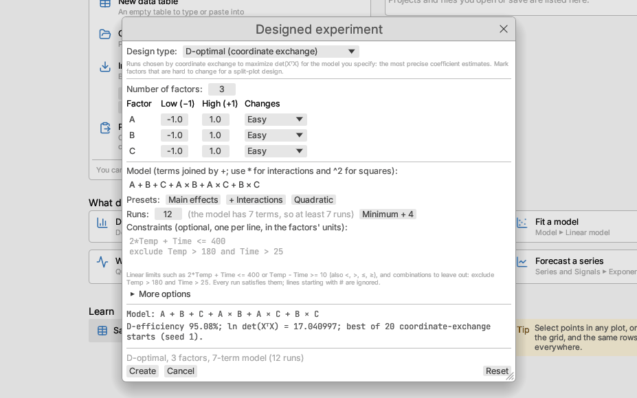

## Split-plot designs for hard-to-change factors

Some factors are slow or costly to reset: a furnace takes hours to reach a
new temperature, a batch of raw material is used up over several runs.
Running every run in a fully random order would reset them every time.
Instead, the runs are grouped into **whole plots**: the hard-to-change
factors are set once per whole plot, and the easy factors vary from run to
run within it. This is a split-plot design. With a third, very hard
factor, the whole plots are split into **subplots**: very hard factors are
fixed within whole plots and hard ones within subplots (a split-split-plot
design).

Design ▸ Optimal ▸ **Split-plot (hard-to-change factors)…** opens the
D-optimal dialog with the first factor marked hard. In the factor table,
the **Changes** column sets each factor to Easy, Hard or Very hard; any
factor that is not easy makes the design a split-plot design. Then give:

- the **model** and number of **runs**, as for any D-optimal design;
- the number of **whole plots** (and of **subplots** when there are very
  hard and hard factors). Runs are shared out as evenly as possible;
- the **variance ratio η**, your guess of the whole-plot variance relative
  to the run-to-run variance. 1 is a good default when you have no prior
  information; the design changes little over a wide range.

The search (coordinate exchange without a candidate list; Jones & Goos
2007) changes a hard factor's setting for a whole plot at a time and
maximizes det(XᵀV⁻¹X), which accounts for runs in the same whole plot
being correlated (Goos & Vandebroek 2003). The notes give the
D-efficiency (relative to a completely randomized orthogonal design with
the same total variance per run; it can exceed 100% because comparisons
within a whole plot are free of the whole-plot variance), the average and
largest prediction variance, and the **degrees of freedom for whole-plot
error**: whole plots minus the terms that involve only hard factors (with
the intercept). With none, the effects of hard factors cannot be tested,
so add whole plots.

The table has a nominal **Whole Plot** column (and **Subplot**), numbered
in run order. The run order is randomized only within the restrictions:
whole plots in random order, then the runs inside each one. Run them in
that order.

The new table opens with the design declared (Design ▸ This table ▸
Declare table as design shows the plots, which factors are fixed within
them and the analysis to use) and with a project script, *Fit split-plot
model*. Once the responses are entered, choose Model ▸ **Mixed model**: it
is filled in with the design's model and a random intercept for the whole
plots (and for the subplots within them), fitted by REML. Its F tests use
Satterthwaite degrees of freedom, so a hard factor is tested against the
variation between whole plots rather than the smaller run-to-run
variation, which an ordinary linear model would wrongly use. The sample
*Furnace coatings (simulated) — split-plot design* shows the whole cycle.

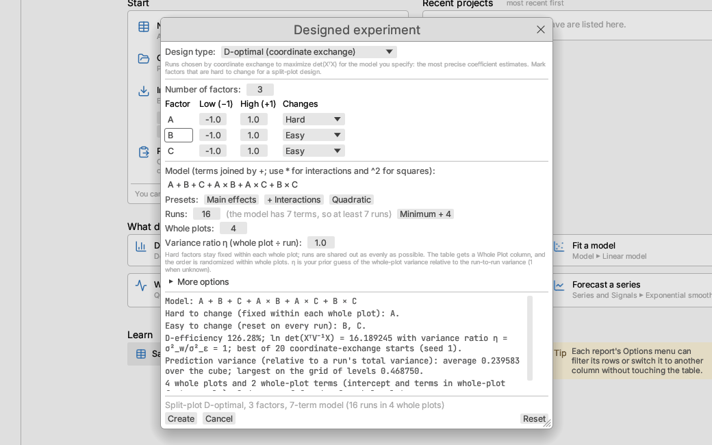

## Space-filling designs for computer experiments

A computer model (a simulation or a formula) gives the same answer every
time it is run with the same inputs, so replicates and center points tell
you nothing, and designs that put their runs at the corners leave most of
the region unexplored. Space-filling designs spread the runs evenly over
the whole range of every factor, ready for fitting a flexible surrogate
model. Design ▸ Space filling offers four:

| Design | What it optimizes |
|---|---|
| Latin hypercube (maximin) | Each factor's range is cut into as many equal slices as there are runs and each slice is used once; among such designs, the runs are pushed apart by minimizing the φ₅₀ criterion (Morris & Mitchell 1995) |
| Maximin distance | The smallest distance between two runs is made as large as possible, with the runs free to go anywhere (often on the edges of the region) |
| Minimax distance | The largest gap (the distance from any point of the region to its nearest run, the *fill distance*) is made as small as possible, by clustering many points of the region (Mak & Joseph 2018) |
| Uniform (centered L2 discrepancy) | Like a Latin hypercube, one run per slice of each factor, with the runs spread as evenly as possible by the centered L2 discrepancy (Fang et al. 2000) |

Set the number of factors and their low and high settings (the design
spreads the runs between them), the number of **Runs** (up to 1000; the
**10 × factors** button is a common starting size) and the **Seed**. Each
design is found by a randomized search, so the same seed always gives the
same design and another seed may give a slightly different one. There are
no center points.

The preview lists four measures of each design, computed with every
factor's range scaled to 0…1, so you can compare the designs:

- **Minimum distance between runs** — larger is better spread.
- **φ₅₀** — a smooth version of one over the minimum distance that also
  counts close pairs; smaller is better.
- **Centered L2 discrepancy** — how far the runs are from an even spread
  over every corner-anchored box; smaller is better.
- **Fill distance** — the largest gap, measured over a fine grid and a
  quasi-random set of points (so slightly optimistic); smaller is better.

The sample *Borehole water flow (Worley 1987)* is a computer experiment: a
40-run maximin Latin hypercube over the eight inputs of a groundwater
model, with the flow computed from its formula. It opens with a surrogate
linear model and the Response Explorer.

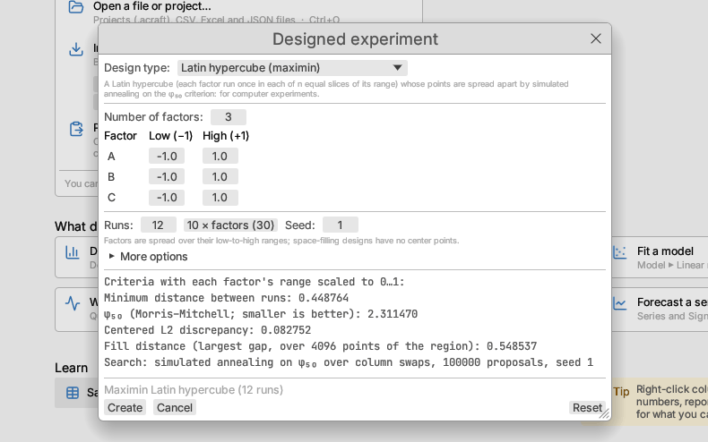

## Extreme-vertices mixture designs

When each component of a mixture has its own lower and upper limit, the
blends that satisfy them form a smaller region inside the simplex. Design ▸
Extreme vertices… finds the corners of that region (McLean & Anderson's
algorithm), after tightening any bound that the others make unreachable.
Enter each component's name, lower bound and upper bound in the units
chosen under **Components as** (proportions, percentages or amounts). The
options add:

- the centroids of the region's edges, or of its edges and two-dimensional
  faces;
- the overall centroid (the average of the vertices);
- axial check blends half-way between the overall centroid and each vertex.

The preview lists the Scheffé models the blends support. Fit the results
with Model ▸ Mixture model.

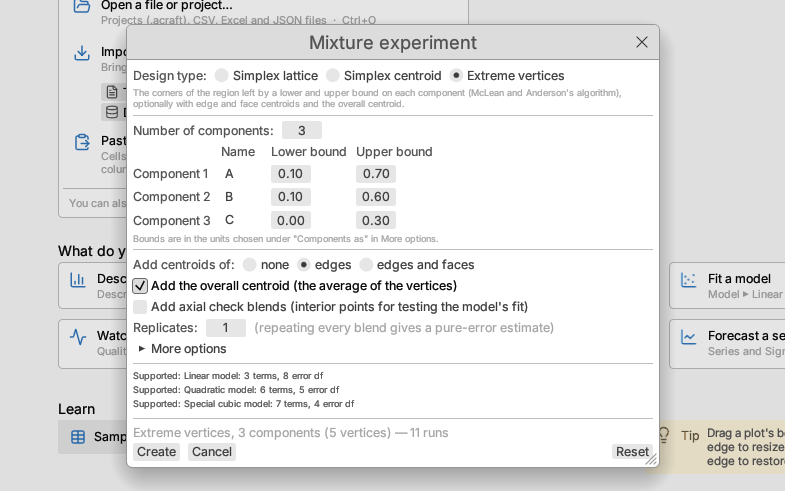

## Robust design with orthogonal arrays

Design ▸ Robust design (orthogonal arrays)… lays out a robust-design
experiment in the style described by Phadke (1989). Control factors (the
settings you can choose) go in an **inner array**, one of the standard
orthogonal arrays:

| Array | Runs | Columns |
|---|---|---|
| L4 | 4 | 3 two-level |
| L8 | 8 | 7 two-level |
| L9 | 9 | 4 three-level |
| L12 | 12 | 11 two-level |
| L16 | 16 | 15 two-level |
| L18 | 18 | 1 two-level and 7 three-level |
| L27 | 27 | 13 three-level |

Noise factors (conditions you cannot control in use but can set in the
test) go in an optional **outer array**. Each run of the inner array is
tested at every run of the outer array, and each outer run becomes one
response column, named after its noise settings, such as
`Shrinkage (Humidity=low, Age=new)`. Without an outer array, choose how
many times each inner run is repeated. Factors take the array's columns in
order; level names whose values are all numbers make numeric columns. The
run order can be randomized with a seed.

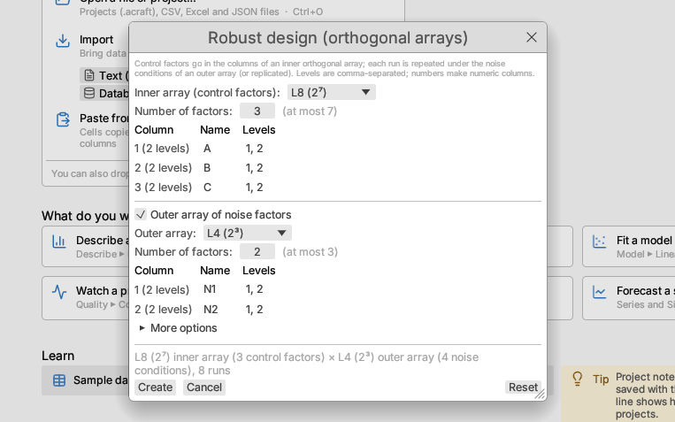

### Signal-to-noise analysis

With the results entered, Design ▸ Signal-to-noise analysis… summarizes
each run's responses as a signal-to-noise ratio η (in decibels, larger is
better whatever the goal):

| Goal | Ratio |
|---|---|
| Smaller the better | η = −10 log₁₀(mean of y²) |
| Larger the better | η = −10 log₁₀(mean of 1/y²) |
| Nominal the best | η = 10 log₁₀(ȳ² / s²) |
| Nominal the best (variance only) | η = −10 log₁₀ s² |

Choose the factor columns and the response columns (one per outer-array
run or repeat). The report shows:

- **Summary:** the ratio used and the settings with the largest ratio,
  with the predicted η and mean response there from the additive model
  (overall mean plus the gain of each chosen level).
- **Main Effects on the Ratio:** the mean η at each level of each factor.
- **Factor Ranking:** each factor's range of level means (delta) and rank,
  for the ratio and for the mean response.
- **Response Table:** the number of runs, mean η and mean response at each
  level of each factor.
- **Main Effects on the Mean**, to pick a factor that moves the mean
  without changing η (an adjustment factor).
- **Ratio by Run:** each run's settings, number of responses, mean,
  standard deviation and η.

The ratio can be changed in place from the report's settings.

*Try it:* Moulding shrinkage (smaller the better).

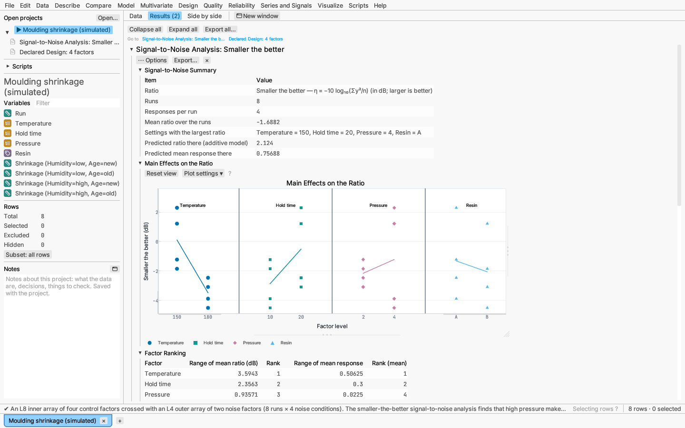

## Declaring a table as a design

Design ▸ Declare table as design… treats columns of any open table as the
factors and responses of an experiment, for a design built elsewhere or an
existing set of runs. For each factor you can give the settings coded −1
and +1; otherwise the column's smallest and largest values are used.
A categorical factor (text, or numbers marked nominal or ordinal) must have
two levels: the first in sorted order is coded −1 and the second +1.
Responses must be numeric. The report shows:

- **Factors and Responses:** each factor's −1 and +1 settings, its number
  of distinct levels and how many runs fall outside the range; each
  response with its number of values;
- **Runs:** the number of runs and of distinct settings, settings run more
  than once and the pure-error degrees of freedom they give, and center
  runs;
- **Correlations of Coded Factors**, with a note saying whether the design
  is orthogonal for the main effects;
- **Models the Runs Support:** main effects, main effects with two-factor
  interactions, and the full quadratic, each with its parameters, whether
  it can be estimated, error degrees of freedom and D-efficiency.

For a split-plot experiment, also choose the **Whole plots** column (and
**Subplots** for a split-split-plot design). The report then adds
**Restricted Randomization** — the number and size of the plots and the
factors held fixed within them — and a note on the analysis, with the
whole-plot error degrees of freedom when the design's model is recorded
(as it is for a design made by Design ▸ Split-plot). Model ▸ Mixed model
on the table is then filled in with that analysis.

*Try it:* Moulding shrinkage (temperature, hold time and pressure);
Furnace coatings for a split-plot design.

## Augmenting a design

Design ▸ Augment design… (with a table open) adds runs to the experiment
in the active table and keeps the runs already made. Choose the factor
columns (a numeric factor is coded −1 and +1 at its smallest and largest
values unless you give its settings under More options; a categorical
factor needs two levels) and, optionally, the response columns, then what
to add:

| Add | What it does |
|---|---|
| Fold-over | Repeats the two-level runs with signs reversed. Reversing **every factor** frees all main effects from two-factor interactions (a resolution III fraction becomes resolution IV). Reversing **one factor** frees that factor and its two-factor interactions. Center runs are not repeated; a two-level text factor swaps its levels. |
| Center runs | Runs at the middle of every factor's range, for pure error and a curvature check. |
| Axial runs | Runs at ±α on each factor axis (α = 1, face-centered, by default) plus center runs: a two-level factorial becomes a central composite design. The notes give the rotatable α for the factorial runs. |
| D-optimal runs | The number of runs you ask for, chosen by coordinate exchange to maximize det(XᵀX) of all runs for the model you give (for example a larger model with interactions or squares), with the existing runs fixed. Constraints can be given as for optimal designs. |
| New whole plots | For a split-plot design: the number of whole plots you ask for, each with the same number of runs. Choose the **Whole plot column**; the factors constant within every existing whole plot are taken as hard to change and stay fixed within each new whole plot, while the others vary freely. The settings maximize det(XᵀV⁻¹X) of all runs, V = I + η ZZᵀ, with the existing runs fixed (Goos & Jones 2011, ch. 10). |

The preview shows how many runs are added and notes such as the aliases a
fold-over removes or the D-efficiency before and after. **Create** opens a
new table: every original row and column, then the new runs with their
factor settings in actual units (other columns empty, ready for the
responses), and a nominal **Block** column — 1 for the original runs and 2
for the added ones — to include as a factor in the analysis, since the new
runs are usually made later. The order of the new runs can be randomized
with a seed (More options). With **Keep in this project** ticked (the
default) the augmented design joins the current table's project; clear it
to open the design as a separate project.

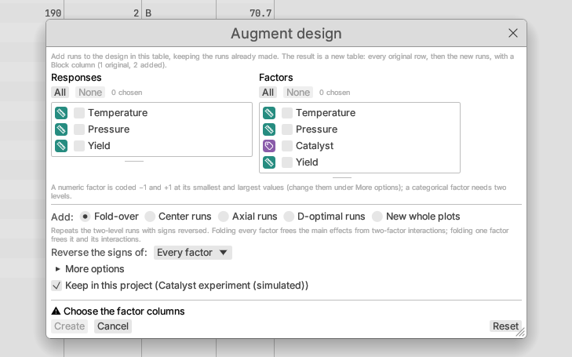

New whole plots are numbered after the existing ones in the whole-plot
column (5, 6, … after plots 1 to 4) and run in random order, the runs in
random order within each. The notes name the hard-to-change factors and
give the D-efficiency before and after and the whole-plot error degrees of
freedom. Script: `t.augment_whole_plots(#{ factors, whole_plot, model,
whole_plots, runs, ratio })`.

## Simulating responses

Design ▸ Simulate responses… (with a table open) makes up responses for
the design in the active table, to see before running the experiment
whether the planned analysis finds the effects that matter. Each simulated
response comes from its own random true coefficients for the model you
give:

- **Sparsity**: each main effect is active with the main-effect
  probability p (default 0.25).
- **Hierarchy and heredity** (Chipman, Hamada & Wu 1997): an interaction
  or square is active with probability p₁₁ when all its factors are active,
  p₀₁ when some are and p₀₀ when none is. **Strong** heredity sets
  (0.25, 0, 0), so an interaction can be active only with its parents;
  **Weak** (the default) is (0.25, 0.10, 0.01); **None** gives every term
  the main-effect probability.
- Active coefficients are drawn from N(0, τ²) in coded units (half the
  change from low to high setting; τ = 2 by default), inactive ones are zero
  (or drawn with a small SD, under More options), and normal noise with the
  noise SD is added.

Factor columns are coded −1 and +1 at their smallest and largest values; a
categorical factor needs two levels. **Add** puts the responses in the
table as new columns (Simulated Y 1, 2, …; one edit, so Undo removes them)
and adds a table of the true coefficients to the project, one row per
response with its active terms, to compare with what the analysis finds.
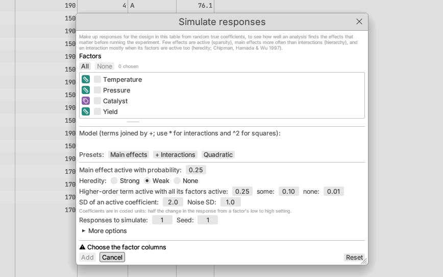

Script: `t.simulate_responses(#{ factors, model, count, seed, main,
all_parents, some_parents, no_parents, effect_sd, noise_sd })`.

## Evaluating a design before running it

Design ▸ Evaluate design… judges the runs in the open table for a model
before any responses are collected — a design made by the Design menu, one
built elsewhere, or several candidates to choose between. Choose the factor
columns (coded −1 to +1 as in *Declaring a table as a design*: from each
numeric column's smallest to largest value, or two-level categories in
sorted order) and the model: main effects, main effects with two-factor
interactions, the full quadratic, or a formula typed over the column names
(`Temperature + Time + Temperature*Time + Temperature^2`). Variances are in
units of the error variance σ², which is unknown until the experiment is
run, and the anticipated coefficient is in units of σ: a coefficient of 1
for a main effect means the mean response changes by one standard
deviation from the factor's midpoint to its high setting.

The report shows:

- **Design Summary:** runs, model terms, error degrees of freedom, and the
  D-, A- and G-efficiencies (100% for an orthogonal two-level design for its
  model) with the average and largest relative prediction variance;
- **Power by Effect:** for each term, its relative standard error
  √[(XᵀX)⁻¹]ⱼⱼ, variance inflation factor, and the power of the two-sided
  t test at level α for the anticipated coefficient. A design with as many
  runs as terms has no error degrees of freedom, so no power is shown;
- **Prediction Variance Profile:** the relative variance of the predicted
  mean along each factor, one pane per factor, with the other factors at
  their midpoints;
- **Fraction of Design Space:** the relative prediction variance at
  random points of the region, sorted, against the fraction of the region
  at or below each value (Zahran, Anderson-Cook & Myers 2003). A low, flat
  curve predicts well everywhere; a steep end shows corners predicted
  poorly. **Prediction Variance over the Region** lists its quantiles
  (**… over the Constrained Region** when constraints are given);
- **Alias Matrix:** how terms left out of the model would bias each
  estimate. By default these are the two-factor interactions not in the
  model (the three-factor ones when the model has every two-factor
  interaction); type others under *More options*. A 1 means complete
  aliasing; values such as ±1/3 mean partial aliasing;
- **Absolute Correlations of Terms:** a heat map of |r| among the model and
  alias columns, with each value printed in its cell;
- **About These Measures:** the model and how the measures are computed.

To compare two candidate designs, stack them in one table with a column
naming each run's design and choose it as *Compare designs by*. Both designs
are coded over the same region (all rows), each section shows both, the
plots draw each design in its own colour and marker shape with a key, and a
**Design Comparison** table gives the D, A, G and I criteria side by side
with the first design's relative efficiency to the second: above 1 favours
the first. The *per run* column divides out the numbers of runs.

The region is the cube of coded factor settings unless you type
**Region constraints** in the dialog, in the factors' actual units and the
same form as for optimal designs (`Temp + 4*Time <= 300`, `exclude Temp >
180 and Time > 25`, one per line). The largest and average prediction
variance (and so the G- and I-criteria) and the fraction-of-design-space
curve are then over the constrained region only, sampled at quasi-random
points inside it, and the note says so; the variance profiles still run
across the whole cube. A D- or I-optimal design created with constraints
opens with this report already set up for its constraints.

The model, alias terms, coefficient, α, constraints and each factor's coded
settings can be changed from the report's options menu; the report updates
at once.

*Try it:* Design comparison (planned): a 15-run Box–Behnken design and a
15-run I-optimal design for the quadratic model in three factors. The
I-optimal design, which uses the corners of the cube, has the smaller average
prediction variance and a flatter fraction-of-design-space curve; the
Box–Behnken design predicts poorly at the corners it never visits.

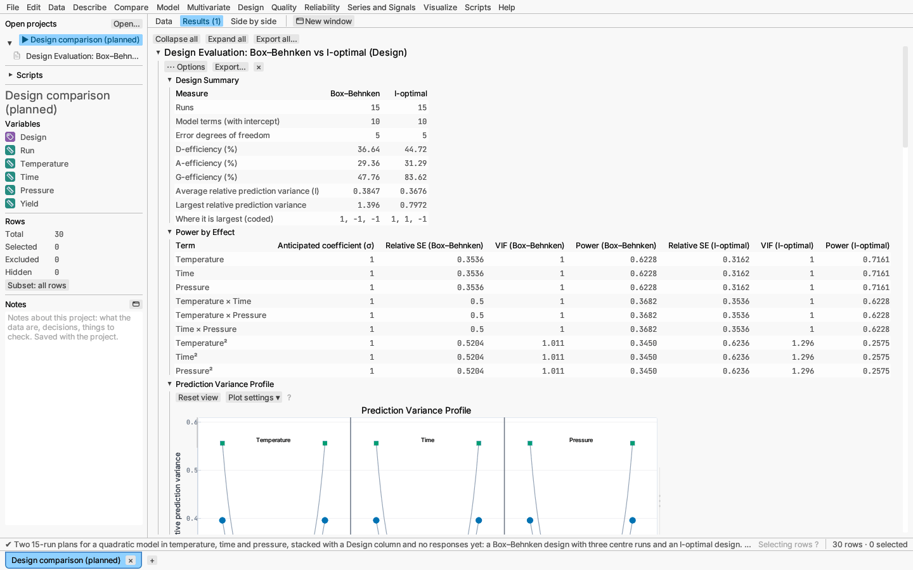

## Factorial analysis

Design ▸ Factorial analysis… analyses a two-level factorial or fractional
factorial experiment held in the open table, one row per run. Choose the
factor columns and the response:

- **Factors** are coded −1 (low) and +1 (high) as for a declared design: a
  numeric factor's smallest and largest values (or the settings given when
  the report was declared), a categorical factor's two levels in sorted
  order. Centre runs (coded 0) are used in the fit and left out of the
  plotted means.
- **Response type:** *Continuous* is fitted by least squares; *Binary* (0/1,
  or any column with two levels, modelling the probability of the second)
  by logistic regression; *Count* by Poisson regression. Binary and count
  effects are on the log-odds or log-mean scale, with Wald z tests and the
  odds or rate ratio from low to high.
- **Model terms:** every interaction the runs can estimate (the default; in
  a fraction, a term aliased with an earlier one is left out and listed in
  the summary), interactions of up to a number of factors, or a formula
  such as `A + B + C + A*B`.

**More options** set the significance level α, whether the plots show the
data means or the fitted model's predictions (factors not shown held at
their centre), and, with more than three factors, which three make the
cube.

The **effect** of a term is twice its coefficient in coded units: the change
in the mean response from the term's low to its high setting. The report
shows:

- **Factorial Summary:** model, runs, error degrees of freedom, root mean
  square error (or deviance), and Lenth's pseudo standard error (PSE),
  margin of error (ME) and simultaneous margin of error (SME) when they are
  used.
- **Effect Estimates:** each term's effect and coefficient. With error
  degrees of freedom (replicates, centre runs or terms left out) each effect
  has a standard error and t test. Without them (a saturated model) Lenth's
  method judges the effects: effects beyond ME are marked active, beyond
  SME active allowing for all the comparisons.
- **Effect Pareto** of −log₁₀ p.
- **Normal and half-normal plots of effects:** each effect labelled with its
  term, against normal (or half-normal) quantiles. Inert effects lie near
  the line through the origin whose slope is their standard error; active
  effects stand off it and are drawn with their own marker shape and
  colour. Vertical lines mark ME and SME.
- **Main Effects:** one pane per factor with each run's response and the
  line through the two level means.
- **Interaction** plots for each pair of factors (of the first five): the
  mean at each setting of the first factor, one line per setting of the
  second. Lines that are not parallel show an interaction.
- **Cube Plot** (or square for two factors): the mean (or prediction) at
  each corner of three factors.
- **Dispersion effects:** for a replicated design, the standard deviation
  at each setting and the effects of ln s (Box & Meyer), with a normal plot;
  for an unreplicated design, the Bergman–Hynén test for each factor (the
  location model of the active effects refitted within the runs at each
  setting, comparing the residual variances by an F ratio) and Box–Meyer's
  ln ratio of residual sums of squares.
- **Notes**, among them how many runs missed their target settings. The
  model is fitted at the settings actually run, so the effects stay
  unbiased.

Terms, response type, α and the means shown are changed in place from the
report's options menu.

*Try it:* Filtration rate (Montgomery's unreplicated 2⁴, with four effects
active beyond SME) and Coating thickness (a replicated 2³ whose oven
temperature changes the variability).

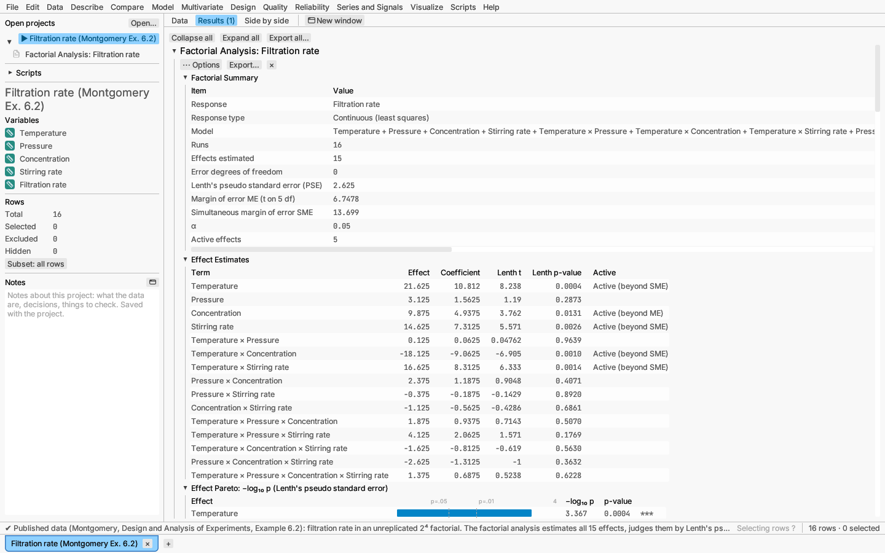

## Gauge study worksheet

Design ▸ Gauge study worksheet… (also under Quality) creates the run sheet
for a gauge study before any measurements are taken. Give the number of
parts, the operators' names, the number of replicates and the layout:

- **Crossed:** every operator measures every part.
- **Nested:** each operator measures their own parts (for destructive
  tests), so parts are labelled within operators.

The run order can be standard, fully random, or random within each
replicate (each operator–part combination once per round, in a new order
each round), with a seed. The sheet opens as a new table with Run,
Replicate, Operator and Part columns and an empty measurement column.
Analyse a crossed study with Quality ▸ Gauge R&R… or Intraclass
correlation….
