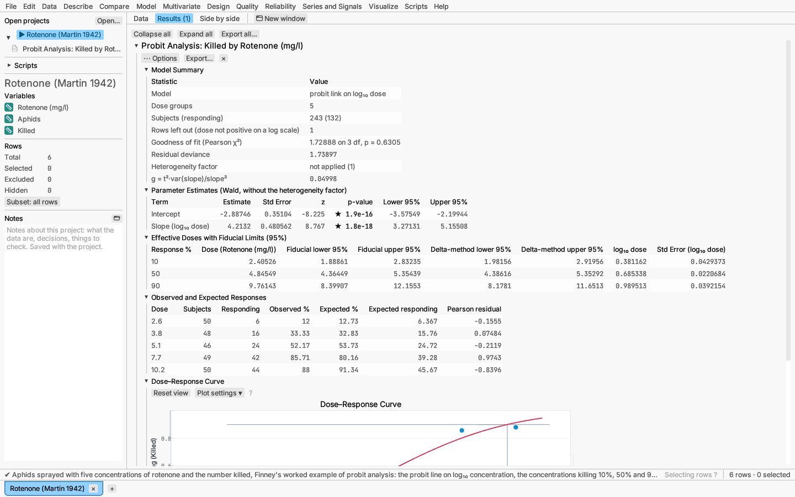
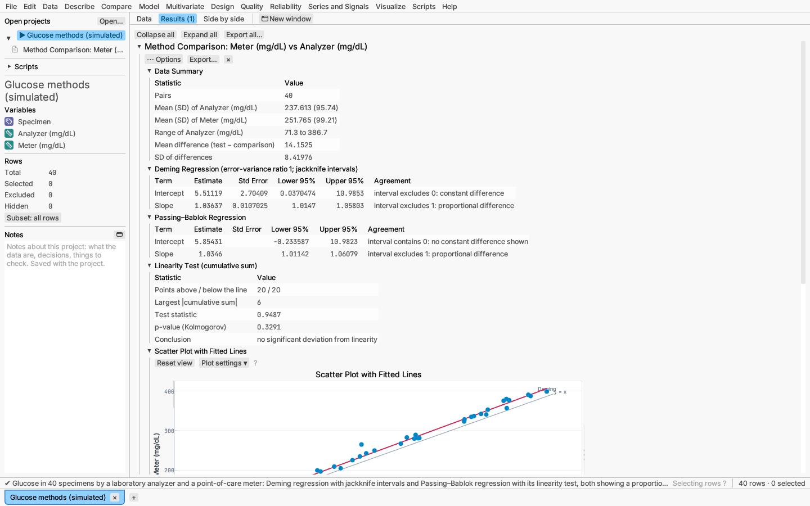
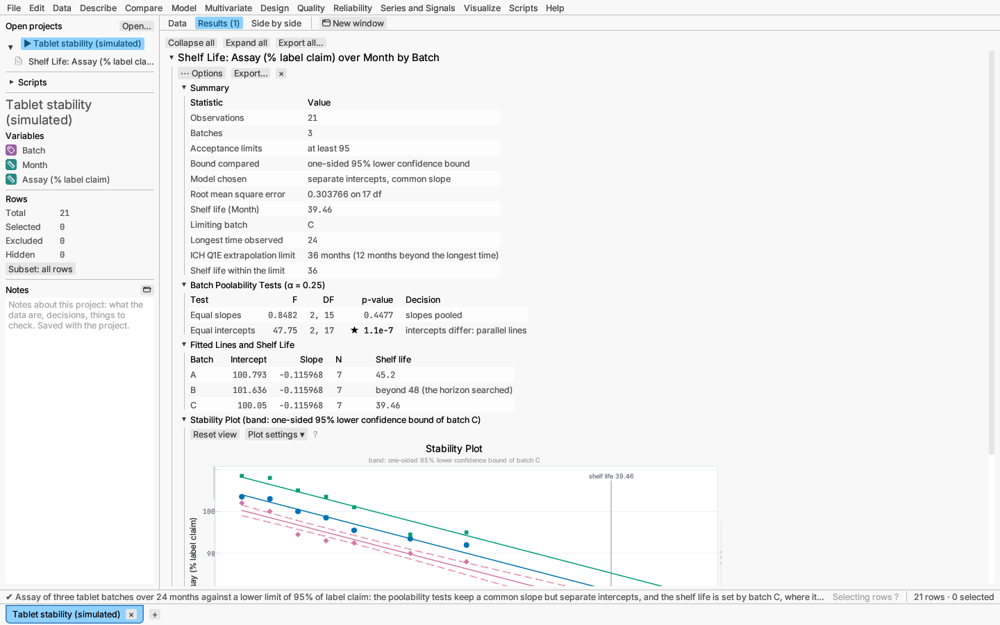

# Model: dose–response, method comparison and shelf life

Three specialised regressions on the Model menu: probit analysis of quantal
responses, regression for comparing two measurement methods, and shelf life
from stability studies.

## Dose–response (probit) analysis

Model ▸ Dose–response (probit)… fits the proportion of subjects responding
(killed, cured, failed) against a dose, and estimates the dose that gives a
chosen response — the median effective dose ED50, or ED10, ED90 and so on.

**Dialog:**

- **Dose**, **Number responding** and **Number of subjects** columns. Each
  row is a group of subjects given one dose; rows with the same dose are
  pooled. With *One subject per row* the response column must be 0 or 1.
- **Link:** probit (the normal curve, the classical choice), logit, or
  complementary log-log (an asymmetric curve, for one-hit models).
- **Dose scale:** log₁₀ dose (the default), ln dose or the dose itself.
  On a log scale, rows with a zero dose (untreated controls) are left out
  and counted in the summary.
- **Effective doses for (%):** the response percentages to report, such as
  `10, 50, 90`.
- **Fiducial level** (95%) and **Heterogeneity test level** (0.05).

**Report:**

- *Model Summary:* dose groups, subjects, Pearson's χ² test of fit on k − 2
  degrees of freedom, the residual deviance, and whether the heterogeneity
  factor was applied. When the χ² test is significant at the chosen level the
  groups vary more than binomial sampling allows; as Finney recommends, the
  variances are then multiplied by the heterogeneity factor χ²/(k − 2) and
  Student's t on k − 2 df replaces the normal deviate. *g* measures how well
  the slope is determined: when g ≥ 1 the fiducial limits are unbounded.
- *Parameter Estimates:* intercept and slope on the model scale.
- *Effective Doses with Fiducial Limits:* each requested percentage, its dose,
  the fiducial limits (Fieller's theorem, asymmetric about the dose) and the
  simpler delta-method limits for comparison.
- *Observed and Expected Responses:* per dose group, with Pearson residuals.
- *Dose–Response Curve:* observed proportions against the (log) dose with
  the fitted curve; each effective dose is marked with a drop line and its
  fiducial interval. Points are linked to their rows.

With only two doses the curve passes through both observed proportions
(there is nothing left to test its fit), so each dose needs some but not all
subjects responding: a dose at 0% or 100% gives an infinitely steep curve,
and the analysis says so. Add a dose between them.

The same links are available for any binomial model in Model ▸ Generalized
linear model….

*Try it:* Rotenone (Martin 1942), Finney's worked example.

## Method comparison

Model ▸ Method comparison… regresses a test method (Y) on a comparison
method (X) when both are measured with error, so ordinary least squares
would underestimate the slope.

**Dialog:** the two columns; **Deming**, **Passing–Bablok** or both; the
**error-variance ratio** Var(error of Y) / Var(error of X) for Deming
regression (1 gives orthogonal regression; use the ratio of the two methods'
squared repeatability standard deviations when known); the confidence level.

**Report:**

- *Data Summary:* pairs, means, the range of X, and the mean and standard
  deviation of the differences.
- *Deming Regression:* intercept and slope with jackknife standard errors and
  t intervals on n − 2 df (Linnet 1993). The *Agreement* column reads the
  intervals: an intercept interval excluding 0 shows a constant difference
  between the methods, a slope interval excluding 1 a proportional one.
- *Passing–Bablok Regression:* the median-based slope and intercept with
  their confidence limits, robust to outliers. The method assumes the two
  methods are positively related. When they are not (most pairwise slopes
  below −1, as when one method falls while the other rises) the upper slope
  limit is undefined: it shows as ∞ and a *Passing–Bablok Note* explains
  why, rather than a finite limit that would mean nothing.
- *Linearity Test:* Passing and Bablok's cumulative-sum test. A small p-value
  means the relation is not linear and Passing–Bablok regression does not
  apply. The largest cumulative sum is divided by √(l + L), the numbers of
  points above and below the line, which makes it the two-sample
  Kolmogorov–Smirnov statistic. Some texts print the divisor as √(L + 1);
  that form flags linear data as non-linear far more often than 5% of the
  time, so results from software that uses it can show smaller p-values.
- *Scatter Plot with Fitted Lines:* the data, the line of identity and each
  fitted line, labelled.
- *Difference Plot:* the difference Y − X against the mean of the two, with
  the mean difference and the limits of agreement mean ± 1.96 SD (Bland and
  Altman).

*Try it:* Glucose methods (simulated), where one specimen has a gross
error that pulls the Deming line but not Passing–Bablok's.

## Shelf life

Model ▸ Shelf life… estimates how long a product stays within its
acceptance limits from stability data of several batches, following ICH
Q1E.

**Dialog:** the **Time**, **Response** and **Batch** columns (no batch for a
single batch); whether the batches are **fixed** (the ICH Q1E pooling
analysis below) or **a random sample of batches** (see *Batches as a random
effect*); a **lower limit** (for an attribute that falls, like assay),
an **upper limit** (one that rises, like a degradation product) or both; the
**poolability test level** (0.25, as ICH Q1E sets), the confidence level
(95%) and the **time unit** of the time column (months, weeks, days or years;
months by default, or *Not stated*).

**How the model is chosen:** an analysis of covariance first tests whether
the batches share a slope. If they do not (p < 0.25), each batch keeps its
own line. If they do, a second test asks whether they share an intercept: if
not, the batches get parallel lines; if so, all data are pooled into one
line.

When every batch has only two measurement times, the separate-lines model
fits each batch exactly and leaves nothing to test the slopes against. The
slope test is then skipped, the slopes are assumed common (the notes say
so), and the intercept test alone chooses between parallel lines and one
line. Measure at three or more times to test the slopes. If every batch
lies exactly on its line, identical lines pool (F = 0, p = 1) and different
slopes count as differing with certainty (F = ∞, p = 0).

**Shelf life** is the earliest time at which the 95% confidence bound for the
mean response meets a limit: the one-sided lower bound against a lower limit,
the one-sided upper bound against an upper limit, or two-sided bounds when
both limits are set. With separate or parallel lines the shortest batch shelf
life applies. The search runs to twice the longest time observed.

**Extrapolation limit:** ICH Q1E allows a shelf life of at most twice the
period the long-term data cover, and no more than 12 months beyond it. With
data to 24 months that is 36 months; with data to 6 months, 12. The time unit
tells the analysis how long 12 months is, so with *Not stated* only the
twice-the-data limit is applied. The summary shows the limit and the **shelf
life within the limit**, the smaller of the estimate and the limit.

**Report:** a summary (model chosen, shelf life, limiting batch,
extrapolation limit, shelf life within the limit), the
poolability tests, each line with its own shelf life, a plot of the data by
batch with the fitted lines, the confidence bound of the limiting batch, the
limits and the shelf life marked, and notes. When the shelf life lies beyond
the data the notes recall the ICH Q1E rule: extrapolation up to twice the
period covered, and no more than 12 months beyond it.

### Batches as a random effect

When the batches tested are a sample of the batches that will be made, the
dialog's **Batches are: A random sample of batches** choice fits
y = (β₀ + b₀) + (β₁ + b₁)·time + ε, with each batch's intercept and slope
deviations (b₀, b₁) drawn from a normal distribution with an estimated
covariance G, by REML. It needs three or more batches. **Bound for** picks
the bound compared with the limits:

- **A future batch** (default): the prediction bound for the mean of a batch
  not yet made, whose variance adds the batch-to-batch variance xᵀGx to the
  variance of the population line; this is the shelf life a new batch can be
  expected to meet.
- **The mean of all batches:** the confidence bound for the population line
  alone, which is narrower.

Degrees of freedom come from Satterthwaite's approximation for the bound's
variance, using the covariance of the REML variance parameters (Chow &
Shao 1991 for random batches in stability studies). The report shows the
shelf life, the population line, the batch-to-batch variances and
correlation, each batch's predicted line (its conditional modes) with the
shelf life where it meets the limit, and the plot with the chosen bound.
The same extrapolation limit applies.

*Verified:* against bounds and degrees of freedom computed in R from lme4's
fit and lmerTest's covariance of the variance parameters.

*Try it:* sample *Capsule stability, six lots (simulated) — shelf life with
random lots*, which holds the random-lot report beside the fixed-lot one.

*Try it:* Tablet stability (simulated). Batch C's bound meets 95% at about
39.5 months, beyond the 36-month limit for 24 months of data, so the shelf
life within the limit is 36 months.
