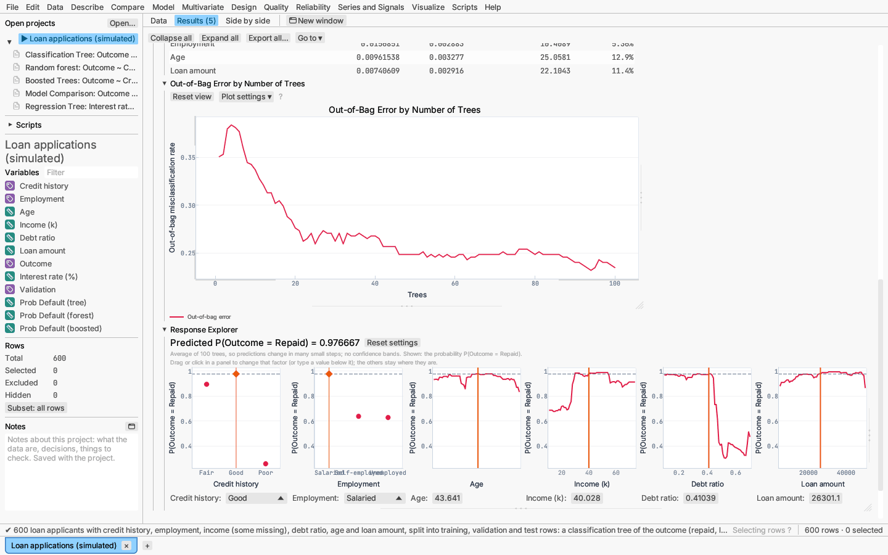

# Model: random forests and boosted trees

Both models combine many decision trees, and both use the validation roles
and fit measures described in
[Model: decision trees and validation](decision-trees.md#validation-and-fit-measures).
Rows missing the response, and excluded rows, are left out.

## Random forest

Model ▸ Random forest… grows many trees, each on a bootstrap sample of the
training rows. At every split a tree tries only a random subset of the
predictors. Predictions are averaged over the trees: class probabilities for
a categorical response, values for a continuous one (Breiman, 2001).

**Settings:** number of trees; predictors tried per split (by default √p for
classification and p/3 for regression); bootstrap sample size as a share of
the training rows; smallest node that may be split; smallest leaf; maximum
depth; impurity (Gini or entropy) for classification; seed.
Trees grow in parallel, and each tree's seed is derived from the seed you
set, so the same settings always give the same forest.

**Out-of-bag rows.** Each tree's bootstrap sample leaves out about a third of
the rows. Predicting each row only from the trees that never saw it gives a
held-out error without a separate validation set, so by default every row
trains.

**K-fold cross-validation** refits the forest without each fold in turn and
reports those held-out predictions instead of the out-of-bag ones. With
fewer training rows than folds, there is one fold per row (at least two).
A fold whose remaining rows cannot grow a forest (for example, they hold a
single class) leaves its rows without a held-out prediction rather than
stopping the report.

**Report:**

- summary and fit measures for each role (with an out-of-bag row);
- confusion matrix (classification);
- variable importance: permutation importance (how much the out-of-bag error
  rises when a predictor's values are shuffled) and impurity importance;
- out-of-bag error as trees are added, so you can see when more trees stop
  helping;
- the Response Explorer and 3-D profiler.

**Saving:** predicted values, or each class's probability and the most likely
class, and the validation roles.

*Try it:* Loan applications: a forest of the outcome on the same roles as the
tree. Credit history comes out as the most important predictor.

## Boosted trees

Model ▸ Boosted trees… adds small trees one at a time. Each tree is fitted to
what the model so far gets wrong (the gradient of the loss), then shrunk by
the learning rate before it is added (Friedman, 2001).

**Losses:** squared or absolute error for a continuous response (absolute
error is robust to outlying values); logistic for two classes; multinomial
(one tree per class per round) for more.

**Trees.** Split gains and leaf values use second-order (Newton) steps with
an L2 penalty on leaf values (Chen & Guestrin, 2016). Continuous predictors
are binned at training-row quantiles. A categorical predictor splits its
levels into two groups. Each split learns which way to send missing values.

**Settings:** greatest number of rounds, learning rate, tree depth, rows per
leaf, L2 penalty, share of training rows used each round, rounds without
improvement before stopping, and seed.

**Rounds kept:**

- with validation rows, boosting stops once their loss has not improved for
  the set number of rounds, and keeps the best round;
- with k-fold cross-validation, the number of rounds with the smallest
  cross-validated loss;
- without validation, every round.

**Report:** summary, fit measures by role, confusion matrix, variable
importance (each predictor's total gain, its share and its number of
splits), and the training and held-out loss by round with the kept round
marked. Also the Response Explorer and 3-D profiler.

**Saving:** as for random forests.

*Try it:* Loan applications: boosted trees of the outcome, stopped early on
the validation rows.
