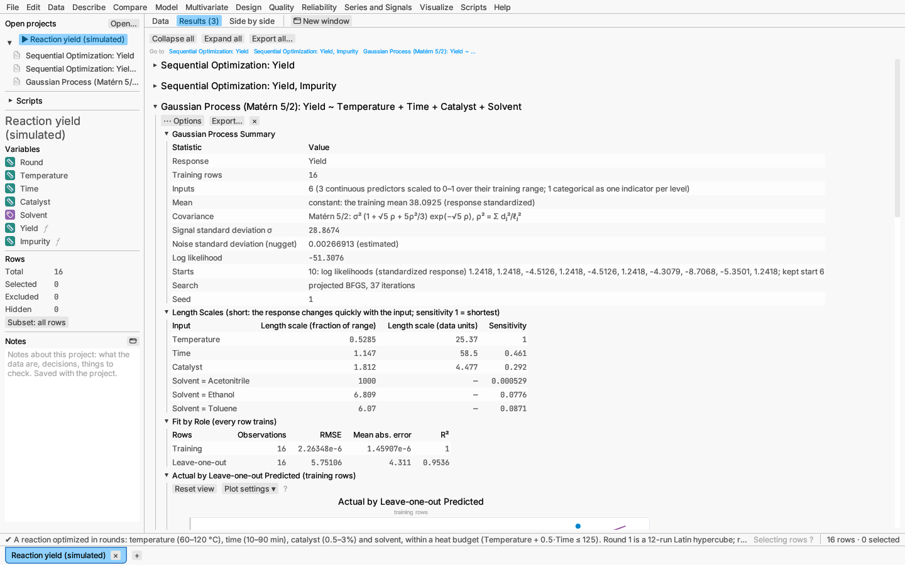
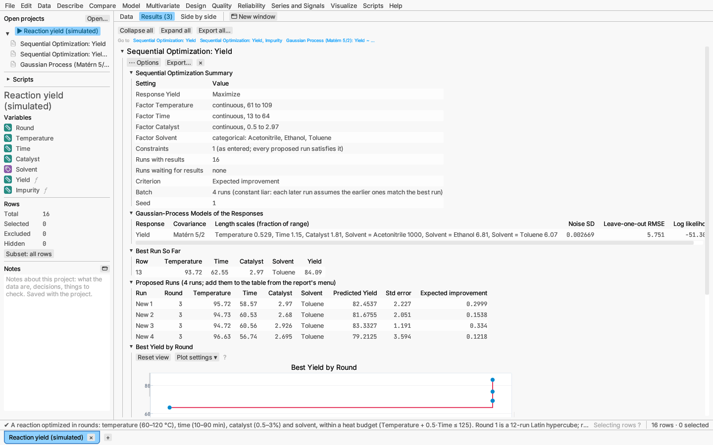

# Model: Gaussian processes and sequential optimization

A *Gaussian process* treats the unknown response surface as a random smooth
function: any set of its values is jointly normal, and two settings close
together have strongly correlated responses. Fitted to the runs, it gives a
prediction everywhere together with a standard error, which is small near the
runs and grows between and beyond them. That makes it the usual model for
computer experiments and small designed experiments, and the basis of
*sequential optimization*: choosing the next runs where the model expects the
largest gain.

Two menu items use it:

- **Model ▸ Gaussian process…** fits the model and reports it, with a
  Response Explorer and contour maps.
- **Design ▸ This table ▸ Propose next runs…** fits one model per response
  to the runs made so far and proposes the next batch, which you can add to
  the table as new rows.

## The model

The response is standardized (the training mean subtracted, divided by the
standard deviation) and modelled as

y(x) = f(x) + ε, with Cov(f(x), f(x′)) = σ²_f · r(x, x′) and ε ~ N(0, σ²_n),

where the correlation r depends on the scaled distance

d = √( Σⱼ ((xⱼ − x′ⱼ) / ℓⱼ)² ).

Inputs are rescaled to 0–1 over their observed range first; a categorical
predictor becomes one 0/1 indicator per level, each with its own length scale.

**Kernel.** Two correlation functions are offered:

- *Matérn 5/2* (the default): r = (1 + √5 d + 5d²/3) e^(−√5 d). Its surfaces
  are twice differentiable, which suits most physical responses and rarely
  overshoots between runs.
- *Squared exponential*: r = e^(−d²/2). Infinitely smooth surfaces, suited to
  simulators whose response changes gently.

**Length scales.** Each input has its own length scale ℓⱼ (*automatic
relevance determination*): a short length scale means the response changes
quickly with that input; a very long one (at the upper bound of 1000 times
the range) means the input has no detectable effect.

**Nugget.** The noise variance σ²_n, as a fraction of the response's
variance, is estimated by default. Under the dialog's options it can be fixed
instead; a tiny value such as 10⁻⁶ makes the surface pass through every run,
as suits a deterministic simulator.

**Fitting.** The signal variance, the length scales and the nugget maximize
the log marginal likelihood

log p(y | θ) = −½ yᵀK⁻¹y − ½ log |K| − (n/2) log 2π,

with K the covariance matrix of the runs. The search works on the logarithms
of the parameters, within σ²_f ∈ [10⁻³, 10³], ℓ ∈ [10⁻³, 10³] and
σ²_n ∈ [10⁻⁸, 10], by a quasi-Newton (BFGS) method with the exact gradient
½ tr((ααᵀ − K⁻¹) ∂K/∂θ), α = K⁻¹y. The likelihood often has several local
maxima, so the search starts from several points spread by a Latin hypercube
(10 by default, set under More options with the seed) and keeps the best;
every start's log likelihood is listed in the summary. Up to 2,000 rows can
be fitted.

**Predictions.** At a new setting x, with k the vector of covariances with
the runs, the predicted mean is kᵀK⁻¹y and the variance of the mean
σ²_f − kᵀK⁻¹k (both returned in the response's units). Intervals use ±1.96
standard errors.

**Validation.** By default each row's held-out prediction is its
*leave-one-out* prediction, computed exactly without refitting
(Rasmussen & Williams 2006, eq. 5.12). Validation roles from a column, random
holdout and k-fold cross-validation work as for
[decision trees](decision-trees.md#validation-and-fit-measures).

**Report:**

- summary: rows by role, the inputs, the kernel and its formula, the signal
  and noise standard deviations (the nugget, estimated or fixed), the log
  likelihood, and every start's log likelihood with the start kept;
- length scales: each input's as a fraction of its range and in data units,
  with a sensitivity (shortest length scale divided by this one, so 1 marks
  the input the response is most sensitive to);
- fit measures by role (RMSE, MAE, R²), with leave-one-out or
  cross-validated rows;
- actual by held-out predicted plot;
- contour maps of the predicted mean and of its standard error over the first
  two continuous predictors, the other predictors held at the Response
  Explorer's starting settings (named in the titles); the runs are marked,
  so the low-error valleys around them show where the model is sure;
- Response Explorer and 3-D surface profiler (from the options menu), with
  confidence bands from the standard error.

**Save** (options menu): the predicted values, their standard errors and the
validation roles.

*Try it:* Reaction yield (simulated): the Gaussian process of yield, with
its length scales showing how quickly yield changes with each factor.

## Proposing the next runs

Design ▸ This table ▸ Propose next runs… works on a table with one row per
run: the factor settings and the measured responses. Rows with every factor
set but a response still missing are *runs in progress*: they are not used
to fit the models, and the proposals keep away from them.

**Responses and goals.** Each response is maximized, minimized or matched
to a target. With one response the criterion works on it directly; with
several, they are combined into an overall desirability (the geometric mean
of each response's desirability, weighted by importance; Derringer & Suich
1980), each scaled between its smallest and largest observed values unless
limits are set under More options.

**Factors.** Continuous factors are searched between the table's smallest
and largest settings, or a range set under More options; categorical factors
take their levels. Linear constraints and disallowed combinations are typed
in the factors' units, one per line, as for
[optimal designs](design.md): for example `Temperature + 0.5*Time <= 125` or
`exclude Temperature > 110 and Catalyst > 2.5`.

**Round column.** An optional column numbering the batches of runs; the
progress chart then shows the best value after each round, and proposed runs
get the next round number.

**Criterion.** Each candidate setting is scored from the model's predicted
mean μ and standard error s, with f* the best run so far:

- *Expected improvement* (the default; Jones, Schonlau & Welch 1998):
  E[max(0, Y − f*)] = (μ − f*) Φ(z) + s φ(z), z = (μ − f*) / s, when
  maximizing (mirrored when minimizing). For a target T, the improvement is
  in the distance from it, E[max(0, b − |Y − T|)] with b the best run's
  distance, which also has a closed form. For several responses the
  improvement in overall desirability is averaged over 256 draws from the
  models, the same draws for every candidate.
- *Upper confidence bound* (Srinivas et al. 2010): μ + κs (μ − κs when
  minimizing), with κ standard errors (2 by default). A larger κ explores
  more.

**Batches.** A batch of runs (4 by default) is chosen one run at a time by
the *constant liar* heuristic (Ginsbourger, Le Riche & Carraro 2010): after
each proposal the models are updated as if that run had come out at the best
value so far, which lowers their uncertainty there and moves the next
proposal elsewhere. Runs in progress are treated the same way first.

**Search.** For each run, 2,000 random settings (a Latin hypercube over the
continuous factors, rejecting those outside the constraints, with random
levels) are scored; the best five are refined by a bounded Nelder–Mead search
and by trying every level of each categorical factor.

**Stop rule.** The report says *stop* when the best run reaches a value you
set (a response value, a distance from the target, or an overall
desirability), or when the largest expected improvement falls below a
fraction of the response's observed range (1% by default; of desirability 1
for several responses). Otherwise it says *continue*.

**Report:**

- summary: responses and goals, factors and their ranges, the number of
  constraints (their text stays in the dialog, opened with Edit), the
  runs with results and the runs in progress, criterion and batch;
- the model of each response: kernel, length scales, noise SD,
  leave-one-out RMSE, log likelihood;
- the best run so far;
- the proposed runs with their round, predicted responses, standard errors
  and criterion values;
- progress: each run's value by round (or by run) with the best so far as a
  step line;
- the stop rule's verdict.

**Settings and adding the runs** (options menu): the batch size, criterion
and stop rule are edited in place, and the report updates as you change
them. *Add proposed runs to the table* appends the proposed runs as new rows
with their factor settings and the next round number, the responses left
empty; Undo removes them. Measure the responses, type them in, and the
report proposes the next batch.

*Try it:* Reaction yield (simulated): round 1 is a 12-run Latin hypercube,
round 2 the four runs the yield report proposed. Its yield is a formula
column standing in for the experiment, so the added runs are measured at
once: add runs a few times and watch the best yield approach the optimum
under the heat budget. A second report trades yield against impurity by
desirability.

**References.** Rasmussen, C. E. & Williams, C. K. I. (2006) *Gaussian
Processes for Machine Learning*, MIT Press. Santner, T. J., Williams, B. J.
& Notz, W. I. (2018) *The Design and Analysis of Computer Experiments*, 2nd
ed., Springer. Jones, D. R., Schonlau, M. & Welch, W. J. (1998) Efficient
global optimization of expensive black-box functions, *Journal of Global
Optimization* 13, 455–492. Srinivas, N., Krause, A., Kakade, S. & Seeger, M.
(2010) Gaussian process optimization in the bandit setting, *ICML*.
Ginsbourger, D., Le Riche, R. & Carraro, L. (2010) Kriging is well-suited to
parallelize optimization, in *Computational Intelligence in Expensive
Optimization Problems*, Springer. Henkenjohann, N. & Kunert, J. (2007) An
efficient sequential optimization approach based on the multivariate expected
improvement criterion, *Quality Engineering* 19, 267–280.
