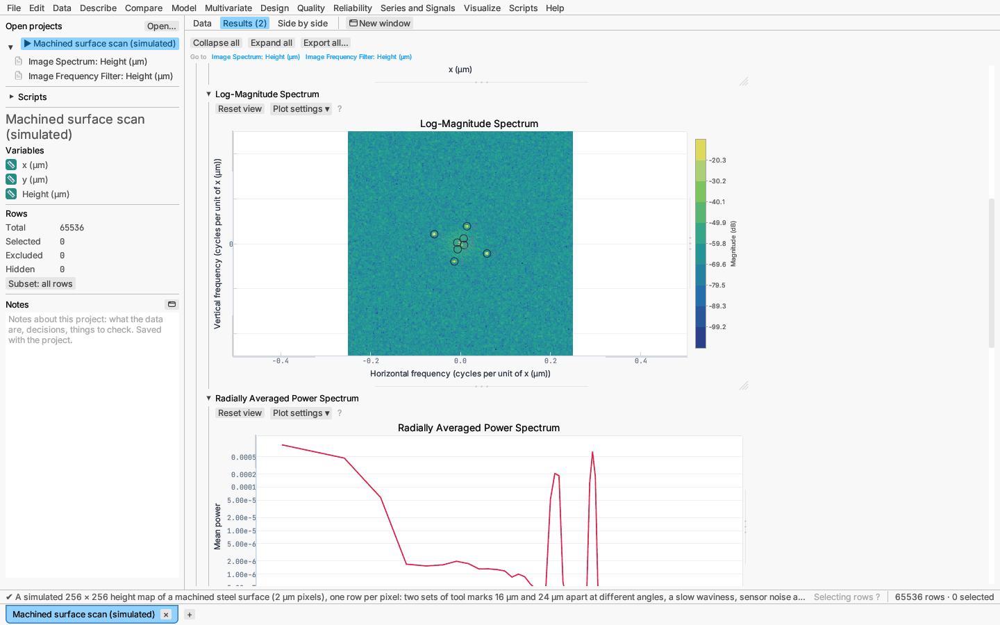
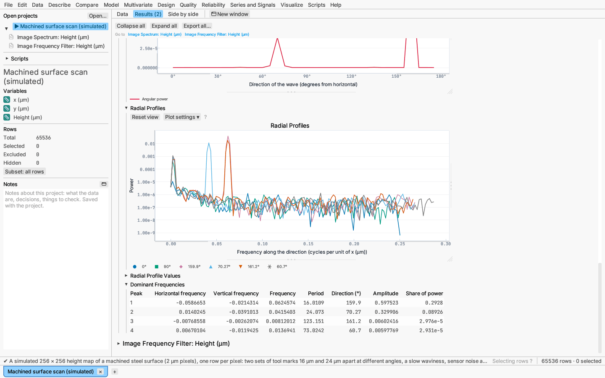
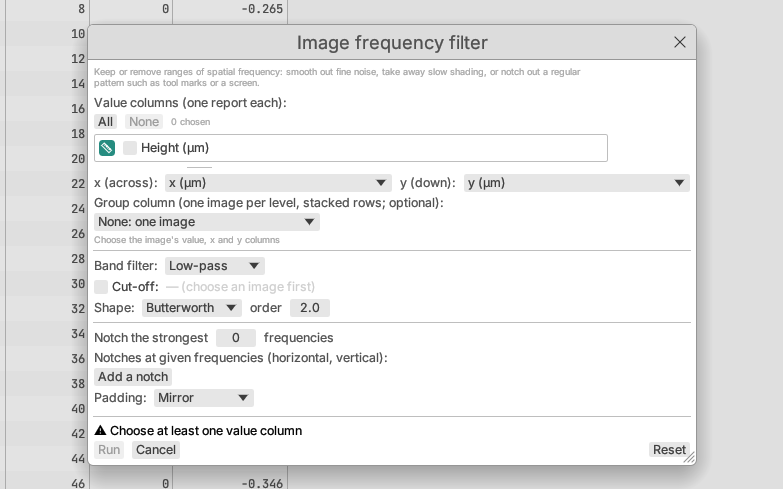
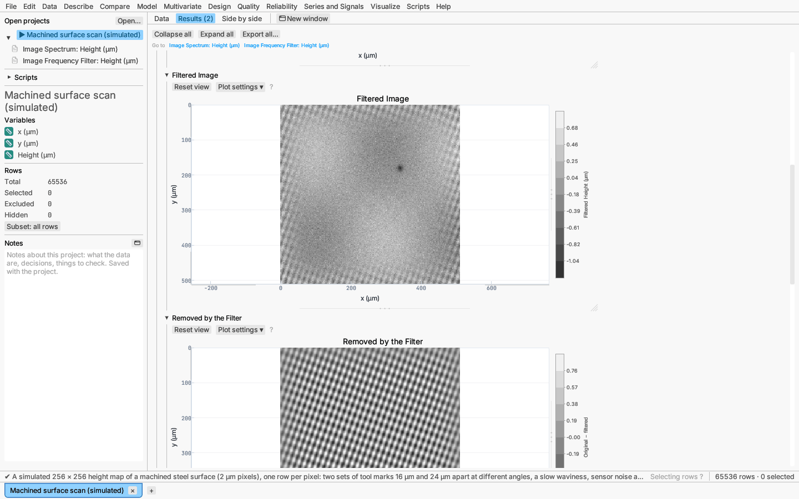
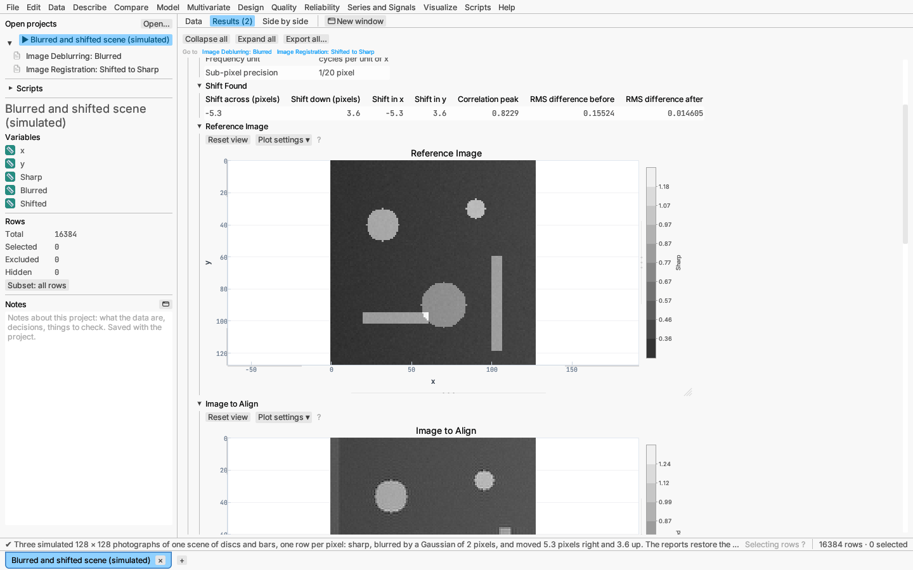

# Series and Signals: image processing

The three items under **Images** at the bottom of the **Series and Signals**
menu analyse pictures in the frequency domain, by the two-dimensional fast
Fourier transform: where a signal report asks which frequencies a trace is
made of, these ask which *spatial* frequencies (repeating patterns across
the picture) an image is made of, and keep or remove them.

| Item | What it does |
|---|---|
| [Image spectrum…](#image-spectrum) | Log-magnitude and phase spectra, the radially averaged power spectrum with a power-law fit, radial profiles along chosen directions, power by direction, the strongest spatial frequencies |
| [Image frequency filter…](#image-frequency-filter) | Low-, high-, band-pass and band-reject filters and notch filters, applied by inverse FFT; filtered image and removed part saved as columns |
| [Image registration and deblurring…](#image-registration-and-deblurring) | Wiener, constrained least-squares and Richardson–Lucy deblurring of a Gaussian blur; the shift between two images by phase correlation; the 2-D autocorrelation |

## The image

An image is an ordinary table with **one row per pixel**: an **x** column
(across, increasing to the right), a **y** column (down, increasing
downwards, as image rows are counted) and one or more **value** columns.
Opening a PNG, JPEG, TIFF or BMP file with File ▸ Open (see
[Images as tables](../data/images.md)) gives exactly this table (columns
`x`, `y` and `intensity`, or `red`, `green`, `blue` and `luminance`), but
any table of that shape works, such as a height map exported by a
profilometer. The dialogs pick the columns named x and y, and an
`intensity` or `luminance` column, when the table has them.

- **Value columns** — numeric, one report each.
- **x** and **y** — the pixel positions. The distinct x values must be
  evenly spaced, and so must the distinct y values; those spacings are the
  pixel sizes, and spatial frequencies are reported in *cycles per unit of
  x*. Rows may be in any order.
- **Group column** (optional) — several images stacked in one table: each
  level is its own image. The first four are drawn; tables list them all.

The dialog shows the image size and the **Nyquist frequency**, half a cycle
per pixel: the finest pattern the pixels can show.

A pixel whose row is excluded, or whose value is missing, leaves a hole,
filled with the image's mean (the summary counts them), so the image keeps
its shape. Two rows for one pixel are an error naming the rows. Images up
to 4096 × 4096 pixels are accepted.

Every image section is drawn as a picture with a colour bar, and hovering a
cell reports its position and value, so colour is never the only way to
read it. Dragging a box on an image (or clicking a pixel) selects those pixels'
rows in the data grid and in every other plot; rows selected elsewhere are
shaded in the selection colour on the image. Each picture can be exported from its right-click menu as PNG, SVG,
PDF or EPS (the vector formats embed the picture as a bitmap).

## Image spectrum

Series and Signals ▸ Images ▸ Image spectrum… computes the 2-D discrete Fourier
transform of the image (after optionally removing its mean and applying a
window) and draws it **centred**, with zero frequency in the middle:

```text
F(u, v) = Σ_r Σ_c w(r, c) · (f(r, c) − f̄) · e^{−2πi (u c/C + v r/R)}
```

for an image of `R` rows and `C` columns, with frequencies
`f_x = u / (C Δx)` and `f_y = v / (R Δy)` (Gonzalez & Woods 2018,
*Digital Image Processing*, 4th ed., ch. 4; Bracewell 2000, *The Fourier
Transform and Its Applications*, 3rd ed.). A pattern that repeats every
`p` units in direction θ shows as a pair of bright spots at distance `1/p`
from the centre, on the line at angle θ, mirrored through the centre.

Options:

- **Window** — none, Hann across and down (the outer product of two
  periodic Hann windows; the default), or radial Hann (one Hann window
  swept around the centre, which favours no direction). Without a window
  the jump between opposite edges of the image shows as a bright cross
  through the centre of the spectrum.
- **Padding** — none (the image is treated as repeating), zeros to the next
  size with small prime factors, or mirroring (doubles each side; no edge
  jumps).
- **Remove the mean first** (on by default), so the zero-frequency spike
  does not swamp the scale.
- **Phase spectrum**, **Radial spectrum and power law**, **Angular
  spectrum** (with the number of direction sectors over 0–180°), the number
  of **dominant frequencies** listed, and the **lowest frequency**
  considered for the peaks, fit and angles, as a percentage of the Nyquist
  frequency (default 2 %, which skips slow shading).
- **Radial profiles at directions (°)** (on by default, at 0 and 90): the
  directions to cut the spectrum along, typed as degrees separated by
  commas. **Average a wedge of ±** a number of degrees around each
  direction instead of a straight cut (default 0), and **Also along each
  dominant frequency's direction** adds a profile through every peak listed.

Report sections:

- **Summary** — values column, size, pixel spacing, Nyquist frequency,
  unit, holes filled, window and padding.
- **Image** — the picture analysed.
- **Log-Magnitude Spectrum** — `10 log₁₀ |F|²` (decibels), with the
  dominant frequencies ringed and numbered. Its axes are the horizontal and
  vertical frequency; the vertical axis increases downwards, as y does, so a
  spot at `(f_x, f_y)` is the wave vector in the image's own coordinates.
- **Phase Spectrum** (optional) — `arg F`, in radians.
- **Radially Averaged Power Spectrum** — the mean power over rings of equal
  radial frequency `ρ = √(f_x² + f_y²)`, on log–log axes (van der Schaaf &
  van Hateren 1996, *Vision Research* 36). Natural textures and rough
  surfaces fall off as a power law `P ∝ ρ^−β`.
- **Power-Law Fit of the Radial Spectrum** — least-squares slope of
  `log₁₀ P` on `log₁₀ ρ` between the lowest frequency and the Nyquist
  frequency, its standard error, `β = −slope`, R² and the number of rings.
  β near 2 is typical of photographs of natural scenes; a flat spectrum
  (β ≈ 0) is white noise.
- **Radial Profiles** — the power spectrum along each chosen direction,
  from zero frequency outwards, one line per direction, with frequency on a
  linear axis and power on a log axis. Where the radially averaged spectrum
  averages every direction together, a profile keeps them apart, so it shows
  directional structure (anisotropy): a lay of tool marks gives sharp peaks
  in the profile across the marks and none along them, and grid artefacts
  show as peaks along the axes. A straight cut steps one column or one row
  at a time, whichever the direction crosses faster
  (`Δ = 1 / max(|cos θ| / s_x, sin θ / s_y)` with `s_x`, `s_y` the frequency
  steps), reading the power by bilinear interpolation between cells, so a
  cut at 0° or 90° reads the centre row or column exactly. A real image's
  spectrum is symmetric through the centre, so each point is read on
  whichever side lies inside the spectrum, and the cut runs out to its edge:
  the Nyquist frequency along the axes, further along a diagonal. A wedge of
  ±w° instead averages the cells within w° of the direction whose radial
  frequency rounds to each step; ±90° averages every direction and gives the
  radially averaged spectrum.
- **Radial Profile Values** — the profiles as numbers: direction, frequency,
  period (`1/f`), power, and the cells averaged for a wedge. It starts
  collapsed; make it a data table from its menu to plot or model the
  profiles further.
- **Angular Spectrum** — mean power in each direction sector (0° is a wave
  running horizontally, 90° vertically, counter-clockwise on screen), for
  frequencies above the lowest one. A peak shows the dominant orientation
  of the texture (machining lay, fibre direction, grain).
- **Dominant Frequencies** — the strongest local maxima of the power
  spectrum: horizontal and vertical frequency (refined between cells), the
  radial frequency, the **period** (pattern spacing, `1/ρ`), the
  **direction**, the amplitude (twice the cell's magnitude: a cosine's
  amplitude when it falls on a frequency of the grid) and the share of the
  total power (both spots of the pair). Copy it or make it a data table from
  its menu.

The report's options menu turns the phase, radial, radial profile and
angular sections on and off and changes the window in place.





## Image frequency filter

Series and Signals ▸ Images ▸ Image frequency filter… multiplies the image's
transform by a **mask** `H(u, v)` and transforms back. The masks are real
and symmetric through the origin, so the result is real and nothing is
shifted. With `D` the radial frequency of a cell, a cut-off `D₀`, and for
a band `[f₁, f₂]` its centre `C₀ = (f₁ + f₂)/2` and width `W = f₂ − f₁`
(Gonzalez & Woods 2018, §4.8–4.10):

| Shape | Low-pass `H_LP(D)` | Band-reject `H_BR(D)` |
|---|---|---|
| Ideal | 1 if `D ≤ D₀`, else 0 | 0 inside the band, else 1 |
| Butterworth, order `n` | `1 / (1 + (D/D₀)^{2n})` | `1 / (1 + (DW / (D² − C₀²))^{2n})` |
| Gaussian | `exp(−D² / (2D₀²))` | `1 − exp(−((D² − C₀²) / (DW))²)` |

High-pass is `1 − H_LP` and band-pass `1 − H_BR`. An ideal mask cuts
sharply and rings around edges in the image; Gaussian masks never ring;
Butterworth lies between, sharper as the order rises. A Gaussian low-pass
with `D₀ = 1/(2πσ)` is a Gaussian blur of standard deviation σ.

**Notches** remove a regular pattern, which shows in the spectrum as a
pair of spikes at `(u, v)` and `(−u, −v)`. The notch-reject mask is the
product over notches of high-pass masks centred on both spikes of each
pair, with the notch radius as cut-off; **Keep only the notched
frequencies** uses `1 −` that product instead, which isolates the pattern
itself. Notches can be typed as (horizontal, vertical) frequencies, read
from an Image spectrum report's dominant-frequency table, and the
**Notch the strongest … frequencies** option finds them itself (the
strongest local maxima of a Hann-windowed spectrum above 2 % of the Nyquist
frequency). The default radius is two frequency steps of the image (the
coarser of across and down), with a Gaussian shape.

Options: the band (none, low-pass, high-pass, band-pass, band-reject), its
cut-off or edges (default a quarter of the Nyquist frequency; bands a
quarter to a half), the shape and Butterworth order (default 2), the
notches, their radius and shape, and **padding** — mirroring by default,
which stops the filter wrapping one edge of the image into the opposite
one.

Report sections: **Summary**, **Original Image**, **Filtered Image**,
**Removed by the Filter** (original minus filtered), **Spectrum with
Notches** (the power spectrum in decibels with each notch marked by a
numbered cross), **Filter Mask** (the gain, 0 to 1, centred like the
spectrum) and **Notches** (each notch's frequencies, period and whether it
was given or found). The options menu saves **Filtered** and **Removed**
columns (one value per pixel row; NaN on rows the image does not use) and
switches notch-pass and padding in place.





## Image registration and deblurring

Series and Signals ▸ Images ▸ Image registration and deblurring… offers three
operations.

**Deblur** undoes a Gaussian blur whose standard deviations across and down
(in pixels) you give; the point-spread function is truncated at four
standard deviations and sums to 1.

- **Wiener filter** — `F̂ = H̄ G / (|H|² + λ)`, with `G` the blurred image's
  transform and `H` the blur's (Gonzalez & Woods 2018, §5.8). λ = 0 divides
  by the blur outright, which amplifies noise wherever the blur leaves
  little signal; larger λ gives a smoother, less sharp result.
- **Constrained least squares** — `F̂ = H̄ G / (|H|² + λ|L|²)` with `L` the
  transform of the discrete Laplacian (§5.9): the roughness of the result is
  penalised, which suppresses speckle.
- **Richardson–Lucy** — the multiplicative iteration
  `f_{k+1} = f_k · (h̃ ⋆ (g / (h ⋆ f_k)))`, with `h̃` the flipped PSF
  (Richardson 1972, *JOSA* 62; Lucy 1974, *AJ* 79). It keeps values
  non-negative (so the image must be), and more iterations sharpen more and
  amplify noise. A 1024 × 1024 image takes about a fifth of a second per
  iteration.

The restoration treats the image as repeating, so a few pixels along the
border can ring. Sections: **Summary**, **Blurred Image**, **Restored
Image**; the options menu saves a **Restored** column.

**Align a second image** finds the shift between this image (the
reference) and another value column on the same pixels by phase
correlation: the inverse transform of `F₁ F̄₂ / |F₁ F̄₂|` peaks at the shift
(Kuglin & Hines 1975), refined to a fraction of a pixel by evaluating the
transform on an upsampled grid around the peak (Guizar-Sicairos, Thurman &
Fienup 2008, *Optics Letters* 33(2)). The **precision** sets the fraction
(default 1/20 pixel). The shift reported is the one that moves the second
image onto the reference (the convention of scikit-image), applied as a
Fourier shift. Sections: **Summary**, **Shift Found** (across and down in
pixels and in x and y units, the height of the correlation peak, 1 for an
exact circular shift, and the RMS difference before and after aligning),
**Reference Image**, **Image to Align**, **Aligned Image**, and the
**Difference Before Aligning** and **After**. The options menu saves an
**Aligned** column.



**2-D autocorrelation** correlates the image with itself at every shift
(mean removed first by default), normalised to 1 at zero shift. A texture
that repeats every `p` units shows as a lattice of peaks `p` apart;
elongated central peaks show the direction of the grain.

## Samples

- **Machined surface scan (simulated)** — a 256 × 256 height map of a
  machined steel surface (2 µm pixels) with two sets of tool marks 16 µm
  and 24 µm apart, a slow waviness, noise and a pit as deep as the marks are
  high. It opens with an Image spectrum report, whose dominant-frequency
  table finds both sets of marks with their spacing and direction, and an
  Image frequency filter report that notches out the two strongest
  frequencies, leaving the pit plainly visible in the filtered image.
- **Blurred and shifted scene (simulated)** — three 128 × 128 pictures of
  one scene: sharp, blurred by a Gaussian of 2 pixels, and moved 5.3
  pixels right and 3.6 up. It opens with a Wiener deblurring of the blurred
  picture and the registration of the moved picture, which recovers the
  shift to within a tenth of a pixel.

## Scripting

The reports are available to scripts by their analysis names
`image-spectrum`, `image-filter` and `image-restoration` (see the
scripting reference), with the columns `column`, `x`, `y` and optionally
`group`, and the settings as in a saved project.
