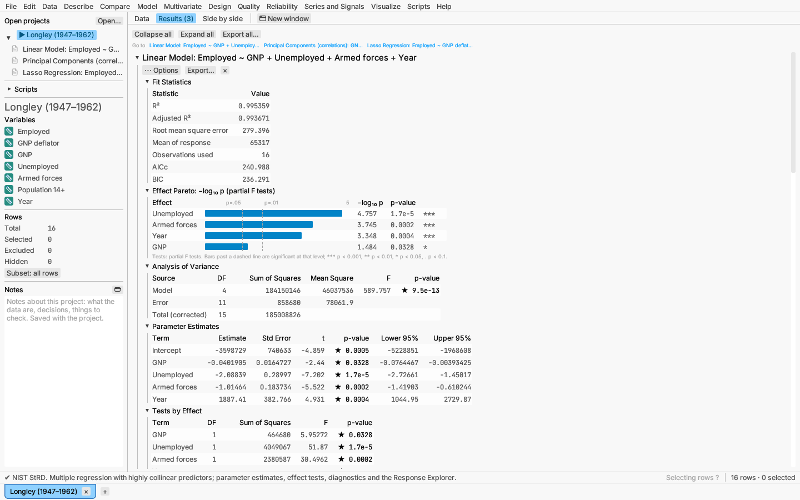
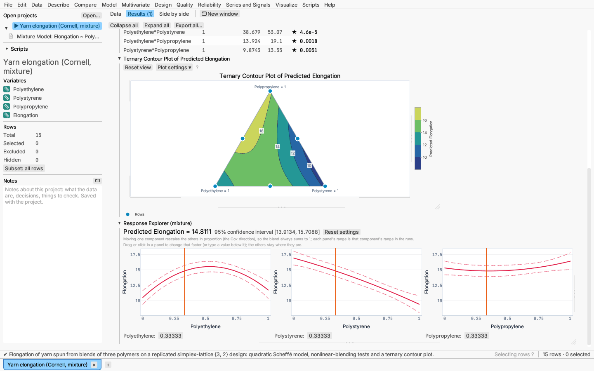
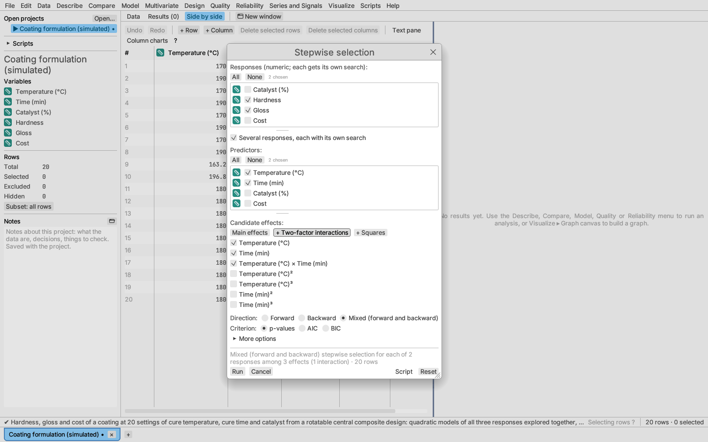
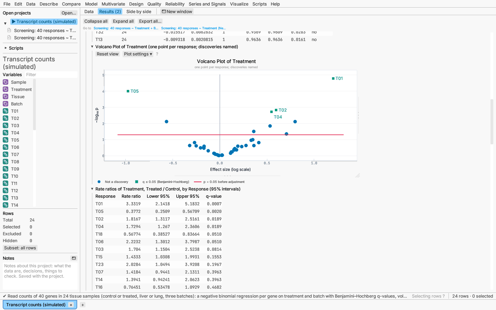
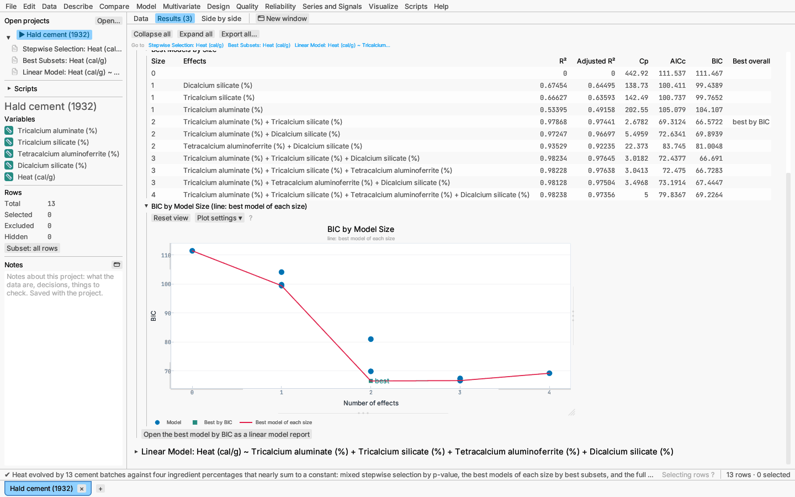

# Model: linear and response-surface models

## Linear model

Model ▸ Linear model… fits ordinary least squares with continuous and
categorical predictors, interactions and powers.

**Building the model.** Choose a numeric response and tick the predictors;
each enters as a main effect, which you can untick in the effect list (a
predictor left with no effect is not in the model). The **Main effects**, **+ Two-factor
interactions** and **+ Squares** buttons build common models quickly. The
dialog keeps models hierarchical: an interaction or power brings in its
lower-order effects, and unticking an effect also removes the interactions
and powers built on it (turn this off under **More options**, which also notes
how predictors are centered and coded). Click **Run**.

**Report:**

- Fit statistics: R², adjusted R², RMSE, AICc and BIC.
- Effect Pareto (−log₁₀ p per effect).
- Parameter estimates with standard errors, t tests and p-values.
- Effect tests.
- A fitted line plot (one predictor) or observed-versus-predicted plot.

**Options:** ANOVA table, effect sizes, confidence limits for the estimates, confidence
band, residual plot, influence diagnostics (leverage, Cook's distance and a
residual quantile plot), the [Response Explorer and 3-D surface
profiler](../reports/response-explorer.md).

**Saving:** predicted values as a new column (for every row with its
predictors present, excluded rows and rows without a response included, so new
rows are scored), residuals (for every row with complete data), or the
**prediction formula** as a formula column, so predictions update with the data
and are computed for new rows.

**One-way models.** When the only predictor is one categorical factor, the
report adds tests of equal variances (Levene, Brown–Forsythe, Bartlett) and a
**Pairwise comparisons** choice: Tukey–Kramer (the default), Games–Howell, Holm-adjusted t, Bonferroni,
Šidák, Holm–Šidák, Fisher's LSD (unadjusted; only after a significant
overall test), Newman–Keuls (stepwise studentized range; p-values only, no
intervals), and for unequal variances Tamhane's T2 (Welch t per pair with
Šidák's adjustment) and Dunnett's T3 (Welch t against the studentized
maximum modulus), or none. **Linear trend across ordered levels** (three or more
levels) tests a straight-line trend in the means across the levels in their
order, with an F test of departure from linearity. **Comparisons with a control (Dunnett)** compares
every other level with the level you pick, with simultaneous 95% intervals
from the model's error mean square and an interval plot of the differences.
**Comparisons with the best (Hsu)** compares every level with the best of the
others, larger or smaller being better, and says which levels may be the best
(see [Compare](compare.md#two-or-more-groups)).

**Effect sizes** (options menu) adds a table with, for each effect, η²
(the effect's share of the total sum of squares), partial η², ω² and
Cohen's f, with confidence intervals for partial η² and f found by
inverting the noncentral F distribution of the effect's F statistic
(Steiger 2004). The intervals use the report's confidence level.

**Spline terms.** Under **More options** each continuous predictor that is
not in an interaction or power can enter as a curve instead of a straight
line: a **natural cubic spline** (cubic between the knots, straight beyond
the outer ones, so it does not swing at the ends), or a **linear**,
**quadratic** or **cubic B-spline** (a linear B-spline is a broken line).
**Knots** sets the number of interior knots, placed at equally spaced
quantiles of the predictor (3 by default, up to 20), or choose **at** and
type the knot positions, separated by commas. The boundary knots are the
smallest and largest values. The spline's columns appear as one effect:
the effect test is the joint F test of all its coefficients, and the
estimates table lists one coefficient per basis column (`x: spline 1`,
`x: spline 2`, …). The fit plot and Response Explorer show the curve with its
band, and the saved prediction formula writes the basis with
`natural_spline(…)` or `bspline(…)` (see [formula columns](../reference/formulas.md)).
The bases follow de Boor (1978) and Harrell (2015, §2.4); with the same
knots they give the same fits as R's `splines::ns` and `splines::bs`.

**Comparisons within slices.** For each interaction of two categorical
factors A × B, **Comparisons within slices** (in **More options** or the
report's ⋯ Options) tests A at each level of B and B at each level of A
(*simple effects*), each with an F test from the model's error mean square,
and lists the least-squares means of every A × B cell (other factors
averaged over their levels, covariates at their means). Choosing Tukey,
Holm or Bonferroni adds the pairwise differences of the means within each
slice with adjusted p-values and intervals; **Tests only** leaves them out.
The least-squares means are the estimable functions of Searle, Speed &
Milliken (1980), the same as R's `emmeans`.

**Slopes by group.** For an effect of a categorical factor with a
continuous predictor (separate slopes, as in an analysis of covariance
with unequal slopes), **Slopes by group** gives each group's slope with its
interval, the F test that all slopes are equal, and, with an adjustment
chosen, every pairwise difference of slopes (Milliken & Johnson 2002).

*Verified:* the NIST StRD linear regression and ANOVA suites; effect-size
intervals against R; spline fits against `lm` with `splines::ns`/`bs`;
slices against `emmeans` (`joint_tests`, `pairs(by =)`) and slopes against
`emmeans::emtrends`.

*Try it:* Norris calibration; Longley economy (multiple regression); Plant
growth (ANCOVA); Silicon resistivity (one-way).

## Response surface

Model ▸ Response surface (second-order model)… fits the full second-order
model (linear, two-factor interaction and squared terms) on coded factors,
and adds:

- the **stationary point** and **canonical analysis** (eigenvalues tell you
  whether it is a maximum, a minimum or a saddle);
- **ridge paths** of maximum and minimum response;
- **contour plots** over any two factors (choose the horizontal and vertical
  factors; editing the analysis down to fewer factors goes back to the first
  two), filled with colour and a colour bar; the colours, lines and levels
  are set in the plot's Plot settings (see
  [Contour maps](../reports/plots.md#contour-maps));
- the Response Explorer and 3-D profiler.

The method follows Box & Draper, *Response Surfaces, Mixtures, and Ridge
Analyses*.

*Try it:* Reaction yield.

## Mixture model

Model ▸ Mixture model… fits Scheffé linear, quadratic and special-cubic models
for components that sum to a constant. The mixture Response Explorer rescales
the other components when you move one, and ternary plots show the response
over three components as a filled contour map (see
[Contour maps](../reports/plots.md#contour-maps)).

*Try it:* Yarn elongation.

## Stepwise selection

Model ▸ Stepwise selection… chooses model effects from a set of candidates:

- direction: forward, backward or mixed;
- criterion: p-values, AIC or BIC;
- under **More options**: the **Enter if p <** and **Remove if p >**
  thresholds and the heredity rule, so the selected model stays hierarchical.

Click **Run**.

To search several responses at once, tick **Several responses, each with
its own search** and choose the responses: each gets its own search among
the same candidates, and the selected models open together in a
[several-responses report](several-responses.md#terms-every-term-or-stepwise-for-each-response),
with desirability goals and a search for the best settings.

The report shows the step history. For the selected model you can show the
Response Explorer and 3-D profiler, or **Open as linear model report** for
full estimates and diagnostics.

*Try it:* Hald cement.

## Best subsets

Model ▸ Best subsets… searches every subset of the candidate effects and
reports the best models of each size. The dialog is the stepwise dialog's,
with:

- candidate effects built the same way (interactions and powers allowed);
- **Best overall by:** R², adjusted R², Mallows' Cp, AICc or BIC (the
  default);
- under **More options**: a heredity rule (strong, weak or none),
  **Effects in every model** (effects forced into each model), **Models kept
  per size** (3 by default) and an optional **Largest model size**.

Click **Run**. The report lists the models of each size, best first,
with R², adjusted R², Cp, AICc and BIC; the best overall by the chosen
criterion is labelled "best by …" in the last column. A plot shows the
criterion against the number of effects (for Cp, with the line Cp = number
of coefficients). **Open the best model … as a linear model report** sits
under the report, and any other listed model opens from the ⋯ Options menu.
The search uses branch and bound (Furnival & Wilson's "leaps and bounds"),
so it gives the same answer as fitting every subset; with many candidates it
can still take a while, and the dialog warns above 25 free candidates.

*Try it:* Hald cement.

## Screening many responses

Model ▸ Screen many responses… fits the same model to every chosen
response column against the same factors, as in screening gene or protein
expression, many quality characteristics, or a panel of assays, and says
which responses the factors affect while controlling the false discovery
rate across them.

**Dialog.** Tick the responses (numeric columns) on the left and the
factors on the right; a column can be in one list only. **Screen each level
of** (optional) runs a separate screen within each level of another column,
such as each tissue. Then choose:

- **Model:** *Linear model* (F tests of each main effect from `lm`),
  *Poisson regression* for counts (likelihood-ratio χ² tests, log link),
  *Negative binomial regression* for overdispersed counts (the dispersion θ
  estimated by maximum likelihood with each fit; likelihood-ratio tests with
  θ refitted under the smaller model, as R's `anova` of `MASS::glm.nb`
  models), or *Kruskal–Wallis* (ranks; one categorical factor only).
- **False discovery rate by:** Benjamini–Hochberg (independent or positively
  dependent tests), Benjamini–Yekutieli (any dependence), or Storey's
  q-values with the proportion of true nulls π̂₀ estimated at λ = 0.5. Each
  effect is adjusted across the responses (within each subgroup).
- **α** for the discoveries (q ≤ α), and the **order** of the tables.

**Report:**

- Summary: model, responses fitted, the adjustment, and the number of
  discoveries per effect (with π̂₀ for Storey).
- A table per effect: each response's n, effect size, test statistic, df,
  p-value, q-value, −log₁₀ p and whether it is a discovery. The effect size
  is the slope for a continuous factor; for a categorical one the difference
  from the first level (linear model) or the log rate ratio (counts) when it
  has two levels, and the range of the level effects otherwise; for
  Kruskal–Wallis it is ε² = H/(n − 1). Responses that could not be fitted
  show the reason.
- A volcano plot per effect (and subgroup): the effect size against
  −log₁₀ p, one point per response, discoveries drawn with a different
  marker and named, and a reference line at p = α before adjustment.
- For a two-level factor: the difference of means (linear model) or rate
  ratio (counts) with its 95% interval for each response, and a forest plot
  marking the discoveries.
- With a single response, the model's coefficients.

⋯ Options → **Open a response's full report** lists the responses, smallest
q first, and opens the chosen one's full model report (linear model,
Poisson GLM, two-or-more-groups comparison, or a one-response negative
binomial screen).

*Verified:* against R's `lm` with `drop1`, `glm` (Poisson), `MASS::glm.nb`,
`kruskal.test` and `p.adjust` on simulated data
(`crates/app-model/tests/data/screening_reference.R`).

*Try it:* Transcript counts (simulated): counts of 40 transcripts in 24
samples, four of which respond to the treatment; one screen with
Treatment and Batch, and one of Treatment within each tissue.

