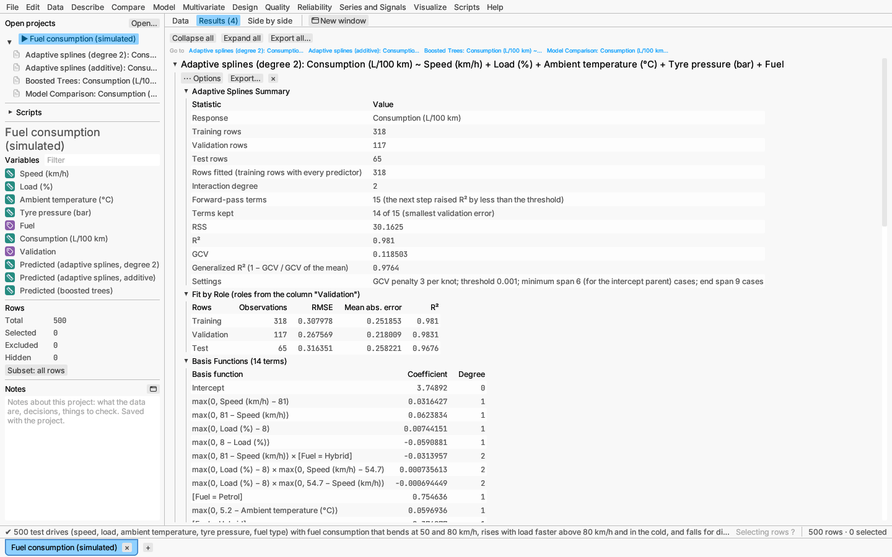

# Model: adaptive regression splines

Model ▸ Adaptive regression splines… fits multivariate adaptive regression
splines (Friedman, *Annals of Statistics* 19, 1991) to a continuous
response. The model is a sum of *hinge functions*

- max(0, x − t), zero below the knot t and rising above it, and
- max(0, t − x), its mirror image,

with knots t placed at values in the data, and of products of hinges on
different predictors. Each predictor's effect is therefore made of straight
pieces that bend at the knots, so the model finds thresholds and changes of slope
on its own, and products let one predictor's effect depend on another.

**Interactions.** *None (additive)* keeps every term to one predictor;
*Pairs* (the default) allows products of two; *Up to three predictors*
allows three.

**Predictors.** Continuous predictors enter through hinges. Those ticked
under *Enter linearly* enter only as x times another term, with no knots. A
categorical predictor enters through 0/1 indicators of each of its levels
except the first, so a level effect, or a level-specific slope when the
indicator multiplies a hinge, is just another term. Training rows missing a
predictor are left out; rows missing a predictor the final model uses get no
prediction.

**Forward pass.** Starting from the mean, each step tries every existing
term as a *parent*, every predictor not already in it, and every allowed
knot, and adds the pair of terms (parent × each hinge) that most reduces
the residual sum of squares. A term that adds nothing new (for example the
second hinge of a predictor that already has a pair at another knot) is
dropped, so a step can add a single term. The pass stops when the maximum
number of terms is reached (each pair counts two; by default
min(200, max(20, 2 × variables)) + 1), when the best step raises R² by less
than the threshold (0.001), when R² reaches 1 − threshold, or when no step
helps. Knots keep Friedman's *minimum span* (cases between knots) and *end
span* (cases outside the outermost knots), which guard against knots fitted
to runs of noise; both can be set under More options.

**Pruning.** The forward model deliberately has too many terms. The backward
pass removes, one at a time, the term whose removal hurts least, giving the
best model of each size. The size kept is the one with the smallest
*generalized cross-validation* criterion,

GCV = RSS / (n (1 − C/n)²), with C = terms + d × (terms − 1)/2,

which charges d (2 for an additive model, 3 with interactions; settable)
for each knot. With validation rows the size with the smallest validation
error is kept instead; with k-fold cross-validation each fold repeats both
passes without its rows and the size with the smallest cross-validated error
is kept. Roles work as for
[decision trees](decision-trees.md#validation-and-fit-measures).

**Report:**

- summary: rows by role, forward-pass terms and why it stopped, terms kept
  and how the size was chosen, RSS, R², GCV and the generalized R²
  (1 − GCV / GCV of the mean alone), and the settings;
- fit measures by role (cross-validated with k-fold);
- basis functions with their coefficients, written like
  `max(0, Speed (km/h) − 80.2) × max(0, 61 − Load (%))` (knot values as
  found in the data);
- variable importance: the number of backward-pass subsets (up to the size
  kept) that use each predictor, and the reductions in GCV and RSS they
  bring, with a relative scale (square root of the GCV reduction, largest
  100);
- model size: GCV, and the validation or cross-validated error when used,
  against the number of terms, the size kept marked;
- the forward-pass steps (parent, terms added, R²);
- the Response Explorer and 3-D profiler: each continuous predictor's
  slice is piecewise linear, bending at its knots.

**Saving:** predicted values; the prediction formula as a formula column, a
sum of coefficients times `max(Speed - 80.2, 0.0)`-style hinges (and a
`switch` on the label for a level indicator), so it follows later edits and
works on new rows (see [formula columns](../reference/formulas.md)); and the
validation roles. Saved predictions can be compared with other models in
[Compare models](model-comparison.md).

*Verified:* functions built from known hinges are recovered exactly (knots
and coefficients); additive fits agree with the R package earth to rounding,
and fits with interactions to a fraction of a percent (details in the
validation record).

*Try it:* Fuel consumption: consumption bends at 50 and 80 km/h, rises with
load faster above 80 km/h, rises in the cold and is lower for diesel and
hybrid cars. The degree-2 model finds the knots and the speed × load
interaction and ignores tyre pressure; the additive model and boosted trees
are compared with it on the test rows.
