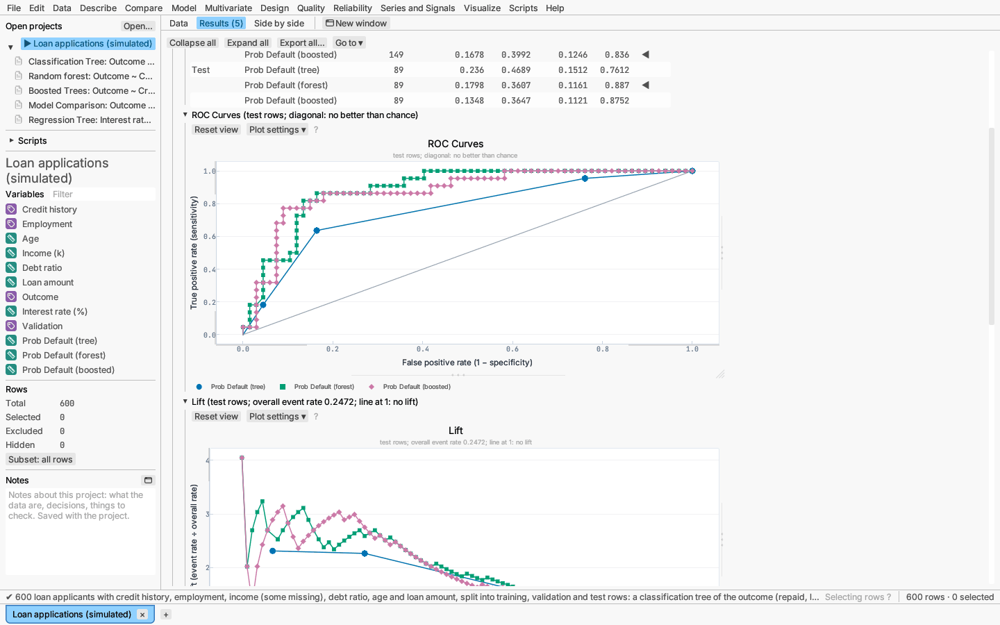

# Model: comparing models

Model ▸ Compare models… compares predictive models through the prediction
columns they saved (each model's options menu offers *Save* for its
predictions). It uses the rows where the response and every chosen column are
present.

**Choose:** the response, two or more prediction columns, and optionally a
column of validation roles. For a categorical response, choose the columns
holding each model's probability of one event class (by default the last
class), which is compared against all the others.

**Measures,** for each role when a role column is given, with ◀ marking the
best model in each (lowest RMSE, or highest AUC):

- continuous response: RMSE, MAE and R²;
- categorical response: misclassification at a 0.5 cut-off, log loss, Brier
  score and AUC.

**Plots** use the test rows when there are any, otherwise the validation
rows, otherwise all rows. Each model has its own colour and marker shape, and
every point is a data row, so selecting points selects those rows everywhere.

- Categorical response: ROC curves with the chance diagonal; lift and
  cumulative gains by depth; a calibration plot of the observed event rate
  against the mean predicted probability in tenths.
- Continuous response: actual by predicted, and residual by predicted.

Every plot exports as PNG, SVG, PDF and EPS from its right-click menu.

*Try it:* Loan applications compares the tree's, the forest's and the boosted
trees' default probabilities on the test rows. Pump sensors compares radial
and linear support vector machines. Fuel consumption compares two adaptive
spline models with boosted trees. Polymer batches compares a neural network with
boosted trees. To fit and rank every kind of model in one step, use
[Model search](model-search.md).
