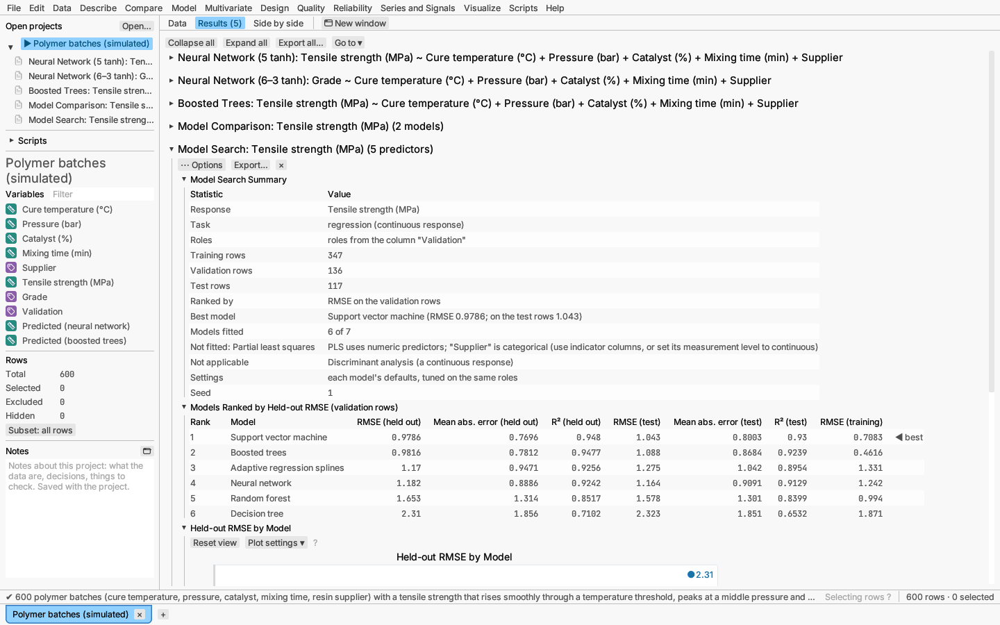

# Model: model search

Model ▸ Model search… fits every kind of predictive model that suits the
response, each with its own default settings and the same validation roles,
ranks them by their error on rows they were not fitted to, and opens the
best one's full report below the ranking.

**Models.** Decision tree, random forest, boosted trees, neural network,
support vector machine, adaptive regression splines (continuous response
only), partial least squares, and discriminant analysis (categorical
response only, numeric predictors). Untick any under *Models to try*; those
that do not suit the response are greyed out. Each model runs exactly as its
own report would with default settings, so the report it opens shows the
same numbers as its row in the ranking. A model that cannot be fitted to the
data (for example discriminant analysis with a text predictor) is listed in
the summary with the reason.

**Ranking.** Each model is tuned and ranked on held-out rows:

- *Hold back random rows* or *Roles from a column*: the validation rows tune
  every model and rank them; test rows are used by none of them, so the test
  columns of the ranking are an honest estimate for new data. A search
  needs some validation rows (test rows alone cannot rank without biasing
  the test).
- *K-fold cross-validation*, or *None (all rows train)*, which uses 5 folds:
  each row's held-out prediction comes from the model fitted without its
  fold.

The measure is the root mean square error for a continuous response. For a
categorical one it is the log loss (the mean of −ln of the probability given
to the observed class), which rewards probabilities that are both right and
well calibrated and separates models the misclassification rate often ties;
ties go to the lower misclassification rate. The seed (under More options)
seeds every model, so a search repeats exactly.

**Report:**

- summary: the task, rows by role, the measure, the best model with its
  held-out and test error, models fitted, models that could not be fitted
  (with the reason) or do not apply;
- the models ranked by held-out error (◀ marks the best), with the held-out
  and test measures (RMSE, mean absolute error and R², or misclassification,
  log loss and AUC) and the training error;
- held-out error by model, best at the left.

**Repeated and nested cross-validation.** One split into folds is a single
draw: with another seed the ranking can change. Under **More options**,
**Repeat k-fold cross-validation** reruns the k-fold ranking that many times
(up to 50) with fresh folds, the seed for repeat *i* being the search's seed
plus *i*, so repeat 1 is the ordinary search. The report adds a table of
each model's mean held-out error across the repeats with a 95% t interval,
its standard deviation, and its best and worst repeat, and a forest plot of
the means with their intervals (Kim 2009). **Nested** goes further for models
that tune themselves on held-out rows: each outer fold is held out while the
model tunes by cross-validation on the remaining rows only, so the outer error is not
flattered by tuning on the rows it is scored on (Varma & Simon 2006). Both
need k-fold cross-validation (or every row training); with validation rows the
section says so. Fitting takes the number of repeats times longer, and
nested folds about the number of folds times longer again.

**Opening reports.** A new search opens the best model's full report below
it. ⋯ Options lists every ranked model; choosing one opens its full report,
with the profilers, fit measures and columns to save. To compare models on
more measures and plots (ROC curves, lift, calibration), save their
predictions from their reports and use [Compare models](model-comparison.md).

*Verified:* on simulated data where the true model class is known, the true
class wins: a sum of hinge functions is won by adaptive regression splines,
and a curved class boundary made of tanh units by the neural network; seeded
searches repeat exactly, and each ranked model matches its own report (see
the validation record).

*Try it:* Polymer batches: the search of tensile strength ranks the six
models that suit it on the validation rows.
