# Multivariate

The Multivariate menu is in four groups, each under a small heading:
**Relationships** (correlations, scatterplot matrix, outlier distances, item
analysis), **Reduce dimensions** (principal components, factor analysis,
correspondence analysis, and MDS, t-SNE and UMAP maps), **Clusters**
(clustering, Gaussian mixtures, latent classes), **Groups** (multivariate
analysis of variance, discriminant analysis) and **Curves** (functional
data).

## Correlations

Multivariate ▸ Correlations… measures how each pair of numeric columns moves
together. Choose the columns, then:

- **Rows with a missing value:** *pairwise* uses, for each pair, every row
  that has both values (pairs may then rest on different rows); *listwise*
  uses only rows complete in every chosen column, so all pairs share one set
  of rows. Excluded rows are always left out.
- **Confidence level** of the intervals (95% by default).
- Optional tables: **Spearman's rank correlations**, **partial
  correlations** (on by default) and the **covariance matrix**.

**Report:**

- *Summary* — each column's count, mean and standard deviation, and the
  number of rows complete in every column.
- *Pearson Correlations* — the matrix of r.
- *Correlation Heat Map* — the same matrix as coloured cells: blue for
  negative, orange for positive, stronger colour for a larger |r|. Every
  cell also prints its value, so the colour is never needed to read it;
  hover a cell to see which pair it is. The key under the grid shows the
  colour scale. Right-click the section heading to save it as a figure.
- *Pairwise Pearson Correlations* — every pair once with its N, r, the
  Fisher z interval and the p-value of the test of no correlation.
- *Spearman's ρ* — the same for rank correlations, which measure any
  monotone association and resist outliers.
- *Partial Correlations* — each pair's correlation with all the other chosen
  columns held fixed, from the complete rows, with its test on n − p degrees
  of freedom. A large correlation whose partial correlation is near zero is
  explained by the other columns.

*Try it:* Flower measurements (the petal measurements correlate strongly;
the sepal width hardly at all); Course evaluation (rank correlations of the
answers).

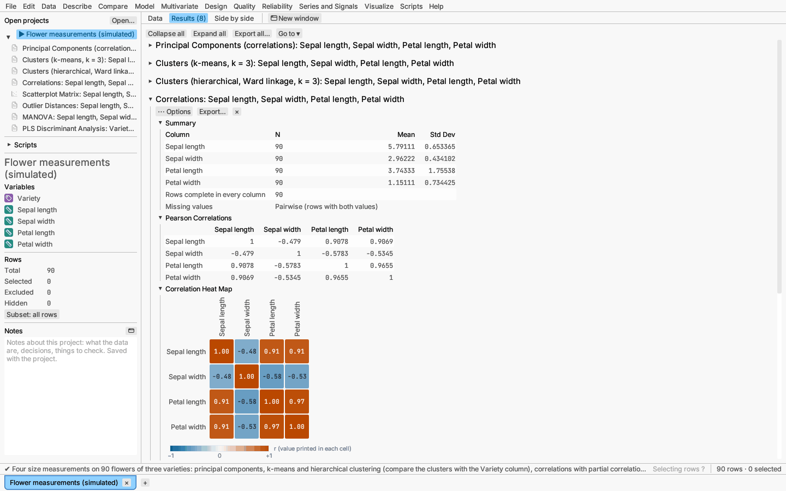

## Scatterplot matrix

Multivariate ▸ Scatterplot matrix… (also Visualize ▸ Scatterplot matrix…) plots every pair of the chosen continuous
columns in a square grid of linked panels: the panel in row *i*, column *j*
has column *i* up and column *j* across, each with a 95% density ellipse
(and the correlation written on it), and each column's histogram sits on the
diagonal. Optionally colour (and mark) the points by a column, such as a
group.

The matrix opens as a [graph canvas](../reports/graph-canvas.md) with the
**Scatterplot matrix** chart form, so everything the canvas offers works:
drag a box in any panel to select rows, and they are ringed in every panel,
in the histograms and in the data grid; add fit lines or smoothers, change
the ellipse level, switch the histograms for dot plots, or use a colour,
shape or size column.

*Try it:* Flower measurements (coloured by variety).

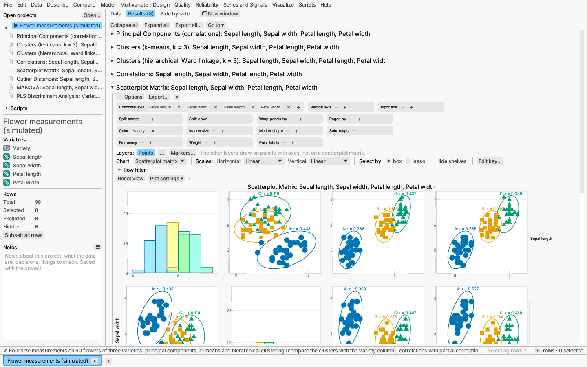

## Outlier distances

Multivariate ▸ Outlier distances… measures how unusual each row is across
several columns at once, allowing for the correlations between them: a row
can be ordinary in every column alone and still unusual in combination. Rows
complete in every column and not excluded take part.

- **Mahalanobis distance** — distance from the mean of all rows, in units
  set by their covariance.
- **Jackknifed distance** — distance from the mean and covariance of all
  the *other* rows, so an outlier cannot hide by pulling the estimates
  towards itself.
- **Hotelling T²** — the squared Mahalanobis distance.

Choose which to plot and the upper-tail probability α of the reference limit
(0.05 by default). The limits assume multivariate normal data: T² uses a
scaled beta distribution, the jackknifed distance a scaled F, and the
Mahalanobis limit is the square root of the T² limit. With many rows, some
will cross a per-row limit by chance; use a smaller α to allow for that.

**Report:** a summary with all three limits; the chosen distance by row
number with its limit (rows above it drawn as a different marker, and
selectable in the plot); a table of the rows above the limit with all three
distances; and the mean and covariance used. The report's options menu saves
any of the three distances as a new column.

*Try it:* Flower measurements.

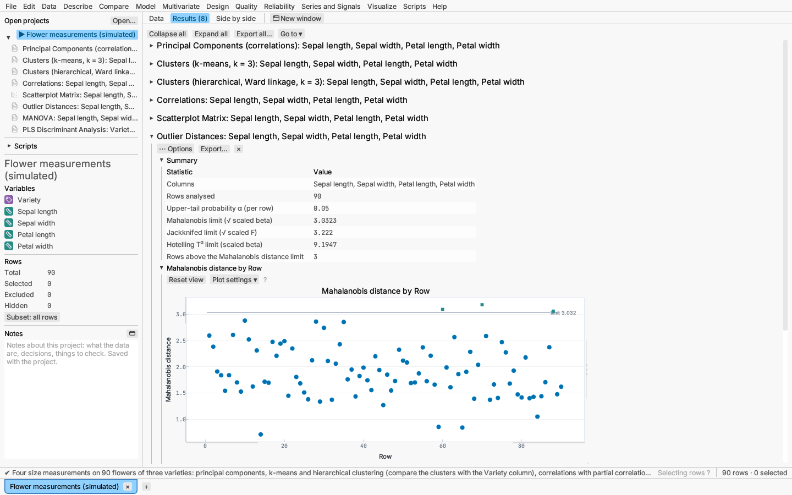

## Item analysis

Multivariate ▸ Item analysis… checks the reliability of a scale scored by
adding several items, such as the answers to a questionnaire. Tick the item
columns; tick **reverse** beside negatively worded items ("The course was
hard to follow") so that every item points the same way. A reversed answer
*x* becomes low + high − *x*, where low and high are the ends of the answer
scale: give them (1 to 5 by default), or clear the box to use the smallest
and largest answers given. Only rows with every item answered take part.

**Report:**

- *Reliability* — **Cronbach's alpha** with Feldt's confidence interval,
  **standardized alpha** (alpha of the items scaled to equal variance,
  from the mean inter-item correlation), and the total score's mean and
  SD. Values around 0.7–0.9 are usual for a scale in use.
- *Item Statistics* — each item's mean and SD; its correlation with the
  total score (item–total) and with the total of the other items
  (item–rest, the better guide, since the item–total correlation includes
  the item itself); and alpha if the item were deleted. An item with a low
  or negative item–rest correlation, whose deletion raises alpha, does not
  measure what the others do — or needs reversing.
- *Inter-Item Correlations* — a heat map of the items' correlations, with
  values printed in the cells.

The options menu saves the **total score** (after reversal) as a new
column.

*Try it:* Course evaluation — then run it again without reversing "Hard to
follow" and "Pace too fast" and watch alpha fall and their item–rest
correlations turn negative.

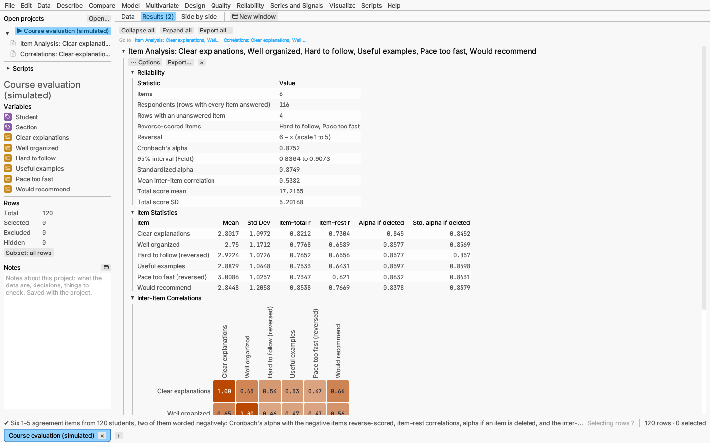

## Principal components

Multivariate ▸ Principal components… finds the directions of greatest
variation in several continuous columns, computed by singular value
decomposition. Choose standardized (correlation-based) components, which put
every column on an equal footing, or covariance-based ones.

**Report:** eigenvalues with the share of variation each component explains,
a scree plot, loadings, and a score plot with lines showing each variable's
loadings. Save the component scores as new columns.

*Try it:* Flower measurements; Longley economy.

## Clustering

Multivariate ▸ Clustering… groups rows by similarity:

- **k-means** with a chosen number of clusters (a row equally close to two
  centres stays in its current cluster, so repeated rows give the same
  clusters whatever their order, and no cluster is left empty);
- **hierarchical** clustering with single, complete, average or Ward linkage,
  drawn as a dendrogram.

**Starting centers (k-means).** By default k-means runs ten seeded
k-means++ starts and keeps the best. Under **Starting centers** choose
**Given centers** to start once from centers you type (one row per
cluster, one value per column, in the data's units; the number of rows is
the number of clusters), or **Given and seeded** to add them as one more
start beside the seeded ones, keeping whichever gives the smallest
within-cluster sum of squares (the given start wins a tie). **Read from
table** copies the centers from another open table that has columns with
the same names and one row per center (up to 50). When the columns are
standardized the centers are standardized the same way. The report adds a
**Starting Centers** table saying which start won. Lloyd's iterations from
given centers match R's `kmeans(x, centers = …, algorithm = "Lloyd")`.

**Report:** cluster means and plots, and for k-means each cluster's average
silhouette width (how much closer its rows are to their own cluster than to
the next nearest, from −1 to 1; Rousseeuw 1987). Save each row's cluster
number as a column.

**Choosing the number of clusters.** For k-means, tick **Compare numbers of
clusters (gap statistic and silhouettes)** and set the largest k to try
and the number of reference data sets. The report adds a table and two
plots over k = 1 … the largest k:

- the **gap statistic** (Tibshirani, Walther & Hastie 2001): how much
  tighter the clusters are than in reference data with no clusters, drawn
  uniformly over **the data range** of each column or over **the
  principal-component box** (the range of the data's rotated principal
  components, better when the columns are correlated). Each reference set
  has its own seed, so the result is reproducible. The suggested k is the
  smallest with Gap(k) ≥ Gap(k+1) − s(k+1);
- the **average silhouette width** for each k ≥ 2; the suggested k is the
  largest.

Both suggestions are marked in the table; they often agree, and when they do
not, look at the cluster plot of each.

**Distances.** Hierarchical clustering compares rows by Euclidean distance
unless you choose another **Distance** in the dialog: any of the measures in
[Distance measures](#distance-measures) — Gower lets the columns be text,
ordinal or numeric, with missing values — or **The columns are a distance
matrix** (one column per row, as made by Data ▸ Reshape ▸ Distance
matrix…). k-means always uses Euclidean distances. With another distance the
cluster plot maps the rows by their first two principal coordinates, and
cluster means are of the numeric columns.

*Try it:* Flower measurements; Shrub traits (average linkage on Gower
distances of mixed traits).

## Correspondence analysis

Multivariate ▸ Correspondence analysis… maps the rows and columns of a two-way
table of counts: an inertia table and a symmetric map where nearby categories
are associated.

*Try it:* Customer survey.

## Multivariate analysis of variance

Multivariate ▸ Multivariate analysis of variance… (MANOVA) tests whether
the effects of a linear model shift several continuous responses together.
Testing each response separately ignores their correlations and multiplies
the chances of a false alarm; MANOVA tests every effect on all the responses
at once.

Choose two or more **responses** (continuous columns) and the
**predictors**. As in the linear model dialog, continuous predictors enter
as they are and text, nominal or ordinal columns as categorical factors, and
the effect list adds interactions and powers (kept hierarchical unless you
turn that off under More options). Rows not excluded with every response and
predictor present take part.

**More options:**

- **Rank effects by** — the statistic whose p-values order the Effect
  Pareto (Pillai's trace by default, the most robust to unequal covariance
  matrices); the report shows all four.
- **Canonical plot of** — the categorical factor whose canonical plot is
  drawn (by default the first one in the model).
- **Contrasts among levels** — choose a factor, give each level a weight
  (weights adding to zero, such as 1 and −1 to compare two levels, or 2, −1
  and −1 to compare one level with the average of two others), and Add
  contrast. Each contrast is tested on all the responses, on the factor's
  least-squares means (each level's mean with the other factors balanced).

**Report:**

- **Multivariate Tests** — for each effect, Wilks' Λ, Pillai's trace, the
  Hotelling–Lawley trace and Roy's largest root, each with its F
  approximation, degrees of freedom and p-value. The last column says
  whether the F is exact (always when the effect has one degree of freedom
  or there is a single canonical variate), an approximation, or (for Roy's
  root) an upper bound, so its p-value is a lower bound.
- **Effect Pareto** — −log₁₀ p of each effect by the chosen statistic.
- **Univariate Tests of Each Response** — each response's own F-test of
  each effect, the same as its linear model's effect tests.
- **Contrast Tests** and **Contrast Estimates** — each contrast's exact F
  test and its estimated value for each response.
- **Canonical Analysis of Each Effect** — the eigenvalues of E⁻¹H (the
  effect's variation relative to the error variation), the share of each,
  the canonical correlations, and the standardized coefficients of each
  canonical variate: the combination of responses the effect separates
  most, scaled by each response's error standard deviation so they can be
  compared.
- **Canonical Plot** — the rows' scores on the first two canonical variates
  of the chosen factor, marked and coloured by level with each level's mean
  labelled; with a single variate (a two-level factor), the scores by level.
  Points are linked to the data, so selecting them selects the rows.
- **Residual Correlations** — each response's error standard deviation and
  the correlations of the responses after the model (partial correlations).
- **Equal Covariance Matrices (Box's M)** — when every predictor is
  categorical, Box's test that every cell of the factors has the same
  covariance matrix, with its chi-square approximation. It is sensitive to
  non-normality; when it rejects, prefer Pillai's trace.

*Try it:* Plastic film (Johnson & Wichern), a two-way MANOVA; Flower
measurements, a one-way MANOVA by variety with the contrast A vs B.

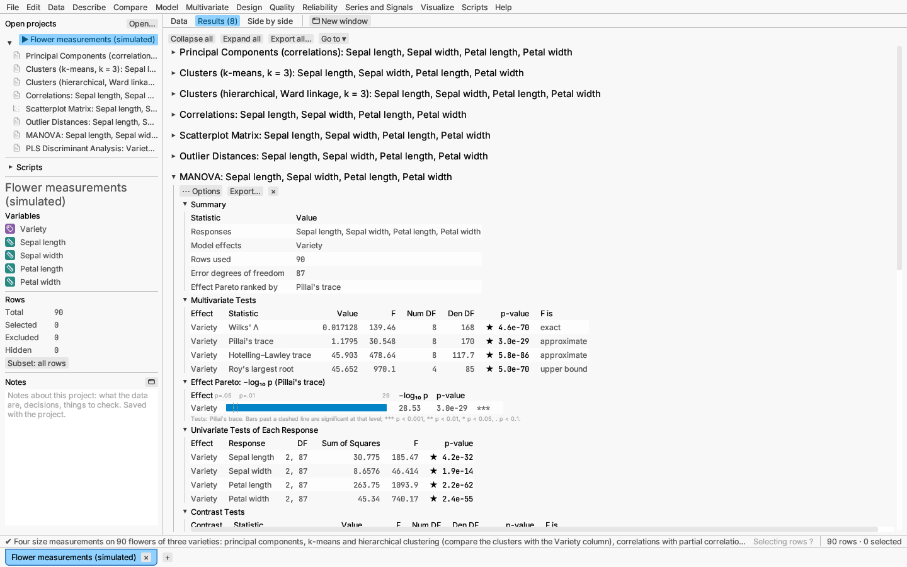

## Factor analysis

Multivariate ▸ Factor analysis… looks for a few unobserved **common
factors** that explain the correlations among several numeric columns — for
example verbal, quantitative and spatial ability behind a set of test
scores. Each column is modelled as a weighted sum of the factors (its
**loadings**) plus a part of its own (its **uniqueness**); the share it has
in common with the others is its **communality**. Rows complete in every
column and not excluded take part.

- **Extraction.** *Maximum likelihood* finds the loadings that make the
  observed correlations most likely under multivariate normal data, and
  tests whether the number of factors is enough. *Principal axis* repeats
  an eigen-decomposition with the communalities on the diagonal until they
  settle; it makes no distributional assumption. When a column's
  communality reaches its whole variance (a **Heywood case**) it is held at
  that bound and named in the summary — usually a sign of too many factors
  or too few rows. Under principal axis such a column is reported with a
  communality equal to its variance and a uniqueness of 0, so Bartlett
  scores (which divide by the uniquenesses) are not available; use
  regression scores.
- **Number of factors.** By default, as many as the eigenvalues of the
  correlation matrix above 1 (above their mean for a covariance matrix), or
  a number you set. Maximum likelihood needs ((p − m)² − p − m)/2 ≥ 0 for
  p columns and m factors; when the eigenvalue rule asks for more, fewer are
  fitted and the summary gives both numbers.
- **Rotation.** Factors can be turned without changing the fit, to make
  each column load mainly on one factor. *Varimax* keeps them uncorrelated;
  *Promax* lets them correlate (more realistic for abilities or attitudes)
  and reports the **pattern** loadings (each factor's own contribution), the
  **structure** loadings (correlations of columns with factors, or
  covariances when covariances are analysed) and the
  factor correlations.
- **More options:** analyse covariances instead of correlations, the
  method of the saved scores (*Regression*, which shrinks scores towards 0
  but correlates best with the factors, or *Bartlett*, unbiased for each
  row) and the promax power (4).

**Report:** a summary (with any Heywood cases); the eigenvalues and a scree
plot marking the number of factors; for maximum likelihood, the chi-square
test that the factors suffice (Bartlett's correction; a small p-value means
more factors are needed); unrotated and rotated loadings; communalities with
their starting values (squared multiple correlations) and uniquenesses; the
variance each factor accounts for; and a plot of the columns' loadings on
factors 1 and 2. The report's options menu saves each factor's scores as a
new column.

*Try it:* Ability tests — a maximum-likelihood solution with varimax, and a
principal-axis solution with promax showing correlated factors.

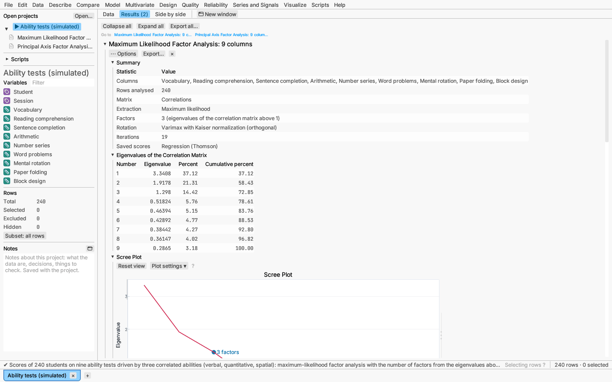

## Discriminant analysis

Multivariate ▸ Discriminant analysis… (also under Model with the other
classifiers) assigns rows to the classes of a categorical response from
numeric measurements, assuming the measurements are multivariate normal
within each class.

- **Rule.** *Linear* uses one covariance matrix pooled over the classes, so
  the boundaries between classes are straight; *Quadratic* gives each class
  its own covariance matrix (curved boundaries), which needs more rows than
  predictors in every class.
- **Prior probabilities.** *Proportional* to the training rows of each class,
  or *Equal*. Each row's **posterior probability** of a class combines its
  prior with how typical the row is of that class; the most probable class
  is the prediction.
- **Validation.** The same choices as the other predictive models: every row
  trains (the classical analysis; its error rates are optimistic), random
  validation and test rows, roles from a column, or k-fold cross-validation.
  The rule is fitted to the training rows only; the others are classified
  with it, so their misclassification rates estimate the error on new data.

**Report:** a summary; fit measures by role (misclassification rate, log
loss, AUC) and confusion matrices of actual by predicted class; the
misclassified rows with their posterior probabilities; class means and
priors; and **Fisher's canonical discriminant functions** — the weighted
sums of the predictors that best separate the classes (at most one fewer
than the classes): their eigenvalues, canonical correlations and Wilks' Λ
tests (does this function and every later one separate the classes?), a
canonical plot of the rows by class (colour and marker) with each class mean,
the standardized and raw coefficients, and the structure correlations of
each predictor with each function. Points in the canonical plot are rows,
so selecting them selects the rows everywhere.

The options menu saves each class's posterior probability, the most likely
class, the validation roles and the canonical scores. The saved
probabilities can be compared with other models' under Model ▸ Compare
models.

*Try it:* Honey origins — linear and quadratic rules with training,
validation and test rows from the Validation column.

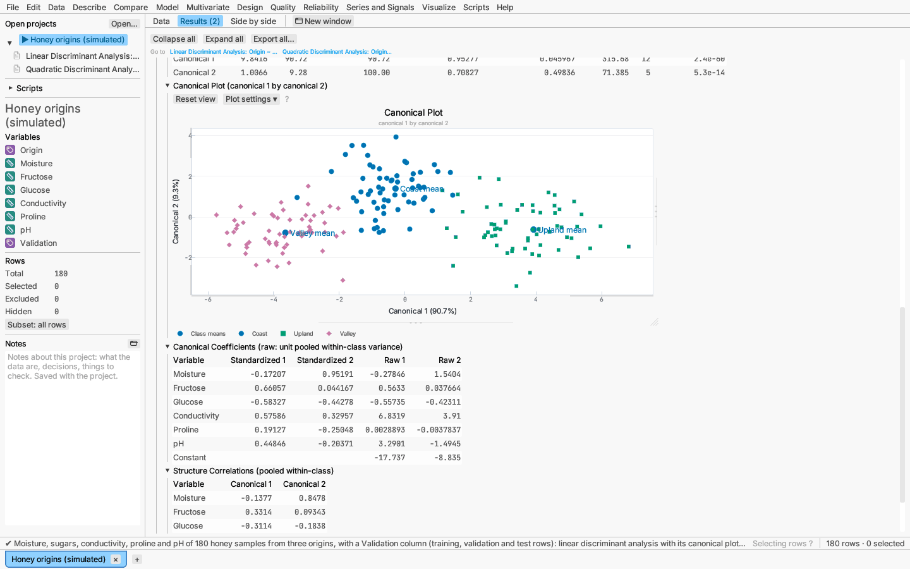

## Gaussian mixture clustering

Multivariate ▸ Gaussian mixture clustering… treats the rows as drawn from a
mixture of normal distributions, one per cluster, each with its own mean,
spread and share of the rows. Unlike k-means, clusters can be elongated,
tilted and of different sizes, and every row gets a *probability* of
belonging to each cluster rather than a hard label.

Choose the numeric columns and the range of numbers of components to try (1
to 6 by default). The **covariance structure** says how the clusters'
shapes may differ; each is named by three letters for volume, shape and
orientation (E equal across clusters, V varying, I identity):

| Structure | Clusters are |
|---|---|
| EII | round, all the same size |
| VII | round, of different sizes |
| EEI | axis-aligned ellipses, all alike |
| VVI | axis-aligned ellipses, each its own |
| EEE | tilted ellipses, all alike |
| VVV | tilted ellipses, each its own |

Every ticked structure is fitted with every number of components by the EM
algorithm, from several starts (the first from k-means or Ward clustering,
the rest from seeded random k-means runs; set them under **More options**),
and the model with the smallest **BIC** (−2 log-likelihood + parameters ×
ln n) is chosen: it balances fit against the number of parameters. Fits
that break down — a cluster left with almost no rows, a covariance that
cannot be estimated — are shown as *not fitted*. With one column only the
two spherical structures differ (equal or unequal variances).

**Report:**

- *Chosen Model* — the structure, number of components, log-likelihood,
  parameters and BIC, and how many rows are uncertain (probability of their
  most likely cluster below 0.8). The log-likelihood and every BIC are those
  of the values in the columns' own units, also when the columns were
  standardized for fitting.
- *BIC by Model* — every structure and number of components, with the
  chosen one marked.
- *BIC by Number of Components* — one line and marker shape per structure.
- *Components* — each cluster's mixing proportion, the rows most likely in
  it, and its means.
- *Covariance Matrices* — each cluster's (or the shared) covariance matrix.
- *Rows by Most Likely Component* — the rows on the first two columns,
  coloured and marked by cluster, with each cluster's 95% ellipse. Drag a
  box to select rows; they are selected everywhere.

The options menu saves each row's **membership probabilities**, its **most
likely component** (a nominal column) and its **uncertainty** (1 minus its
largest probability).

*Try it:* Cell populations — the mixture finds the three populations with
their own shapes (VVV, 3 components), where k-means cuts the long, tilted
population in two; compare both with the Population column.

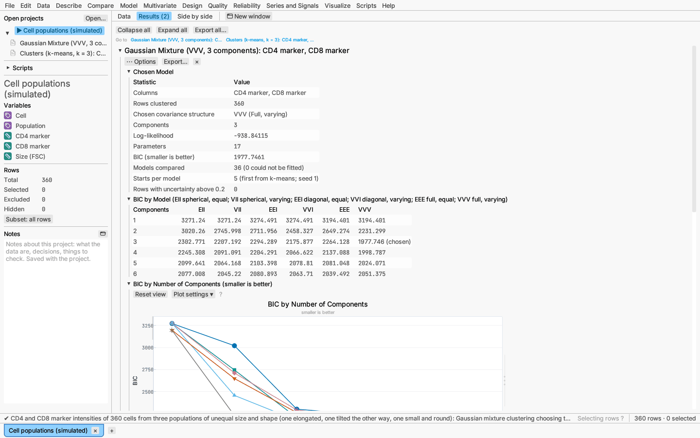

## Latent class analysis

Multivariate ▸ Latent class analysis… looks for a few hidden groups
(*classes*) of rows behind several categorical answers — survey items,
symptoms, test results. Within a class the items are assumed independent
(*local independence*), so everything the items have in common is
explained by the class a row belongs to. Each class is described by its
**size** and by the probability of each answer to each item.

Choose two or more nominal or ordinal columns as the **items** (continuous
columns are not offered; set a coded column's measurement level to nominal
or ordinal to use it). An item may have any number of levels — its levels
are its distinct non-blank values. Choose the range of numbers of classes
to try (1 to 5 by default). Under **More options** set the number of random
starts per number of classes (10), the random seed, and a **smoothing**
value (0 by default) that adds a small count to every level so that no
probability is estimated as exactly 0 or 1.

Each number of classes is fitted by the EM algorithm from several random
starts, keeping the best; the report says how many starts reached it (if
only one did, try more starts). The number of classes with the smallest
**BIC** is chosen. A blank answer is simply left out of that row's
likelihood, so rows with some items missing still count; rows with every
item blank, and excluded rows, are left out. With few items not every
number of classes can be estimated — with four yes/no items, at most three
classes — and those are listed as *not fitted*. Classes are numbered from
the largest to the smallest.

**Report:**

- *Chosen Model* — number of classes, log-likelihood, parameters, AIC, BIC
  and the sample-size-adjusted BIC, the **entropy R²** (1 when every row
  clearly belongs to one class, near 0 when classes are indistinct), and
  the likelihood-ratio **G²** and Pearson **X²** comparing observed and
  expected counts of the response patterns. With many items most patterns
  are rare and these tests are unreliable; compare models by BIC instead.
- *Model Selection by Number of Classes* — the same measures for every
  number of classes tried, the chosen one marked.
- *Information Criteria by Number of Classes* — BIC, AIC and adjusted BIC
  against the number of classes.
- *Class Sizes* — each class's estimated share with its standard error,
  and the rows whose most likely class it is.
- *Item Response Probabilities by Class* — for every item and level, the
  probability of that answer in each class with its standard error (from
  the observed information). A probability on the boundary (0 or 1) has no
  standard error and shows —.
- *Response Probability Profiles* — one pane per item, one marker and stem
  per class at each level, so the classes' answer patterns can be compared
  at a glance.
- *Classification* — for the rows assigned to each class, the average
  probability of every class. Values near 1 on the diagonal mean clear
  assignments.

The options menu saves each row's **most likely class** (a nominal column)
and its **probability of each class**.

*Try it:* Symptom checklist — BIC chooses three classes: a large group with
few symptoms, one with fatigue, poor sleep and muscle pain, and one with
low mood and worry. Save the most likely class and compare it with the
Simulated profile column.

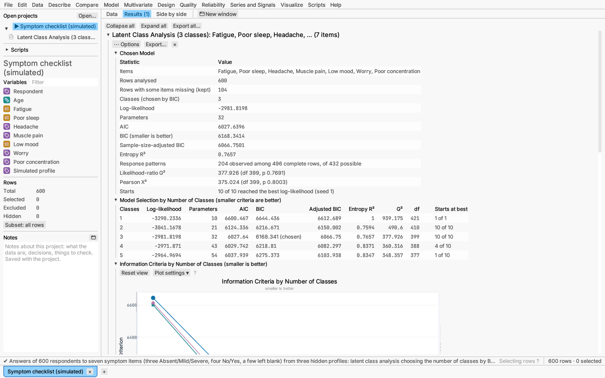

## Dimension reduction

Multivariate ▸ Dimension reduction (MDS, t-SNE, UMAP)… draws the rows as
points on a map (two dimensions by default) so that rows that are alike lie
close together. Choose a method:

- **Classical scaling** (Torgerson) — the map whose distances best match
  the rows' distances in the least-squares sense of principal components;
  for Euclidean distances between rows it equals the principal component
  scores. Exact and fast.
- **Metric scaling (SMACOF)** — moves the points to make the map distances
  match the dissimilarities as closely as possible (smallest *stress*),
  starting from classical scaling and from four seeded random layouts.
  Better than classical scaling for non-Euclidean distances; up to 3000 rows.
- **t-SNE** — keeps each row's nearest neighbours together, so clusters
  stand out; distances *between* clusters and cluster sizes mean little.
  The **perplexity** (30) is about how many neighbours each row pays
  attention to; it must be below the number of rows less one. Up to 600
  rows use the exact gradient, more use the Barnes–Hut approximation.
- **UMAP** — like t-SNE, keeps neighbourhoods together, and tends to keep
  more of the larger-scale layout; **neighbours** (15) sets how local the
  view is and **minimum distance** (0.1) how tightly points may pack.

The columns either hold **variables** — the rows' distances are then the
Euclidean distances between their values, standardized by default (under
**More options**) so that columns in larger units do not dominate — or a
**distance matrix**: one column per row, with row *i* of column *j* the
distance between rows *i* and *j* (so the table has as many rows as
distance columns). Excluded rows are left out, with their matching columns.
**Colour and marker by** colours the map by a column (its categories, or
quartiles of a continuous column), each with its own marker shape. Under
**More options**: the number of dimensions (1–3), the iterations and the
random seed. The same settings and seed always give the same map.

**Report:**

- *Fit* — the method and settings, and how good the map is: the share of
  the eigenvalues kept (classical scaling; negative eigenvalues mean the
  distances are not Euclidean), stress-1 (metric scaling; below about 0.1
  is good), the KL divergence and the iterations, with how many of the
  first ones used early exaggeration (a quarter of them, at most 250; t-SNE),
  the curve parameters and graph size
  (UMAP); and for all, the **trustworthiness** — how far the map's nearest
  neighbours are true neighbours (1 is perfect, about 0.5 is random).
- *Eigenvalues* (classical scaling).
- *Map* — the rows on the first two dimensions; select rows by dragging a
  box, and they are selected in every other plot and the data grid.
- *Shepard Diagram* (scaling methods) — each pair's dissimilarity against
  its distance on the map, with the line of equality (up to 1500 pairs
  drawn at random when there are more).

The options menu saves the map coordinates as new columns.

*Try it:* Expression profiles (t-SNE, UMAP and classical scaling of 20 genes,
coloured by cell type); Town distances (a map of twelve towns from their
road distances alone).

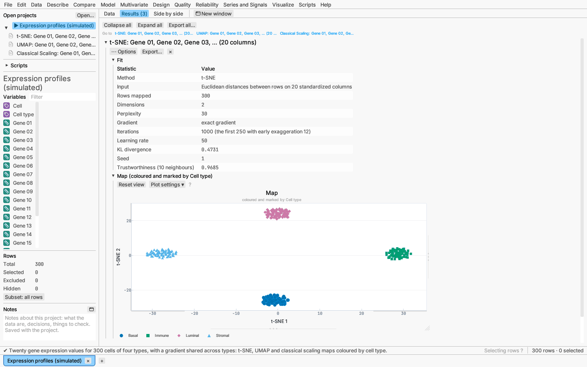

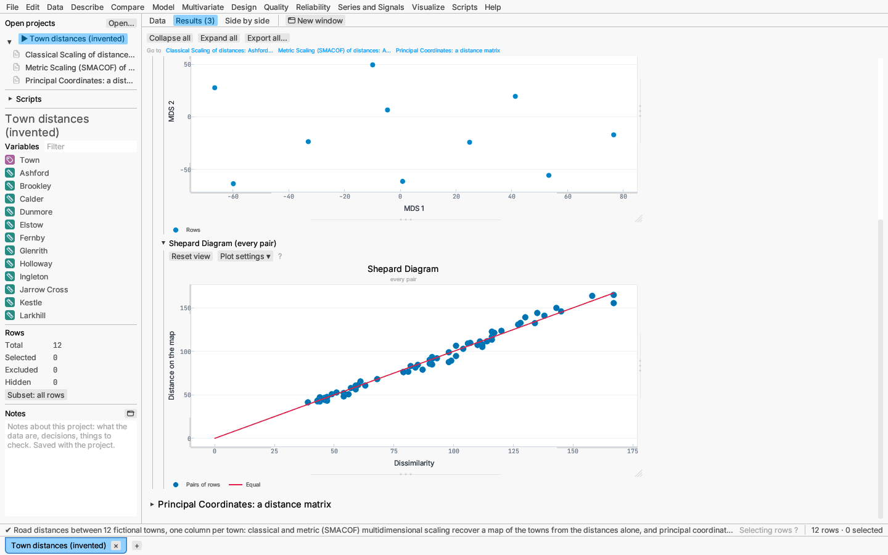

## Principal coordinates

Multivariate ▸ Principal coordinates… (principal coordinates analysis, PCoA;
Gower 1966) maps the rows from any distance between them. Choose **Measured
from columns** — then the **distance** (see below; Euclidean and Manhattan
can standardize the columns first, under More options) — or **The columns
are a distance matrix**. Excluded rows are left out (with their matrix
columns).

With D the n × n distances, PCoA double-centres A = −½D² (squared element
by element): B = (I − 11ᵀ/n) A (I − 11ᵀ/n), and takes the eigenvalues λ and
eigenvectors of B; the coordinates on axis k are the eigenvector scaled by
√λₖ. For Euclidean distances this is principal components; other distances
can give **negative eigenvalues** (the distances cannot be drawn exactly in
any number of real dimensions). The report keeps them, and under More
options **Negative eigenvalues** can be corrected (Legendre & Legendre 2012,
§9.3.4):

- **Lingoes** (1971) adds 2c₁ to every squared distance off the diagonal,
  with c₁ the absolute value of the most negative eigenvalue;
- **Cailliez** (1983) adds a constant c₂ to every distance off the
  diagonal, the largest real eigenvalue of [[0, 2B], [−I, −4B₁]] (B₁ built
  from the distances rather than their squares).

Either makes every eigenvalue non-negative; the correction is applied only
when there is a negative eigenvalue, and the constant is reported.

**Report:**

- *Summary* — distance, objects, rows left out, the correction and its
  constant, and how many eigenvalues are negative.
- *Eigenvalues* — every axis with its eigenvalue, its share of the sum of
  the positive eigenvalues, the cumulative share and the **broken-stick**
  share expected if the variation were split at random (axes above it are
  worth interpreting).
- *Ordination* — the rows on the first two axes (labelled with their
  shares), brushable, coloured and marked by an optional **Colour points by**
  column.
- *Correlations of Continuous Columns with the Axes* — of each continuous column used with the first
  axes (variables input).

The options menu saves up to three coordinate columns.

*Verified:* R `cmdscale` and `ape::pcoa` (eigenvalues, coordinates up to
sign, both corrections, broken stick).

*Try it:* Shrub traits (Gower distances of mixed traits, coloured by growth
form); Town distances (road distances: compare the negative eigenvalues
with the classical scaling map).

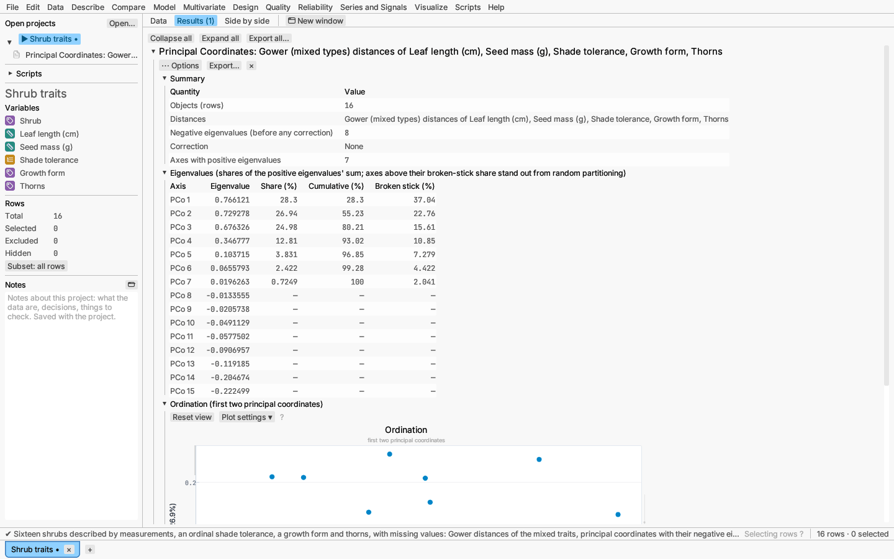

### Distance measures

Principal coordinates, hierarchical clustering and Data ▸ Reshape ▸ Distance
matrix… share these distances between rows x and y over p columns:

| Distance | Definition | Columns |
|---|---|---|
| Euclidean | √Σ(xⱼ − yⱼ)² | numeric (optionally standardized) |
| Manhattan (city block) | Σ\|xⱼ − yⱼ\| | numeric (optionally standardized) |
| Gower (mixed types) | Σ wⱼ dⱼ / Σ wⱼ over the columns present in both rows: numeric \|xⱼ − yⱼ\|/rangeⱼ; ordinal the same on the ranks; nominal 0 if equal, else 1 | any; missing values allowed |
| Jaccard (presence/absence) | 1 − a/(a + b + c), a = columns present (non-zero) in both, b and c in one only | numeric (non-zero = present) |
| Bray–Curtis | Σ\|xⱼ − yⱼ\| / Σ(xⱼ + yⱼ) | non-negative numbers (abundances) |
| Hamming | number of columns that differ | any |
| Simple matching | share of columns that differ | any |

Gower (1971) gives each column a weight wⱼ of 1 when both values are
present and 0 otherwise, so missing values only drop that column from that
pair. Text columns and numeric columns marked nominal count as nominal,
numeric columns marked ordinal as ordinal. A 0/1 column is compared as an
ordinary (symmetric) column: two absences count as agreement. For the other
distances a row with a missing value in a chosen column is left out.

## Functional data

Multivariate ▸ Functional data… analyses measurements that each trace a
curve: a temperature profile of every batch, a growth curve of every plant,
a spectrum of every sample. The data are in long form, one row per reading,
with a **curve identifier** column (rows with the same value form one
curve), a **time** column (where along the curve the reading was taken; any
numeric scale, such as wavelength) and a **value** column. Curves need not
be read at the same times or have the same number of readings; curves with
fewer than three readings are skipped and listed in the summary. Missing
values are left out.

- **Basis and smoothing.** Each curve is turned into a smooth function.
  *B-splines* (piecewise cubic polynomials by default, joined smoothly at
  equally spaced knots) suit most curves; a *Fourier series* suits curves
  that repeat with a period (the length of the time range unless you set
  one). *Smooth by GCV* uses many basis functions and a roughness penalty on
  the curvature, chosen by generalized cross-validation (one penalty for
  all the curves, so they are smoothed alike); *Fixed smoothing* sets the
  penalty λ yourself; *No smoothing* fits the basis by least squares, so the
  number of basis functions sets the smoothness. The number of basis
  functions is chosen for you unless you clear *Automatic number of basis
  functions*.
- **Registration.** Curves that rise and fall at different times blur the
  mean curve and mix differences in timing with differences in size.
  *Add landmark* lines up each curve's maximum or minimum (anywhere, or
  within a time window you give) at its mean time, by stretching each
  curve's time axis smoothly between landmarks; several landmarks must
  occur in the same order in every curve. *Continuous registration to the
  mean curve* then aligns the whole curve shapes (Ramsay & Silverman's
  minimum-eigenvalue criterion) with smooth increasing warping functions;
  More options sets how many functions describe each warp and how strongly
  bends are penalized.
- **Principal components.** Functional principal components are the
  typical ways the curves differ from their mean, each an *eigenfunction*
  of time; every curve gets a score on each. By default enough components
  are kept to explain 90% of the variation (at most six).
- **Factors** (optional) describe each curve, such as the settings of a
  designed experiment; they must be constant within each curve. The scores
  of the kept components are then modelled on the factors (main effects,
  and optionally two-factor interactions), which gives a predicted curve
  for any factor settings.

**Report:**

- *Summary* — curves, readings, basis, smoothing parameter and degrees of
  freedom, residual standard deviation, the components kept and the share
  of variation they explain.
- *Smoothed Curves* — each curve's smooth with its readings (curves are
  named in the key when there are ten or fewer). Select readings to select
  their rows everywhere.
- *Smoothing Parameter (GCV)* — log₁₀ GCV against log₁₀ λ with the chosen
  value marked.
- *Landmarks*, *Registered Curves* and *Warping Functions* (when
  registered) — each curve's landmark times and the mean they were moved to,
  the aligned curves, and each curve's warp of registered time to its own
  time (the diagonal is no warping).
- *Mean Curve* — the mean with a band of ±2 standard deviations, over the
  curves.
- *Functional Principal Components* — eigenvalues with the percent and
  cumulative percent of variation, the kept components marked.
- *Eigenfunctions*, each numbered at its largest value, and one *FPC Effect*
  plot per kept component: the mean curve and the mean plus and minus two
  standard deviations of that component's score (marked + and −), which
  shows what a high or low score means for the curve's shape.
- *Component Scores* — the curves on the first two components (coloured by
  the first categorical factor), and a table of every curve's scores.
- *Reconstruction* — each curve and its approximation from the kept
  components; *Fit by Curve* — readings, degrees of freedom, residual
  standard deviation and the reconstruction error of each curve.
- With factors: *Score Model* — Wilks' Λ test of each factor over the
  component scores, with the p-value for each component on its own;
  *Score Fits* (R² and RMSE of each component's model) and the *Effect
  Pareto*.
- *Curve Explorer* (with factors) — the predicted curve with its confidence
  limits: drag a factor's line to change its setting and watch the whole
  curve move, or drag the time line to read the prediction at any time. The
  *3-D Response Surface* shows the predicted value over time and one factor.

The options menu turns the Curve Explorer and 3-D profiler on or off and
saves each curve's component scores, the smoothed value at each reading and
(when registered) the registered time of each reading as new columns; every
row of a curve gets its curve's score.

*Try it:* Exotherm profiles — 24 batch temperature profiles from a factorial
in catalyst, feed rate and agitator. The first report models the component
scores on the three factors (more catalyst makes the exotherm come earlier
and higher); the second lines the peaks up by a landmark and continuous
registration.

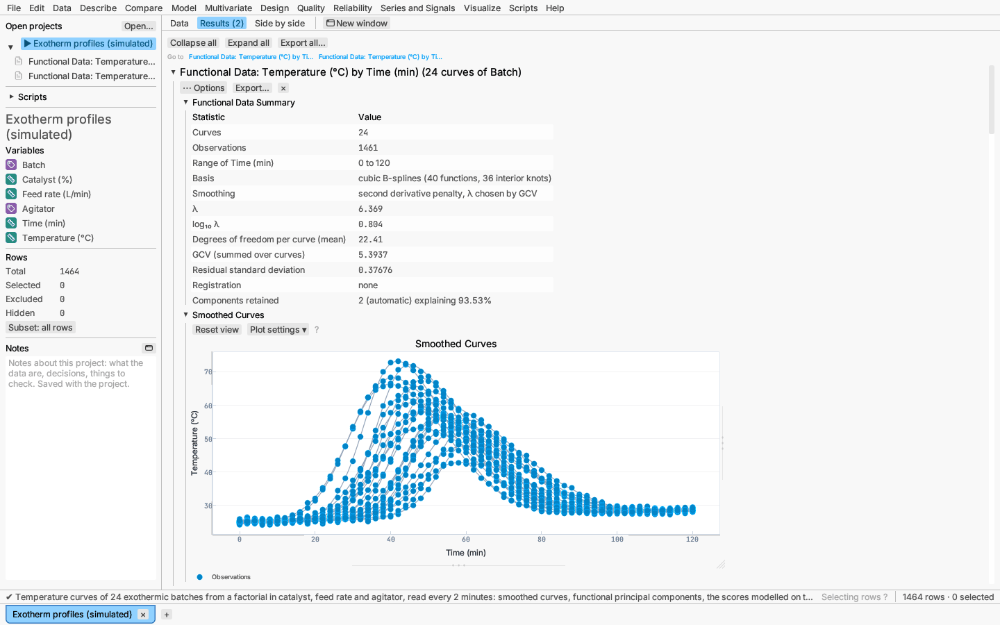
