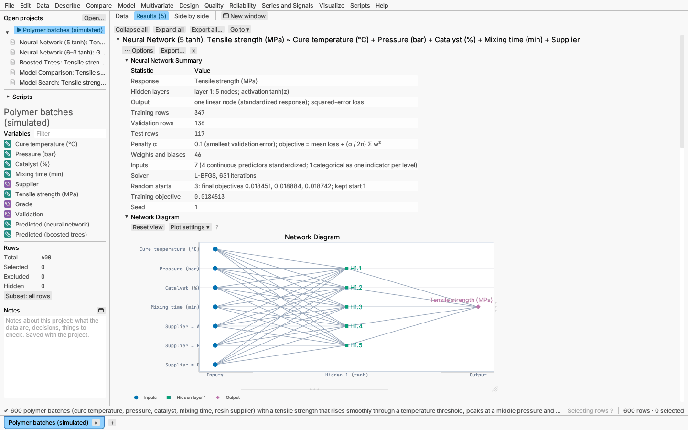

# Model: neural networks

Model ▸ Neural network… fits a fully connected feed-forward neural network
(a multilayer perceptron) to a continuous response or to a categorical one.
The predictors feed one or two *hidden layers* of nodes; each node takes a
weighted sum of the layer before it, adds a bias and passes the result
through an *activation* function, and the output layer combines the last
hidden layer:

- a continuous response gets one linear output node, fitted by least
  squares;
- two classes get one logistic node, the probability of the second class;
- three or more classes get one node per class, turned into probabilities
  by the softmax function.

Because every hidden node is a smooth curve of a different combination of
the predictors, a network can follow curved effects and interactions without
being told where they are. The price is that its weights are hard to read
directly, so the report leans on the profilers to show what the network has
learned.

**Hidden layers and activation.** Choose one or two layers and the number of
nodes in each (three nodes in one layer by default). The activation is the
hyperbolic tangent tanh(z) (the default), the logistic function
1 / (1 + e^(−z)), the rectified linear function max(0, z), or the identity
(which makes the whole network linear, useful as a check).

**Inputs.** Continuous predictors are standardized with the training rows'
mean and standard deviation; a categorical predictor becomes one 0/1
indicator per level. A continuous response is standardized too, and every
prediction is returned in its units. Rows missing a predictor are left out.

**Fitting.** The network minimizes the mean loss over the training rows
(half the squared error, or the cross-entropy for classes) plus a penalty
(α / 2n) Σ w² on the size of the weights (*weight decay*; biases are not
penalized). The penalty keeps the network from bending to fit noise: a
larger α gives a smoother, more cautious fit.

- *Penalty.* By default α is chosen from 0.0001, 0.001, 0.01, 0.1, 1 and 10
  by the smallest held-out error (root mean square error, or log loss for
  classes): on the validation rows, or by k-fold cross-validation (5 folds
  when every row trains). Ties go to the larger penalty. Under More options
  the penalty can be fixed instead. Roles work as for
  [decision trees](decision-trees.md#validation-and-fit-measures).
- *Solver.* L-BFGS, a quasi-Newton method that uses every training row at
  each step, or Adam, which takes many small steps on random batches of 200
  rows. *Automatic* (the default) uses L-BFGS up to 2,000 training rows and
  Adam above. *Most iterations* caps the L-BFGS iterations or Adam passes
  (2,000 by default); the summary says when a fit stopped at the cap.
- *Random starts.* A network's loss has many local minima, so it is fitted
  from several random sets of starting weights (3 by default) and the start
  with the smallest final objective is kept. Every start's objective is
  listed in the summary. The seed fixes the starting weights, so the same
  request always gives the same network.

**Report:**

- summary: the layers and activation, the output node and loss, rows by
  role, the penalty and how it was chosen, the number of weights, the
  inputs, the solver and its iterations, every random start's objective and
  the one kept;
- network diagram: the inputs (named on the left), the hidden nodes
  (H1.1, H1.2, …) and the output nodes, joined by their connections; each
  layer has its own colour and marker shape;
- penalty tuning: the held-out error of each penalty, ◀ marking the one
  used, and a plot of held-out error against log₁₀ α;
- fit measures by role (cross-validated with k-fold) and, for classes, the
  confusion matrix;
- weights: one table per layer, each row a node and each column a node
  feeding it (and the bias), shaded from negative to positive with the
  value printed in each cell;
- the Response Explorer and 3-D profiler (for classes they show the
  probability of one class; the second of two, or the most common of more).

**Saving:** predicted values, or each class's probability and the most
likely class; for a continuous response, the prediction formula as a
formula column (the standardized inputs, each hidden node as `tanh(…)`,
`logistic(…)` or `max(…, 0.0)`, and the output in the response's units), so
it follows later edits and works on new rows (see
[formula columns](../reference/formulas.md)); and the validation roles.
Saved predictions can be compared with other models in
[Compare models](model-comparison.md).

*Verified:* at weights fitted by scikit-learn, the objective, its gradient
and the predictions agree to 10⁻¹⁰ for a tanh regression network, a
two-layer logistic network for two classes and a rectified-linear softmax
network for three classes, and fits from random starts reach objectives at
least as small as scikit-learn's (details in the validation record).

*Try it:* Polymer batches: tensile strength rises through a temperature
threshold, peaks at a middle pressure and gains most from the catalyst when
the cure is cool. The strength network follows these curves (drag the
temperature line in the Response Explorer and watch the catalyst slice
flatten) and beats boosted trees on the test rows; a second network
classifies each batch's grade, and a [model search](model-search.md) ranks
the network against the other models.
