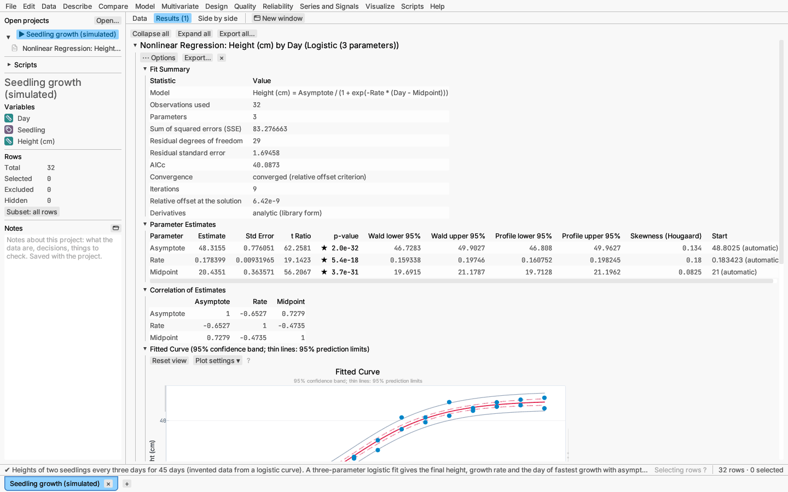
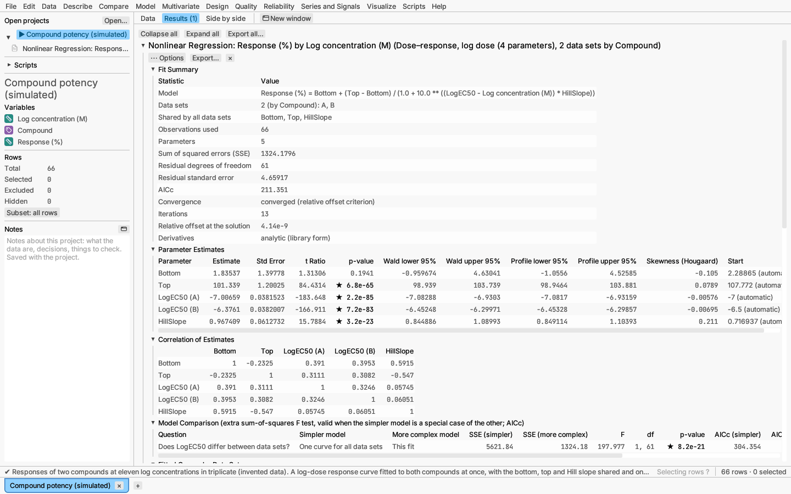

# Model: nonlinear regression

Model ▸ Nonlinear regression… fits a curve whose parameters do not enter
linearly — growth that levels off, a reaction rate that saturates, a decay
towards a floor — by least squares. Pick a curve from the library, write the
model as a formula with named parameters, give it as a differential
equation, or describe a curve implicitly by an equation that is zero on it.
Several data sets can be fitted at once with some parameters shared, and the
report compares models, flags outliers and reads unknowns off a standard
curve.

## Dialog

- **Response:** the numeric column to fit.
- **Model:** *Curve from the library*, *Formula with parameters*,
  *Differential equation* or *Implicit equation*.
  - A library **Curve** in one **Predictor (x)** column. The dialog shows the
    equation with its parameter names:

    | Curve | Equation |
    |---|---|
    | Exponential growth or decay | `Scale * exp(Rate * x)` |
    | Exponential with asymptote | `Asymptote + Scale * exp(Rate * x)` |
    | Logistic (3 parameters) | `Asymptote / (1 + exp(-Rate * (x - Midpoint)))` |
    | Logistic (4 parameters) | `Lower + (Upper - Lower) / (1 + exp(-Rate * (x - Midpoint)))` |
    | Gompertz | `Asymptote * exp(-exp(-Rate * (x - Inflection)))` |
    | Michaelis–Menten | `Vmax * x / (Km + x)` |
    | Power | `Scale * x ** Exponent` (x must not be negative) |
    | Rational (linear / linear) | `(a + b * x) / (1 + c * x)` |
    | Straight line | `Intercept + Slope * x` |
    | Dose–response, log dose (4 parameters) | `Bottom + (Top - Bottom) / (1 + 10 ** ((LogEC50 - x) * HillSlope))` |
    | Dose–response, dose (4 parameters) | `Bottom + (Top - Bottom) / (1 + (EC50 / x) ** HillSlope)` |
    | Asymmetric logistic, log dose (5 parameters) | `Bottom + (Top - Bottom) / (1 + 10 ** ((LogC - x) * HillSlope)) ** Asymmetry` |
    | Weibull growth | `Asymptote - (Asymptote - Initial) * exp(-((Rate * x) ** Shape))` |
    | Beta growth | `Ymax * (1 + (End - x) / (End - Peak)) * (x / End) ** (End / (End - Peak))` (x capped at End) |
    | Segmented line (one breakpoint) | `Intercept + Slope1 * x + (Slope2 - Slope1) * max(x - Breakpoint, 0)` |
    | Sum of two exponentials | `Plateau + Span1 * exp(-Rate1 * x) + Span2 * exp(-Rate2 * x)` |
    | Gaussian peak | `Baseline + Height * exp(-(x - Center)² / (2 Width²))` |
    | Lorentzian peak | `Baseline + Height / (1 + ((x - Center) / HalfWidth)²)` |

    The two dose–response curves are the four-parameter logistic of
    pharmacology (Hill equation), on log dose and on dose; *Bottom* is always
    the lower plateau, and a falling curve has a negative *HillSlope*. The
    asymmetric form (Richards 1959; Gottschalk & Dunn 2005) lets the curve
    approach its two plateaus at different rates. Weibull and beta growth
    (Yin et al. 2003) describe growth that stops at a final size; the
    segmented line changes slope at an estimated breakpoint (its derivative
    is not smooth there, so start near the bend if the automatic value is
    poor). The peak shapes fit a single peak on a flat baseline.

    Library curves find their own starting values (leave *Start* empty): for
    each value of the curve's rate, midpoint, Km or exponent on a grid scaled
    to the data, the remaining parameters follow by linear least squares, and
    the best combination starts the fit. Their derivatives are exact.
  - A **model formula** written like a [formula column](../reference/formulas.md):
    columns and parameters are variables, for example
    `Vmax * Conc / (Km + Conc)`. List every parameter under **Parameters**
    with a starting value (**Add parameter**, **Remove**). Parameter names are
    letters, digits and `_`, and may not be column names. Derivatives are
    computed by central differences. The dialog reports a formula it cannot
    read before you run it. A formula in **two** columns is a surface
    `z = f(x, y)`: the report draws it as contours over the data.
  - A **differential equation** for the response in a **Predictor (x)**
    column, such as time: write the **rate of change** `dy/dx` using the
    response, the predictor and the parameters by name (for example
    `-Vmax * Substrate / (Km + Substrate)`), choose which parameter is the
    response's value **at the start**, and give the **starting predictor
    value** (empty means the smallest observed value). Each evaluation
    solves the equation from that point with an adaptive Dormand–Prince
    5(4) Runge–Kutta method (Dormand & Prince 1980) to a relative tolerance
    of 10⁻⁸; derivatives are by central differences.
  - An **implicit equation** in the response and one other column that is
    zero on the curve, for example `(X - a)**2 + (Y - b)**2 - r**2` for a
    circle. The fit minimises the sum of squared *shortest distances* from
    the points to the curve (orthogonal distance regression; Boggs &
    Rogers 1990), so both columns are treated as measured with error. Each
    point's nearest point on the curve is found by Newton projection along
    the gradient followed by steps along the curve.
- **Parameters:** a starting value and optional **lower** and **upper
  bounds** for each. A start close to the answer helps a hard model
  converge; bounds keep a parameter in a meaningful range (a rate that must
  be positive, an asymptote that cannot be negative). Equal lower and upper
  bounds fix a parameter at that value: it is a known constant, not
  estimated, so it is marked *(fixed)*, has no standard error and uses no
  residual degree of freedom (the fit summary counts the parameters as, for
  example, *3 (2 estimated, 1 fixed by equal bounds)*); the fit, its
  residual standard error, tests and intervals are those of the model with
  that value written in. A parameter that merely ends on one of its bounds
  is still counted, since the data put it there.
- **Data sets (optional):** a column whose values split the rows into data
  sets (compounds, batches, subjects) fitted together in one *global* fit
  (Motulsky & Christopoulos 2004, ch. 37). Each parameter is either
  **Shared by all data sets** (one value for all, the default) or fitted to
  each data set separately: untick it to estimate, say, a separate potency
  for each compound with a common slope and plateaus. Bounds and starting
  values apply to every copy of a parameter.
- **Weights:** *Equal*, *1/Y² (relative error)* when the scatter grows in
  proportion to the response, *1/Y (Poisson)* for counts, or a **weight
  column** (positive values; a weight of 2 counts as two observations).
  Weighted fits minimise `Σ wᵢ (yᵢ − f(xᵢ))²`; the residual standard error
  is that of an observation of weight 1, and prediction limits for a new
  observation use the weight it would have (`1/ŷ²` or `1/ŷ`; 1 with a
  weight column).
- **Fitting:** *Least squares*; *Robust (Cauchy loss)*, which minimises
  `Σ ln(1 + (rᵢ/s)²)` so that a few wild points barely pull the curve; or
  *Least squares after removing outliers*, which fits robustly, flags
  outliers by the ROUT rule with false discovery rate **Q** (1% by default;
  Motulsky & Brown 2006), and refits the remaining rows by least squares.
  The robust scale `s` is the 68.27th percentile of the absolute residuals
  times `N/(N − K)`, re-estimated at each reweighting step. ROUT ranks the
  absolute residuals and, from the 70th percentile upward, flags the first
  residual whose two-sided t p-value (residual over the robust scale,
  `N − K` degrees of freedom) falls below `Q·(N − i + 1)/N`, together with
  every larger one.
- **Compare with** (one data set and a library curve): another library
  curve to compare against this one.
- **Confidence level** (95%), **Iteration limit** (200) and **Profile
  intervals** (on).

Rows that are excluded, or missing the response, a column the model reads,
the data set or a valid weight, are left out of the fit. Rows with a
response but no predictor value are not fitted: their predictor is read off
the curve (see *Inverse Prediction*).

## Report

- *Fit Summary:* the model, the initial value of a differential equation,
  the data sets and which parameters they share, observations used, rows
  excluded or missing, the weighting and fitting method, the robust scale
  and outliers removed, the sum of squared errors, residual degrees of
  freedom, the residual standard error, AICc, whether and how the fit
  converged, the iterations, the relative offset at the solution, and
  whether derivatives were exact or numeric.
- *Warnings* (only when there is something to say): the fit did not
  converge (the estimates are those of the last iteration; try other
  starting values), a parameter ended on one of its bounds (it is held there,
  without a standard error), or a profile interval is open on one side.
- *Parameter Estimates:* each estimate with its asymptotic standard error,
  t ratio and p-value (for the hypothesis that the parameter is zero), the
  Wald interval `estimate ± t × SE`, the profile interval, and the starting
  value used (marked *automatic* when the library chose it). Unshared
  parameters appear once per data set, as `LogEC50 (A)`. The profile
  interval holds the parameter fixed at trial values, refits the others, and
  keeps the values whose increase in the sum of squares is not significant
  (Bates & Watts 1988, ch. 6). It follows the curvature of the model, so it
  is often asymmetric, and it is the better interval when the two disagree.
  The *Skewness (Hougaard)* column measures how far each estimate's
  sampling distribution is from the symmetric one the Wald interval
  assumes (Hougaard 1985; Ratkowsky 1990, §2.6): below 0.1 in absolute
  value the parameter behaves close to linearly, above 0.25 the
  nonlinearity is noticeable and a reparameterization (for example log EC50
  instead of EC50) usually helps. It is computed from the first and second
  derivatives of the model at the estimates.
- *Correlation of Estimates:* correlations near ±1 mean the data barely
  separate two parameters; a different parameterization or more data over
  the curve's range helps.
- *Fitted Curve:* the data with the fitted curve, the confidence band for
  the mean (shaded) and prediction limits for single new observations (thin
  lines), both by the delta method. A formula that reads several columns
  shows observed against predicted values instead. Points are linked to
  their rows. With data sets, *Fitted Curves by Data Set* draws one curve
  per data set in the data set's colour and marker. An implicit curve is
  drawn over the points without bands.
- *Fitted Surface* (a formula in two columns): a filled contour map of the
  fitted surface with its colour bar and the observations (see
  [Contour maps](../reports/plots.md#contour-maps)).
- *Model Comparison* (with data sets, or a curve to compare with): each row
  asks one question — *Does LogEC50 differ between data sets?* (the fit
  against the same model with that parameter shared), *Do the data sets
  differ?* (against one curve for all), or *Dose–response or Logistic?* —
  and answers it two ways. The **extra sum-of-squares F test**
  `F = ((SSE₁ − SSE₂)/(df₁ − df₂)) / (SSE₂/df₂)` applies when the simpler
  model is a special case of the other. **AICc**
  `N ln(SSE/N) + 2K + 2K(K + 1)/(N − K − 1)`, with `K` the estimated
  parameters plus one, also compares models that are not nested; the
  probability that the more complex model is the better one is
  `e^{−Δ/2} / (1 + e^{−Δ/2})` with `Δ` its AICc minus the simpler model's
  (Burnham & Anderson 2002). No comparisons are made for a robust fit.
- *Outliers* (when outliers are removed): each flagged row with its value
  and its residual from the robust fit, or a note that none was found.
- *Residuals vs Predicted:* residuals against fitted values with a zero line
  (*Distances to the Curve* for an implicit fit: each point's signed
  distance to the curve).
- *Inverse Prediction* (rows with a response but no predictor): the
  predictor value at which the curve reaches each such response, with an
  interval for one new observation — every `x` whose prediction limits
  contain the response (for a straight line this is the classical
  calibration interval, Draper & Smith 1998, §3.2). An interval that the
  data range does not close is reported as open, and a response the curve
  reaches more than once is noted. This reads unknown samples off a
  standard curve.
- *Prediction Formula:* the fitted model as a formula, with **Copy formula**.

**⋯ Options** saves predicted values (every row the model can be computed
on, excluded rows included), residuals, or the prediction formula as a
formula column: a library curve with the estimates written in, or your
formula preceded by `let Vmax = …;` for each parameter (with data sets, one
branch per data set). It also saves inverse predictions, and for an
implicit curve the distance of each row to it. A differential equation has
no prediction formula. **Response Explorer** and **3-D surface profiler**
(models with two or more inputs, such as a surface or a curve with data
sets) show the fitted response as each input changes. Renaming a column
that a model formula uses makes the report fail until you run it again with
the new name.

*Try it:* Seedling growth (simulated), a three-parameter logistic fit;
Compound potency (simulated), two compounds fitted together with a
separate LogEC50 for each; Assay standard curve (simulated), a weighted
dose–response standard curve with an outlier removed and six unknowns read
off it; Substrate depletion (simulated), a Michaelis–Menten rate equation
fitted as a differential equation.

## How the fit is computed

The estimates minimise the sum of squared residuals by the
Levenberg–Marquardt method: each step solves the linearised problem with a
damping term that shrinks to zero near the solution, where the steps become
plain Gauss–Newton steps. The fit has converged when Bates & Watts' relative
offset — the remaining Gauss–Newton step measured against the residual
standard error — falls below 10⁻⁸. Standard errors and bands come from the
derivative matrix at the solution. The validation record (`docs/validation.md`
in the source repository) lists how the results are checked.
