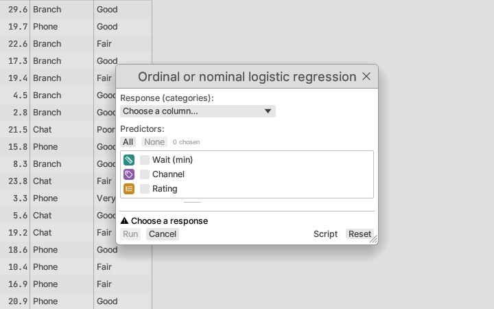
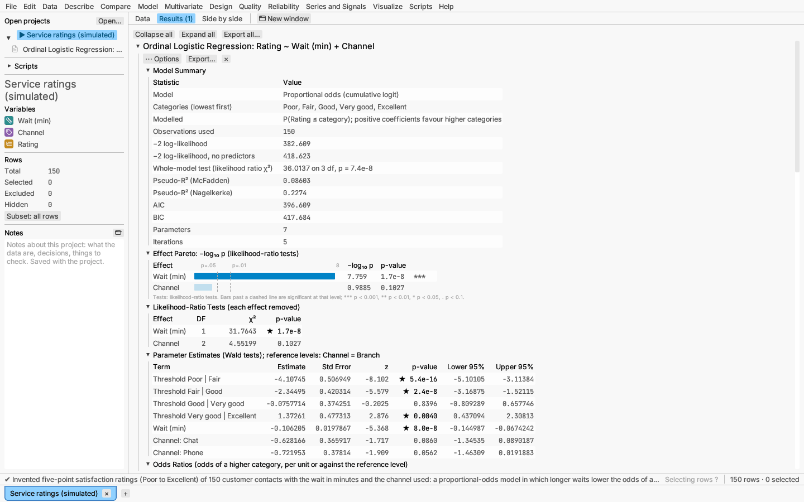

# Model: generalized, mixed and penalized models

## Generalized linear model

Model ▸ Generalized linear model… fits binomial, Poisson, Gaussian and Gamma
families, with categorical predictors. Choose the response first: the dialog
then suggests a distribution from its values (binomial for a column with two
values or text, Poisson for whole numbers of zero or more, normal otherwise),
which you can change. For a binomial response, **Event** chooses which of the
two values the model predicts the probability of; it starts at the second in
sorted order ("Yes" against "No"). The dialog offers each family's links, the
canonical one first:

- **Binomial:** logit, probit or complementary log-log. Probit and
  complementary log-log reports drop the odds ratios, which belong to the
  logit link.
- **Poisson:** log or identity.
- **Normal:** identity or log.
- **Gamma** (positive, right-skewed responses with a constant coefficient of
  variation): inverse, log or identity. The dispersion is estimated from
  Pearson's statistic and the tests use t; with the log link the report adds
  mean ratios.

For grouped yes/no data (a count out of a number of trials per row) and the
effective doses of probit analysis, see
[Dose–response analysis](dose-response-and-agreement.md).

**More options** adds **two-factor interactions** (tick any pair of
predictors), **spline terms** for continuous predictors that are not in an
interaction, and **comparisons within slices** and **slopes by group**, as
for the [linear model](linear-models.md#linear-model). In a GLM the slices
are Wald tests from the coefficients' covariance and the
least-squares means and differences are on the link scale (log odds, log
mean), as R's `emmeans` gives them by default.

**Report:** parameter estimates, a likelihood-ratio test for each term, a
fitted curve (one predictor) or observed-versus-fitted plot, and the
Response Explorer and 3-D profiler. The explorer's confidence band is the
interval for the linear predictor mapped through the inverse link. With the
inverse link (mean = 1/η), where that interval includes η = 0 the mean is
not bounded at all, so the band is left out there rather than drawn as a
range that would not even contain the prediction.

**Saving:** predicted values (the fitted mean), or the prediction formula as
a formula column: the inverse link applied to the linear predictor —
`logistic(…)`, `normal_cdf(…)`, `1.0 - exp(-exp(…))`, `exp(…)` or `1.0 / (…)`.

*Try it:* Customer churn (logistic and Poisson models).

## Ordinal and nominal logistic regression

Model ▸ Ordinal or nominal logistic regression… models a response with
several categories (a rating scale, a choice among options). Any column can
be the response; its categories are the distinct values of the rows used.

- **Ordinal (ordered categories):** the proportional-odds model,
  P(response ≤ category j) = logistic(αⱼ − xβ). There is one threshold αⱼ
  between each pair of neighbouring categories and one set of coefficients
  for all of them, so a positive coefficient moves the response up the scale.
  The dialog lists the categories in sorted order (numbers numerically, text
  alphabetically); use the ▲ and ▼ buttons to put them in their real order,
  lowest first. The order is saved with the report.
- **Nominal (unordered categories):** baseline-category logits,
  ln(P(category j) / P(reference)) = β₀ⱼ + xβⱼ, with an intercept and its own
  coefficients for every category but the reference. Choose the reference
  category in the dialog (the first category by default).

A column whose measurement level is nominal starts as a nominal model, any
other as an ordinal one; you can switch either way. Predictors and model
effects (interactions, powers, keeping the model hierarchical) are chosen as
for the [linear model](linear-models.md); categorical predictors are coded
the same way.

**Report:**

- *Model Summary:* the categories, −2 log-likelihood with and without the
  predictors, the whole-model likelihood-ratio χ², McFadden's and
  Nagelkerke's pseudo-R², AIC, BIC, and a warning when the fit did not
  converge (usually because a predictor separates the categories).
- *Effect Pareto* and *Likelihood-Ratio Tests*: each effect tested by
  refitting the model without it (for a nominal model the test covers the
  effect in every equation, so its degrees of freedom are multiplied by the
  number of equations).
- *Parameter Estimates* with standard errors, Wald z tests and 95%
  intervals: the thresholds and coefficients (ordinal), or one block per
  category (nominal).
- *Odds Ratios* with intervals: for the ordinal model, the factor by which the
  odds of a higher category change per unit of a continuous predictor, or
  against a categorical predictor's reference level; for the nominal model,
  the odds of each category against the reference category.
- *Parallel-Lines Test* (ordinal only): the score test of the proportional-odds
  assumption. A small p-value says the effects differ between the cumulative
  splits; consider the nominal model then.
- *Classification:* counts of each actual category by the most likely
  predicted one, with the share correct.
- *Predicted Probabilities* against the first continuous predictor, one curve
  per category, with the other predictors at their mean or most frequent
  level. Each row is drawn at its fitted probability of the category it has,
  and can be brushed.
- *Prediction Formulas* for each category's probability.

**Saving:** each category's probability ("Prob *y* = *category*") and the
most likely category ("Most likely *y*"), all as formula columns that follow
later edits to the predictors.

*Try it:* Service ratings (ordinal) and Commute modes (nominal), two invented
datasets.

## Mixed model

Model ▸ Mixed model… fits linear and generalized linear mixed models.

- **Random effects:** random intercepts, and random slopes that are correlated
  or independent, for grouping columns that are crossed or nested.
- **Families:** normal (REML or ML, with Satterthwaite t and F tests),
  binomial, Poisson, Gamma, negative binomial, and **ordinal** (cumulative
  logit link).
- **Estimation** for non-normal families: the Laplace approximation, or
  adaptive Gauss–Hermite quadrature when there is a single random intercept.
- **Frequency and weight:** a *frequency* column (whole numbers) makes each
  row count as that many identical observations; a *weight* column gives
  prior weights, so the residual variance of a row is σ²/w (normal) or its
  dispersion is divided by w (Poisson, Gamma, negative binomial). Weights are
  not offered for the binomial family, whose number of trials already plays
  that role. An **offset** column (GLMMs) is added to the linear predictor
  with its coefficient fixed at 1, such as log exposure in a Poisson rate
  model.

**Normal-family options** (under *More options* unless noted):

- **Residual variance differs by** (in the main dialog): a grouping column
  whose levels each get their own residual variance, σ²·δ²_g with δ = 1 for
  the first level. The report adds a *Residual variance test* section: the
  likelihood-ratio test of equal variances against the fit with one
  variance (χ² with one fewer degree of freedom than levels; both fits use
  the same REML or ML criterion), and the variance table lists the residual
  variance of each level.
- **Denominator df:** *Satterthwaite* (default) or *Between–within*. The
  between–within method gives each fixed effect the degrees of freedom of
  the outermost grouping level at which it varies: a column that is constant
  within each group of a grouping level (and that level's coarser levels)
  gets that level's df, G_ℓ − G_ℓ₋₁ − p_ℓ, and the intercept and effects
  that vary within the innermost groups get the residual df, N − G_L − p
  (Pinheiro & Bates 2000, §2.4.2). Simple and quick, it suits balanced
  designs; Satterthwaite's approximation is better for unbalanced data.
- **Robust standard errors, clustered on the outermost grouping:** the
  cluster-robust (sandwich) covariance of the fixed effects with the
  bias-reduced CR2 correction (Bell & McCaffrey 2002; Pustejovsky & Tipton
  2018). Each coefficient's t test uses the Satterthwaite degrees of freedom
  of its CR2 variance, and each effect's test is the Hotelling T² test with
  its approximate F distribution (HTZ). The fixed-effects table keeps the
  model-based standard errors in a column of their own. The robust errors
  hold even when the variance model is wrong, but need a fair number of
  clusters (20 or more is a common guide).

**Ordinal responses.** With the ordinal family, the response categories are
ordered (natural order, or the order set in the dialog) and the model is
logit P(Y ≤ k) = α_k − η, where η holds the fixed and random effects
(Agresti 2010, ch. 10). A positive coefficient means higher categories are
more likely. The model has no intercept: its place is taken by the
**thresholds** α₁ < … < α_{K−1}, one between each pair of adjacent
categories, which the report lists with standard errors. The fixed-effects
table adds **odds ratios** (e^β, the factor by which the odds of a higher
rather than a lower category change) with confidence limits, and a
*Category probabilities* section compares, for every category, its count
and observed proportion with the mean predicted probability over the rows,
once including each group's random effects and once with the random effects
at zero (a typical group). Saving offers one probability
column per category and the most likely category. Residual plots use the
expected category number (1 for the lowest category).

**Report:** fixed effects and tests, variance components with Satterthwaite χ² limits (always positive),
correlations between random effects, and conditional modes (the estimated
random effects). The Response Explorer works at the population level.

**Comparisons** (More options): **comparisons within slices** of a
two-factor interaction and **slopes by group**, as for the
[linear model](linear-models.md#linear-model), on the fixed effects. For a
normal model each slice test is an F test with Satterthwaite's denominator
degrees of freedom (as R's `lmerTest::contest` with `joint = TRUE`); for
other families the tests are Wald tests on the link scale.

**Saving:** population-level predictions, predictions including the random
effects, or residuals.

*Verified:* against an independent dense reference implementation and the
Dyestuff data; weights, offsets, CR2, unequal variances, between–within df
and the ordinal model against R (lme4, lmerTest, nlme, clubSandwich and
ordinal) on the Orthodont and wine data.

*Try it:* sample *Wine bitterness (Randall 1989) — ordinal mixed model*;
sample *Plant growth (simulated) — ANCOVA, outliers* has a second mixed
model with a residual variance for each fertilizer and robust standard
errors.

## Penalized regression

Model ▸ Penalized regression (lasso, ridge)… fits the lasso, ridge regression
and the elastic net.

- The penalty λ is chosen by k-fold cross-validation, reporting both λ_min
  (lowest cross-validated error) and λ_1SE (the largest λ within one standard
  error of it). A predictor that happens to be constant within one fold's
  training rows gets a zero coefficient in that fold; a predictor whose
  values are all equal in the whole table is refused.
- **Coefficient paths** show each coefficient as λ changes.
- Coefficients are reported in the original units of the predictors.
- Response Explorer and 3-D profiler.

**Saving:** predicted values, or the prediction formula of the λ_1SE fit
(dropped predictors are left out).

*Try it:* Longley economy; Customer churn.
