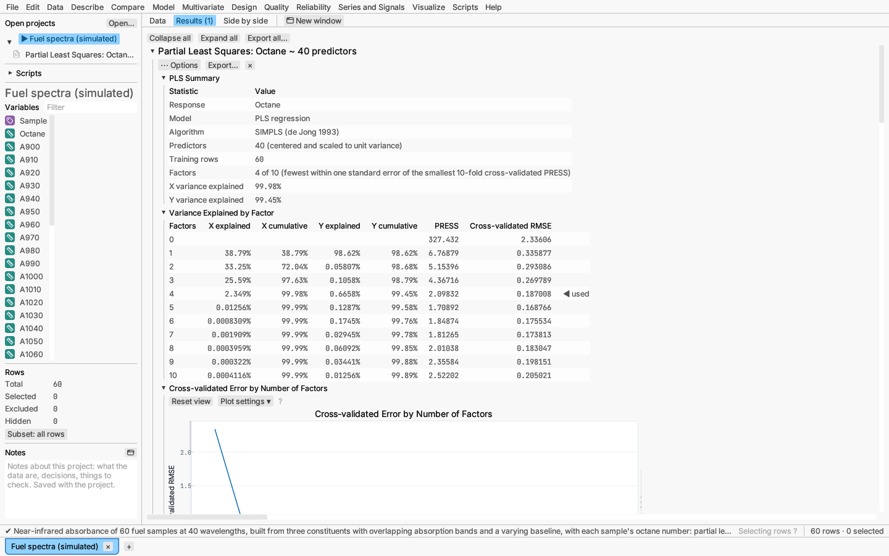

# Model: partial least squares

Model ▸ Partial least squares… regresses the response on a few **factors**:
weighted sums of the predictors, chosen to explain both the predictors and
the response (Wold; de Jong, 1993). It suits many strongly correlated
predictors, such as the absorbances of a spectrum, even when there are more
predictors than rows.

**Predictors** must be numeric. They are centered, and by default standardized
to unit variance so that predictors on large scales do not dominate. Rows
missing a predictor are left out.

**Method:** SIMPLS (the default) or NIPALS. The two agree for a single
response.

**Number of factors.** Fix it, or let held-out rows choose it: the fewest
factors whose held-out mean squared error is within one standard error of
the smallest. Held-out error comes from the validation rows, or from k-fold
cross-validation (10 folds when every row trains). Roles work as for
[decision trees](decision-trees.md#validation-and-fit-measures).

**Categorical response.** PLS discriminant analysis (PLS-DA) fits one 0/1
indicator per class. The fitted indicators, clipped to [0, 1] and rescaled to
sum to one, serve as class probabilities.

**Report:**

- summary;
- factors table: X and Y variance explained by each factor and in total,
  held-out PRESS and RMSE, with ◀ marking the number used;
- PRESS against the number of factors;
- fit measures by role, and the confusion matrix (PLS-DA);
- variable importance in projection (VIP): above 1 is important, below 0.8
  minor;
- coefficients in the predictors' original units;
- X loadings, and a score plot of the first two factors (points grouped by
  class for PLS-DA; every point is a data row, so selections link);
- the Response Explorer and 3-D profiler.

**Saving:** predicted values with their prediction formula (continuous
response), or each class's probability and the most likely class, and the
validation roles.

*Verified:* with every factor, PLS equals least squares (to 10⁻⁹); one factor
matches its closed form; NIPALS and SIMPLS agree for one response; scores are
orthogonal; VIP scores have mean square 1.

*Try it:* Fuel spectra: octane from 40 near-infrared absorbances, with the
number of factors chosen by 10-fold cross-validation. Flower measurements
also opens with a PLS-DA of the variety.
