# Quality

The Quality menu is in five groups, each under a small heading: **Control
charts**, **Process capability**, **Measurement systems** (gauge studies and
attribute agreement), **Acceptance sampling**, and **Problem-solving tools**
(analysis of means, Pareto chart, cause-and-effect diagram and multi-vari
chart).

## Control charts

Quality ▸ Control chart… draws variables control charts: **X̄ and R**,
**X̄ and S** (subgroups) and **individuals and moving range**, with the eight
**Nelson run rules**, and the **moving-average**, **three-way
(between/within)**, **zone** and **short-run** charts described below.
Flagged points are drawn as diamonds and labelled with the numbers of the
rules they break. Hover over a chart type in the dialog for what it is for.

### Building a chart from column roles

The dialog has five roles. Choose a column for each from its list, or drag
a column from the variables list onto it; choose **None** to clear an
optional role.

- **Measurement** (required): the numeric column to chart.
- **Subgroup ID:** rows sharing a value form one subgroup, in order of
  first appearance, so the rows of a subgroup need not be adjacent and
  subgroups may differ in size. Without it, consecutive rows are grouped
  by the **Subgroup size**. Giving a subgroup ID switches an individuals
  chart to X̄ and R.
- **Phase:** each run of consecutive rows with the same value (for example
  *before* and *after* a process change) is a phase with its own center
  line, σ and limits, computed from that phase's points only. Run rules
  restart at each phase, the moving range is not taken across a boundary,
  and the chart separates the phases with a solid rule, shades every other
  phase lightly and names each one in a label centred along the top edge of
  the chart (the key lists the *Phase boundary*). Exported charts show the
  same.
- **Point label:** names each point (from the first row of its subgroup)
  in the tooltip and the table of flagged points. Without it, a subgroup ID
  serves as the label.
- **Part number** (short-run charts only): a column of any type naming the
  part each row belongs to. Assigning it switches the chart type to
  short-run.

The measurement, subgroup ID, phase and part number must be different
columns; the dialog names any column chosen for two of them. The point
label may repeat another role.

When subgroups differ in size, the limits are computed for each size and
drawn as steps: a smaller subgroup has wider limits (Montgomery,
*Introduction to Statistical Quality Control*, §6.3.1). The Control Limits
table then shows each limit as a range, and for several phases it has a row
per phase.

Rows with a missing measurement, subgroup ID or phase are left out. X̄
charts leave out subgroups with a single value. Excluded rows leave the
chart and its limits, so excluding an assignable-cause point recomputes the
limits without it.

### Changing a chart in place

The report's **Options** menu switches the **chart type** (and the subgroup
size, when there is no subgroup ID column) without reopening the dialog, and
chooses the **run rules** applied to each chart. By default all eight apply
to the mean or individuals chart, and only rule 1 (a point beyond the
limits) to the dispersion chart. It also shows or hides the dispersion
chart, the 1σ and 2σ zone lines, and the table of flagged points. Rules 5
to 8 measure distances in σ, so they are not applied when the limits have
no spread (σ = 0, as for a series that never varies).

Hover over a point to see its sample number, label, phase and the rules it
breaks.

### Limit and display options

More options in the dialog set how the limits are drawn on individuals,
X̄–R and X̄–S charts (Montgomery, *Introduction to Statistical Quality
Control*, ch. 6–7; Wheeler, *Advanced Topics in SPC*):

- **Limits at k σ:** the limits are center ± kσ̂ (± kσ̂/√n for means) and the
  dispersion limits use k in place of 3, for example 2.5σ for earlier
  warning. The run rules' zones stay at 1σ and 2σ.
- **Values per moving range** (individuals): each moving range is the
  largest minus the smallest of w consecutive values, σ̂ = M̄R / d₂(w), and
  the moving-range limits are M̄R (1 ± k d₃(w)/d₂(w)), the lower one at
  least 0. The first w − 1 points have no moving range; hovering over a
  moving range lists the w rows it spans.
- **Limits from standard (historical) values:** type a process center μ₀
  and σ₀, or press **Read from …** to take them from a limits table saved
  earlier (any open table with Measurement, Process center and Process
  sigma columns and a row for this measurement). The center is μ₀, the
  limits μ₀ ± kσ₀/√n, and the range, standard deviation or moving range
  chart is centered on d₂σ₀, c₄σ₀ or d₂(w)σ₀ with limits (d₂ ± k d₃)σ₀,
  (c₄ ± k√(1 − c₄²))σ₀ or (d₂(w) ± k d₃(w))σ₀. Use them to judge new data
  against limits set in an earlier, stable period.
- **Show only the last N subgroups** (any chart type): the limits come
  from all subgroups, with the earlier ones hidden, or from the N shown
  alone. The limits table says how many are shown.

The report's Options menu adds a **Run chart of every value**: each value at
its subgroup's position, with the subgroup medians (or means) joined and a
center line at the median (or mean) of all values. It also has **Save limits
as data table**, which adds a table with each phase's center, limits,
process center, process σ, subgroup size and σ multiple; open it with a
later dataset and its values can be read back as standard values.

*Try it:* Fill weights (an X̄ and R chart by the Subgroup column, and the same
chart with Filler setting as the phase: the upward shift from subgroup 21 is
flagged on the first chart, while the second gives each setting its own
limits); Beam deflection (an individuals chart on which no rule fires: the
readings swing so much from one to the next that the moving ranges, and so the
limits, are wide. The runs test in its distribution report catches the
oscillation).

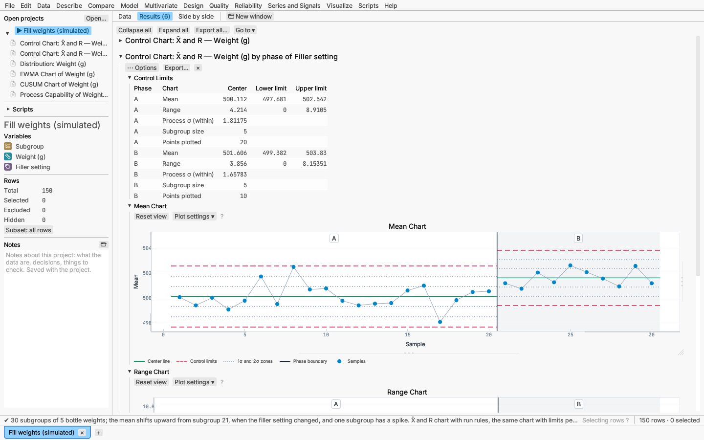

### Moving-average chart

Each point is the average of the last *w* values (individual values, or
subgroup means with a subgroup size or ID), with *w* the **span** (default
5, set in the dialog or the Options menu). Averaging makes the chart more
sensitive to small sustained shifts than an individuals chart. With σ
estimated as for the individuals or X̄ chart, the limits of point *i* are

x̿ ± 3σ √(Σⱼ 1/nⱼ) / wᵢ,

summing over the wᵢ subgroups in its window; the first *w* − 1 points of each
phase average fewer values and have wider limits. Because consecutive
averages share values, only rule 1 (a point beyond the limits) applies; the
other run rules are switched off for this chart. The dispersion chart is the
usual moving-range, R or S chart.

### Three-way (between/within) charts

When the subgroup means vary more than the spread within subgroups allows
(for example readings across a coil, with coil-to-coil differences that are
part of the process), an X̄ chart's limits, built from the within-subgroup
spread, flag nearly every subgroup. The **three-way** chart (Wheeler 1995,
*Advanced Topics in Statistical Process Control*) draws three charts:

- the subgroup means as **individual values**, with limits from the moving
  range of the means: X̿ ± 3 MR̄/d₂(2);
- the **moving range** of the means;
- a **within-subgroup** range (three-way R) or standard-deviation (three-way
  S) chart, titled *Within-Subgroup … Chart*, with its own run-rule choice
  in the Options menu.

### Zone chart

The zone chart (Jaehn 1987) scores each point by the σ zone it falls in: 1
within 1σ of the center line, 2 between 1σ and 2σ, 4 between 2σ and 3σ and
8 beyond 3σ (a point exactly on a boundary belongs to the inner zone).
Scores add up while points stay on the same side of the center line; the
total restarts when a point crosses to the other side and after a signal.
The chart **signals** when the total reaches 8. Each point is labelled with
its total, signalling points are drawn as diamonds, and the flagged-point
table lists them with the rule "zone". The usual run rules are switched
off. Scoring 1 for points near the center line means eight points in a row
on one side signal, so this chart signals by chance more often than a chart
with rule 1 alone.

### Short-run charts for several part numbers

When one process makes several part numbers in short runs, no single part
has enough data for a chart of its own. The **short-run Z and moving-range
chart** (Griffith 1996, *Statistical Process Control Methods for Long and
Short Runs*) standardizes every value by its own part's estimates,

Z = (x − x̄ₚ) / σₚ, with σₚ = MR̄ₚ / d₂(2),

where MR̄ₚ is the average moving range between consecutive values of the
same part (within the phase). The Z chart has center line 0 and limits ±3;
the moving range of the Z values has center line d₂(2) and upper limit
d₂(2) + 3d₃(2). The **Part Estimates** table gives each part's count, mean
and σ (per phase). Each part needs at least two values in each phase.

*Try it:* Coil thickness (the X̄ and R chart flags most coils, the three-way
chart judges the coil means against their own variation; the moving-average
and zone charts of Line speed catch the shift from reading 101); Short-run
machining (three part numbers on one chart, where the Flange parts made
after the tool slipped stand out).

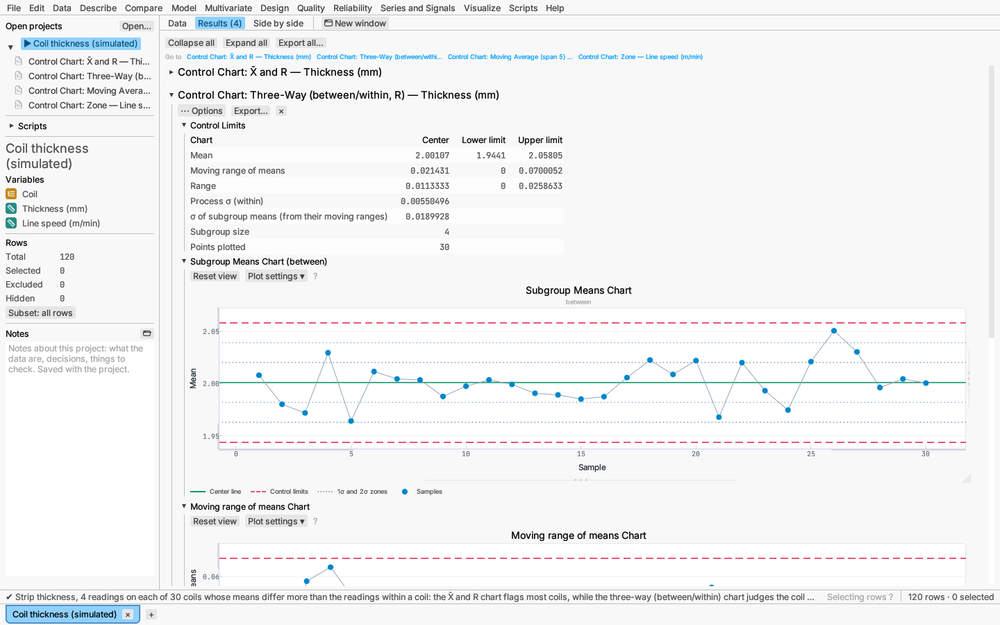

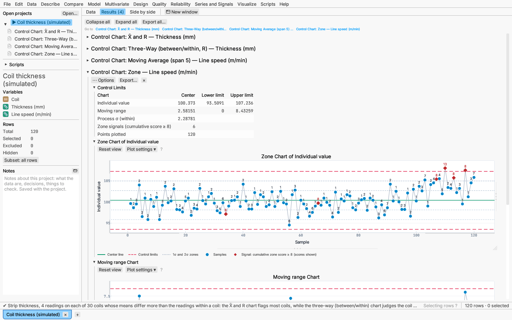

## Count and rare-event charts

Quality ▸ Count and rare-event chart (p, np, c, u, p′, u′, g, t)… charts
counts, one row per subgroup:

- **p** and **np** charts for defective units, **c** and **u** charts for
  defects per subgroup;
- **Laney p′** and **u′** charts (Laney 2002) for large subgroups, where
  real variation of the rate from subgroup to subgroup (overdispersion)
  makes the ordinary limits so narrow that most points fall outside. Each
  subgroup's value is standardized, zᵢ = (pᵢ − p̄)/σ_pᵢ, and σ_z, the
  moving range of the z values divided by d₂(2), widens the limits to
  p̄ ± 3σ_z σ_pᵢ. σ_z near 1 means no overdispersion and the chart is the
  ordinary one; the summary table reports it;
- the **g chart** (Benneyan 2001) for rare events, with one row per event
  giving the number of units (cases, procedures, opportunities) since the
  previous one. The counts are geometric, with center line ḡ and limits
  ḡ ± 3√(ḡ(ḡ + 1)) (the lower limit is usually 0). A point above the upper
  limit is an unusually long run without an event: an improvement;
- the **t chart** (Nelson 1994) for the time between rare events. Times
  are transformed by y = t^(1/3.6), which makes exponential or Weibull times
  roughly normal; an individuals and moving-range chart of y gives the
  limits, which are transformed back and drawn on the original time scale
  (so they are not symmetric).

The dialog takes the count column, the subgroup size (a column or a
constant) for the charts that need one (for p, np and p′ the number of
units inspected, a whole number; for u and u′ the number of inspection
units, which may be fractional, such as 2.5 m² of panel), an optional **phase** column (each
run of equal values gets its own center line and limits), and whether to
apply the **run rules**. The rules are applied to the standardized values
(or, for the t chart, the transformed values), so they work with limits
that vary with subgroup size; the zones are measured in the plotted
statistic's σ even where a proportion's upper limit is capped at one. The Options menu switches the chart type and
the run rules in place.

*Try it:* Daily inspection (p, u and c); Ward safety (the p chart of
readmissions flags many weeks, while the p′ chart, with σ_z well above 1,
flags almost none; a u′ chart of medication errors; a g chart with one long run
without infection; a t chart whose run rules catch pressure injuries
becoming more frequent).

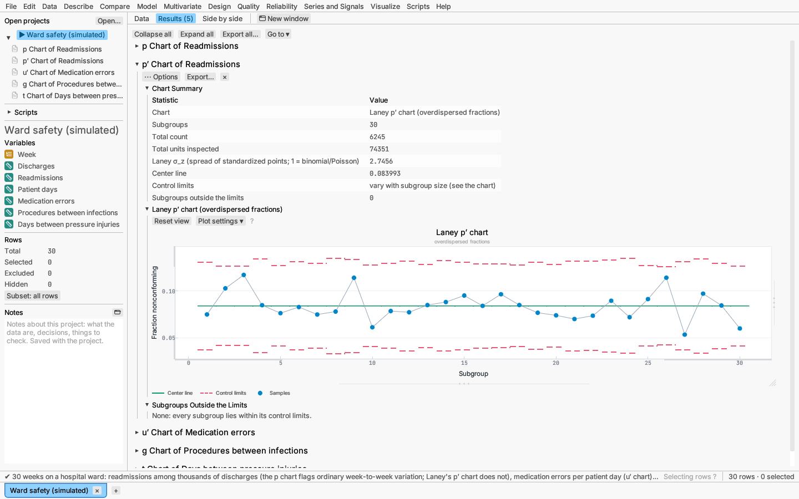

## EWMA and CUSUM charts

Quality ▸ EWMA chart… and CUSUM chart… detect small, persistent shifts. The
target and σ can be given or estimated from the data: without them the
target is the mean and σ the average moving range ÷ d₂. A signals table
lists where the chart signals.

- **EWMA** plots the exponentially weighted moving average with weight
  **λ** (default 0.2, from 0.01 to 1; smaller λ remembers more of the past
  and catches smaller shifts) and limits **L** standard errors wide
  (default 3).
- **CUSUM** accumulates deviations above and below the target, less a
  reference value **k** (default 0.5), and signals when a sum exceeds the
  decision interval **h** (default 5), both in units of σ; the settings
  table shows them in data units as K = kσ and H = hσ. Choose k as about
  half the shift you want to detect.

In scripts these are the `ewma-chart` (`lambda`, `width`) and
`cusum-chart` (`k`, `h`) analyses.

*Try it:* Fill weights.

## Multivariate control charts

Quality ▸ Multivariate control chart… watches two or more correlated
measurements together, where separate charts for each would miss a point
that is unusual only in combination (a high fill volume without the torque
that normally goes with it). Tick the measurements, then choose:

- **Hotelling T²**: the squared distance of each observation, or each
  subgroup mean, from the overall mean, scaled by the covariance. Subgroups
  come from an ID column or from consecutive runs of a fixed size (1 gives
  individual observations).
- **Generalized variance |S|**: the determinant of each subgroup's
  covariance matrix, which grows when the spread grows. It needs subgroups
  of at least two, and more rows per subgroup than measurements. Limits sit
  three standard errors either side of the expected |S| (Alt 1985); a
  negative lower limit is set to zero.
- **MEWMA**: an exponentially weighted moving average of the individual
  observations, charted as a T² distance (Lowry et al. 1992). Small,
  sustained shifts build up over several points. Set the weight λ (0.1 by
  default) and either the upper limit H or the in-control average run
  length the limit should give (200 by default, at most 2000); the app
  finds that limit by simulation, the same each time. The simulation follows
  5000 runs up to a run length of 200 and fewer beyond it (500 at 2000), so
  the limit for a long run length is a little less precise (about 4.5% in
  run length at 2000) but is found in about a second.

**Estimate from the first *m* points** splits the chart into a reference
sample and a monitoring stretch. The mean and covariance come from the
reference sample only. Reference points are compared with limits for the
data that produced them (a beta distribution for individual observations,
F for subgroups); later points are compared with F limits for new
observations (Montgomery, *Introduction to Statistical Quality Control*,
ch. 11). Leave it off to use every point for both. α (0.0027 by default,
that of three-sigma limits) is the false-alarm probability per point.

T² and MEWMA charts have an upper limit only. A point above it is drawn as
a diamond, with the colour as a second cue, and listed under **Points
outside the limits**. **Contributions** splits each such point's statistic
by variable: a variable's contribution is T² minus the T² computed without
it (Runger, Alt & Montgomery 1996), so a large value names a variable that
drives the signal. Values above the χ² value with one degree of freedom
that is exceeded with probability α are marked ▲, and the contribution chart draws them against that
guide, one line per point. The estimates table gives the reference means
and covariance. Points select their rows in every other view.

*Try it:* Bottle filling (a T² chart of the subgroups, a |S| chart and a
MEWMA chart of the bottles, each estimated from the first part of the run).

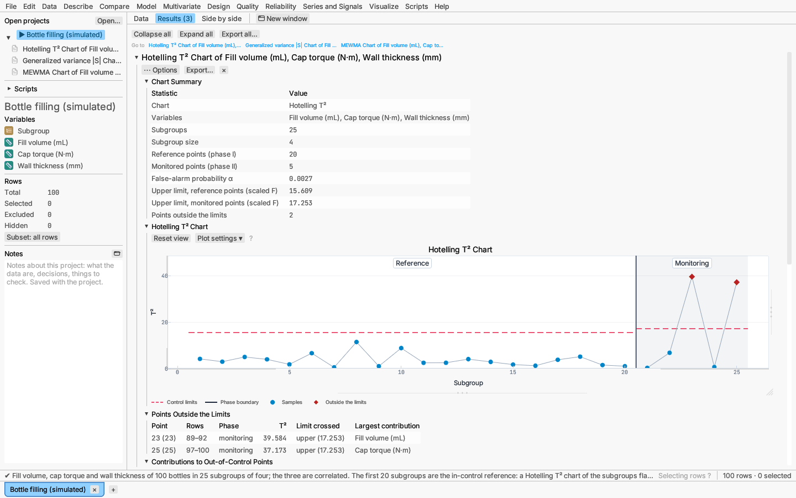

## Principal-components control chart

Quality ▸ Principal-components control chart… watches many correlated
measurements, such as the sensors on a reactor, through a
principal-components model of a reference period (Jackson & Mudholkar 1979;
Nomikos & MacGregor 1995; Kourti & MacGregor 1996). Where a Hotelling T²
chart of every variable needs more reference rows than variables and loses
power when the variables are nearly collinear, this chart works on the few
components that carry most of the variation, and adds a second chart for
everything the components leave out. Tick the measurements; optionally
choose a column that labels the points.

**Fit the model to the first *m* rows** marks the reference period
(normal operation); the rest are monitored against it. Leave it off to use
every row for both. The model centres each variable on its reference mean
and, by default, divides by its reference standard deviation (a
correlation model; untick **Standardize** in More options to use
covariances, when the variables share units). The number of components is
chosen by cross-validation, or set by hand. Cross-validation leaves out a
fold of reference rows (row *i* goes to fold *i* mod *k*, 7 folds by
default), refits the model, and predicts every value of each left-out row
from that row's other values; the number of components with the smallest
sum of squared prediction errors (PRESS) is kept (Bro, Kjeldahl, Smilde &
Kiers 2008). The table **Choosing the Number of Components** lists PRESS
and the cumulative variance for each number.

Two charts follow, both with an upper limit only:

- **T² chart**: the scores of each row on the retained components,
  T² = Σ tₐ²/λₐ. It rises when a row moves along the usual patterns of
  variation, but further than usual. Reference rows have the scaled-beta
  limit and monitored rows the F limit for new observations (Tracy, Young &
  Mason 1992), as for a T² chart of that many variables.
- **SPE chart** (squared prediction error, also called Q): the squared
  distance between a row and its projection on the model. It rises when
  the usual correlations break, for example when one sensor drifts while
  the others do not follow. The limit is Jackson and Mudholkar's
  approximation from the eigenvalues the model leaves out, or Box's scaled
  χ² (More options). With every component retained nothing is left over and
  there is no SPE limit.

α (0.0027 by default, that of three-sigma limits) is the false-alarm
probability per point. **Points Above the Limits** lists every point above
either limit, with the variable that contributes most. **Contributions**
split each signal by variable: for T², each variable's standardized value
times its weight in the retained scores (the shares add up to T²; a share
can be negative); for SPE, each variable's squared residual (these add up
to SPE). A contribution plot draws them across the variables, one line per
point (the eight largest signals). **Signalling Points against the
Reference** draws the same points' standardized values across the
variables, in reference standard deviations, against the reference mean
and ±3 SD, so you can see which way each variable moved.

When anything signals, **Change Point in the Mean** estimates where a single
shift in the mean of the retained scores happened, over all rows: the split
that maximizes the likelihood-ratio statistic for a change in the mean
vector with a common covariance (Sullivan & Woodall 2000). Its p-value comes
from 999 random reorderings of the rows (the same each time); the scan plot
shows the statistic for every split. The last table gives the reference
means, standard deviations, loadings and eigenvalues.

Every point is one row, so brushing a chart selects its row everywhere.
The options menu changes the reference period, the model and the limits in
place. In scripts this is the `pca-chart` analysis.

*Try it:* Reactor sensors (the coolant sensor drifts from reading 71,
caught by the SPE chart; the production rate runs high from reading 86,
caught by the T² chart).

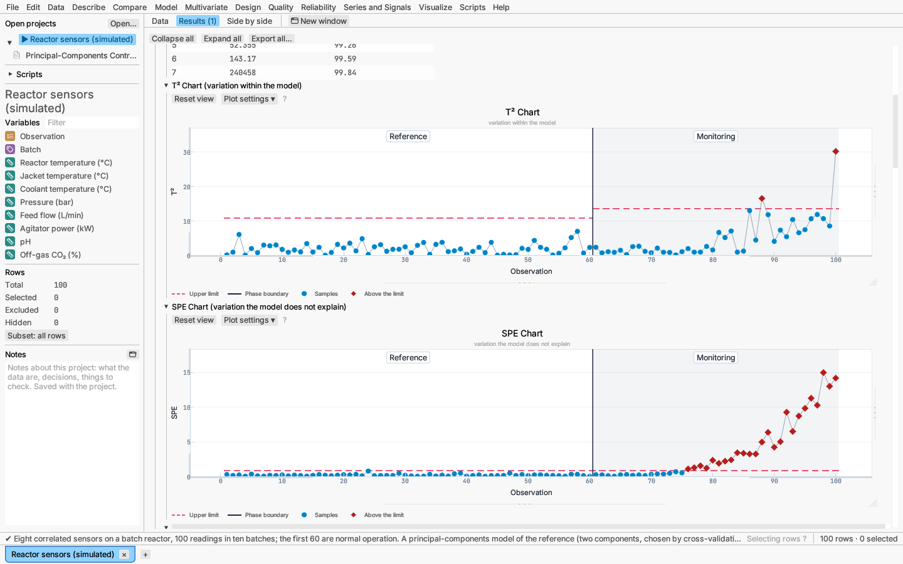

## Environmental monitoring limits

Quality ▸ Monitoring alert and action limits… sets alert and action levels
for environmental monitoring of clean rooms and similar areas, from the
data themselves, and charts each sampling location against them (USP
⟨1116⟩; PDA Technical Report 13). Choose what the readings are:

- **Counts**, such as colony-forming units per plate. The candidate
  families are the Poisson, the negative binomial (counts more spread out
  than a Poisson), and the zero-inflated Poisson and negative binomial
  (more plates with no growth than either expects; Lambert 1992; Hilbe
  2011).
- **Positive samples out of samples taken**, such as contact plates with
  any growth: give the number taken, from a column or the same for every
  reading. The candidates are the binomial and the beta-binomial (positives
  that vary more from day to day than a binomial). Readings and levels are
  shown as proportions.
- **Continuous readings** of zero or more, such as particle counts per m³:
  the fourteen continuous families of distribution identification.

Each family is fitted by maximum likelihood and the one with the smallest
AIC is used, unless you pick a family. A family whose extra parameter runs
to its limit (no extra spread, or no extra zeros) is listed as not fitted,
because it is then the simpler family. **Families Compared** lists every
candidate's log-likelihood, AIC and ΔAIC.

Choose the location column (each location gets its own chart and summary
row; leave it empty for one location) and a time-order column (a date or
number; otherwise table order). **Set levels for** says which readings share
levels: all locations together, each location, or each level of another
column such as a room grade. A missing location or grade is a group of its
own, "(missing)".

**Levels from**:

- **Quantiles of the fitted distribution** (default 0.975 for the alert
  level and 0.9985 for the action level). For counts the level is the
  smallest whole count whose cumulative probability reaches the quantile,
  so a count above it has at most that small a chance.
- **Mean + k standard deviations** (2 and 3 by default), from each group's
  readings; for positives p̄ + k√(p̄(1 − p̄)/n), so the levels follow the
  number of samples taken.
- **Typed in** for each group; a row with an empty group applies to every
  group not listed.
- **From columns of the data**: an alert-level and an action-level column
  (bring a table of levels in with Data ▸ Join first). A row without a
  value takes the first value of its group.

A reading **above** a level is an excursion; a reading equal to it is not.
Each location's readings are checked in time order against numbered rules,
shown beside the points: 1, an action excursion; 2, an alert excursion;
3, *n* or more alert excursions within *m* readings (2 in 5 by default);
4, *k* increases in a row (3 by default). Rules 3 and 4 can be changed or
turned off in More options. **Summary by Location** gives each location's
readings, mean, maximum, excursions, early warnings and a status;
**Excursions and Early Warnings** lists every flagged reading with its date
and row. Tick **Chart only the locations with a signal** to keep the report
short. Each location chart draws the alert level (lower dashed line) and the
action level (upper dashed line); its title gives both values.

Every point is one row, so brushing links the charts with the data. The
options menu changes the levels and rules in place. In scripts this is the
`monitoring-limits` analysis.

*Try it:* Clean-room monitoring (air colonies by room grade, contact
plates, and particle counts by location).

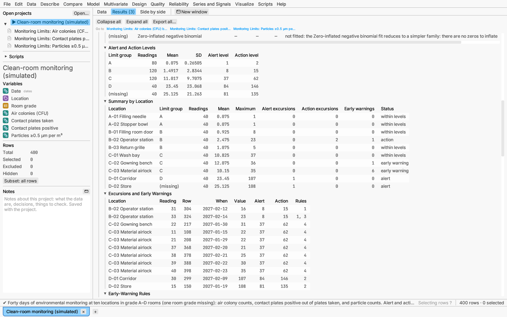

## Analysis of means

Quality ▸ Analysis of means… compares each group with the overall value,
instead of comparing groups with each other: the chart shows each group's
mean, proportion or rate, the overall value as a center line, and decision
limits around it (Ott 1967). A group outside the limits differs from the
overall value at significance level α (0.05 by default); it is drawn as a
diamond as well as in colour and listed in the group table. Each column
can fill only one role in the dialog: **Run** stays unavailable, with a note
saying so, while a column is chosen twice.

- **Means (normal data):** a response column and a grouping column. The
  limits use the pooled within-group standard deviation and an exact
  critical value from the multivariate t distribution of the group
  deviations, for equal or unequal group sizes (Nelson 1982); with unequal
  sizes each group has its own limits. Add a **second factor** for a
  balanced two-way layout: one chart per factor's main effects and, when
  every cell has two or more rows, a chart of the interaction effects
  (cell mean minus row and column means plus the grand mean) whose limits
  use the studentized maximum modulus (exact for a 2 × 2 layout,
  conservative otherwise).
- **Proportions (binomial counts):** a column of events (for example parts
  cracked) and the trials behind them (parts inspected), from a column or
  the same for every row.
- **Rates (Poisson counts):** a column of counts and the exposure (area,
  time or units) behind them.

For proportions and rates the rows of each group are pooled; with no
grouping column every row is its own group. These limits use the normal
approximation, and the report notes the groups where fewer than five
events (or non-events) are expected, as the approximation is rough there.

*Try it:* Heat treatment (hardness by furnace, by furnace and shift, the
cracked proportion by furnace and the pit rate by shift).

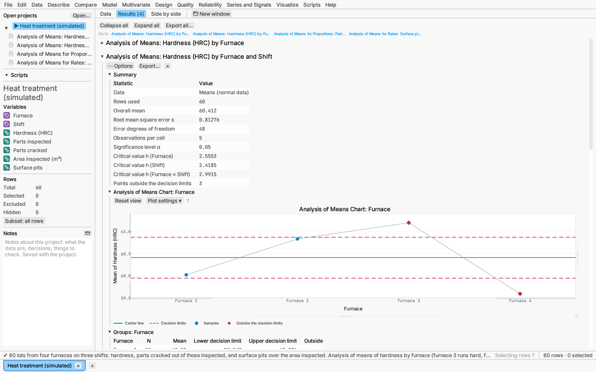

## Process capability

Quality ▸ Process capability… compares a process with its specification
limits:

- within-subgroup indices **Cp, Cpk, Cpl, Cpu**; overall indices **Pp, Ppk,
  Ppl, Ppu**; and **Cpm**;
- confidence intervals for the indices: the χ² interval for Cp and Pp and
  Bissell's (1990) interval for Cpk and Ppk. Their width depends on the
  degrees of freedom of the σ estimate: n − 1 for the overall indices; for
  the within indices k(m − 1) with the pooled standard deviation of k
  subgroups of m, and an effective (Patnaik) value for the range
  estimators, about 0.9·k(m − 1) for the average range and about
  0.6·(n − 1) for the moving range, because ranges carry less information
  than standard deviations. The within intervals are approximations;
- observed and expected nonconforming rates;
- a histogram with the specification limits and the fitted normal curve.

**Also by group of** a column (lines, machines, suppliers, shifts) adds two
sections after the indices. **Capability by …** lists each group's N, mean,
overall SD, Cp, Cpk, Pp, Ppk and the observed share of values outside the
limits, from the same study run on that group's rows alone (in row order,
so the within σ uses that group's own subgroups or moving ranges); with a
non-normal model it adds each group's percentile-based Ppk. A group too
small for the chosen within-σ method shows — and a note saying why. **Ppk
by …** plots each group's Ppk as a dot on a stem from zero, with reference
lines at 1 and 1.33; choose **Order the Ppk chart** by group label, smallest
Ppk first or largest first under More options or in the report's options.

**Probability plot with the limits** (More options, or the report's options)
adds a normal probability plot (or a quantile plot against the chosen
distribution) with LSL, target and USL drawn across it, so it shows where
the fitted line crosses each limit. The summary page always has it.

The report's options also offer **Save in-specification indicator**, a
formula column that is 1 when a value is within the limits, 0 outside and
missing without a value; as a formula it follows later edits.

*Try it:* Fill weights, by Filler setting: the setting B period sits nearer
the upper limit and has the lower Ppk.

### Non-normal processes

The normal-theory indices assume the process is normal: for skewed data
they misstate the tails, and so the nonconforming rates, often by orders
of magnitude. Choose another **Process distribution** in the dialog:

- **Normal after Box–Cox:** transforms the data and limits by a power λ
  and computes the usual indices on that scale.
- **A distribution** (lognormal, Weibull, gamma, … with or without a
  threshold), or **Best fit by AIC** among all fourteen.
- **Johnson transformation:** a transformation to normality chosen from the
  data's percentiles.
- **Nonparametric:** the sample's own percentiles. These need many values
  (about 740 before the outer percentiles leave the sample extremes); the
  expected rates are the observed ones.

The indices then use percentiles of the fitted distribution in place of
mean ± 3σ (ISO 22514-2, Clements 1989): with X0.135, X50 and X99.865 the
0.135%, 50% and 99.865% points,

- Pp = (USL − LSL) / (X99.865 − X0.135);
- Ppl = (X50 − LSL) / (X50 − X0.135) and Ppu = (USL − X50) / (X99.865 − X50);
- Ppk = the smaller of Ppl and Ppu.

**Ppk (equivalent)** is the normal-theory Ppk that would give the same
expected nonconforming fraction on the worse side. The report also shows
the fitted distribution and its percentiles (with the AIC of every family
for best fit), the expected rates under the fit beside the observed and
normal ones, the fitted density over the histogram, and a quantile plot
against the fit. The normal-theory indices follow at the end for
comparison. Only overall (Pp-type) indices are given: a non-normal fit has
no short-term σ.

**Bootstrap intervals.** Tick *Bootstrap intervals for the percentile
indices* in the dialog (or the report's Options menu) to add percentile
bootstrap intervals (Efron & Tibshirani 1993, ch. 13) for Pp, Ppl, Ppu
and Ppk: the data are resampled with replacement, the model is refitted to
each resample (best fit refits the chosen family), and the 2.5% and 97.5%
points of the resampled indices form a 95% interval. Choose the number of
**resamples** (default 1000, at least 20) and the **seed**; the same seed
gives the same intervals every time. Resamples whose model cannot be fitted
are skipped and counted in the table's Bootstrap row.

*Try it:* Seal strength, peel strength with a lower limit of 21 N and the
Weibull with threshold.

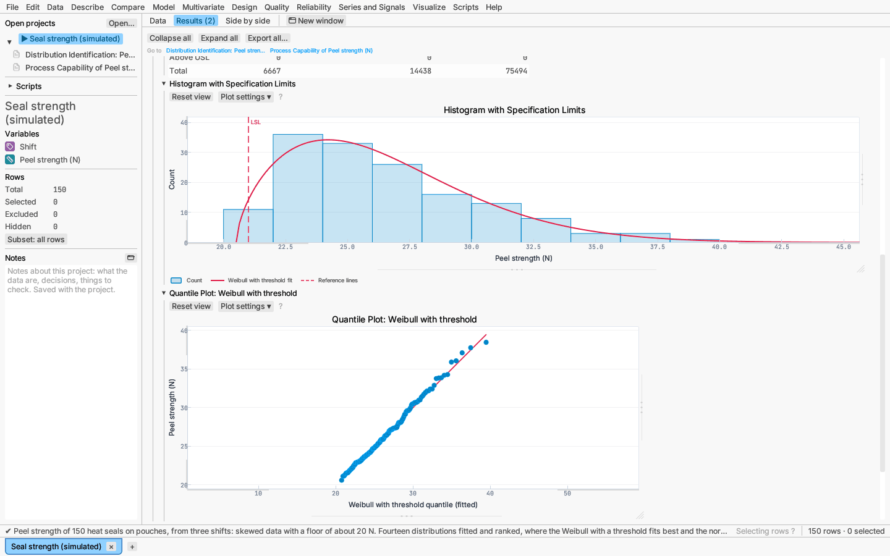

## Between/within capability

Quality ▸ Between/within capability… is for a process run in batches, or in
parallel streams such as mould cavities or filling heads, whose means differ
from one another. The ordinary within-subgroup σ ignores that
batch-to-batch variation and makes the process look better than it is; the
between/within σ adds it back.

Choose the measurement, then the subgroups: rows with the same value of a
column (a batch or stream ID), or consecutive rows a fixed number at a time.
Give at least one specification limit. The between-subgroup σ comes from
the **moving range of subgroup means** (batches in time order), or from
**variance components** of a one-way layout (streams, where order does not
matter). The within σ is the pooled standard deviation or the average
range.

The report shows Cp and Cpk within, Cp and Cpk between/within, and Pp and
Ppk overall, with 95% intervals; a variance components table (between,
within, between/within and overall σ); a process summary; observed and
expected nonconforming parts; the values by subgroup with the subgroup means
and the limits (points are linked to the data); and a histogram.

**Options:** the limits and both σ estimators, edited in place.

*Try it:* Coating batches. Compare the between/within report with the
ordinary capability report opened beside it.

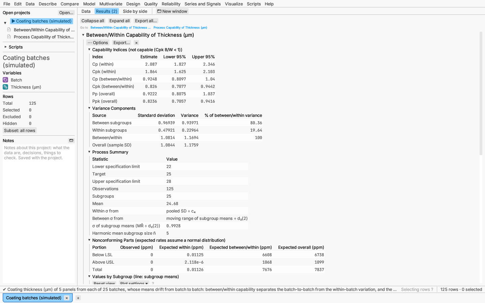

## Attribute capability

Quality ▸ Attribute capability… estimates capability from counts, one sample
per row. **Binomial** takes the number of defective units and the units
inspected, and reports the percent defective and defective PPM with exact
(Clopper–Pearson) intervals and the process Z, the normal deviate with the
same tail area. **Poisson** takes the number of defects and the units
inspected (a column or a fixed number, which need not be whole,
but not the count column itself), and reports
the defects per unit with an exact (Garwood) interval. The dialog lists only
columns of whole, non-negative numbers as counts (and, for binomial data, as
units inspected).

The estimate only describes a stable process, so the report includes the p
chart (binomial) or u chart (Poisson; a c chart with no sizes) and counts
the samples outside the limits. It also plots the cumulative estimate,
which should settle, and each sample's rate against its size, which should
show no trend, and lists the samples.

**Options:** the model and the confidence level.

*Try it:* Supplier lots: defective units with units inspected (binomial),
and cosmetic defects (Poisson).

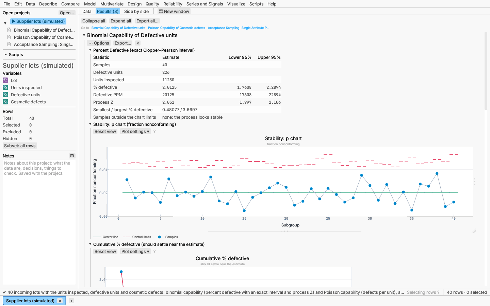

## Acceptance sampling plans

Quality ▸ Acceptance sampling plan… designs a lot-by-lot inspection plan.
It uses no data columns. Enter the **producer's point**: the acceptable
quality level p₁ and the risk α of rejecting such a lot. Then enter the
**consumer's point**: the lot tolerance level p₂ and the risk β of
accepting such a lot. Also give the lot size.

The plans it can design are:

- **Single attribute plan** (n, c): the plan with the smallest sample
  meeting both points.
- **Double attribute plan** (n₁, c₁, n₂, c₂, with n₂ a chosen multiple of
  n₁): among the plans meeting both points, the one with the smallest
  average sample number at p₁.
- **Variables plan** (n, k) by the k-method, for a normally distributed
  measurement with one specification limit, with σ known or unknown.

Attribute plans are worked out with a binomial model (a continuing process
or a large lot), a hypergeometric model (an isolated lot of the given size)
or a Poisson model. Nothing is looked up in published sampling tables:
every plan is computed from the risk points.

The report gives the plan and its decision rule, the risks it achieves and
its AOQL, then the curves: operating characteristic (probability of
acceptance, with the risk points marked), average outgoing quality with the
AOQL (rejected lots screened and nonconforming items replaced), average
total inspection and, for double plans, average sample number. Plans you
enter under *Plans to compare* are drawn on the same plots. Each plan has
its own labelled marker (D for the designed plan, 1, 2, … for yours), and a
comparison table says which plans meet both points. Choose *None* as the
design to compare entered plans only.

**Options:** every setting, edited in place.

*Try it:* Supplier lots: the 1%/6% plan compared with n = 89, c = 2 (which
misses the producer's point) and a double plan.

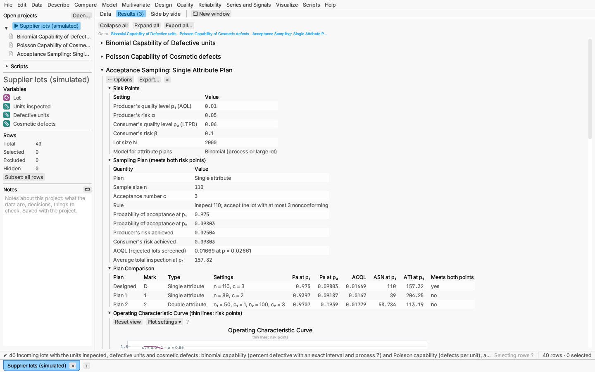
## Capability summary page

Quality ▸ Capability summary page… opens the same dialog with **Summary
page layout** ticked (it can also be switched on in any capability
report's Options menu). The report then gathers on one page:

- the capability indices and the process summary;
- a **location chart** and a **dispersion chart** of the data, subgrouped as
  for the within σ (individuals and moving range, or X̄ with R or S for
  consecutive subgroups), with all run rules on the location chart and
  rule 1 on the dispersion chart;
- the **last 25 subgroups** (or values) against the specification limits
  and target: every value, with a line through the subgroup means;
- the **histogram** with the limits and the fitted density;
- a **probability plot** against the chosen model (normal, or the fitted
  distribution).

*Try it:* Tablet hardness (a lognormal model, summary page and bootstrap
intervals).

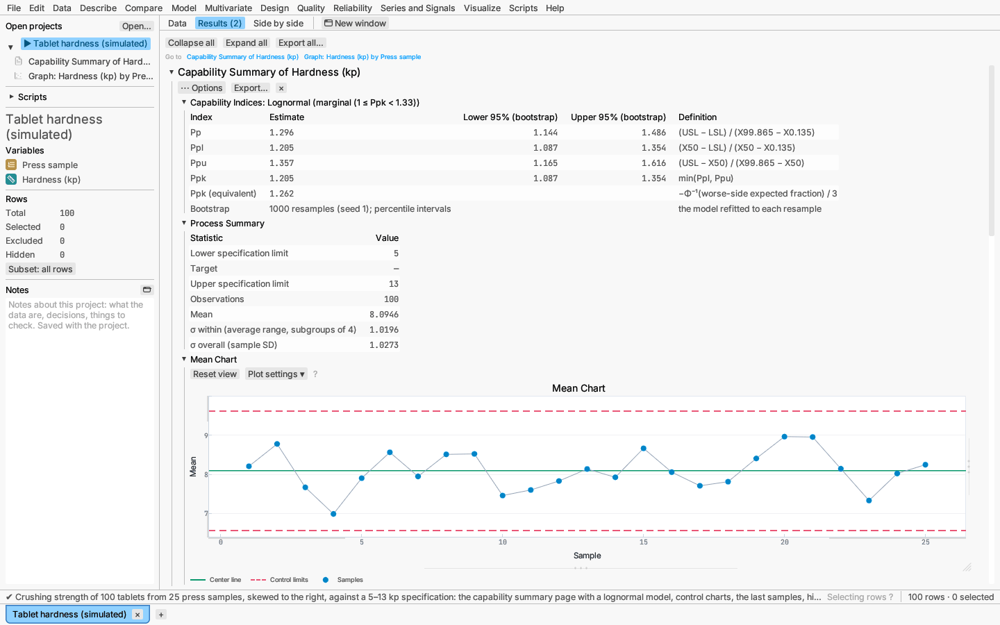

## Gauge R&R

Quality ▸ Gauge R&R… runs a measurement systems study and reports the
variance components: repeatability, reproducibility and part-to-part
variation, with %contribution, %study variation, %tolerance (when you enter
a tolerance) and the number of distinct categories. The data are one row per
measurement, with a part column, an operator column and a numeric
measurement column. Choose the **study type** at the top of the dialog:

- **Crossed** — every operator measures every part the same number of
  times. Analysed by the ANOVA method with a part × operator interaction,
  which can be pooled into repeatability when it is not significant.
- **Nested** — for destructive tests, where a part cannot go to a second
  operator: each operator measures their own parts (in practice, pieces cut
  from one batch stand in for repeat measurements). The ANOVA has operators,
  parts within operators and repeatability; there is no interaction, and
  reproducibility is the operator component. Parts may be numbered 1, 2, 3…
  within each operator: in a nested study a part is its label together with
  its operator. Every operator must test the same number of parts, each
  equally often.
- **Expanded** — for studies with more factors than parts and operators,
  or with readings missing. Add extra factor columns (a second gauge, a
  fixture, a location, a day) with **Add factor**, and give each one a role
  — *random* (its levels are a sample, such as gauges drawn from the
  plant's stock, and it gets a variance component) or *fixed* (the levels
  are the ones of interest, and it is tested for a shift in the mean) — and
  a place: crossed with parts and operators, nested within parts, or nested
  within operators. Tick *Parts nested within operators* for a destructive
  test, and *Two-factor interactions* to include every interaction of
  factors that are not nested in one another (part × operator,
  part × gauge, operator × gauge…). The model is fitted by restricted
  maximum likelihood (REML), so unbalanced data and empty cells are fine.
  Gauge R&R totals are built from the random components: the part term is
  part-to-part variation, the residual is repeatability, and every other
  random component counts as reproducibility — except a random factor
  nested within parts (a location or position on the part): that
  *within-part* variation is a property of the product, not of the
  measurement system (AIAG *Measurement Systems Analysis*; Burdick, Borror &
  Montgomery 2005), so the Variance Components table lists it under
  *Part-to-part* (as *Between parts* and *Within part*), it counts in
  part-to-part variation, its %study variation and the number of distinct
  categories, and stays out of gauge R&R. Its interactions with operators
  or gauges are still reproducibility. Fixed factors do not enter the
  totals; a *Tests of Fixed Factors* table gives their F tests. When
  missing cells leave only some of a fixed term's effects estimable, the
  study summary notes that its F test covers only those.
  *Variance Component Intervals* lists each component and total with its
  standard error and 95% confidence limits (Satterthwaite's χ² limits,
  which stay positive). Terms the data cannot separate from repeatability
  or from another term are left out and listed in the study summary. For
  balanced data the expanded study gives the same estimates as the crossed
  or nested ANOVA whenever those are all positive.

**Run order (optional):** a numeric column (run number or time stamp)
giving the order in which the measurements were taken, used by the gauge
run chart; without one the row order is used.

The **Gauge Run Chart** shows each part in its own pane, with that part's
measurements in run order, coloured and shaped by operator, and a thin line
at the part's mean. Scatter within a pane is repeatability, operators
sitting apart is reproducibility, and a trend across panes or within a pane
suggests drift.

**Options:** the ANOVA table (crossed and nested), measurements by part and
by operator, the gauge run chart, pooling the part × operator interaction
when it is not significant (crossed), and two-factor interactions
(expanded). In the by-operator chart of a nested study each operator's pane
holds only that operator's parts.

*Try it:* Gauge study (crossed), Weld pull test (nested), Bore gauges
(expanded, with seven readings lost).

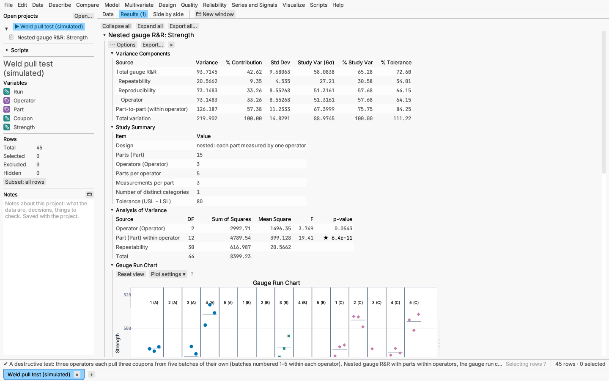

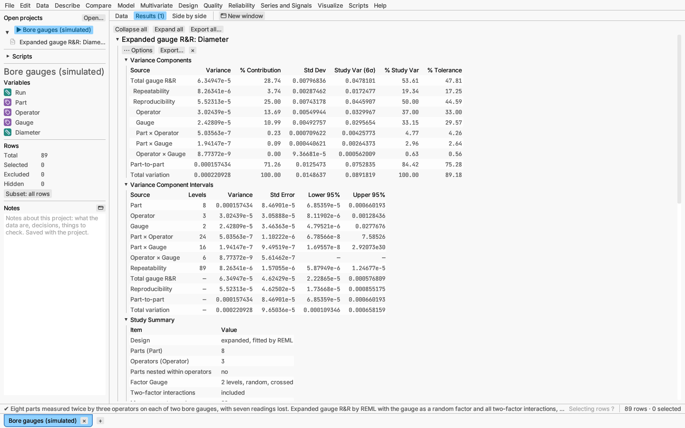

To plan a study, Quality ▸ Gauge study worksheet… creates a randomized run
sheet as a new table; see [Design](design.md#gauge-study-worksheet).

## Bias and linearity

Quality ▸ Bias and linearity… checks a gauge's accuracy over its range.
Measure several reference parts of known value repeatedly, then choose the
reference-value column and the measurement column. Following the AIAG
measurement systems analysis method, each measurement's bias (measured
minus reference) is regressed on the reference value. The report shows:

- **Summary:** the average bias with its confidence interval and p-value,
  the slope of the bias line (the change in bias per unit of reference)
  with its p-value, R², and %linearity = 100 × |slope|. With a process
  variation (for example 6σ of the process) entered, also linearity =
  |slope| × process variation and %bias = 100 × |average bias| / process
  variation.
- **Conclusion:** whether zero bias lies inside the confidence band across
  the whole range (the gauge is acceptably linear and unbiased), or where
  it does not.
- **Bias plot:** each bias and the mean bias at each reference value, the
  fitted line with its confidence band, and the zero-bias line.
- **Linearity line:** slope and intercept with standard errors, t tests and
  confidence intervals.
- **Bias by reference value:** for each reference value, the number of
  readings, mean bias, standard deviation, t and p.

The confidence level and the process variation can be changed in place.

*Try it:* Gauge linearity.

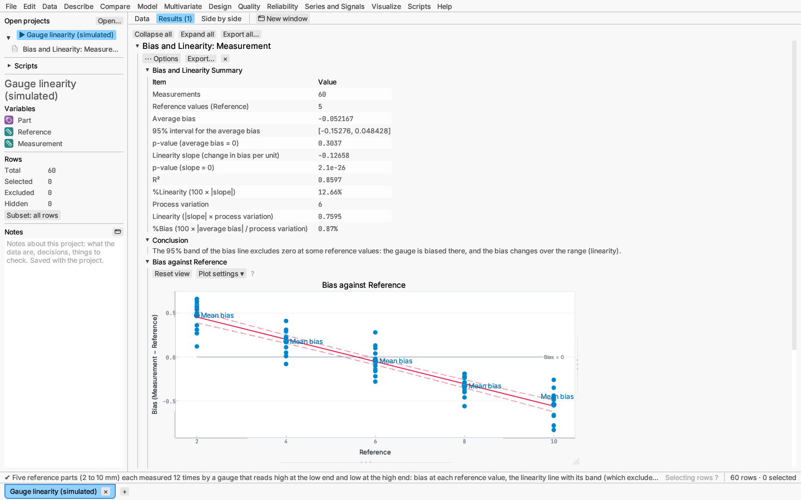

## Gauge repeatability (Cg, Cgk)

Quality ▸ Gauge repeatability (Cg, Cgk)… evaluates one gauge by measuring
one master part of known reference value many times (Dietrich & Schulze,
*Measurement Process Qualification*). Choose the measurement column and
enter the reference value and the tolerance T of the feature the gauge
will check. With s the standard deviation of the readings and bias their
mean minus the reference:

- Cg = (K/100 · T) / (L · s)
- Cgk = (K/200 · T − |bias|) / (L/2 · s)

K, the share of the tolerance the gauge may use, is 20% and L, the spread
of the readings, is 6 s by default; both can be changed. A gauge is usually
called capable when Cg and Cgk are both at least 1.33; the report marks
each index against that value with a word as well as a colour. It also
gives %repeatability (100 L s / T) and %repeatability with bias
(100 (L s + 2 |bias|) / T), a t test of the bias with its confidence
interval, and a run chart of the readings with the reference value and the
reference ± K/200 · T limits.

Two optional columns add sections:

- **Direction of approach** (a column with two values, such as "below" and
  "above"): a **Hysteresis** section with each direction's N, mean and
  standard deviation and the hysteresis h = ȳ₁ − ȳ₂ (the first value in
  row order minus the second), with a Welch t test of h = 0 and its
  confidence interval. Readings that approach the reference from opposite
  sides should agree; a gauge with backlash or friction gives h ≠ 0.
- **Time or order** (numeric; by default the row order 1, 2, …): a **Drift**
  section fits reading = a + c · time by least squares and reports the slope
  c with its standard error, t test of c = 0 and interval, and the total
  change c × (last − first time) over the study. Uncheck **Drift over time
  or order** under More options to leave it out.

The **Summary Statistics** section lists N, mean, standard deviation,
minimum, maximum and range by default; under More options (or the report's
options) choose any of N, mean, standard deviation, standard error of the
mean, minimum, median, maximum, range, 6 × standard deviation and the
coefficient of variation.

*Try it:* Gauge repeatability. Its Approach column alternates readings from
below and above, which differ by about 0.0015 mm, and the readings drift
slowly upward over the run.

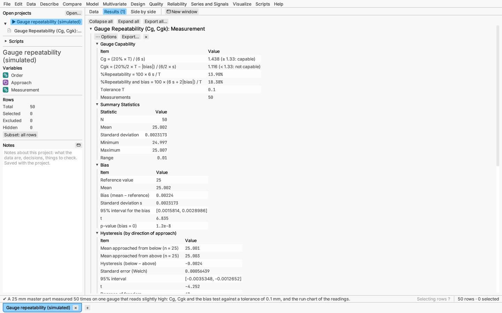

## Intraclass correlation

Quality ▸ Intraclass correlation… asks how well a measurement separates
the parts, using a crossed study (every operator measures every part,
optionally with replicates). Choose the part, operator and measurement
columns. The report shows:

- **Evaluation (Wheeler & Lyday, *Evaluating the Measurement Process*):**
  the intraclass correlation ρ — the share of the measurements' variance
  that comes from the parts — and the monitor class it puts the
  measurement in: first class (ρ ≥ 0.8; signals are attenuated by less
  than 10%), second (≥ 0.5), third (≥ 0.2) or fourth (below 0.2). With
  attenuation 1 − √ρ, the probable error 0.675 σₑ (half of all
  measurements are within this of the part's value) and the smallest and
  largest useful measurement increments (0.2 and 2 probable errors). The
  increment of the recorded data, read from its decimals or entered, is
  compared with them.
- **By source of error:** the same evaluation with repeatability alone and
  with repeatability and reproducibility combined (from the gauge R&R
  variance components when there are replicates).
- **Shrout & Fleiss forms:** the six forms ICC(1,1), ICC(2,1), ICC(3,1) and
  their averages over k operators, ICC(1,k), ICC(2,k), ICC(3,k), each with a
  confidence interval (Shrout & Fleiss 1979, computed on the operator–part
  cell means).

The confidence level and the measurement increment can be changed in place.

*Try it:* Gauge study (it opens a gauge R&R and an intraclass correlation
report).

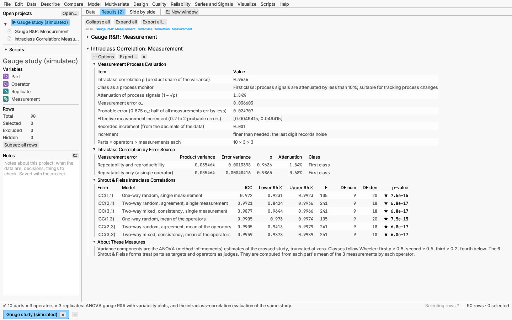

## Attribute agreement

Quality ▸ Attribute agreement… studies a measurement that sorts parts into
categories (pass/fail, a defect type, a 1–5 grade) rather than measuring
them. Several appraisers rate the same parts, usually more than once, and
ideally the right category of every part (the standard) is known.

The data have **one row per rating**: a part column, an appraiser column and
the rating. Two columns are optional:

- **Trial** — which repeat a rating is. Without it, an appraiser's ratings
  of a part are taken as trials in the order of the rows.
- **Standard** — the part's known category, repeated on each of its rows
  (empty cells are ignored, but a part may not have two different values).

Every appraiser must rate every part the same number of times; excluded
rows count against this. Tick **Ordered categories** when the categories
have an order (grades, severity levels); a numeric or ordinal rating column
starts ticked. The order of the categories is shown lowest first and can be
changed with the arrow buttons. The categories analysed are those of the
ratings and standards in the rows used, so a category found only in excluded
rows is left out (it would otherwise shift the weighted kappas).

The report answers four questions, each with the percentage of parts on
which all the ratings compared agree, and its exact (Clopper–Pearson)
confidence interval:

- **Within each appraiser:** does the appraiser give a part the same rating
  every trial? With Fleiss' kappa (the trials as the ratings), and for
  ordered categories Kendall's coefficient of concordance W across trials.
- **Each appraiser against the standard:** are all the appraiser's ratings
  of a part right? The table also counts parts *consistently misrated* (the
  same wrong rating every trial) and parts with *mixed ratings*, and gives
  Cohen's kappa of the ratings against the standard (every trial a pair)
  with its standard error, interval and z test.
- **Between appraisers:** do all appraisers give a part the same rating on
  every trial? With Fleiss' kappa over all the ratings of a part, Kendall's
  W for ordered categories, and Cohen's kappa for every pair of appraisers
  (ratings paired by trial).
- **All appraisers against the standard:** is every rating of a part right?

For ordered categories, **Ordered Categories Against the Standard** adds
linear and quadratic weighted kappas, which give partial credit to near
misses, and Kendall's τ_b between the ratings and the standard. **Kappa by
Category** gives each category's kappa in every comparison (a category
against all the others), showing which categories are confused. **Ratings
Against the Standard** counts every rating by the standard category. The
**agreement plot** shows each appraiser's percentage of parts matched with
its interval — within the appraiser and against the standard, each in its
own colour and marker.

Kappa is 1 for perfect agreement and 0 for agreement no better than chance;
it is shown as — when every rating falls in one category (chance agreement
is then complete). The confidence level and the ordered-categories choice
can be changed in place.

*Try it:* Visual inspection (it opens the pass/fail study and the 1–5 grade
study, both against the standard).

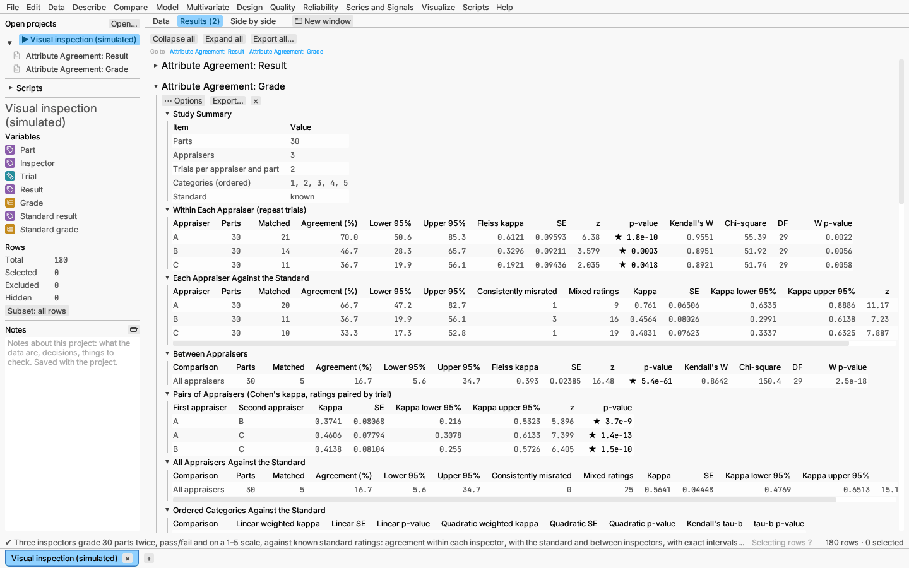

## Attribute gauge bias and repeatability

Quality ▸ Attribute gauge bias and repeatability… evaluates a go/no-go
gauge by the analytic method of the AIAG *Measurement Systems Analysis*
manual. Parts of known reference value spanning the region where the gauge
changes from rejecting to accepting are each checked the same number of
times (20 in the AIAG design). The data can hold the counts — a reference
value, the times accepted and the times checked on each row — or one row
per check with a result column; then choose the result that means
accepted. Enter the specification limit the gauge decides at.

The probability of acceptance at each reference value is adjusted half a
check away from 0 and 1, and the reference values accepted some but not all
of the time are fitted with a normal curve (a straight line on the probit
scale). From the curve:

- **Bias** — the limit minus the reference value accepted half the time;
- **Repeatability** — the distance between the reference values accepted
  0.5% and 99.5% of the time, divided by AIAG's adjustment factor 1.08;
- **t test of bias = 0** — t = 31.3 · |bias| / repeatability on (checks − 1)
  degrees of freedom.

Acceptance that rises with the reference value means a lower limit; falling
acceptance an upper limit. The report notes where the study departs from
the recommended design (at least eight parts, six of them accepted some of
the time, the extremes always and never accepted, 20 checks each). The limit
can be changed in place.

*Try it:* Go/no-go gauge.

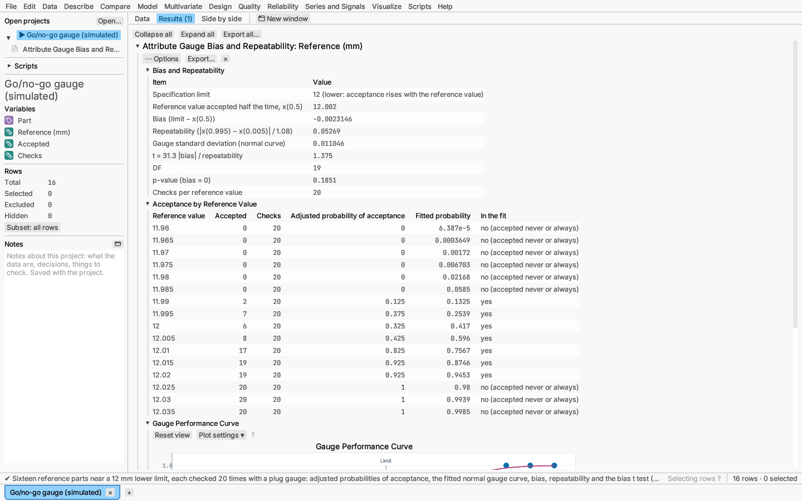

## Pareto charts

Quality ▸ Pareto chart… ranks the categories of a column (defect types,
complaint reasons, causes) by how often they occur, largest first, with a
line of cumulative percentages (Juran's "vital few and useful many"). Each
row counts once, or choose a **frequency** column whose values are added up
(counts, costs or minutes lost). Pick a **grouping** column to draw one
chart per level side by side (for example per line or shift), each ranked on
its own, so you can see whether the same causes lead everywhere.

Each point of the cumulative line is labelled with its percentage. The
report adds a table of counts, percentages and cumulative percentages, and
a summary naming the first categories that together reach 80%. When that
point falls in the **Other** bar, the summary names it with the number of
categories it pools (for example "Other (8 categories)") and counts each of
them. Ties rank in
natural order of the category names.

Every bar carries its rows: click a bar, or drag a box over several, to
select their rows in the data and every other view. Selected rows show as a
highlighted part of each bar (in proportion to their frequencies).

**Options:** pool the categories whose share is below a percentage you
choose into one **Other** bar (drawn lighter, always last; at least two
categories must qualify), and show bar heights as **percentages** of the
total instead of counts. Both are also in the dialog.

*Try it:* Solder defects. The first report ranks causes by defects for each
line: nozzle wear leads line A, the reflow profile line B, and the rarest
causes pool into Other.

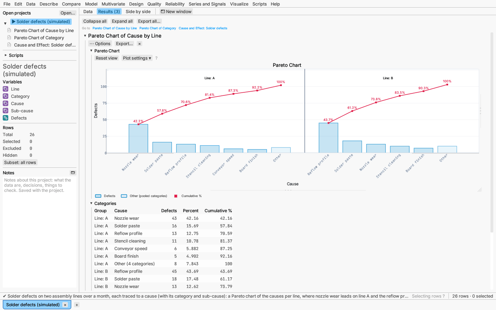

## Cause-and-effect diagrams

Quality ▸ Cause-and-effect diagram… draws a fishbone diagram (Ishikawa)
from columns of your table: the first column names the **main branches**
(categories of causes, such as machine, method, material), the second the
**causes** on each branch and the third, optionally, their **sub-causes**.
Each row is one path; repeated paths are merged and counted, and an empty
cell ends the path. Branches and causes keep the order in which they first
appear, so arrange the table the way you want the diagram read. Type the
**effect** (the problem) for the head of the diagram.

Branches slant off the spine alternately above and below it, each cause on
a short rib, its sub-causes indented under it. Click any branch, cause or
sub-cause to select the rows behind it (shift or ⌘/Ctrl adds to the
selection); labels with selected rows are tinted and marked with a dot. The
**Causes** table lists every branch, cause and sub-cause with its number of
rows. Right-click the diagram to save it as PNG, SVG, PDF or EPS.

*Try it:* Solder defects, the third report: six branches from the
category, cause and sub-cause columns.

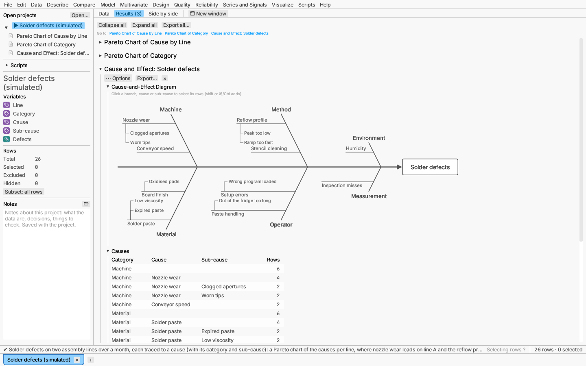

## Multi-vari charts

Quality ▸ Multi-vari chart… shows how a response varies across up to four
factors, outermost first (Seder 1950) — for example batch (time), shaft
within batch (piece to piece) and position on the shaft (within piece).
Factors can be nested (shaft 1 of one batch is not shaft 1 of another) or
crossed; only the combinations present in the data are drawn.

The outermost factor's levels become side-by-side panes. Each innermost
combination (cell) gets a place along the horizontal axis, labelled with
its levels. The chart shows:

- each **individual value** at its cell: by default a cell's values are
  spread a little to the left and right of the cell's place in their row
  order and joined by a thin line, so each cell reads as a short run chart
  and a drift or a jump within the cell shows (the classic form of the
  chart, Seder 1950; Snee 2001);
- the **means** of every factor's levels, each factor with its own colour
  and marker shape (named in the key);
- lines joining each factor's means within each level of the factor above
  it, and the outermost factor's means joined across the panes.

The **Variation by factor** table puts numbers on what the chart shows: for
each factor, the range of its level means within each level of the factor
above (averaged, and the largest), then the average range within the cells
and the pooled within-cell standard deviation. The largest of these is the
family of variation to chase first.

The **Ranges view** charts the range of the values within each cell, with
3-sigma limits from the cell sizes (R̄, D₃R̄ and D₄R̄ when the cells are the
same size); a cell beyond the upper limit is flagged. Cells with a single
value have no range and are left out.

Values in the chart and cells in the ranges view are linked to their rows:
box-select or click to select them everywhere.

**Options:** individual values, the ranges view, a cell summary table
(count, mean, minimum, maximum, range and standard deviation per cell), and
**Replicates**: *In order (side by side)*, the default, or *Stacked*, which
draws a cell's values on one vertical line at the cell. The layout is the
same in exported figures and report exports; pane headings sit above the
highest value inside the frame, as on screen. With the individual values
off, the headings stand above the highest mean.

The graph canvas has the same chart as a chart form (Visualize ▸ Graph
canvas, Chart: Multi-vari chart): factors on the horizontal-axis shelf,
the response on the vertical one.

*Try it:* Shaft diameters. The first report (batch and shaft) shows that
batches differ far more than shafts within a batch; the second adds the
position and shows each shaft's taper; the third is the graph-canvas form.

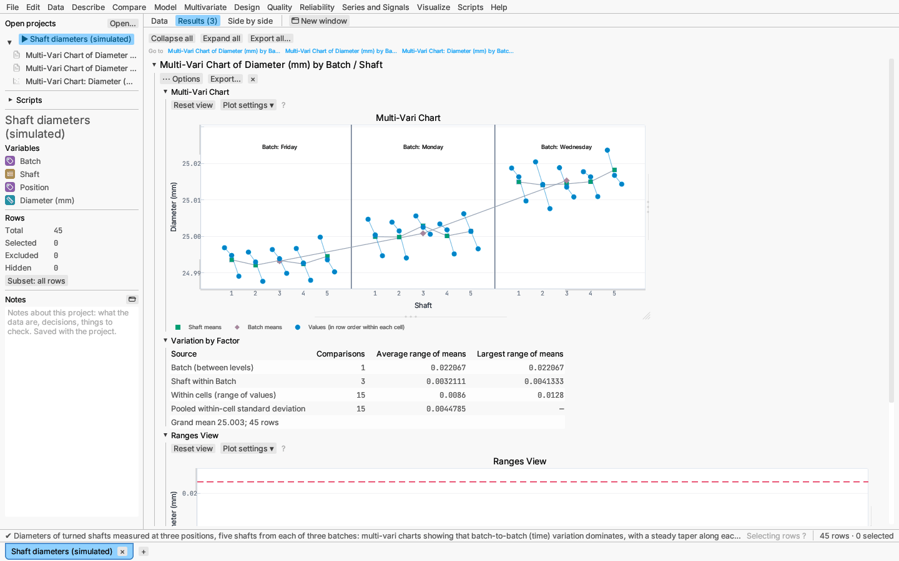
