# Reliability

The Reliability menu is in four groups, each under a small heading: **Life
data** (survival curves, life distributions, competing risks), **Life data
with predictors** (proportional hazards, parametric survival regression,
life–stress models, degradation), **Field and repair data** (warranty
returns, repairable systems, reliability growth) and **Planning** (test
plans).

## Survival curves

Reliability ▸ Survival curves… analyses times to an event, some of which may
be censored (the event had not happened when observation stopped).

- Kaplan–Meier survival curves, with confidence bands on the plain, log or
  log-log scale;
- the product-limit table;
- a log-rank test comparing groups, and (tick **Log-rank test for trend**
  in the report's options) Peto's test for a trend across ordered groups:
  χ² on one degree of freedom from the weighted observed-minus-expected
  events, with the group labels as scores when they are numbers (doses,
  stages) and 1, 2, 3, … in the groups' order otherwise;
- a **number-at-risk table** under the plot (tick **Number at risk under
  the curves**): for each group, the units still at risk at each labelled
  time tick, aligned with the ticks. **Also count censored rows** adds, in
  brackets, the units censored since the previous tick. The same counts
  appear as a table in the report;
- quick Weibull and lognormal maximum-likelihood fits drawn over the curves,
  with AIC and BIC to compare them. For other distributions, left or
  interval censoring, and intervals for percentiles, use Life distributions.

*Try it:* Leukemia remission; Bearing life test.

*Verified:* against published Kaplan–Meier and maximum-likelihood results.

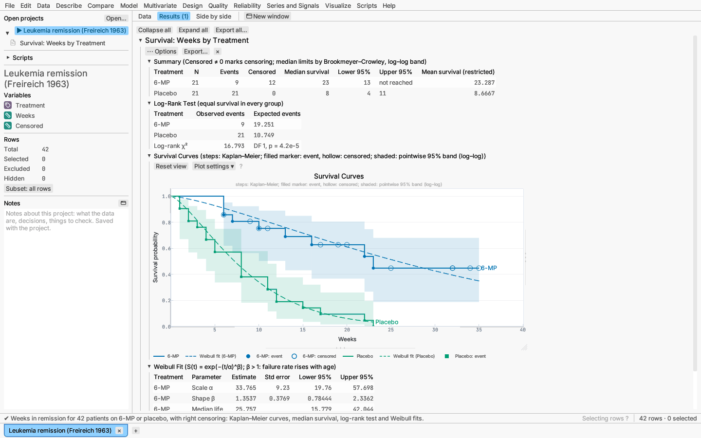

## Life distributions

Reliability ▸ Life distributions… fits parametric distributions to failure
times by maximum likelihood when some times are only partly known:

- **right-censored** — the unit was still running when last seen;
- **left-censored** — it had already failed at the first look;
- **interval-censored** — it failed between two inspections;
- **exact** failures.

Choose one of two layouts in the dialog:

- **Time and censor columns:** one time per row and, optionally, a censor
  column. Choose whether a non-zero censor value means "still running" (the
  default) or "failed".
- **Start and end of the failure interval:** the last time the unit was seen
  working and the time it was found failed. Leave the start empty for a unit
  that had failed by its first inspection, leave the end empty for one still
  running at the start time, and give equal values for an exact failure.

A **frequency** column gives the number of units a row stands for, so
inspection results can be entered as counts. A **group** column fits each
group separately.

Tick the distributions to fit: exponential, Weibull, lognormal,
log-logistic, gamma, normal, logistic, smallest and largest extreme value,
and the forms with a threshold (a failure-free period). One of them is shown
in detail — the best by AIC unless you choose one. You can list the
percentiles (in % failing) and the times you want estimates for, and set
the confidence level.

The report has:

- **Life Data Summary:** units and how many of each kind of observation;
- **Model Comparison:** each distribution's log-likelihood, AIC, BIC and an
  Anderson–Darling distance adjusted for censoring (the distance between the
  nonparametric estimate and the fitted distribution; smaller is better),
  ordered by AIC;
- **Nested Models:** likelihood-ratio tests of the exponential within the
  Weibull and gamma, and of each two-parameter form within its threshold
  form;
- a **probability plot** of the chosen distribution: the nonparametric
  estimate at each failure or inspection time on the distribution's own
  scale (straight when the distribution fits), the fitted line and
  pointwise confidence limits; the vertical axis is labelled in % failing;
- **parameter estimates** with standard errors, Wald limits and
  likelihood-ratio (profile) limits;
- **percentiles** (the time by which a given fraction fails) and **failure
  probabilities** at the times you gave, each with Wald and likelihood-ratio
  limits;
- **survival** (the nonparametric estimate with the fitted curve; failures
  are filled markers, censored units hollow ones) and **hazard** plots;
- the **Turnbull nonparametric estimate**: the probability of failing in
  each interval it can resolve. With only exact and right-censored times it
  is the Kaplan–Meier estimate.

**Few or no failures.** Tick *Weibull with known shape* and give the shape
β (from experience with similar parts). With failures and right-censored
times only, the report adds the scale estimate with chi-square limits and
one-sided lower bounds for the scale, the percentiles and the reliability at
your times — usable even with no failures at all (Nelson 1985).

*Try it:* Seal inspections — interval-censored counts from two suppliers;
Bearing endurance test — two failures in twelve units, with the known-shape
Weibull.

*Verified:* against an independent SciPy implementation of the censored
likelihood, profile intervals, Turnbull's estimate and the adjusted
Anderson–Darling distance (see the validation record).

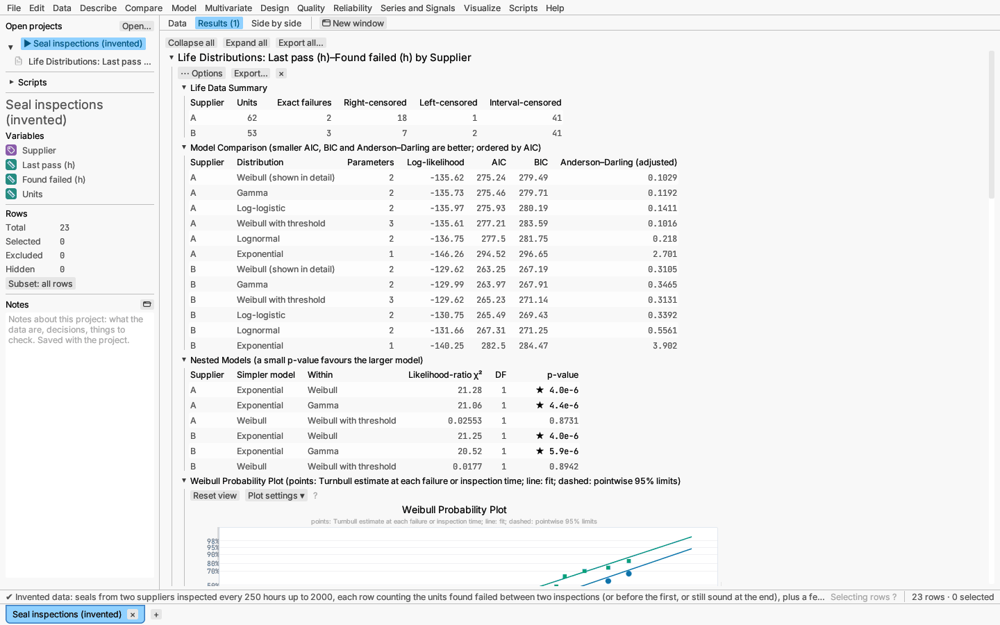

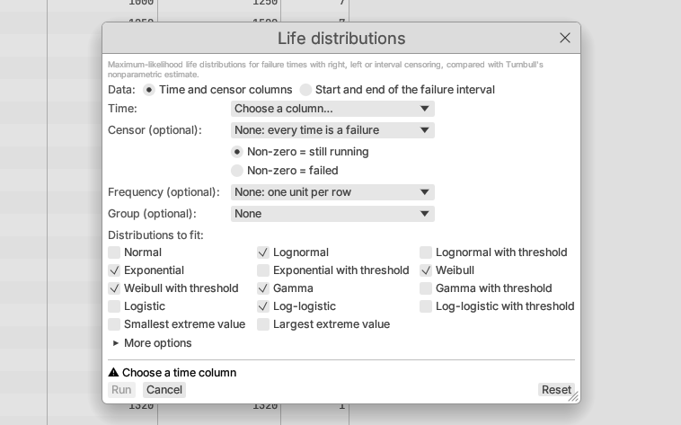

## Life–stress models

Reliability ▸ Life–stress models… analyses accelerated life tests: units
run at raised temperature, voltage, humidity or another stress so that they
fail sooner, and the results are extrapolated to the conditions of use. The
log of life follows a location–scale distribution whose location μ depends
on the stresses (Nelson 1990; Meeker & Escobar 1998, ch. 19–20).

Data use the layouts of [Life distributions](#life-distributions): a time
column with an optional censor column, or the start and end of the interval
in which each unit failed, so right, left and interval censoring are all
allowed; a **frequency** column counts units per row. Then choose:

- the **stress** column, its **relationship** and its **use condition**:
  - **Arrhenius** (temperature, in °C or K): μ = β₀ + β₁·11604.518/T, so β₁
    is the activation energy Eₐ in electron-volts;
  - **Eyring** (temperature): as Arrhenius with a further −ln T term;
  - **Inverse power** (voltage, load): μ = β₀ + β₁ ln s; life ∝ s^−n with
    n = −β₁;
  - **Exponential** (linear): μ = β₀ + β₁ s;
- optionally a **second stress** with its own relationship and use
  condition (Arrhenius with an inverse-power humidity or voltage term is the
  Peck model), and their **interaction** (the generalized Eyring form);
- the **life distribution**: Weibull, lognormal, log-logistic or
  exponential.

The scale (the Weibull shape is 1/σ) is the same at every stress unless you
tick *Scale depends on the stresses* under More options, which makes ln σ
linear in the stresses and adds a likelihood-ratio test of a constant scale.
More options also take the percentiles and times reported at use
conditions, and the confidence level.

The report has:

- **Test Levels:** units, exact failures, survivors and left- or
  interval-censored units at each stress combination;
- **Model Fit:** the distribution and relationships, units, parameters,
  log-likelihood and AIC;
- **Parameter Estimates** with standard errors, Wald limits and
  likelihood-ratio (profile) limits;
- **Activation Energy and Power Exponents** with their limits;
- **Acceleration Factors:** life at use conditions divided by life at each
  test level, with limits;
- **Life at Use Conditions:** percentiles, and failure probabilities at your
  times, each with Wald and likelihood-ratio limits;
- the **life–stress plot:** failure and censoring times against the stress
  (on the 1/T scale for temperature, log scale for an inverse power), each
  kind of observation with its own marker, and percentile lines of the
  fitted model from the use condition to the highest test level, with the
  median life at use marked;
- the **probability plot by test level:** Turnbull's estimate at each level
  on the distribution's own scale, each level with its own color and marker,
  and the fitted lines (parallel when the scale is constant);
- **Model Checks:** likelihood-ratio tests of equal scales across levels,
  of the life–stress relationship against a separate location per level,
  and of the model against separate fits at every level (and of a constant
  scale when the scale depends on the stresses);
- **Individual Fits by Level:** each level fitted on its own.

*Try it:* Device-A accelerated life test — a lognormal–Arrhenius model at
10 °C, with an activation energy of about 0.63 eV.

*Verified:* against an independent SciPy implementation of the censored
likelihood and profile limits for every family, one and two stresses,
interval censoring and a stress-dependent scale; against lifelines'
accelerated failure time fitters; and against Meeker & Escobar's published
Device-A estimates and Nelson's Class-B insulation fit (see the validation
record).

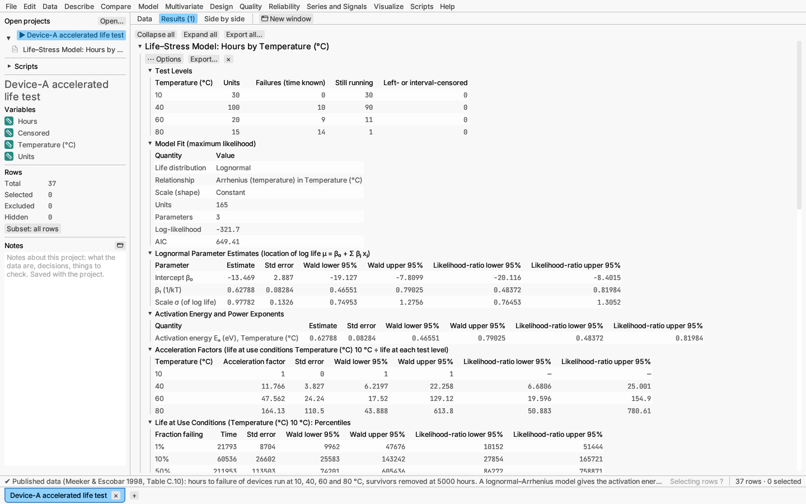

## Fatigue (stress–life) curves

Reliability ▸ Fatigue (stress–life) curves… fits an S–N curve to
constant-amplitude fatigue tests: specimens cycled at a stress amplitude S
until they break after N cycles, or are stopped unbroken (**run-outs**,
right-censored at their cycles). Choose the **cycles**, an optional
**run-out** column (non-zero = did not fail), the **stress** and an optional
**frequency** column. The life follows a log-location–scale distribution
(**lognormal**, **Weibull** or **log-logistic**) whose location μ = E[ln N]
(for the Weibull, ln of the 63.2% life) depends on the stress through the
**curve** (ASTM E739-10; Meeker & Escobar 1998, ch. 17; Pascual & Meeker
1999):

- **Basquin** (log–log line): μ = β₀ + β₁ ln S, equivalently S = A·N^b with
  A = exp(−β₀/β₁) and b = 1/β₁ (at N = e^μ);
- **Semi-log**: μ = β₀ + β₁ S;
- **Quadratic log–log**: μ = β₀ + β₁ ln S + β₂ (ln S)² (three or more
  stress levels);
- **Endurance limit** (Stromeyer form): μ = β₀ + β₁ ln(S − E) for S > E, and
  no failure at or below the endurance limit E. E is found by profile
  likelihood over (0, min S), with a likelihood-ratio interval; standard
  errors of the other parameters are conditional on Ê.

The scale σ is the same at every stress unless *Scatter depends on stress*
is ticked under More options (ln σ = γ₀ + γ₁ ln S). All parameters are fitted
by maximum likelihood with the run-outs contributing their survival
probability. More options also set the quantile curves (% failing; 10 and 50
by default), the lives for the fatigue strength (10⁶ and 10⁷ cycles), the
stresses for life quantiles (the tested levels by default) and the
confidence level.

**Report:**

- *Stress Levels* — specimens, failures and run-outs at each stress.
- *Model Fit* — curve, distribution, parameters, log-likelihood, AIC, and
  for the endurance form Ê with its interval.
- *Parameter Estimates* — coefficients and σ (or the Weibull shape) with
  Wald and likelihood-ratio limits, and Basquin's A and b.
- *Fatigue Strength* — the stress at which each quantile life equals each
  chosen number of cycles.
- *Life Quantiles* — the cycles by which each percentage fails at each
  stress, with limits.
- *S–N Curve* — failures and run-outs (own markers) on log axes (log cycles
  and log stress; linear stress for the semi-log curve) with the quantile
  curves, for example B10 and the median, and the lower confidence bound of
  the lowest one.
- *Standardized Residuals* — (ln N − μ)/σ against stress, run-outs marked.
- *Probability Plot of Standardized Residuals* — Turnbull's estimate of the standardized residuals of
  all levels together (run-outs as censored) on the distribution's own scale
  against the standard distribution's line: points far from the line
  question the distribution or the curve.

*Verified:* an independent SciPy maximum-likelihood implementation (every
curve and distribution, stress-dependent scale, the endurance limit and its
interval) and lifelines' accelerated failure time fitters for the Basquin
fits.

*Try it:* Steel fatigue (32 specimens at 200–400 MPa, two run-outs at 10⁷
cycles): a lognormal Basquin curve, and an endurance-limit curve with an
estimated limit of about 144 MPa.

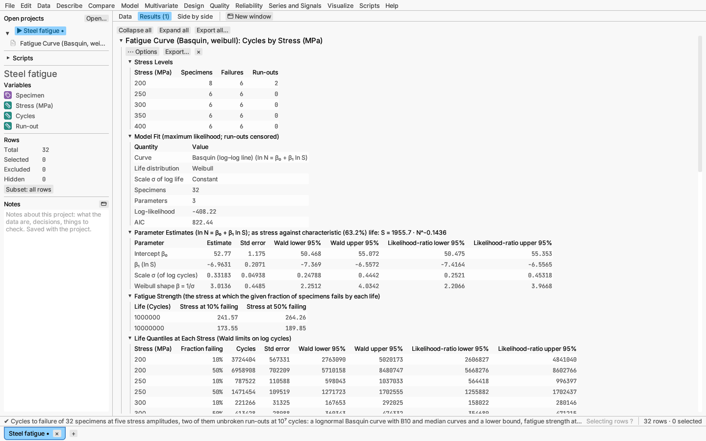

## Degradation

Reliability ▸ Degradation… draws life information from a measured
characteristic — light output, current, crack length, strength — that
drifts towards a failure threshold, which is useful when few units fail
during the test (Meeker & Escobar 1998, ch. 13, 21).

Choose one of two layouts:

- **Repeated measurements of each unit:** unit, time and response columns,
  several measurements per unit;
- **Destructive:** time and response columns, one measurement per unit
  (measuring it destroys it, as when a bond is pulled apart).

Give the **failure threshold** and whether failure is when the response
**rises** or **falls** to it.

For repeated measurements, choose the **path model** fitted to each unit by
least squares: **linear** on transformed scales (the response and time can
each be left as they are, logged or square-rooted), **asymptotic**
D∞(1 − e^(−kt)) or **power** a·t^b. Then choose how life information is
obtained:

- **Pseudo failure times, then a life distribution:** each unit's path is
  solved for the time it reaches the threshold. A unit whose path never
  reaches it is right-censored at its last measurement, and one already past
  it at its first measurement is left-censored. The chosen life distribution
  is fitted to these times; with a stress column (constant within each
  unit), a life–stress model is fitted instead.
- **Random-effects paths** (linear paths only): each unit has its own
  intercept and slope, drawn from a bivariate normal distribution, fitted
  by REML. The distribution of the time to reach the threshold follows from
  the model; its pointwise limits come from a parametric bootstrap (the
  number of replicates is under More options; the bootstrap is seeded, so
  the report is reproducible).

For destructive data the transformed response follows a normal, logistic or
extreme-value distribution whose location falls (or rises) linearly in
transformed time, μ = β₀ + β₁·h(t). With an **accelerating stress** the
rate is β₁·exp(β₂(x − x_use)), where x is the stress on its relationship's
scale (1/kT for temperature), so β₁ is the rate at use conditions and, for
temperature, −β₂ is the activation energy of the degradation rate.

The report has:

- a **summary** of units, measurements and how many reached the threshold;
- the **path plot:** measurements, each unit's fitted path (for destructive
  data, the fitted median response at each stress level, each with its own
  color and marker) and the threshold as a horizontal line;
- **Unit Paths and Pseudo Failure Times:** each unit's parameters, residual
  SD, pseudo failure time and whether it was reached, extrapolated or
  censored;
- the **life distribution** parameters with limits, a **probability plot**
  of the pseudo failure times with the fitted line, and **percentiles** and
  **failure probabilities** with limits; or, for random effects, the
  **variance components** and the **time-to-threshold distribution** curve
  with its bootstrap band; or, for destructive data, the **regression**
  parameters (with the activation energy of the rate) and the
  time-to-threshold distribution at use conditions.

*Try it:* Laser degradation — 15 lasers whose operating current rises; three
reach a 10% increase within 4000 hours. Adhesive bond strength — destructive
tests at three temperatures with a 50 N threshold at 40 °C.

*Verified:* per-unit fits, pseudo failure times and life fits against
NumPy/SciPy; the random-effects model against statsmodels' MixedLM; the
destructive model against an independent SciPy maximum-likelihood fit with
delta-method limits; and the laser data's three threshold crossings as
reported by Meeker & Escobar (see the validation record).

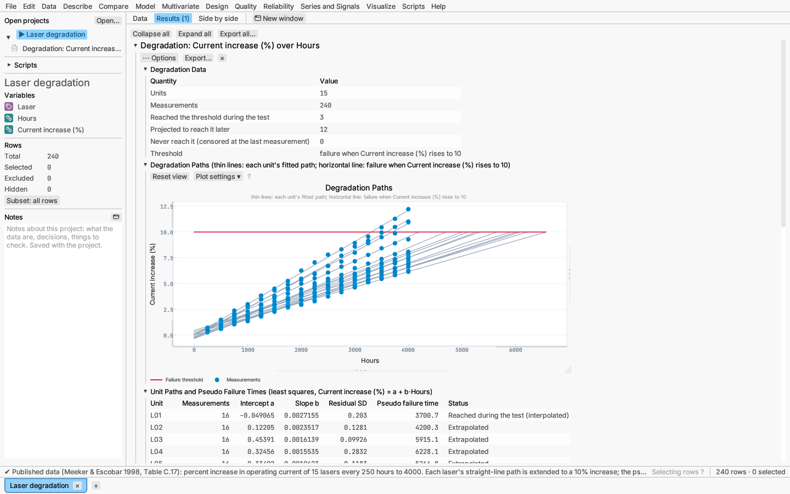

## Proportional hazards

Reliability ▸ Proportional hazards… fits Cox's regression model: each
predictor multiplies the hazard of failure by a constant factor, the hazard
ratio, while the shape of the hazard over time is left unspecified (Cox
1972). It suits clinical follow-up and field data where the question is
"which factors shorten life, and by how much?" rather than "what is the life
distribution?".

Lay the data out with one row per unit: its **time** of failure or
censoring and, optionally, a **censor** column (choose whether non-zero
means censored or failed; with no censor column every time is a failure).
Then tick the **predictors**. Continuous columns enter as slopes;
categorical ones as indicator columns against their first level. Under
*Model effects* add two-factor interactions or squares and cubes of
continuous predictors; with *Keep the model hierarchical* ticked (the
default) an interaction brings in its main effects, and the report notes
any violation when it is unticked. Optionally:

- a **strata** column gives each of its levels its own baseline hazard while
  the predictors' effects are shared — the way to adjust for a factor whose
  effect is not proportional;
- **Survival curves for** one of the predictors draws a curve per level (or
  at its 10th, 50th and 90th percentiles when continuous), the others held
  at their mean or most frequent level.

*More options* sets how **tied failure times** are handled (Efron, the
default, or Breslow), the time scale of the proportional-hazards test
(Kaplan–Meier, the default; rank; identity; log), times at which to
tabulate predicted survival, what the Response Explorer shows (the hazard
ratio against the average unit, or the probability of surviving past a
time) and the confidence level.

The report has:

- a **Model Summary**: log partial likelihood, AIC, and the likelihood-ratio,
  Wald and score tests that every coefficient is zero;
- the **Effect Pareto** and **Tests by Effect**: a likelihood-ratio test of
  each effect, refitting without it;
- **Coefficients and Hazard Ratios**: each coefficient with its standard
  error and Wald z test, and the hazard ratio exp(β) with Wald and
  likelihood-ratio (profile) limits;
- the **Proportional Hazards Check**: Grambsch & Therneau's (1994) test of
  each coefficient and the global test, on the scaled Schoenfeld residuals
  against transformed time — a small p-value says that effect changes over
  time;
- a **scaled Schoenfeld residual plot** for each coefficient, one point per
  failure, with the least-squares trend the test measures and a reference
  line at the estimate; a flat trend supports proportional hazards;
- **Predicted Survival** curves with pointwise bands (from the log
  cumulative hazard), and a table at your times;
- **Deviance residuals** against the linear predictor, to find units that
  failed much earlier or later than the model expects;
- the **Baseline Survival**: Breslow's estimate with every model column at
  its mean, per stratum.

The ⋯ menu shows the Response Explorer and 3-D surface profiler and saves
the linear predictor, hazard ratio, predicted survival, and martingale and
deviance residuals as new columns.

*Try it:* Leukemia with covariates — remission times of 42 patients by
treatment, log white cell count and sex; curves by treatment.

*Verified:* coefficients, standard errors, test statistics and
profile-likelihood limits against statsmodels `PHReg` (Efron and Breslow
ties, with and without strata), and baseline hazard, residuals and
proportional-hazards tests against lifelines `CoxPHFitter` and a direct
NumPy implementation of the published formulas (see the validation record).

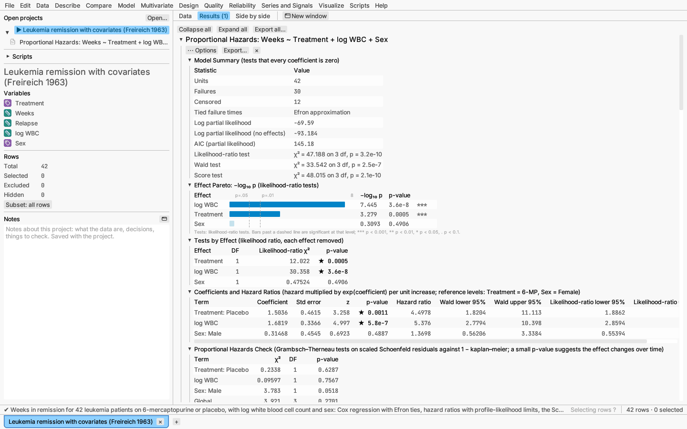

## Parametric survival regression

Reliability ▸ Parametric survival regression… fits an accelerated failure
time model: the log of the failure time is a linear function of the
predictors plus a scaled error with a Weibull (smallest extreme value),
lognormal (normal), log-logistic (logistic) or exponential distribution.
A predictor's coefficient stretches or shrinks every percentile of life by
the same factor — the time ratio — which makes it the natural model for
accelerated life tests and for life data with a few explanatory variables
(Meeker & Escobar 1998, ch. 17; Kalbfleisch & Prentice 2002).

Lay out the failure times exactly as for Life distributions: a time and
censor column, or the start and end of each failure interval (empty start =
failed before the first look; empty end = still running; equal = exact),
with an optional frequency column. Choose the distribution, tick the
predictors and their effects (with the same hierarchy rule as above), and
optionally a predictor whose levels or percentiles get their own curve and
predictions. *More options* sets the percentiles (% failing) and times to
predict, the fraction failing the Response Explorer shows the time for, and
the confidence level.

The report has:

- a **Model Summary**: log-likelihood, AIC and BIC, and the likelihood-ratio
  test of all effects;
- a **Distribution Comparison** of the four distributions with the same
  effects;
- the **Effect Pareto** and likelihood-ratio **Tests by Effect**;
- **Parameter Estimates** of the location of log time and the scale σ (and
  the Weibull shape 1/σ), with standard errors from the observed
  information, Wald limits and likelihood-ratio limits;
- **Time Ratios**: exp(coefficient), the factor applied to every percentile
  per unit increase, with Wald and profile limits;
- **Predicted Quantiles** and **Predicted Failure Probabilities** at each
  setting, with Wald limits (delta method, on log time for quantiles and on
  the standardized scale for probabilities);
- **Fitted Survival**: the nonparametric (Turnbull) estimate for each level
  of a categorical curve predictor with the model's dashed curve and band;
- a **Cox–Snell Residual Check**: the residuals' cumulative hazard against
  the unit exponential line — points near the line when the distribution and
  effects fit.

The ⋯ menu shows the Response Explorer (predicted time to the chosen
fraction failing) and saves the predicted quantile and the Cox–Snell
residuals as new columns.

*Try it:* Capacitor life test — inspections at 85, 105 and 125 °C, every
life interval- or right-censored; a Weibull model with temperature and lot.

*Verified:* against lifelines' Weibull, lognormal and log-logistic AFT
fitters (right- and interval-censored) and an independent SciPy
implementation of the censored likelihood, profile limits and predictions
(see the validation record).

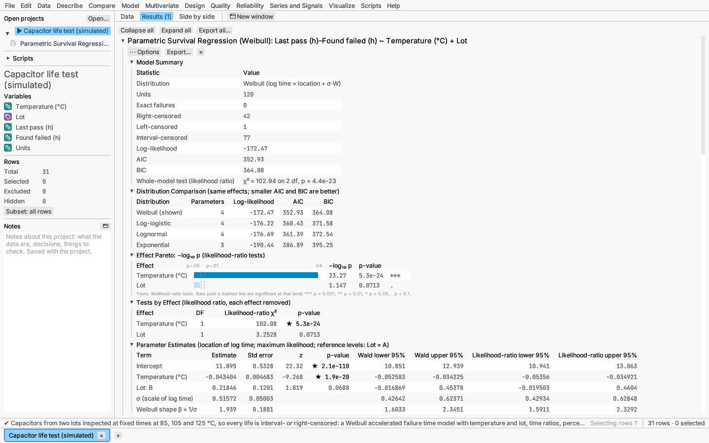

## Reliability growth

Reliability ▸ Reliability growth… follows a system under development whose
failures are fixed as they are found, and asks whether — and how fast — its
reliability is improving. It fits the power-law (Crow–AMSAA) process, whose
failure intensity is λβt^(β−1): a shape β below 1 means failures are
becoming rarer.

Lay the data out with one row per failure and its **cumulative** test time.
Optionally:

- an **event** column, where 0 marks a row that is not a failure but the end
  of the test (or of a phase) — the test is then *time-terminated* there;
  without one it is *failure-terminated* at the last failure, unless you
  give the end time in the dialog;
- a **phase** column, splitting the test where the design changed. Phases
  follow each other on the same clock; each is fitted separately, starting
  where the one before ended.

The report has:

- an estimates table per phase: failures, shape β with exact chi-square
  limits, scale λ, and the intensity and MTBF (mean time between failures)
  at the end of the phase with confidence limits. The shape is the unbiased
  estimate by default ((n−1)/n or (n−2)/n times the maximum-likelihood one,
  for time- or failure-terminated tests); the dialog can show the
  maximum-likelihood estimate instead;
- cumulative failures against time, with the fitted mean;
- the intensity and the MTBF over time, each with a confidence band and a
  curve per phase;
- the Cramér–von Mises goodness-of-fit test of the power-law model, with a
  simulated p-value (for phases starting at time 0).

*Try it:* Prototype failures — two design phases; the redesign's MTBF is
higher and the fit is adequate.

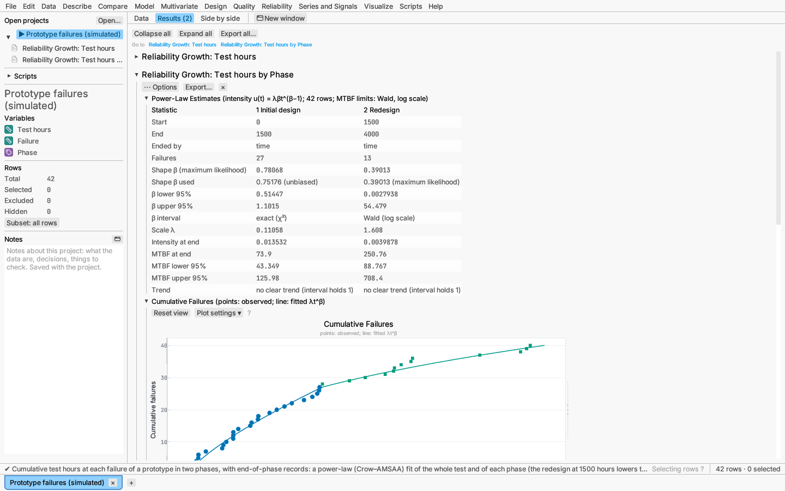

## Repairable systems

Reliability ▸ Repairable systems… describes how repairs accumulate over the
age of systems that are repaired rather than replaced (pumps, vehicles,
servers). Lay the data out with one row per repair: the **system**
identifier and its **age** at the repair. An optional **event** column with
0 marks the row that gives a system's age at the end of observation; a
system without one is taken to be observed up to its last repair. An
optional **population** column splits the systems into groups.

The report has:

- the **mean cumulative function** (Nelson's estimate of the average number
  of repairs per system by each age) with confidence limits, plotted as a
  step curve with repairs as filled markers and ends of observation as
  hollow ones, and as a table. The variance is the robust one (no
  assumption that repairs form a Poisson process) unless you choose
  Poisson. The limits are formed on the log scale by default, so they never
  go below zero; normal limits (the estimate ± z standard errors) are an
  option in the dialog;
- with exactly two populations, the difference between their mean
  cumulative functions with limits: where the band excludes zero, the
  populations differ;
- fits of a constant-rate (homogeneous Poisson) process and of a power-law
  process, with a likelihood-ratio test of a constant rate;
- the Laplace and military handbook trend tests per population: a small
  p-value means the repair rate changes with age (improving or
  deteriorating, as the report says).

*Try it:* Pump repairs — old-design pumps need repairs ever more often;
new-design pumps show no trend.

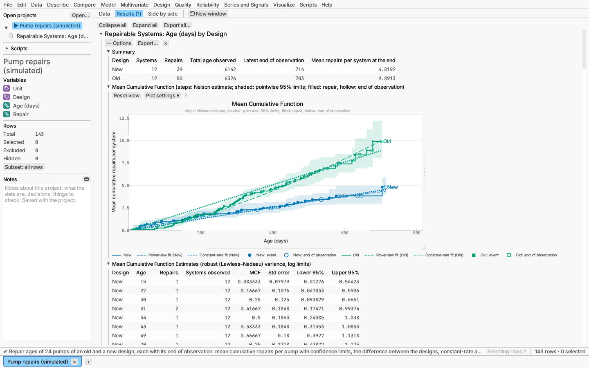

## Competing risks

Reliability ▸ Competing risks… is for units that can fail in several ways —
failure modes of a component, causes of death, reasons for leaving a study —
where the first failure ends the unit's life and hides the others. Lay the
data out with one row per unit: the **time** of failure or censoring and the
**cause** (failure mode). Choose the cause value that means the unit was
still running (censored); the dialog proposes one such as `0`, `Censored` or
`Running` when the column has it. Optional columns:

- a **group** column, compared cause by cause;
- a **frequency** column, the number of units a row stands for;
- **covariates** (in *More options*) for a regression: continuous columns,
  and nominal ones coded by indicators of all levels but the first. The
  group column may also be a covariate.

The report has:

- a **summary** of units, failures from each cause and censored units per
  group;
- the **cumulative incidence** of each cause — the probability of having
  failed from that cause by each time, while the other causes compete — by
  the Aalen–Johansen estimator, drawn as step curves. *Overlaid* (the
  default), each cause has its pointwise confidence limits (delta-method
  standard errors, formed on the log(−log) scale) and an *All causes* curve
  shows 1 − Kaplan–Meier; *stacked*, each curve adds the next cause, so each
  band between curves is one cause and the top curve is all causes.
  Failures are filled markers on their cause's curve, censored units hollow
  ones on the all-causes curve. A table lists the estimates at each failure
  time;
- with a group column, **Gray's test** for each cause: whether its
  cumulative incidence is the same in every group (a χ² test with one
  degree of freedom fewer than groups). Unlike a log-rank test on that
  cause alone, it compares the incidence actually seen, which also depends
  on the other causes;
- with covariates, **subdistribution hazards regression** (Fine–Gray) for
  one cause — the first unless you choose another: coefficients, robust
  standard errors (which allow for the weights below), and subdistribution
  hazard ratios with limits. A ratio above 1 means the covariate raises
  that cause's cumulative incidence. Units that failed from another cause
  stay in the risk set, weighted by the probability that they would still
  have been observed. A fit table gives the log partial likelihoods and the
  robust Wald test of all coefficients, and a plot shows the **predicted
  cumulative incidence** at covariate settings: by default each level of
  the first covariate (or its 10th, 50th and 90th percentiles when it is
  continuous) with the others at their mean or most frequent level; in
  *Predict at* you can give your own, one per line with values in covariate
  order (e.g. `10, North`);
- with *Fit a life distribution to each failure mode* (Weibull by default),
  the engineering view (Meeker & Escobar 1998, ch. 15): each mode's
  distribution is fitted with the other modes' failures treated as
  censored, and the modes are combined into the **series system** — a unit
  fails at its first mode failure, so its failure probability is
  1 − Π(1 − F_j(t)). A table gives each mode's parameters; a plot shows each
  mode's Kaplan–Meier estimate with its fit and the system with pointwise
  limits (delta method on the logit scale); a table gives the system's
  failure probability with limits and each mode's at chosen times (by
  default near the system's 1%, 10% and 50% points), and the times by
  which 1%, 10% and 50% of systems fail. This assumes the modes act
  independently.

*Try it:* Pump failure modes — three modes at two sites: impeller cracks
come sooner at the harsher site (Gray's test), a higher load hastens
bearing wear (the regression), and the Weibull fits per mode combine into
the pump's life.

*Verified:* cumulative incidence, variances and limits against lifelines'
Aalen–Johansen estimator; Gray's test and Fine–Gray regression (estimates,
robust and model-based standard errors, baseline) against independent NumPy
implementations, and with no censoring against lifelines' Cox regression on
the subdistribution risk set; the series system against an independent
SciPy fit (see the validation record).

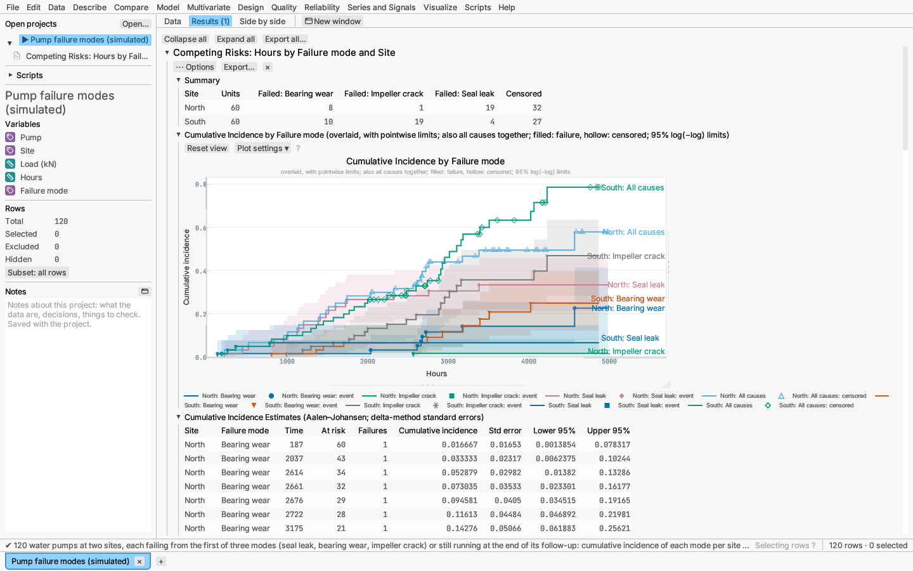

## Warranty returns

Reliability ▸ Warranty returns… turns shipment and return counts into life
data and forecasts the returns still to come. Ages are counted in periods
(months, weeks): units enter service at the start of the period they were
shipped in, so a return in a unit's first period failed at an age between 0
and 1, in its second between 1 and 2, and so on (interval censoring); a
unit not returned has survived to its current age (right censoring), or to
the warranty length when you give one and it has passed it.

Choose one of two layouts:

- **One row per shipment period** (a triangular table): the units shipped,
  an optional period label, and one column per calendar period of return,
  in order — the first is the first row's period, and the cells before a
  row's own period are empty. There are as many periods observed as return
  columns.
- **One row per count:** whole-number shipment and return periods, the
  units returned, and the units shipped in the row's shipment period
  (repeated on its rows). A row with an empty return period gives only the
  shipment.

Tick the distributions to compare (Weibull, lognormal, exponential and
log-logistic by default) and choose the one to forecast with — Weibull by
default, or the best by AIC. Give the number of periods to forecast and,
optionally, **planned shipments** for the coming periods (units shipped in
future periods 1, 2, …). *More options* has the warranty length and the
confidence level.

The report has:

- **Shipments and Returns:** per shipment period, units shipped, returned,
  still in service, their age and the fraction returned;
- the **life data:** returns per age interval and units still in service at
  each age;
- **Model Comparison**, the **probability plot** and the **parameter
  estimates** of the chosen distribution, as in Life distributions, with
  the times by which 1%, 5% and 10% of units fail;
- **Returns per Period:** observed returns per calendar period (markers),
  the returns expected under the fit, and the forecast after the current
  period with prediction limits;
- **Forecast Returns per Period:** expected returns in each future period,
  split into those from units already in service — each cohort's units
  still in service times its probability of failing in that period given
  that it has survived to its current age — and those from planned
  shipments, with prediction limits;
- **Cumulative Forecast Returns:** the total from the next period through
  each future period, with limits.

The prediction limits are a normal approximation: the variance adds the
binomial variation of the returns (for known parameters) to the
uncertainty of the expected count from estimating the distribution (delta
method), and the lower limit is never below zero.

*Try it:* Monthly warranty returns — a year of shipments with returns by
month and six months of planned shipments.

*Verified:* the fits and forecasts against an independent SciPy
implementation of the likelihood built from the counts, and the forecast by
hand for the exponential distribution (see the validation record).

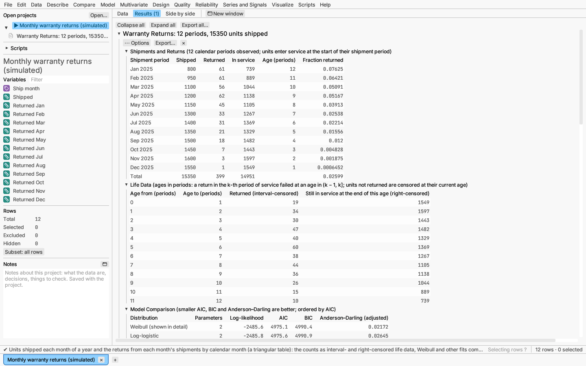

## Test plans

Reliability ▸ Test plans… plans a life test before you run it; it does not
read the data. Three kinds of plan:

- **Demonstration:** how many units to test for a given time (or how long to
  test a given number of units) to show, with a confidence, that the
  reliability at a time is at least a target, allowing 0, 1, … failures,
  for a Weibull life of known shape. The report also lists the plans for
  other numbers of allowed failures and plots the chance of passing against
  the true reliability.
- **Estimation:** how many units are needed to estimate a percentile (say
  the B10 life) of a Weibull or lognormal life within a precision factor R
  (an interval from t̂/R to t̂·R) when the test stops at a time by which a
  given fraction will have failed.
- **Accelerated:** for a test at raised stress (temperature with the
  Arrhenius relationship, voltage with inverse power, or a linear stress),
  the best two-level plan and the 4:2:1 compromise plan (three levels, more
  units at the lower stresses), and optionally your own levels: for each,
  the stresses, the share of units at each, the expected fraction failing
  and the units needed for the precision you ask for at use conditions.

Planning values (the Weibull shape or lognormal σ, the failure probabilities)
are guesses from experience or earlier tests; trying a few values shows how
much the plan depends on them. Open any table first — the menu works on the
open document.

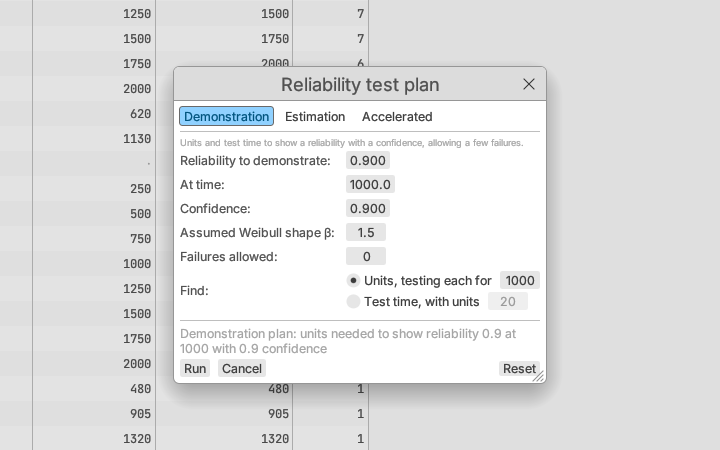

*Verified:* the growth, repairable-system and test-plan calculations
against MIL-HDBK-189 and Crow's formulas, Nelson's (2003) and Meeker &
Escobar's (1998) published formulas, and independent computations.
