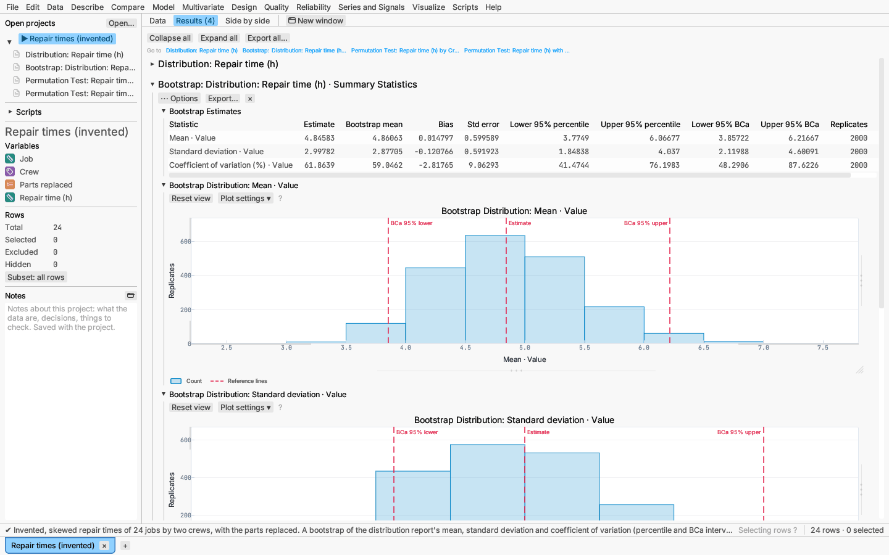
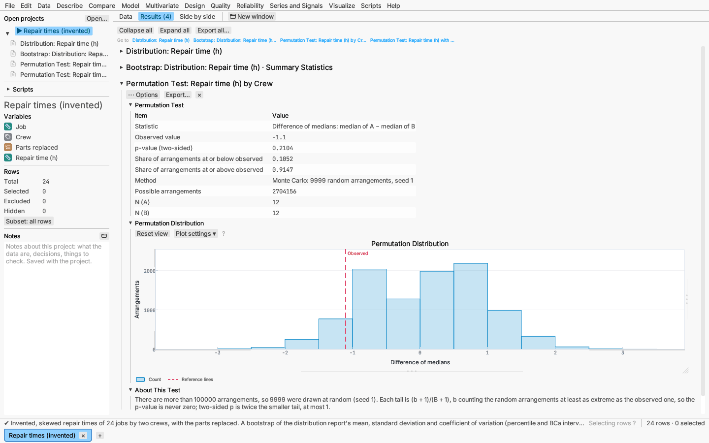

# Resampling: bootstrap and permutation tests

Resampling methods replace a formula for a statistic's sampling distribution
with the data themselves: the **bootstrap** re-computes a statistic on
samples drawn with replacement from the rows, and a **permutation test**
re-computes it over rearrangements of the data that the null hypothesis
makes equally likely. Both are useful for small or skewed samples, and for
statistics that have no standard error formula.

Every resampling run is **seeded**: the same seed gives the same results,
whatever the number of processor cores used. Change the seed to see how much
the Monte Carlo part varies.

*Try it:* Repair times (invented). It opens with a distribution report, a
bootstrap of its mean, standard deviation and coefficient of variation, a
permutation test of the two crews' median repair times, and a permutation
test of the correlation between parts replaced and repair time.

## Bootstrap of any report table

Any table in a report can be bootstrapped. Right-click the table (or its
section heading) and choose **Bootstrap this table…**, or use the report's
**⋯ Options ▸ Bootstrap a table** menu, which lists the report's tables.

The dialog shows the table's columns and rows that hold numbers:

- **Columns** and **Rows:** the cells to collect. Every chosen row of every
  chosen column is one bootstrapped statistic. The first numeric column and
  every row start chosen.
- **Replicates:** the number of bootstrap samples B (1000 by default; at
  least 1000 is advisable for intervals).
- **Seed:** the start of the random draws.
- **Confidence level** of the intervals (0.95 by default).
- **Resample within levels of:** a column whose levels are resampled
  separately, keeping each level's number of rows (the stratified bootstrap,
  for example to keep the size of each group of a two-group comparison).

Each replicate draws as many rows as the report uses, with replacement, from
the rows that are not excluded and have a value in every column the report
refers to. The report is re-run on the resample exactly as it was set up
(its options included), and the chosen cells are read as the report shows
them — with the report's displayed precision, typically five or six
significant digits.

The bootstrap report shows:

- **Bootstrap Estimates:** for each statistic, the estimate (the cell in the
  original report), the bootstrap mean, the **bias** (bootstrap mean minus
  estimate), the **standard error** (standard deviation of the replicates),
  the **percentile** interval (quantiles of the replicates) and the **BCa**
  interval (bias-corrected and accelerated; Efron 1987), the number of
  replicates used and the number that **failed**.
- **Bootstrap Distribution** of each statistic: a histogram of its replicates
  with the estimate and the BCa interval (or the percentile interval when BCa
  is not available) marked.
- **About This Bootstrap:** the settings, how many resamples the report could
  not be computed on, and the jackknife used for BCa.

A replicate **fails** when the report cannot be computed on that resample
(for example a model with a factor level missing from the resample) or the
cell is not a number on it (a dash for "not defined"). Failed replicates are
left out of that statistic's summary and counted, never dropped silently; many
failures mean the resampled report often breaks, and the intervals should be
read with care.

The BCa interval adjusts the percentile interval for bias and skewness. Its
acceleration comes from the **jackknife**: the report is re-run once with
each row left out. That is done for up to 500 rows; with more rows the
report gives percentile intervals only. When every replicate falls on one
side of the estimate, BCa is not defined and shows "—".

The bootstrap treats the rows as independent observations. It does not suit
reports whose meaning depends on the order of the rows (control charts, run
charts, time-ordered data) or on a fixed design (a designed experiment's
runs), where resampling rows breaks the structure the report relies on.

Bootstrap reports are saved in projects with the report they bootstrap, and
re-run when the data or the excluded rows change. Reports that use no data
(power, distribution calculator), graphs and bootstrap reports themselves
cannot be bootstrapped.

## Permutation test

**Compare ▸ Permutation test…** tests one of three designs:

- **Two groups:** a response column and a grouping column with exactly two
  levels. The statistic is the difference of means, or of medians, of the
  first level minus the second (levels in natural order). Under the null
  hypothesis the group labels are exchangeable.
- **Paired columns:** two columns measured on the same rows. The statistic is
  the mean of the differences first − second; under the null hypothesis each
  difference is equally likely to have either sign.
- **Correlation:** two numeric columns, by Pearson's r or Spearman's ρ. Under
  independence every pairing of the values is equally likely.

Choose the **alternative**: two-sided, or one-sided with the statistic lower
or higher than its null distribution. When the number of possible
arrangements is at most **Exact when arrangements are at most** (100 000 by
default), every arrangement is evaluated and the p-value is exact. Otherwise
the **random arrangements** (9999 by default) are drawn with the **seed**,
and each tail is (b + 1)/(B + 1), where b counts the random arrangements at
least as extreme as the data: the p-value is never zero. A two-sided p-value
is twice the smaller tail, at most 1.

The report gives the statistic and its observed value, the p-value, both
tail shares, the method (exact or Monte Carlo) and the number of possible
arrangements, the sample sizes, and a histogram of the permutation
distribution with the observed value marked.

## Scripting

Both reports run from scripts like any other: `t.analyze("permutation-test",
#{ design: "two-groups", response: "Repair time (h)", group: "Crew",
statistic: "median" })`, and `t.analyze("bootstrap", #{ report: #{ analysis:
"distribution", column: "Repair time (h)" }, section: "Summary Statistics",
columns: ["Value"], rows: ["Mean"] })`. See
[Scripting and recording](../reference/scripting.md) for the settings.

## References

- Efron, B. (1987). Better bootstrap confidence intervals. *Journal of the
  American Statistical Association* 82, 171–185.
- Efron, B. and Tibshirani, R. J. (1993). *An Introduction to the Bootstrap*.
  Chapman & Hall (chapters 6, 10, 13 and 14).
- Davison, A. C. and Hinkley, D. V. (1997). *Bootstrap Methods and Their
  Application*. Cambridge University Press (§4.3).
- Phipson, B. and Smyth, G. K. (2010). Permutation p-values should never be
  zero. *Statistical Applications in Genetics and Molecular Biology* 9(1).
