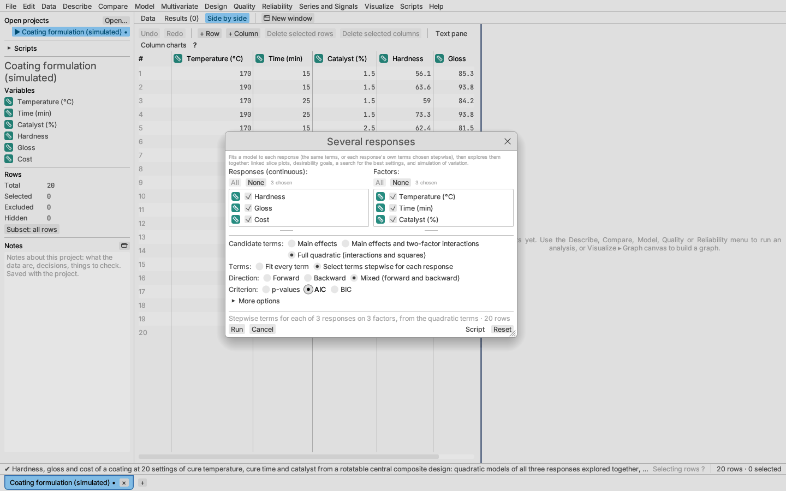
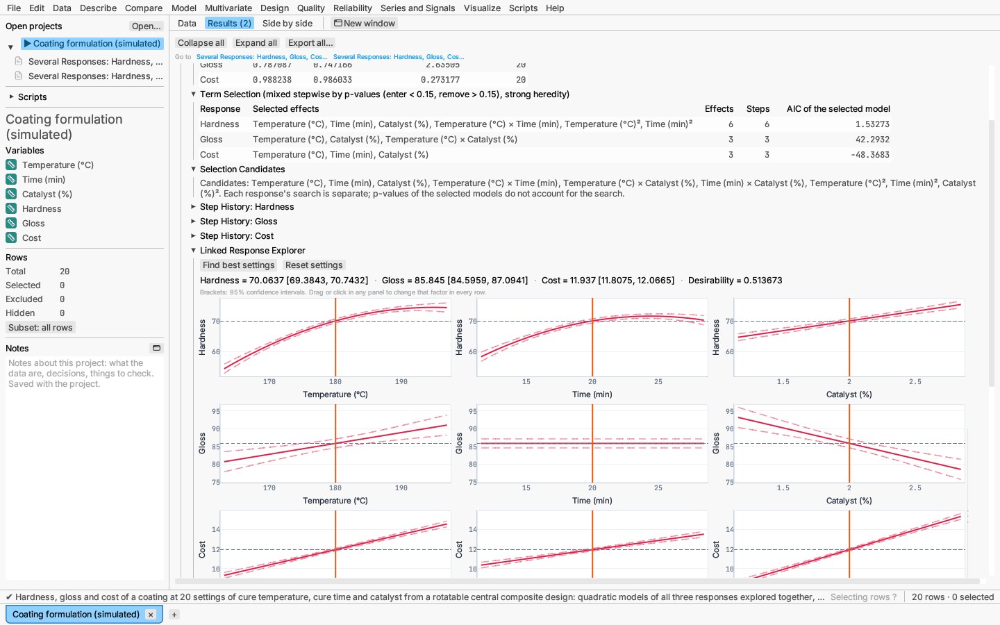
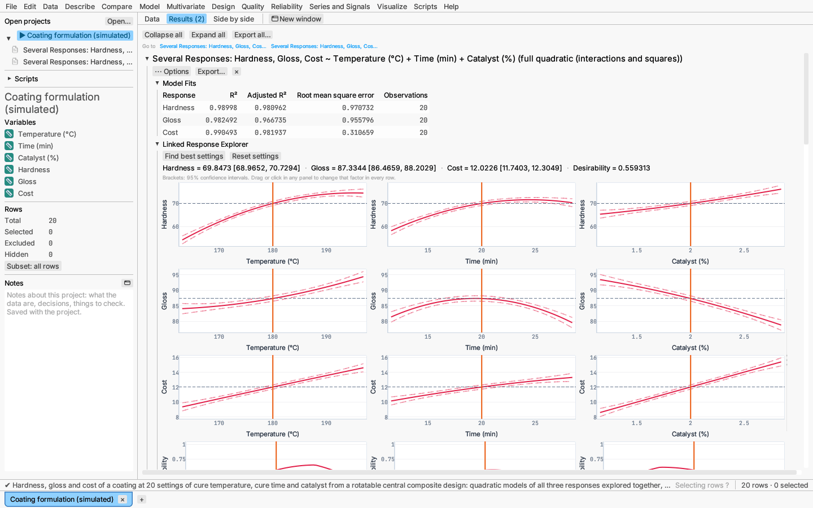
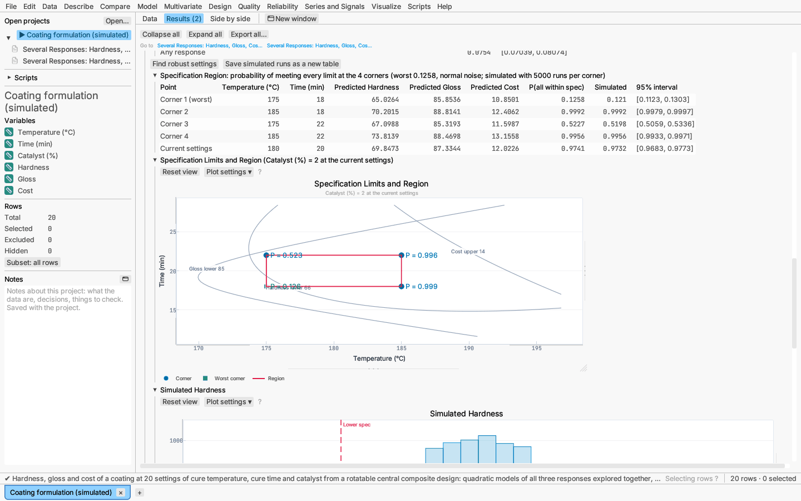

# Model: several responses

Model ▸ Several responses (desirability, simulation)… fits a model to each
of several responses on shared factors (main effects, with interactions, or
quadratic, either in full or with each response's own terms chosen
stepwise), and lets you explore and optimise them together.

*Try it:* Coating formulation: three factors and three responses from a
central composite design. Its second report selects each response's terms
stepwise.

## Terms: every term, or stepwise for each response

Under **Terms**, **Fit every term** gives every response the same model.
**Select terms stepwise for each response** runs a separate stepwise search
(see [Stepwise selection](linear-models.md#stepwise-selection)) for each
response among the terms of the chosen model, so a response that depends on
an interaction or a square keeps it while another can drop it. The
candidates include two-factor interactions and squares when the model form
has them. Choose the direction (forward, backward or mixed) and the
criterion (p-values, AIC or BIC); under **More options** set the heredity
rule (strong by default: an interaction or square enters only with the main
effects it is built from) and the p-value thresholds (enter below 0.15,
remove above 0.15 by default). To pick the candidates one by one (cubes
included), use Model ▸ Stepwise selection… and tick **Several responses,
each with its own search**: it opens the same report.

The report adds **Term Selection**, one row per response with the effects
selected, how many, the number of steps and the criterion of the selected
model; **Selection Candidates**, the candidate list (with parent effects
added for heredity); and a **Step History** per response (closed at first).
A factor that no selected term of a response uses draws flat in that
response's explorer row. A response for which no term is selected is
predicted by its mean, with the interval ȳ ± t₀.₉₇₅,ₙ₋₁ s/√n, and shown as
"(mean only)" in **Model Fits**. The explorer, goals, best settings,
simulation and specification region then work on the selected models.
p-values of the selected models do not account for the search.

## Linked Response Explorer

One row of slice plots per response, plus a row for the overall
desirability. Moving a factor in any row moves it in all of them.
Right-clicking saves every row as one figure.

## Goals and desirability

For each response, choose a goal: **maximize**, **minimize**, **hit a
target**, or **ignore**. Set lower and upper limits, shape exponents
(separately above and below a target) and an importance. Each response's
prediction becomes a desirability between 0 and 1, and the **overall
desirability** is their importance-weighted geometric mean (Derringer &
Suich, 1980). The current predictions and desirabilities update live.

## Find best settings

Maximizes the overall desirability within the factor ranges, using
Nelder–Mead from a Latin hypercube of starting points, and searching every
combination of categorical levels. The five best distinct solutions are
listed, each with a **Set to** button that moves the explorer there.

### Constraints on the factors

Under **Constraints on the factors**, type linear limits such as
`Temperature (°C) + 2*Time (min) <= 230` or `Temperature (°C) - Time (min)
>= 150`, and combinations to leave out such as `exclude Temperature (°C) >
185 and Time (min) > 21`, one per line in the factors' units (the same
syntax as constraints in optimal designs). Find best settings and Find
robust settings then keep to them: the searches start inside the allowed
region and settle on its boundary when the unconstrained best lies outside
it. The best-settings title counts the constraints. A line that does not
parse is reported and not applied.

## Simulation

Simulation shows how variation in the factors and noise in the responses
carries through to the results at the current settings:

- each continuous factor is fixed, or varies normally, uniformly or
  triangularly around its setting;
- each response gets normal noise (by default the model's RMSE);
- optional specification limits per response.

The report gives each response's simulated mean, SD and defect rate, and the
share of runs with any response out of specification, with 95% Wilson
intervals and a histogram per response. It re-runs as you change settings.

**Find robust settings** moves the continuous factors to the lowest simulated
defect rate (using common random numbers so comparisons are fair). The
simulated runs can be saved as a new table.

### Specification region

A process is run not at one setting but anywhere within its operating
ranges. Tick **Check a specification region around the settings** and give
each continuous factor a region low and high (by default its setting ± a
twentieth of its range; **Center on the current settings** resets them). At
every corner of that box the report gives the predictions and the
probability that every response is within its specification limits:

P = ∏ᵢ [Φ((Uᵢ − ŷᵢ)/σᵢ) − Φ((Lᵢ − ŷᵢ)/σᵢ)]

from the normal noise of each response, alongside the simulated share (the
same random draws at every corner, at most 5000 per corner) with a 95%
Wilson interval. The lowest corner is marked worst. When the
probability falls steadily away from the current settings, as it usually
does near an optimum, the worst corner is the least favourable point of the
box; with strongly curved responses an edge or face can be lower still, so
check the contour plot (Peterson 2004; del Castillo 2007). Up to 8 factors can vary (256 corners);
a factor whose low equals its high stays at its current setting.

A contour plot shows each response's specification limits over the first
two varying factors, the others at their current settings, with the box,
its corners and the worst corner marked by a different symbol.

*Try it:* the Coating formulation report has a constraint and a region set
up.

## Full reports

The options menu's **Open each response's linear model report** opens a full
report for every response, with estimates, tests and diagnostics.

*Verified:* desirability functions against hand-computed values; simulated
defect rates against analytic normal tail probabilities; uniform and
triangular spreads against their theoretical standard deviations; corner
probabilities against normal tails and simulation; constrained optima of
problems solved by hand.
