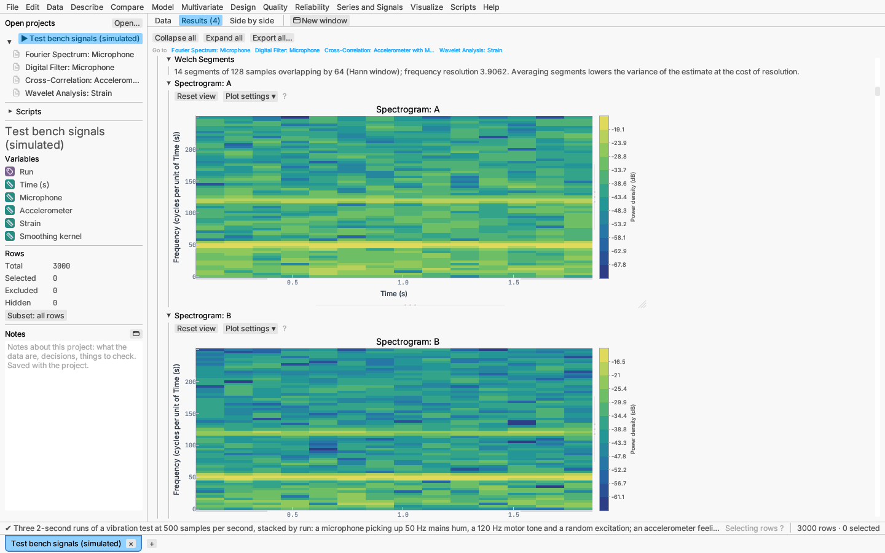
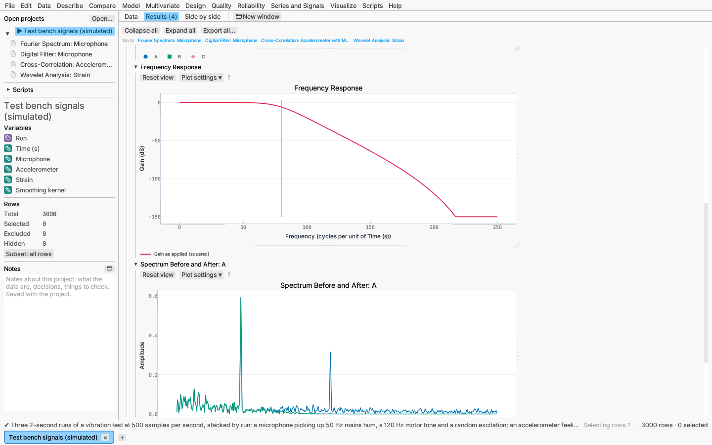
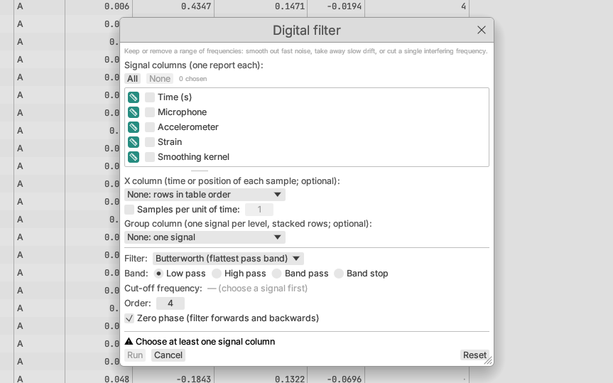
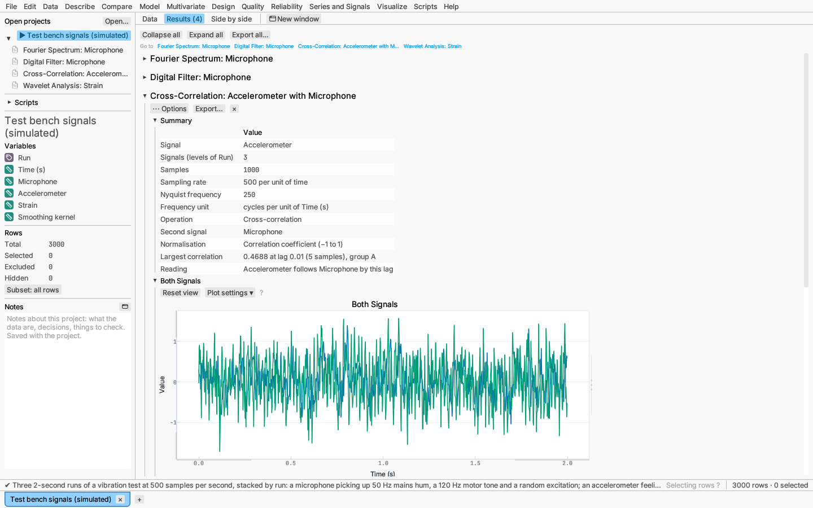
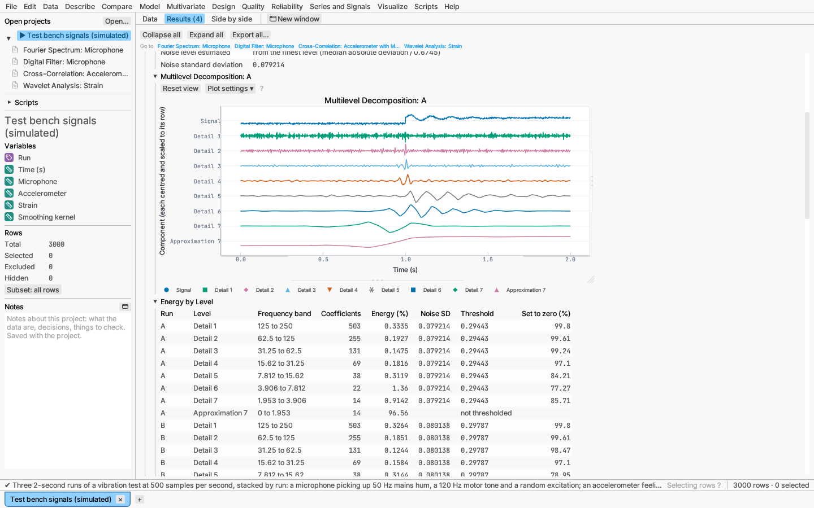

# Series and Signals: signal processing

The Fourier, filter, correlation and wavelet items under **Signals and
spectra** at the bottom of the **Series and Signals** menu analyse signals: values recorded at a steady rate, such as sound, vibration,
voltage or a sensor read many times a second. They find the frequencies a
signal is made of, filter frequencies out, compare signals at a delay, and
take signals apart scale by scale with wavelets.

| Item | What it does |
|---|---|
| [Fourier spectrum…](#fourier-spectrum) | Amplitude, power and phase at each frequency; the strongest frequencies; Welch's averaged spectrum; a spectrogram |
| [Digital filter…](#digital-filter) | Low-pass, high-pass, band-pass, band-stop and notch filters, with their frequency and phase responses |
| [Convolution and correlation…](#convolution-and-correlation) | Cross- and autocorrelation with the lag of best match, convolution and deconvolution with a kernel, the envelope |
| [Wavelets…](#wavelets) | Multilevel wavelet decomposition, wavelet denoising, a scalogram |

## The signal and its sampling

Every one of these dialogs asks for:

- **Signal columns** — numeric columns, one report each.
- **X column** (optional) — the time or position of each sample, numeric
  or date-time. The rows are sorted by it, so the table need not be in
  order. Without it, the rows are read in table order.
- **Samples per unit of time** (only without an x column) — the sampling
  rate, for frequencies in cycles per second (or per your unit of time).
  Left unticked, frequencies are in cycles per sample (per row).
- **Group column** (optional) — for several signals stacked in one column
  (long format), such as several runs or channels: each level is analysed
  as its own signal, plots overlay the groups (up to 12) and tables list
  them all.

Under the choices the dialog shows the **sampling rate** it found and the
**Nyquist frequency**, half the rate: the highest frequency the samples can
show. A tone above it appears at a lower, wrong frequency (aliasing), so
record fast enough.

With an x column, the sampling step is the median spacing of the x values
(per second for date-times). When the spacing is uneven — a missing
sample, a jittery clock — the signal is **resampled** onto an even grid at
that step by linear interpolation, and the report's summary says so.
Excluded rows and rows with a missing value are left out (and, being
uneven gaps, are interpolated over); the summary counts them. Two samples
at the same x in one signal are an error naming the rows.

Frequencies are reported in *cycles per unit of x*, *cycles per second*
for a date-time x, *cycles per unit of time* with a sampling rate, or
*cycles per sample* otherwise. Each report starts with a **Summary**: the
signal, the number of groups and samples, the sampling rate, the Nyquist
frequency, the unit, and what was resampled or left out.

Every plot can be exported from its right-click menu, and every table can
be copied or made into a new data table.

*Try it:* the sample **Test bench signals** — three 2-second runs of a
vibration test at 500 samples per second, stacked by run — opens with one
report of each kind.

## Fourier spectrum

Series and Signals ▸ Fourier spectrum… breaks each signal into sine waves by the
fast Fourier transform (of any length: lengths with only small prime
factors directly, others by Bluestein's algorithm), and shows how strong
each frequency is.

Options:

- **Window** — the signal is multiplied by a taper before the transform to
  reduce *leakage*, the spreading of a strong tone into neighbouring
  frequencies: Rectangular (none: sharpest peaks, most leakage), **Hann**
  (the default, a good general choice), Hamming, Blackman, Flat-top
  (accurate peak heights, broad peaks), Kaiser (β = 8.6) and Tukey
  (α = 0.25). Amplitudes are corrected for the window's average, so a
  tone's peak keeps its height.
- **Remove first** — nothing, **the mean** (the default; otherwise a large
  spike sits at frequency zero), or a straight-line trend.
- **Zero padding** — transform 2, 4 or 8 times the signal length (zeros
  added), and optionally round up to a power of two: the spectrum is drawn
  at finer frequency steps. Padding interpolates; it does not separate
  tones closer than the resolution 1/(signal duration).
- **Power in decibels** (10·log₁₀, on by default), **Phase spectrum**,
  and the number of **dominant frequencies** listed (5).
- **Welch's averaged spectrum** — the signal is cut into overlapping
  segments (length 256 and 50% overlap by default), each windowed and
  transformed, and their power averaged: a much less noisy estimate, at the
  cost of coarser frequency steps.
- **Spectrogram** — the spectrum of each segment drawn against time, to see
  frequencies come and go.
- Under **More options**: one-sided spectra (the default; power at
  negative frequencies is folded onto positive ones) or two-sided, and
  power as a **density** per unit of frequency (the default; it does not
  depend on the signal length) or as the **power at each frequency**.

The report has:

- **Signal** — the samples (points, which you can select) with a line
  through the even grid; one colour per group.
- **Amplitude Spectrum** — the amplitude of the sine wave at each
  frequency: a tone `A·sin(2πft)` shows a peak of height A at f.
- **Power Spectral Density** (or **Power Spectrum**) — power at each
  frequency, in dB by default.
- **Phase Spectrum** (optional) — the phase of each frequency in degrees.
- **Dominant Frequencies** — the largest local peaks of the power
  spectrum, with their period, amplitude, power and share of the total
  power.
- **Welch Spectrum** (optional) and a note giving the segments used.
- **Spectrogram** (optional, for up to four groups) — a time–frequency map:
  time across, frequency up, power as colour on a sequential scale binned
  into 12 steps, with a colour bar beside the map whose values mark the
  steps. Hovering a cell gives its time, frequency and power. In dB the map
  shows the top 100 dB.
- **Spectrum Values** — frequency, period, amplitude, phase and power, a
  table you can make into a new data table.

*Try it:* Test bench signals — the microphone's spectrum shows the 50 Hz
mains hum and a 120 Hz motor tone above a broad hump from the shaker.

## Digital filter

Series and Signals ▸ Digital filter… keeps or removes a range of frequencies.

- **Filter**:
  - **Butterworth** — the flattest pass band (no ripple).
  - **Chebyshev type I** — a sharper cut-off with a set ripple in the pass
    band (dB).
  - **Chebyshev type II** — a sharper cut-off with a set attenuation in the
    stop band (dB), flat in the pass band.
  - **Elliptic** — the sharpest cut-off for its order, with ripple in both
    bands.
  - **FIR, windowed sinc** — a finite impulse response from the ideal
    filter's impulse response tapered by a window (Hamming by default),
    with a set number of **taps** (an odd number for high-pass and
    band-stop); its phase is linear, so it delays every frequency equally.
  - **FFT, ideal cut-off** or **smooth cut-off** — the signal's Fourier
    transform is multiplied by the gain (1 in the band, 0 outside, or a
    Butterworth-shaped gain of the set order) and transformed back. It
    treats the signal as periodic, so its ends can show wrap-around.
  - **Notch** — removes one frequency (such as mains hum) with a
    second-order filter; the **quality factor** is the frequency divided by
    the width of the notch.
- **Band** — low pass, high pass (one cut-off), band pass or band stop
  (two edges). Frequencies are in the signal's unit and must lie between 0
  and the Nyquist frequency; the cut-off starts at a fifth of it.
- **Order** (1–30) of the recursive filters: higher orders cut off more
  sharply. Band-pass and band-stop filters have twice as many poles.
- **Zero phase** (on by default) — the filter is run forwards and then
  backwards, so the output is not delayed and the gain is squared (the
  response plot shows the gain as applied). Turn it off for a causal filter,
  as a real-time instrument would apply it; the output then lags the input
  by the filter's phase. Zero-phase filtering pads each end with a mirror
  image of the signal (three times the filter length), so a signal shorter
  than that is refused.

The recursive filters are designed from the analog prototype (its poles,
zeros and gain), transformed to the band by frequency mapping with
prewarping, then to digital form by the bilinear transform, and applied as
**second-order sections**, which stay accurate at high orders where a single
polynomial would not.

The report has:

- **Filtered Signal** — the samples and the filtered signal as a line.
- **Frequency Response** — the gain in dB against frequency (deep stop
  bands clipped at −150 dB) with the band edges marked.
- **Phase Response** — phase in degrees (only for causal filters).
- **Spectrum Before and After** — the amplitude spectrum of the first
  signal before and after filtering.
- **Second-Order Sections** (b₀, b₁, b₂, a₁, a₂ of each section, a₀ = 1)
  or **FIR Coefficients**. The summary says whether all poles are inside
  the unit circle (the filter is stable).

The **⋯ Options** menu switches zero phase on or off and saves the
**filtered signal** and the **removed part** (signal − filtered) as new
columns, on the rows the signal came from (interpolated back to the rows'
own x values when the signal was resampled).

*Try it:* Test bench signals — a fourth-order Butterworth low-pass filter
at 80 Hz removes the 120 Hz motor tone from the microphone.

## Convolution and correlation

Series and Signals ▸ Convolution and correlation… offers five operations:

- **Cross-correlation with a second signal** — the second column is read
  with the same x and group columns. The correlation at lag ℓ pairs the
  first signal at time t + ℓ with the second at time t, so a peak at a
  **positive lag** means the first signal follows the second by ℓ samples;
  the summary says this in words and gives the lag in time units.
  **Normalisation**: the correlation coefficient (−1 to 1, after removing
  the means; the default), divided by n (biased), divided by the number of
  overlapping samples (unbiased), or raw sums. **Lags** up to a quarter of
  the length by default, or up to a number you set.
- **Autocorrelation** — the signal with itself; the table lists the peaks
  after lag 0, which reveal repeating patterns and their periods.
- **Convolution with a kernel** — the kernel is a column's values in row
  order (its non-missing, included rows), such as weights 1, 4, 6, 4, 1;
  **Divide the kernel by its sum** makes it a weighted moving average. The
  result keeps the signal's length, centred on the kernel.
- **Deconvolution by a known kernel** — undoes a convolution (an
  instrument's blur): **Wiener** division of the transforms with a
  noise-to-signal ratio λ, `Y·conj(H)/(|H|² + λ)` (larger λ is smoother), or
  **Richardson–Lucy** iteration for non-negative data such as counts and
  intensities (the kernel is normalised to sum 1).
- **Envelope and instantaneous phase** — from the analytic signal
  `x + i·H[x]` (H the Hilbert transform, computed with the FFT): the
  envelope is its magnitude (the signal's slowly changing amplitude), the
  phase its unwrapped angle in radians, and the instantaneous frequency the
  phase's rate of change in cycles per unit of time.

The reports plot both signals, the correlation against lag (with the lag of
maximum marked), the convolved or deconvolved signal with the kernel, or
the signal with its envelope and the phase and frequency. The **⋯
Options** menu saves the convolved or deconvolved signal, or the envelope,
phase and frequency, as columns.

*Try it:* Test bench signals — the accelerometer correlates best with the
microphone at lag +5 samples (10 ms) in every run: the vibration reaches the
accelerometer 10 ms after the microphone hears it.

## Wavelets

Series and Signals ▸ Wavelets… splits a signal into an *approximation* (the
smooth part) and *details* at successively coarser scales by the discrete
wavelet transform: at each level the current approximation is filtered
into a low-pass half (the next approximation) and a high-pass half (that
level's detail), each kept at every second sample.

- **Wavelet** — **haar**, Daubechies **db1–db10**, symlets **sym2–sym10**
  and coiflets **coif1–coif5** (db4 by default). Longer wavelets are
  smoother and separate frequencies better; haar suits step-like signals.
- **At the ends** — the signal is extended by its mirror image
  (**symmetric**, the default), **periodically** (each level then has
  exactly half as many coefficients and the transform is orthogonal), or
  by zeros.
- **Levels** — as many as the length allows (`⌊log₂(n / (L − 1))⌋` for a
  wavelet of length L), or a number you set.
- **Denoise** — shrink the detail coefficients towards zero and
  reconstruct: the **universal** threshold `σ̂·√(2 ln n)` (Donoho and
  Johnstone), which removes nearly all the noise, or **SURE** (Stein's
  unbiased risk estimate, per level, with the universal threshold where the
  signal is sparse), which keeps more detail, or a **fixed** value.
  **Soft** shrinkage moves every coefficient towards zero by the threshold;
  **hard** keeps those above it unchanged and zeroes the rest. The noise
  level σ̂ is the median absolute deviation of the finest details divided by
  0.6745, or estimated at **each level** for coloured noise. The
  approximation is never thresholded.
- **Scalogram** — the continuous wavelet transform with a **Morlet** or
  **Mexican hat** wavelet at 48 scales (4–200), spaced evenly on a log scale
  from the Nyquist frequency down to two cycles over the signal.

The report has:

- **Multilevel Decomposition** (first signal) — the signal, each detail
  level and the approximation, each reconstructed alone at the signal's
  length and stacked in rows (each centred and scaled to its row, so compare
  sizes in the table below).
- **Energy by Level** — for each detail level (finest first) and the
  approximation: the frequency band it covers (detail j covers
  fs/2^(j+1) to fs/2^j), the coefficients, the share of the energy, and
  when denoising the noise SD, the threshold and the share set to zero.
- **Denoised Signal** — the samples with the denoised signal.
- **Scalogram** (up to four groups) — time across, frequency up on a log
  scale, the magnitude of the coefficients as colour with a colour bar;
  long signals are averaged into 400 time steps. Hovering a cell gives its
  time, frequency and value.

The **⋯ Options** menu switches denoising, the scalogram and soft or hard
shrinkage, and saves the **denoised signal**, the **removed noise** and the
**smooth part** (the approximation alone) as columns.

*Try it:* Test bench signals — the strain gauge's step and ringing come
through the sym4 denoising sharply, and the scalogram shows the 8 Hz
ringing dying away after the step.

## In formulas and scripts

Formula columns can filter and transform a column down the rows (in row
order, optionally within groups): `lowpass_filter`, `highpass_filter`,
`bandpass_filter`, `bandstop_filter` (fourth-order Butterworth, zero phase,
frequencies in cycles per row), `envelope`, `instant_phase` and
`wavelet_denoise`. See [Formula columns](../reference/formulas.md).

Scripts have `fft`, `ifft`, `spectrum`, `welch_spectrum`, `spectrogram`,
`filter_signal`, `design_filter`, `convolve`, `circular_convolve`,
`cross_correlation`, `autocorrelation`, `deconvolve`, `hilbert`,
`wavelet_decompose`, `wavelet_reconstruct`, `wavelet_denoise` and `cwt` on
arrays, and run the reports with `analyze` (analysis names
`fourier-spectrum`, `digital-filter`, `signal-correlation` and
`wavelet-analysis`). See [Scripting](../reference/scripting.md).

## Accuracy

The transforms, windows, spectra, filter designs, convolutions, Hilbert
transform and wavelets are checked against NumPy, SciPy, scikit-image and
PyWavelets (`docs/validation.md` in the source lists each check and its
tolerance).
