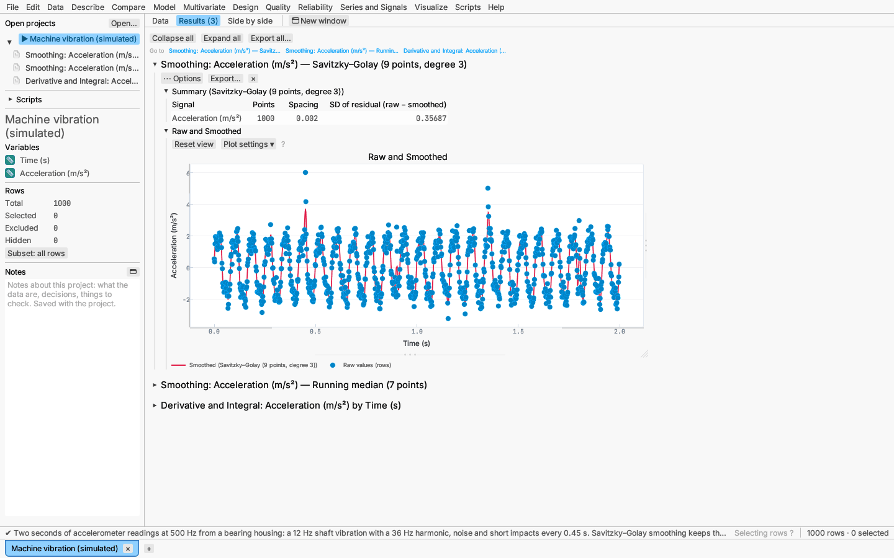
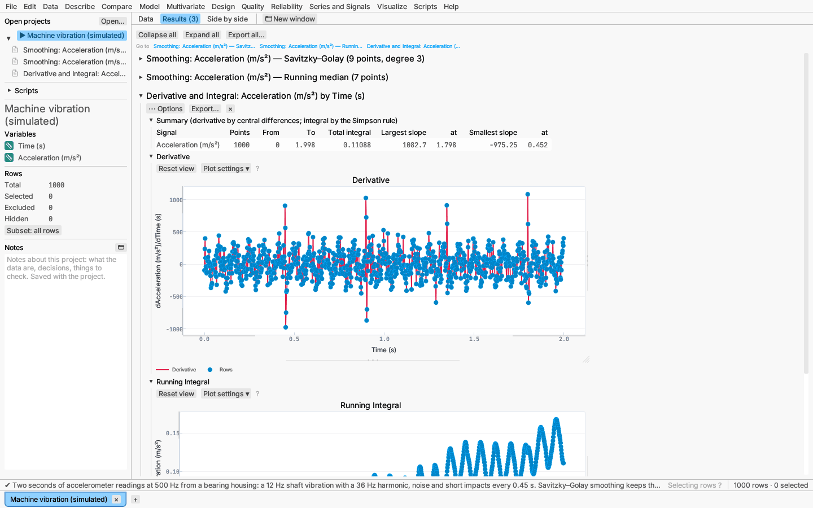
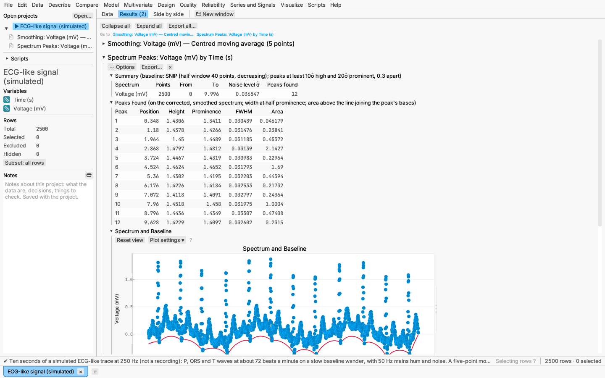
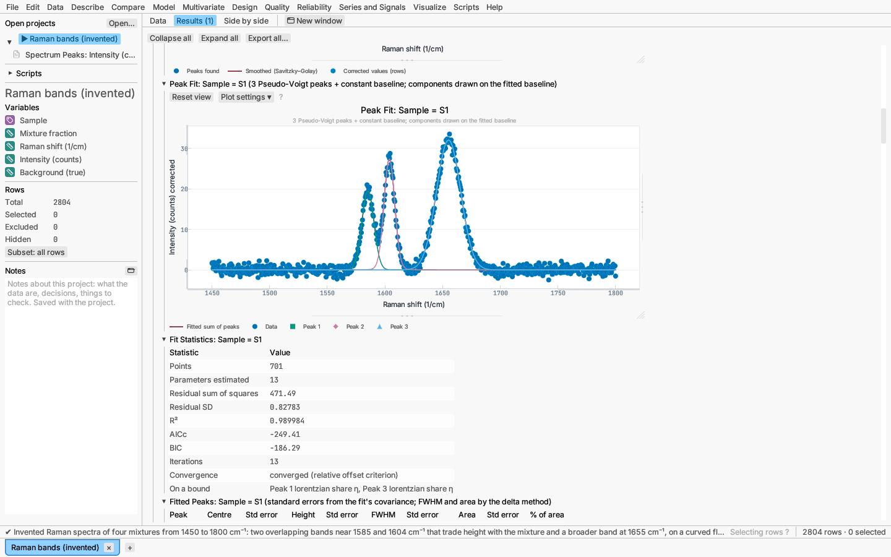
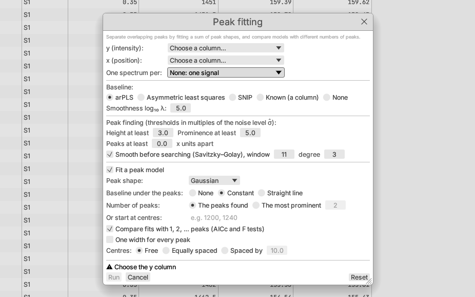

# Series and Signals: signals and spectra

The **Signals and spectra** items at the foot of the **Series and Signals** menu
work on curves measured point by point: an accelerometer or sensor trace, a
chromatogram, a Raman, infrared or X-ray spectrum, a titration curve. They
smooth a noisy signal, take its derivative and running integral, resample
it onto even spacing, remove a background, find peaks and separate
overlapping peaks by fitting a sum of peak shapes.

| Menu item | What it does |
|---|---|
| Smoothing… | Savitzky–Golay, moving-average, exponential, running median or percentile, and Gaussian kernel smoothing, with the raw and smoothed signals overlaid |
| Derivatives and integrals… | Derivative (central differences or Savitzky–Golay), running integral (trapezoid or Simpson's rule), and resampling onto an even grid (linear, cubic spline or shape-preserving interpolation) |
| Baseline correction… | The spectrum report with the baseline methods in front: asymmetric least squares, arPLS, SNIP or a known baseline column |
| Peak finding… | The spectrum report: peaks above the noise by height, prominence and separation |
| Peak fitting… | The spectrum report with a peak model fitted: centres, heights, widths and areas with standard errors, a comparison of peak counts, and one parameter table for many curves |

Baseline correction, peak finding and peak fitting are one report opened
with different defaults; any of them can do all three.

## Columns and curves

Every dialog asks for:

- **y** — the measured values (signal, intensity, absorbance);
- **x** — the position (time, wavenumber, wavelength, retention time). For
  smoothing it is optional: without it the rows are taken in table order;
- **One signal (curve, spectrum) per** — an optional column whose levels
  each hold one curve, for data stacked in long form. Every curve is
  analysed on its own, and the tables list them all; plots are drawn for
  the first eight.

The points of each curve are sorted by x. Rows with the same x in one curve
are averaged into a single point (the report's notes say so). Excluded rows
and rows with a missing x or y are left out.

The smoothing filters and the Savitzky–Golay derivative assume evenly
spaced points, as recorded by an instrument; central differences, the
integrals and interpolation accept any spacing.

## Smoothing

Series and Signals ▸ Smoothing… offers:

- **Savitzky–Golay** (Savitzky & Golay 1964): at each point a polynomial of
  the chosen *degree* is fitted by least squares to the *window* of points
  centred on it, and its value there is the smoothed value. It keeps peak
  heights and widths far better than a moving average of the same length.
  The window is odd and larger than the degree; near the ends, a single
  polynomial is fitted to the first (last) window. A *derivative* of 1 or 2
  gives the fitted polynomial's slope or curvature per x unit instead
  (using the x spacing).
- **Moving average** — centred (the window around each point, odd) or
  trailing (each point and the ones before it; fewer at the start).
- **Exponential** — sᵢ = α·yᵢ + (1 − α)·sᵢ₋₁, starting from the first value.
- **Running median** (Tukey 1977) — the median of the window; it ignores
  isolated spikes that a mean would smear. **Running percentile** takes a
  chosen percentile of the window instead (the value of rank ⌊w·p/100⌋ in
  the sorted window, from 0).
- **Gaussian kernel** — a weighted mean with weights exp(−j²/2σ²) for
  offsets j up to ⌊4σ + ½⌋ points, σ in points.

Centred filters see the signal mirrored beyond its ends
(… y₂ y₁ y₀ | y₀ y₁ y₂ …).

The report has a **Summary** (points, spacing and the standard deviation
of the residual raw − smoothed, or of the derivative), a **Raw and
Smoothed** plot for each curve (points are the table's rows, so selecting
them selects rows everywhere) and, in its options, **Save smoothed values**
as a new column. The window, degree and other settings can be changed in
the report's options; it recomputes at once.

## Derivatives and integrals

Series and Signals ▸ Derivatives and integrals… computes, for each curve:

- the **derivative** dy/dx — by *central differences*,
  (yᵢ₊₁ − yᵢ₋₁)/(xᵢ₊₁ − xᵢ₋₁) generalized to unequal spacing (second-order
  accurate, exact for parabolas) with one-sided differences at the ends, or
  by a *Savitzky–Golay* derivative, which smooths at the same time;
- the **running integral** from the first point — by the *trapezoid rule*
  or by *Simpson's rule* (a parabola through each interval and a neighbour,
  exact for cubics on even spacing);
- optionally, the curve **resampled** onto evenly spaced x from its first
  to its last point, by *linear* interpolation, a *cubic spline*
  (not-a-knot ends), a *natural cubic spline* (zero curvature at the ends)
  or the *shape-preserving cubic* (PCHIP, Fritsch & Carlson 1980), which
  never overshoots the data between points.

The report has a **Summary** (the total integral and the largest and
smallest slopes with their x), plots of the **Derivative** and the
**Running Integral**, and the **Resampled Values** table (save it as a data
table from the table's menu). The derivative and integral can be saved as
columns from the options.

## Baseline correction

A spectrum often sits on a slowly varying background (fluorescence,
scatter, drift). The spectrum report removes it before finding and fitting
peaks:

- **arPLS** (Baek et al. 2015, the default) — a smooth curve z minimizing
  Σwᵢ(yᵢ − zᵢ)² + λΣ(Δ²zᵢ)², where the weights come from a logistic
  function of the residuals scaled by the noise of the points below the
  curve, so points on peaks get almost no weight. One setting: the
  smoothness log₁₀ λ (larger is stiffer; 5–7 suits a few hundred to a few
  thousand points).
- **Asymmetric least squares** (Eilers & Boelens 2005) — the same penalty,
  with weight p for points above the curve and 1 − p below.
- **SNIP** (Ryan et al. 1988) — statistics-sensitive non-linear iterative
  peak clipping: each point is replaced by the smaller of itself and the
  mean of its neighbours k points away, for k up to the *half-window*
  (decreasing windows by default). Set the half-window a little above half
  the widest peak's width in points. The *log–log–square-root* option
  works on v = ln(ln(√(y+1)+1)+1) for counts spanning orders of magnitude.
- **Known** — subtract a baseline column measured or computed elsewhere.
- **None** — the data already sit on zero.

The **Spectrum and Baseline** plot shows the spectrum and the estimated
baseline; the corrected spectrum and the baseline can be saved as columns.

## Peak finding

Peaks are local maxima of the corrected spectrum after optional
Savitzky–Golay smoothing (11 points, cubic by default), kept when they are:

- at least so many **noise levels high** (3 by default), and
- at least so many noise levels **prominent** (5 by default): prominence
  is how far a peak rises above the higher of the lowest points between it
  and a higher peak (or the end) on either side;
- at least the **separation** apart in x units (lower peaks give way).

The noise level σ̂ is estimated robustly from the successive differences
of the corrected spectrum, σ̂ = 1.4826·MAD(Δy)/√2, but never below 0.1% of
its range, so a smooth or noiseless curve does not turn every ripple into a
peak. These rules follow SciPy's `find_peaks`.

The **Peaks Found** table gives each peak's position, height, prominence,
width at half prominence (interpolated between points) and area above the
line joining its bases; the **Peaks** plot marks them on the corrected
spectrum.

## Peak fitting

With **Fit a peak model** ticked (the default for Peak fitting…), the
corrected spectrum is fitted by a sum of peaks plus a baseline term by
Levenberg–Marquardt least squares:

| Shape | Profile (height h, centre c) | Width parameters |
|---|---|---|
| Gaussian | h·exp(−4 ln 2 (x − c)²/w²) | FWHM w |
| Lorentzian | h / (1 + 4(x − c)²/w²) | FWHM w |
| Pseudo-Voigt | weighted sum of a Gaussian and a Lorentzian of the same FWHM and area; η is the Lorentzian share of the area | FWHM w, share η (0–1) |
| Voigt | the convolution of a Gaussian and a Lorentzian, computed from the Faddeeva function (Weideman 1994) | Gaussian FWHM, Lorentzian FWHM |
| Split Gaussian, split Lorentzian | different widths left and right of the centre (asymmetric peaks) | left and right FWHM |

- **Baseline under the peaks** — none, a constant or a straight line,
  fitted with the peaks (on top of the baseline already removed).
- **Number of peaks** — every peak found (at most 12) or the most
  prominent few; or type **starting centres**. The starts (centre, height,
  width at half prominence) come from the first curve; each other curve
  starts from the same centres and widths with its own heights.
- **One width for every peak** — the peaks share their width parameters.
- **Centres** — free, **equally spaced** (a first centre and a spacing are
  estimated) or **spaced by** a fixed distance.

Heights stay positive, widths positive and below twice the x range,
centres within the x range and η within 0–1. A parameter that ends on a
bound is listed under *On a bound* in the fit statistics and has no
standard error.

The report has, for each curve:

- **Peak Fit** — the corrected points, the fitted curve and each component
  drawn on the fitted baseline;
- **Fit Statistics** — points, parameters, residual sum of squares and SD,
  R², AICc and BIC, and how the iterations ended;
- **Fitted Peaks** — centre, height, FWHM and area of each peak with
  standard errors (from the fit's covariance, s²(JᵀJ)⁻¹; FWHM and area by
  the delta method for shapes where they combine parameters), and each
  peak's share of the total area;
- **Parameter Estimates** — every parameter with its standard error;
- **Residuals** against x;
- **Numbers of Peaks** (unless switched off) — the fits with the 1, 2, …
  most prominent peaks, each with its AICc (2k − 2 ln L plus the
  small-sample correction, counting σ as a parameter), ΔAICc from the best,
  and the extra-sum-of-squares F test against one peak fewer.

With a curve column, **Peak Parameters by Curve** lists every curve's
centres, heights, FWHMs and areas side by side: save it as a data table
from the table's menu to analyse the parameters further. The fitted values
and residuals can be saved as columns.

The shape, baseline term, comparison and common width can be changed in
the report's options.

## Formulas and scripts

The smoothers, derivative, running integral and interpolation are also
formula functions (`savgol`, `moving_average`, `running_median`,
`exp_smooth`, `gaussian_smooth`, `derivative`, `cum_integral`,
`interpolate`, `interpolate_spline`, `interpolate_pchip`; see
[Formula columns](../reference/formulas.md)), and every routine, baseline
and peak fitting included, is a script function (`smooth`, `derivative`,
`cumulative_integral`, `interpolate`, `baseline`, `noise_level`,
`find_peaks`, `fit_peaks`; see [Scripting](../reference/scripting.md)). The
reports run from scripts as `"signal-smoothing"`, `"curve-calculus"` and
`"spectrum-peaks"`.

## Try it

- *Raman bands (invented)* — peak fitting of two overlapping bands and a
  broader one in four mixtures, with the true background included as a
  column for comparison with the estimated one.
- *Machine vibration (simulated)* — Savitzky–Golay and running-median
  smoothing, and acceleration integrated to velocity.
- *ECG-like signal (simulated)* — moving-average smoothing of mains hum and
  peak finding of the R waves.

## Validation

The filters, calculus, baselines and peak finding match SciPy and
pybaselines, the Faddeeva function matches SciPy's `wofz`, and the peak
fits match lmfit, on the cases in `crates/stat-signal/tests/data` (the validation record,
`docs/validation.md` in the repository, lists each check and its tolerance).
