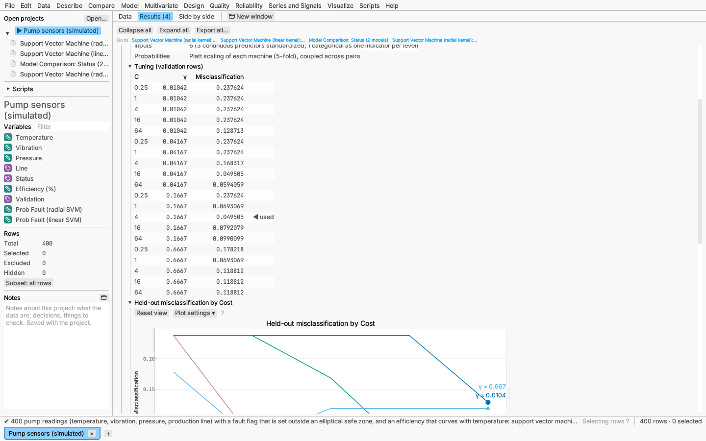

# Model: support vector machines

Model ▸ Support vector machine… fits a maximum-margin classifier for a
categorical response (C-support vector classification; Cortes & Vapnik,
1995), or ε-support vector regression for a continuous one, which ignores
errors smaller than ε. The fit is found by sequential minimal optimization
(Platt, 1998; Fan, Chen & Lin, 2005).

**Kernels** let the boundary bend:

- radial basis, exp(−γ‖u − v‖²) (the default): smooth, flexible boundaries;
- polynomial, (γuᵀv + 1)ᵈ, of degree 2 to 5;
- linear, uᵀv: a flat boundary, whose weights the report lists.

**Inputs.** Continuous predictors are standardized on the training rows, and
each level of a categorical predictor becomes a 0/1 indicator. Rows missing a
predictor are left out. For regression the response is standardized too, so
ε is in response standard deviations (default 0.1).

**Tuning.** The cost C (how heavily margin violations count) is tried at
0.25, 1, 4, 16 and 64. For the radial and polynomial kernels γ is tried at
g/16, g/4, g and 4g, where g is 1 divided by the number of inputs. The pair
with the smallest held-out error wins. Held-out error comes from the
validation rows, or from k-fold cross-validation (5 folds when every row
trains); roles work as for
[decision trees](decision-trees.md#validation-and-fit-measures). Either value
can be fixed in the dialog instead.

**Several classes.** One machine is fitted for each pair of classes, and the
class with the most votes is predicted.

**Probabilities.** Each machine's decision value is turned into a probability
by a sigmoid fitted to cross-validated decision values (Platt scaling; Lin,
Lin & Weng, 2007). With three or more classes, the pairwise probabilities are
combined by pairwise coupling (Wu, Lin & Weng, 2004).

**Report:**

- summary: kernel and γ, cost C and how it was chosen, and the number of
  support vectors, including how many sit at the bound C. When a machine
  finds no separating direction (its best weights are zero, so it puts
  every row in one class), a warning says so and its probabilities are the
  same for every row, giving an AUC of 0.5;
- tuning table, with ◀ marking the setting used;
- held-out error against log₂ C, one labelled line per γ;
- fit measures by role (cross-validated with k-fold), and the confusion
  matrix (classification);
- for a linear machine with a single decision function, its weights on the
  standardized inputs;
- the Response Explorer and 3-D profiler.

**Saving:** predicted values, or each class's probability and the most likely
class, and the validation roles.

*Verified:* the closed-form maximum-margin solutions of small separable
problems (weights, offset, and support vectors on the margin); ε-regression
residuals within ε on exact linear data; Platt scaling and pairwise coupling
recover known probabilities; the same seed gives the same model.

*Try it:* Pump sensors: a fault flag set outside an elliptical safe zone,
fitted with radial and linear kernels and compared on the test rows (only
the radial kernel can follow the curved boundary; the linear machine finds
no separating line at all and says so), and an ε-regression of
efficiency tuned by 5-fold cross-validation.
