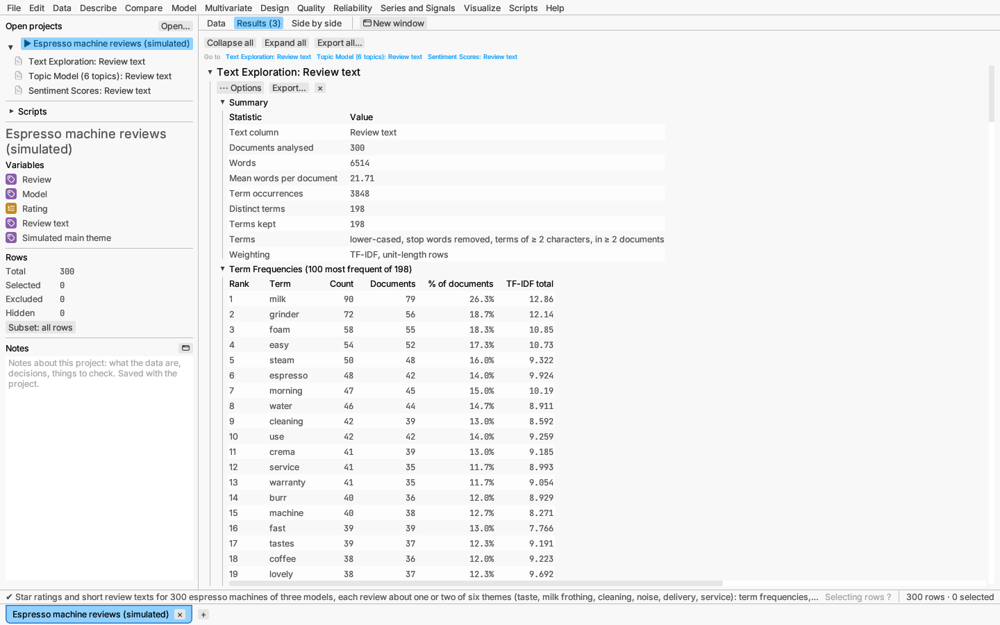
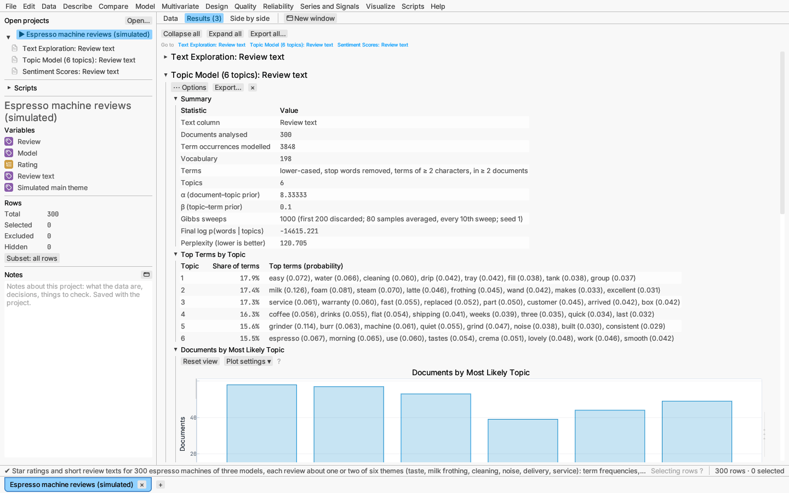
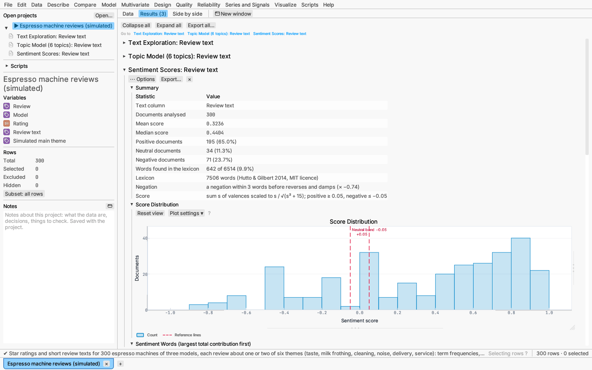

# Text Analysis

The **Text** items at the foot of the **Multivariate** menu analyse a column
of free text: survey comments, product reviews, incident notes. Each
non-empty cell is a *document*. **Text exploration** counts words and
phrases, draws a word cloud and finds the main directions of variation in
the vocabulary; **Topic model** finds topics, each a mix of words, and
describes every document as a mix of topics; **Sentiment scores** rates
each document from negative to positive.

Excluded rows are left out, and empty cells are counted but not analysed
(the report's summary says how many). Selecting documents anywhere, in a
plot, the word cloud or the data grid, selects the same rows in every view.

## Preparing the text

Text exploration and the topic model share the same preparation choices,
under the **Text column**:

- **Leave out common words** (*the*, *and*, *of*, …) — on by default; a list
  of common English function words.
- **Combine word forms** — reduces each word to its Porter stem, so *price*,
  *prices* and *priced* count as one term. The tables then show the most
  common form found in the text, not the stem.
- **Keep terms found in at least N documents** — rarer words are dropped
  (default 2).

Under **More options**: further words to leave out (comma-separated),
whether to lower-case every word (on by default), whether to keep numbers as
terms, the shortest term kept (2 characters by default), the most terms kept
(0 for all) and the random seed.

Words are split at the word boundaries of the Unicode text-segmentation
standard, so contractions such as *don't* stay whole, and phrases never
cross a sentence or comma.

## Text exploration

Multivariate ▸ Text exploration… gives:

- **Summary** — documents, words, distinct terms, and the mean number of
  words per document;
- **Term Frequencies** — the most frequent terms with their counts, the
  number and percentage of documents containing each, and their total
  weight (when word forms are combined, the stem is shown beside the term);
- **Word Frequencies** — a bar chart of the most frequent terms. Each bar is
  made of the documents that contain the term, so clicking or box-selecting
  a bar selects those rows;
- **Word Cloud** — the most frequent terms with type sized by count (the
  area of the type follows the count; the most frequent tenth is set in
  bold). Hover a word for its count; click it to select the documents
  containing it (shift or ⌘/Ctrl adds them). Words of documents already
  selected are underlined. Right-click to save the cloud as PNG, SVG, PDF
  or EPS;
- **Phrases** — runs of 2 to 3 words (the length is an option) seen at
  least twice, with their counts and documents;
- **Semantic Dimensions** — latent semantic analysis: the singular values of
  the weighted document–term matrix and the share of its sum of squares
  each dimension carries;
- **Terms by Dimension** — the terms loading most strongly, positive and
  negative, on each dimension, which say what the dimension is about;
- **Document Map** — the documents on the first two dimensions, coloured
  and shaped by cluster when clusters are asked for, with the leading terms
  marked;
- **Document Clusters** — k-means clusters of the documents' directions in
  the semantic dimensions, with each cluster's size and its most typical
  terms.

The **Term weighting** choice sets the matrix the semantic dimensions are
computed from: counts, presence (binary), log counts, TF-IDF (the default:
count × ln(documents ÷ documents containing the term), which plays down
terms found everywhere) or log TF-IDF. Each document's row is scaled to
unit length, so long and short documents count alike. Set **Semantic
dimensions** or **Document clusters** to 0 to leave those sections out.

Below the report, **Save semantic dimension 1, 2, …** and **Save document
cluster** add the scores and cluster numbers as new columns.

## Topic model

Multivariate ▸ Topic model… fits latent Dirichlet allocation: each topic is
a probability distribution over terms, and each document a mix of topics.
Choose the number of **Topics** (default 5). Under **More options** you can
set the document–topic prior α (default 50 ÷ topics; smaller values let each
document lean on fewer topics), the topic–term prior β (default 0.1;
smaller values give topics fewer, more distinct terms), the number of
sampler sweeps (1000) and how many to discard as burn-in (200).

The model is fitted by collapsed Gibbs sampling, so results depend on the
random seed; the same seed always gives the same report. The report has:

- **Summary** — documents, terms, topics, the priors and the perplexity
  (lower means the model predicts the words better);
- **Top Terms by Topic** — each topic's most probable terms with their
  probabilities, and its share of all words. Read the terms to name the
  topic;
- **Documents by Most Likely Topic** — a bar for each topic; its bar is made
  of the documents whose largest share is that topic, so clicking it
  selects them;
- **Sampler Log-Likelihood** — the log-likelihood at each sweep. It should
  level off after the burn-in; if it is still rising, run more sweeps;
- **Most Representative Documents** — the three documents with the largest
  share of each topic, with their text.

**Save most likely topic** and **Save proportion of topic 1, 2, …** add
columns for further analysis, for example a contingency table of topic
against product.

## Sentiment scores

Multivariate ▸ Sentiment scores… rates each document from a lexicon of about
7,500 English words, each rated from −4 (very negative) to +4
(very positive) by human raters (the VADER lexicon of Hutto & Gilbert,
2014, used under its MIT licence). A word's sign is reversed and its
valence weakened when a negation (*not*, *never*, *isn't*, …) comes within
the three words before it. Intensifiers (*very*), capitals, exclamation
marks and emoticons are not taken into account. The choices are:

- **Reverse words after a negation within N words** — on by default, N = 3;
- **Neutral band** — documents scoring within ±0.05 are neutral;
- **Words of your own** — entries such as `crema = 2, limescale = -1.5`
  that add words to the lexicon or replace its valence (−4 to 4).

Each document's **score** is the sum of its valences s mapped to −1…1 by
s ÷ √(s² + 15). The report has:

- **Summary** — documents scored, how many are positive, neutral and
  negative, and the mean and median score;
- **Score Distribution** — a histogram of the scores with the neutral band
  marked; selecting bars selects the documents;
- **Sentiment Words** — the lexicon words that contributed most, with their
  valence, occurrences and total contribution, and how often they were
  negated;
- **Most Positive Documents** and **Most Negative Documents** — the
  extremes, with their text.

**Save sentiment score**, **Save sum of valences**, **Save sentiment
category** (positive, neutral or negative), **Save positive word count** and
**Save negative word count** add columns. A lexicon score is a rough guide:
it misses sarcasm and domain words, so read the extreme documents before
relying on it, and add your own words where the lexicon is silent.

*Try it:* Espresso machine reviews — 300 simulated reviews of three
machine models with star ratings. The text exploration finds six clusters
that match the hidden main theme of each review (kept in the column
*Simulated main theme*), the topic model recovers the same six themes, and
the sentiment score rises with the star rating.

