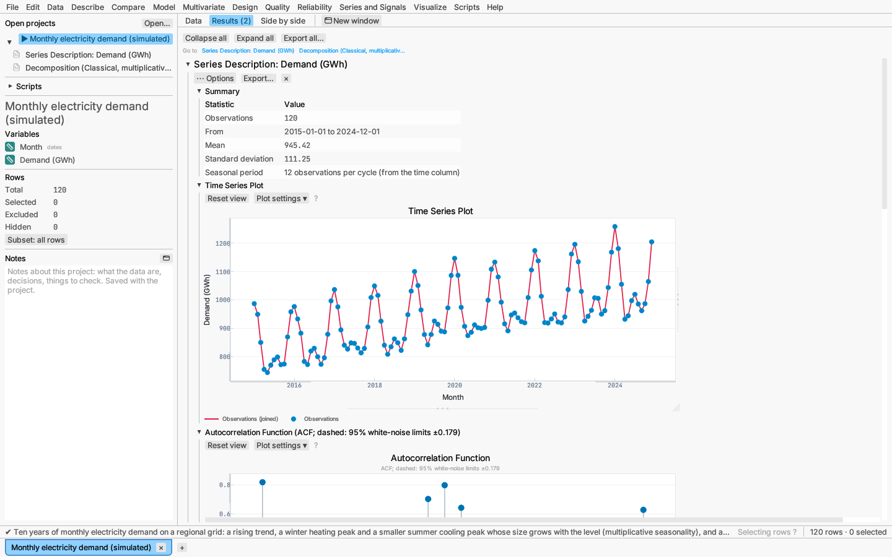
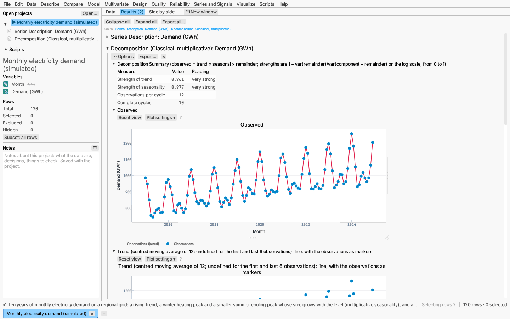
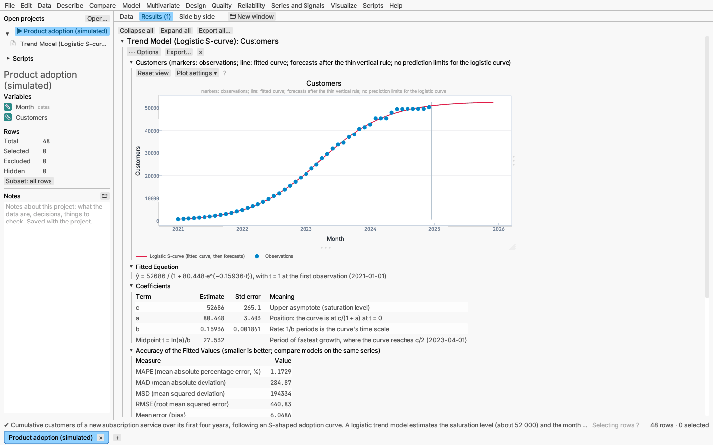
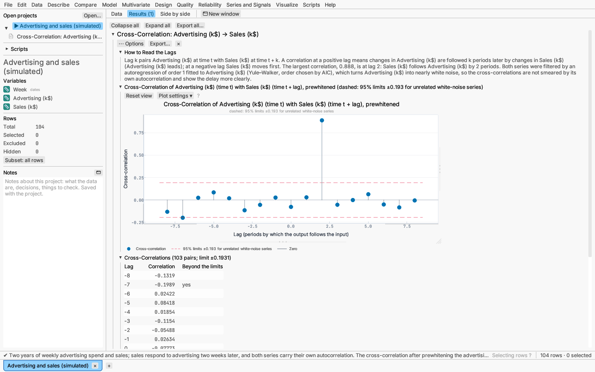
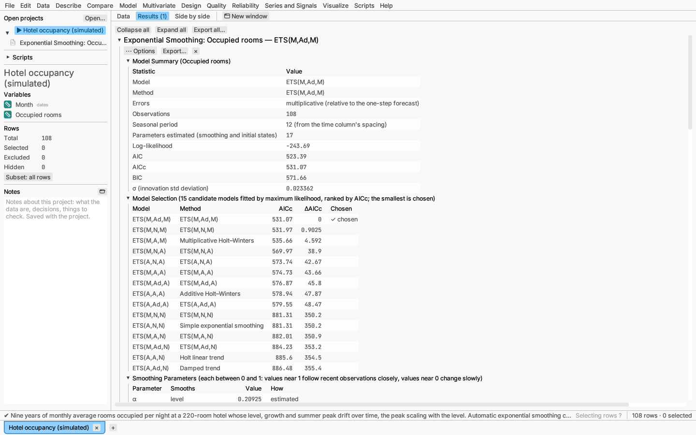
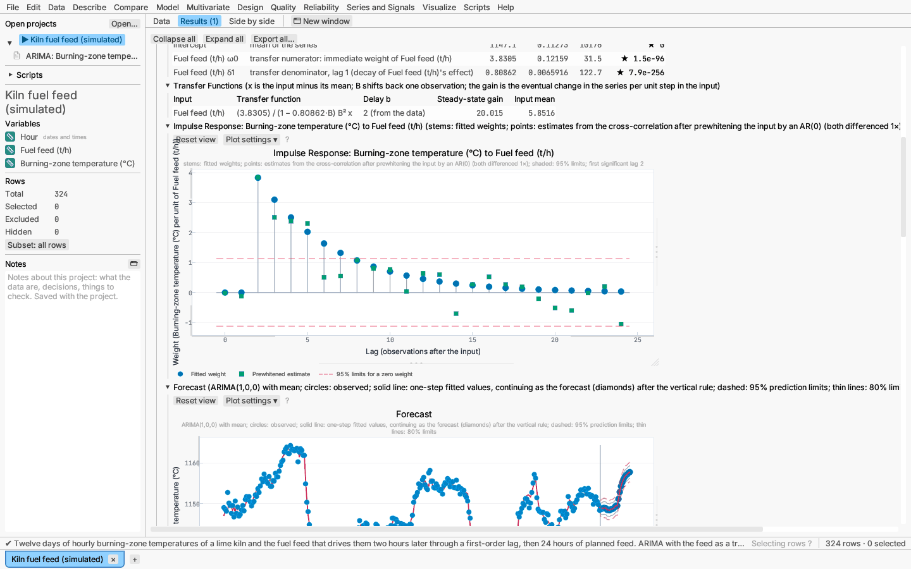
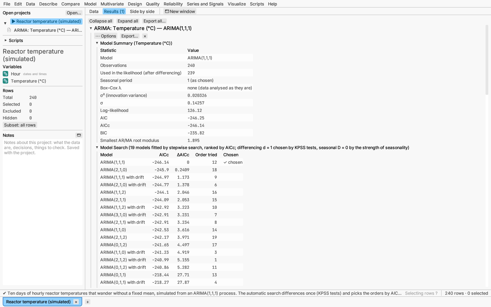

# Series and Signals: time series

The **Series and Signals** menu analyses series of values recorded at equal
intervals: monthly sales, daily temperatures, hourly loads. Its **Explore**
items describe a series and its dependence on the past, split it into
trend and seasonal parts, fit trend curves, and relate two series at a
delay. Its **Forecasting models** items (exponential smoothing and ARIMA)
fit a model and forecast the series ahead with prediction intervals. Its
**Signals and spectra** items (Fourier spectra, digital filters, convolution and
correlation, wavelets) are described in
[Series and Signals: signal processing](signal-processing.md).

## The series and its time axis

Every time series dialog asks for:

- **Series columns** — numeric columns, one report each. The rows are taken
  in table order, so sort the table by time first.
- **Time column** (optional) — a date-time or numeric column that labels the
  time axis (dates are ticked on the calendar) and the time stamps of
  forecasts. It is not used in the computations: the methods assume equal
  spacing. A date-time column in the table is chosen for you; choose *None*
  to number the observations 1, 2, …. Its values must run in time order.
  When they run backwards down the whole table (newest first, as many
  exports are), the rows are taken from the bottom up and the report's
  summary says so. Any other order, or a repeated time, is an error naming
  the first row out of order (*the time column … is not in time order at
  row N*): sort the table by the time column first.
- **Observations per seasonal cycle** — the period of the seasonal pattern.
  By default it follows the time column's spacing: monthly dates give 12,
  quarterly 4, weekly 52, daily 7 and hourly 24 (a numeric column in steps
  of 1/12 or 1/4 gives 12 or 4); anything else gives 1, no seasonality. Set
  it yourself for other cycles, such as 5 for working days.

Rows that are excluded or missing at the start or end of the series are
left out (the report's summary says how many). An excluded or missing row
in the middle is a gap: the report says *the series has a gap at row N* and
shows nothing else, because these methods need equally spaced, complete
data. Fill the gap (Data ▸ Impute missing values…, or by hand) or include
the row again.

## Series description

Series and Signals ▸ Series description… is the place to start with a new series.

Under the series choices you can transform it first:

- **Box–Cox transformation** — `(y^λ − 1)/λ`, the logarithm at λ = 0, for
  a series whose swings grow with its level (positive values only). Give λ,
  or let **Guerrero's method** choose the λ in [−1, 2] that makes each
  seasonal cycle's spread most nearly proportional to its level. The cycles
  are counted back from the last observation, so when the length is not a
  whole number of cycles the incomplete cycle at the start is left out.
- **Differences** — replace each value by its change from the previous one
  (d times), and **seasonal differences** — by its change from the same
  season a cycle earlier (D times). Differencing removes a trend or a
  seasonal pattern that wanders, which the unit-root tests below help
  judge.

The report has:

- **Summary** — observations, time span, mean and standard deviation, the
  period, and what the transformation did;
- **Time Series Plot** — the values against time, joined in order. The
  points are the table's rows, so selecting them selects rows everywhere;
- **Transformed Series** (when transformed or differenced);
- **Autocorrelation Function (ACF)** and **Partial Autocorrelation
  Function (PACF)** — a needle for each lag with dashed limits. A needle
  beyond the limits is a correlation unlikely for white noise (values
  unrelated to earlier ones). The limits are ±z/√n; ticking **Bartlett
  limits** widens the ACF's limits with the lag, as appropriate for judging
  whether a moving average of lower order explains the correlations. A
  slowly decaying ACF suggests a trend; spikes at the period and its
  multiples suggest seasonality. By default lags run to 10·log₁₀ n, and at
  least two seasonal cycles;
- **Autocorrelations** — the values in a table;
- **Ljung–Box Tests** — of no autocorrelation up to lags of one to four
  seasonal cycles (or 5, 10, 15, 20 without a period). A small p-value
  means the values depend on earlier ones;
- **Unit-Root and Stationarity Tests** — the augmented Dickey–Fuller test
  (null: a unit root, the series wanders and needs differencing; lagged
  differences chosen by AIC; deterministic terms none, a constant, or a
  constant and trend) and the KPSS tests (null: stationary around a level,
  or around a trend). Each row gives the statistic, the lag, the p-value
  and a conclusion at the 5% level in words. The two kinds of test have
  opposite null hypotheses, so a series is most clearly stationary when
  ADF rejects and KPSS does not. KPSS p-values come from a table and are
  shown as ≤ 0.01 or ≥ 0.10 beyond it.

The **⋯ Options** menu turns the unit-root tests on or off, picks the
Dickey–Fuller terms, switches Bartlett limits, and adds the **Spectral
Density**: the periodogram (markers) and a smoothed spectrum (line;
smoothing by modified Daniell kernels, from none to very strong) with its
confidence limits on a log scale, against frequency (cycles per
observation) or period (observations per cycle). Thin rules mark the
seasonal frequency and its multiples, and a table lists the largest peaks:
a peak at period 12 in monthly data is a yearly cycle. The series is
detrended (least-squares line) and tapered (10% at each end) first.

*Try it:* Monthly electricity demand — ten years of monthly demand with a
rising trend and winter and summer peaks.



## Decomposition

Series and Signals ▸ Decomposition… splits a seasonal series (at least two
observations per cycle and two full cycles) into a **trend**, a **seasonal**
pattern and a **remainder**:

- **Classical, additive** — the trend is a centred moving average over one
  cycle; the seasonal effect of each position in the cycle is the average
  of the detrended values there (the effects sum to zero); `observed =
  trend + seasonal + remainder`. The moving average is undefined for half a
  cycle at each end.
- **Classical, multiplicative** — the same with ratios: seasonal factors
  that average 1, for swings that grow with the level (positive values).
- **STL** — seasonal-trend decomposition by LOESS (Cleveland et al. 1990):
  the trend reaches the ends, and with a seasonal **span** (odd, 7 or more)
  instead of *the same every cycle* the seasonal pattern may change slowly.
  **Robust** downweights outliers so they stay in the remainder.

The report shows the **Decomposition Summary** (the strengths of trend and
of seasonality, `1 − var(remainder)/var(component + remainder)`, from 0 for
none to 1 for a component that dominates the noise; computed on the log
scale for a multiplicative decomposition), then panels of the **Observed**
series, the **Trend** (with the observations as markers), the **Seasonal**
component and the **Remainder**, all against the same time axis, and for a
classical decomposition the **Seasonal Indices** by month or quarter. Look
at the remainder for outliers and leftover pattern.

The **⋯ Options** menu saves the trend, seasonal component, remainder or
seasonally adjusted series (observed minus, or divided by, the seasonal
component) as new columns.

*Try it:* Monthly electricity demand — a multiplicative decomposition shows
January about 18% above the trend.



## Trend models

Series and Signals ▸ Trend models… fits one curve against time, with t = 1 at the
first observation:

- **Linear** `y = β₀ + β₁t` and **quadratic** `y = β₀ + β₁t + β₂t²`, by
  least squares;
- **Exponential growth** `y = b₀·b₁ᵗ` — a steady percentage growth of
  (b₁ − 1)·100% per period, fitted by least squares on the log scale
  (positive values);
- **Logistic S-curve** `y = c/(1 + a·e^(−bt))` — growth that slows towards
  a ceiling c (adoption, saturation), by nonlinear least squares (positive
  values); the report adds the midpoint, the period of fastest growth;
- **Moving average** — forecasts every period by the mean of the last k
  observations; its one-step forecasts within the data are scored.

The report plots the data (markers) with the fitted curve and the
forecasts after a thin vertical rule, with prediction limits (dashed) for
the linear, quadratic and exponential models; then the **Fitted Equation**,
the **Coefficients** with standard errors and what each means, the
**Accuracy** of the fitted values (MAPE, the mean absolute percentage error;
MAD, the mean absolute deviation; MSD, the mean squared deviation; RMSE and
the mean error), and the **Forecasts** with time stamps that continue the
time column (month by month for monthly dates). Compare models on the same
series by their accuracy: smaller is better.

The **⋯ Options** menu changes the number of periods forecast and saves
the fitted values or residuals as columns. Right-click the forecast table
to save it as a data table.

*Try it:* Product adoption — four years of cumulative customers following
an S-curve; the logistic model finds the ceiling and the month of fastest
growth.



## Cross-correlation

Series and Signals ▸ Cross-correlation… relates an **input** series (one that may
lead, such as advertising) to one or more **output** series (such as
sales; one report each). The two series use the same rows.

The correlation at **lag k** pairs the input at time t with the output at
time t + k. A needle beyond the dashed limits at a **positive lag** means
changes in the input are followed k periods later by changes in the output;
at a **negative lag**, the output moves first. The report's first section
says this in words for its own columns and names the largest correlation.

When the input is itself autocorrelated, its correlations with the output
are smeared over neighbouring lags and the limits are too narrow.
**Prewhitening** fits an autoregression to the input (order chosen by AIC,
or fixed), filters both series with it, and correlates the filtered series;
the report then lists the filter. Turn it on in the dialog or in the
report's **⋯ Options** menu.

*Try it:* Advertising and sales — two years of weekly data in which sales
respond to advertising two weeks later: the prewhitened cross-correlation
has its peak at lag 2.



## Forecasting models

Both forecasting reports share these settings and sections:

- **Forecast steps ahead** (12 by default) and **Prediction intervals** as
  percentages (80 and 95 by default).
- **Forecast:** the observations (circles, which you can select and brush
  like any plot's points), the one-step fitted values as a solid line that
  continues as the forecast (diamond markers) after a thin vertical rule,
  the widest prediction limits dashed and narrower ones as thin lines. With
  a date-time column the axis shows dates, and forecasts continue the
  calendar (whole months for monthly data).
- **Forecasts:** each step ahead with its time, the forecast, its standard
  error and the limits at each level.
- **Residuals over Time**, **Residual Autocorrelation** with dashed 95%
  white-noise limits (±1.96/√n), and the **Ljung–Box Test** pooling 2m lags
  for a seasonal series (10 otherwise, at most n/5), with the fitted model
  parameters taken off its degrees of freedom. A small p-value means the
  model has left structure in the residuals.
- **In-Sample Accuracy:** RMSE, MAE and MAPE of the one-step fitted values.

**Saving forecasts.** *⋯ Options ▸ Save forecasts as data table* adds a
table to the project with the time, the actual and one-step fitted values
for each observation, then one row per forecast with its standard error and
limits. The table is computed again from the report's settings when you
save it; it does not update when the data change — save it again.

### Exponential smoothing

Series and Signals ▸ Exponential smoothing… forecasts from a level, an optional
trend and optional seasonal effects, each updated as observations arrive.
Choose the model:

- **Automatic (smallest AICc):** every model in the error–trend–seasonal
  family is fitted and the one with the smallest AICc kept. Multiplicative
  errors and seasonality are considered only when every value is above
  zero (untick *Consider multiplicative errors and seasonality* to leave
  them out); untick *Consider damped trends* to leave those out. Seasonal
  models need a period of at least 2 and two full cycles of data. Additive
  errors with multiplicative seasonality are not considered, because their
  forecast variance can be infinite.
- **Simple exponential smoothing** (a level only), **Holt linear trend**,
  **Damped trend** (a trend that flattens out), **Holt–Winters, additive
  seasonality** and **Holt–Winters, multiplicative seasonality** (seasonal
  swings that grow with the level; multiplicative errors).
- **Custom combination:** additive or multiplicative errors; no, additive or
  damped trend; no, additive or multiplicative seasonality.

For a chosen model, *More options* can hold α, β, γ or φ at a value instead
of estimating it.

The report has, besides the shared sections:

- **Model Summary:** the model's label (such as ETS(M,A,M)) and plain name,
  the seasonal period and how it was chosen, the log-likelihood, AIC, AICc,
  BIC and the innovation standard deviation σ;
- **Model Selection** (automatic only): every candidate with its AICc and
  its distance from the best, the chosen one marked "✓ chosen";
- **Smoothing Parameters:** α (level), β (slope), γ (seasonal) and φ
  (damping), each marked estimated or fixed;
- **Initial States:** the starting level, slope and the seasonal effects
  (summing to 0) or factors (averaging 1) of the first cycle.

With multiplicative seasonality there is no formula for the forecast
variance, so the limits are quantiles of 5000 simulated sample paths (with
a fixed seed, so they are the same every time) and the forecast table adds
the mean of the simulated paths.

*Try it:* Hotel occupancy — nine years of monthly rooms occupied, whose
level, growth and summer peak drift over time, the peak scaling with the
level; the automatic choice is
multiplicative seasonality.

*Verified:* the engine against published and independently computed
exponential smoothing fits (see the validation record).



### ARIMA

Series and Signals ▸ ARIMA… fits a seasonal ARIMA model by exact maximum
likelihood: the series is differenced d times (and D times at the seasonal
lag) and modelled with p autoregressive and q moving-average terms (P and Q
at the seasonal lag).

- **Automatic search:** the differencing is chosen by KPSS tests (d) and the
  strength of seasonality (D), then the stepwise search of Hyndman and
  Khandakar tries neighbouring orders, keeping the smallest AICc. Untick
  *Stepwise search* to fit every model up to a total order of 5, or
  *Consider a mean or drift term* to leave out the constant.
- **Choose:** the regular orders (p, d, q) and seasonal orders (P, D, Q),
  which use the seasonal period, and whether to include a mean (no
  differencing) or a drift (one difference in all). With two or more
  differences a constant is not allowed.

*More options* offers a **Box–Cox transformation** before fitting (positive
data only): a λ you give (0 is the logarithm) or Guerrero's choice. The
forecasts and limits are transformed back, so the point forecast is then
the median of the forecast distribution, and the standard errors are on the
transformed scale. A Box–Cox transform with λ > 0 cannot go below −1/λ, but
a wide prediction interval can; such a lower limit is shown as 0 (and with
λ < 0 an upper limit beyond the transform's range as ∞, drawn at the top of
the plot), and the table's title says so.

The report has, besides the shared sections:

- **Model Summary:** the model label (such as ARIMA(1,1,1) or
  ARIMA(0,1,1)(0,1,1)[12] with drift), observations used after
  differencing, the seasonal period, the Box–Cox λ, σ², σ, log-likelihood,
  AIC, AICc and BIC, and the smallest root modulus of the AR and MA parts
  (values near 1 warn of a near unit root);
- **Model Search** (automatic only): every model tried with its AICc, the
  order tried and the chosen one marked;
- **Coefficients:** each term (ar1, ma1, sar1, sma1, intercept or drift)
  with its estimate, standard error, t ratio and p-value.

The residuals are the one-step innovations scaled to a common variance; the
first d + mD observations have none.

#### Input series (transfer functions)

When another column drives the series (fuel feed and a kiln's temperature,
advertising and sales), open **Input series (transfer functions)** and tick
it. Each input acts on the series through a *transfer function*: after a
**delay** of b observations, a **numerator** of s + 1 weights on the input's
recent values and a **denominator** of order r that lets the effect build up
or die away geometrically (Box, Jenkins, Reinsel and Ljung, chapters 11–12).
The defaults, delay *From the data*, numerator 0 and denominator 1, describe
an effect that starts after the delay and settles to a new level. The ARIMA
orders (chosen or searched) then model what the inputs leave unexplained.

- **Delay from the data:** the input is prewhitened (an autoregression
  turns it into near white noise, and the series is filtered the same
  way), and the delay is the first lag at which the two correlate
  significantly. Both are differenced as the model differences the series
  first.
- **Rows used:** the rows where the series and every input have values.
  Rows after the series with the inputs filled in (and the series empty)
  are the inputs' planned future values; forecasts use them, so a forecast
  can reach as far ahead as those rows plus the delay. With fewer rows the
  forecasts stop early and the Model Summary says so.
- The input is used as deviations from its mean, and its values before the
  first row count as that mean, so the fitted effect has no start-up jump.

With inputs the report adds:

- **Transfer Functions:** each input's fitted transfer function written out,
  its delay, the **steady-state gain** (the eventual change in the series
  per unit step in the input) and the input's mean; the weights (ω0, ω1, …
  and δ1, …) are also in the Coefficients table with standard errors;
- **Impulse Response** for each input: the fitted response of the series to
  a one-off unit pulse in the input (stems), the same weights estimated from
  the prewhitened cross-correlation (points) and 95% limits for a zero
  weight, so you can see whether the chosen delay and orders follow the
  data;
- **Residual Cross-Correlation with Prewhitened** input: the residuals
  should not correlate with the input's past; the title gives the summary
  test S with its p-value, and a small p-value means the transfer function
  misses part of the input's effect (try another delay or more weights).

*Try it:* Kiln fuel feed — twelve days of hourly burning-zone temperatures
and the fuel feed that drives them two hours later, followed by a day of
planned feed. The report finds the delay of 2 hours, a gain of about 20 °C
per t/h, and forecasts the planned day.



*Try it:* Reactor temperature — ten days of hourly temperatures that wander
without a fixed mean; the automatic search differences once and picks
ARIMA(1,1,1), forecasting the next 24 hours.

*Verified:* the engine against reference fits (see the validation record).



## Scripts

Each Explore and forecasting report can be made from a script with `analyze`, for example

```rhai
let t = current_table();
t.analyze(#{analysis: "decomposition", column: "Demand (GWh)", time: "Month", method: "stl", robust: true});
```

Forecasting reports use the keys `exponential-smoothing` and `arima`.
The settings of each analysis are listed in the
[scripting reference](../reference/scripting.md).
