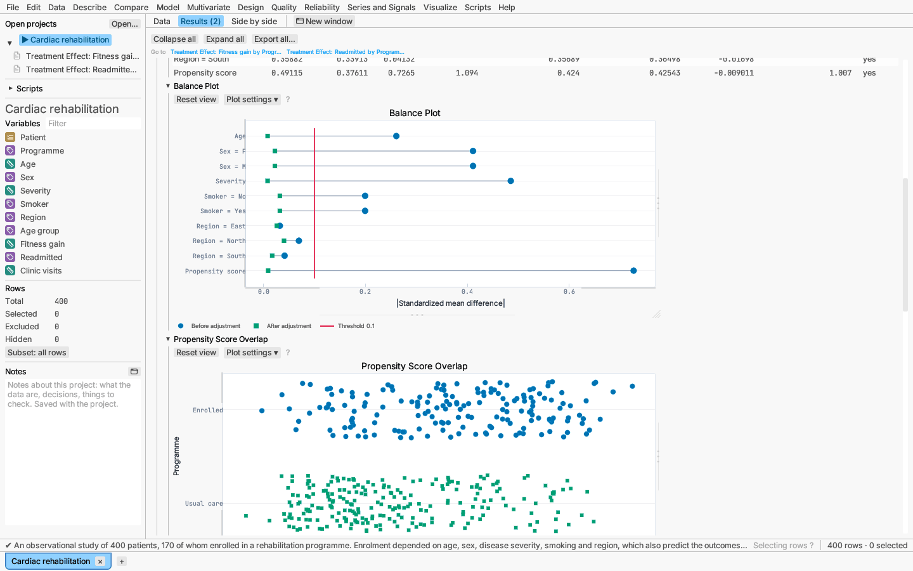

# Model: treatment effects from observational data

Model ▸ Treatment effects (observational data)… estimates the effect of a
two-level treatment (enrolled or not, exposed or not, new process or old) on
an outcome when the treatment was not assigned at random. Rows that received
the treatment usually differ from those that did not in ways that also
affect the outcome (confounding), so a plain comparison of the two groups is
biased. The analysis adjusts for covariates measured before treatment
through the **propensity score**, each row's probability of being treated
given its covariates (Rosenbaum & Rubin 1983).

The adjustment removes the bias from the covariates you choose, and only
those: it cannot help with a confounder that was not measured. Choose
covariates that affect both the treatment and the outcome, and never ones
the treatment itself could have changed.

## Dialog

- **Treatment:** a column with exactly two values. **Treated value:** which
  of them is the treatment (by default the second in sorted order).
- **Outcome** (numeric) and its kind: **Continuous**, **Binary (0/1)** or
  **Count**. The kind sets the outcome models of the doubly robust method
  (normal linear, logistic or Poisson regression) and the effect scales.
  Choosing a 0/1 column sets Binary.
- **Covariates:** the confounders. A categorical covariate enters the models
  as indicators of each of its levels but the first.
- **Subgroups** (optional): columns whose levels each get their own estimate
  (for example age group or sex).
- **Method:**
  - *Inverse-probability weighting* weights each row by the inverse of the
    probability of the treatment it received, so that the weighted groups
    look alike (the normalized, or Hájek, estimator).
  - *Doubly robust (weighting with outcome models)* adds regressions of the
    outcome on the covariates in each group (augmented inverse-probability
    weighting). The estimate is consistent if either the propensity model
    or the outcome models are right.
  - *Nearest-neighbour matching* pairs each treated row with the control
    rows nearest to it in the logit of the propensity score, largest scores
    first. Set the **matches per treated row** (1 for pair matching),
    **with replacement** (a control may serve several treated rows) and a
    **caliper** in standard deviations of the logit (0.2 by default, as
    Austin 2011 recommends): treated rows with no control that close stay
    unmatched and are left out.
- **Effect:** the *average effect (ATE)* over everyone, or the *average
  effect among the treated (ATT)*. Matching for the ATE matches every row,
  treated and control, to the other group and needs matching with
  replacement.
- **More options:** *stabilized weights* (the saved weights are scaled by
  the share of rows in each group; the estimate does not change), *trim
  scores outside* α to 1 − α (rows with scores near 0 or 1, where the groups
  do not overlap, are left out; Crump et al. 2009), *bootstrap intervals*
  instead of sandwich intervals, and the confidence level.

## Report

- *Summary:* the treated and control values, the method and estimand, the
  interval method, rows in each group and rows used, the effective sample
  size of each group ((Σw)²/Σw²: how many unweighted rows the weighted group
  is worth), rows trimmed, excluded or missing, and the largest standardized
  difference left after adjustment, with a note when it is 0.1 or more.
- *Treatment Effect:* the mean difference (continuous), the risk difference,
  risk ratio and odds ratio (binary) or the rate difference and rate ratio
  (count), each with its standard error, z test and interval. Ratios get
  their intervals on the log scale.
- *Estimated Outcome Means:* the mean outcome had everyone (or every
  treated row, for the ATT) been treated, and had they not.
- *Covariate Balance:* for every covariate (each level of a categorical one)
  and the propensity score, the means in each group, the standardized mean
  difference and, for continuous variables, the variance ratio, before and
  after adjustment. Differences are standardized by the unadjusted pooled
  standard deviation √((s₁² + s₀²)/2) for the ATE and by the treated
  group's for the ATT, so before and after are on the same scale; a 0/1
  variable's variance is p(1 − p). Weighted variances use
  Σw/((Σw)² − Σw²) · Σw(x − x̄)². A covariate counts as balanced when its
  adjusted difference is below 0.1 in absolute value (Austin 2009).
- *Balance Plot:* the absolute standardized differences before (one marker)
  and after (another marker) adjustment for each variable, joined by a line,
  with the 0.1 threshold.
- *Propensity Score Overlap:* each row's score, one strip per group
  (jittered). Scores near 0 or 1 in one group with no rows of the other
  group nearby show poor overlap; consider trimming. Points are linked to
  their rows, so a box selection shows the rows in the data grid and every
  other plot.
- *Propensity Score Model:* the logistic regression of the treatment on the
  covariates.
- *Outcome Models* (doubly robust): the regressions fitted in each group.
- *Subgroup Effects* and *Subgroup Forest Plot* (with subgroups): the whole
  analysis repeated within each level of each subgroup column, the effect
  (difference scale) with its interval, and Cochran's Q test that the
  subgroup effects are equal (the subgroup-by-treatment interaction), on
  G − 1 degrees of freedom. Covariates that are constant within a subgroup
  (such as the subgroup column itself) are left out of its models. Many
  subgroups make chance differences likely: treat them as exploratory
  (Wang et al. 2007).

The ⋯ Options menu switches the effect between ATE and ATT and changes the
confidence level in place; *Edit analysis…* reopens the dialog. *Save
propensity scores*, *Save weights* and, for matching without replacement,
*Save matched sets* add columns to the table (NaN for rows the analysis did
not use; weight 0 for rows left out). A saved weight column can be used as
the weight of other analyses.

## Methods

With treatment tᵢ ∈ {0, 1}, outcome yᵢ and estimated score êᵢ:

- **Weighting, ATE:** weights tᵢ/êᵢ + (1 − tᵢ)/(1 − êᵢ); **ATT:** tᵢ + (1 −
  tᵢ)êᵢ/(1 − êᵢ). Each group's mean is the weighted mean of its outcomes.
- **Doubly robust, ATE:** μ̂₁ = n⁻¹ Σ [tᵢyᵢ/êᵢ − (tᵢ − êᵢ) m₁(xᵢ)/êᵢ] and
  μ̂₀ = n⁻¹ Σ [(1 − tᵢ)yᵢ/(1 − êᵢ) + (tᵢ − êᵢ) m₀(xᵢ)/(1 − êᵢ)], with m₁,
  m₀ the outcome models; **ATT:** μ̂₁ is the treated mean and μ̂₀ =
  Σ [tᵢ m₀(xᵢ) + (1 − tᵢ) êᵢ/(1 − êᵢ)(yᵢ − m₀(xᵢ))] / Σ tᵢ (Lunceford &
  Davidian 2004; Hernán & Robins 2020, ch. 13).
- **Matching:** matched rows get weight 1 (a treated row) or the sum, over
  the treated rows they serve, of 1/(that row's number of matches), the
  control weights rescaled to sum to the number of matched controls; the
  effect is the difference of weighted means. For the ATE each row also
  takes the mean of its matches as its missing potential outcome (Abadie &
  Imbens 2006), which is the same as weights 1 + Kᵢ/k.
- **Sandwich intervals** (weighting, doubly robust) treat the propensity
  model, the outcome models and the two means as one set of estimating
  equations, so the uncertainty of the estimated scores is included
  (Stefanski & Boos 2002). **Matching** uses the robust variance of the
  weighted means with matched sets as clusters (rows, with replacement) and
  the small-sample factor G/(G − 1)·(N − 1)/(N − 2), as recommended for
  matched data (Austin & Small 2014); this conditions on the matching.
  **Bootstrap** intervals resample rows within each treatment group, repeat
  everything (score model, matching or weights, outcome models) and take
  percentiles; the p-value is twice the share of replicates on the far side
  of no effect.

## Validation

The propensity and outcome models, weighting and doubly robust estimates
and their sandwich covariances match statsmodels GLMs with a complex-step
stacked sandwich (to 10⁻⁶), the closed-form standard error of Lunceford &
Davidian (2004) agrees to 1%, ATT matching (weights, estimate and robust
standard error, with and without replacement and caliper) matches R
`MatchIt` 4.5 with `sandwich` 3.1, ATE matching matches a brute-force
implementation, and balance statistics match NumPy (the validation record,
`docs/validation.md` in the source).

*Try it:* sample *Cardiac rehabilitation* (Model), an invented
observational study in which younger patients, women, milder cases,
non-smokers and patients in the South enrolled more often. The unadjusted
difference in fitness gain overstates the programme's effect; the doubly
robust estimate is close to the true average, and the subgroup forest plot
shows the larger benefit for patients under 65.

