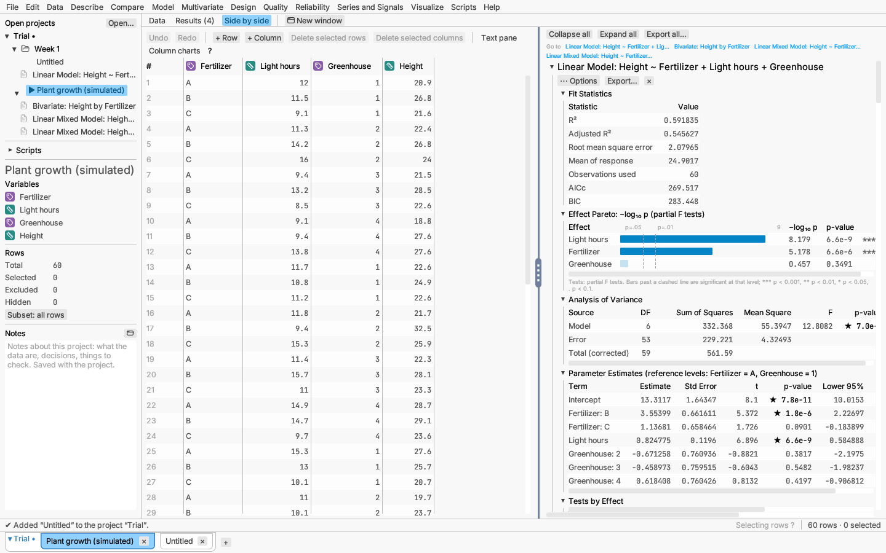
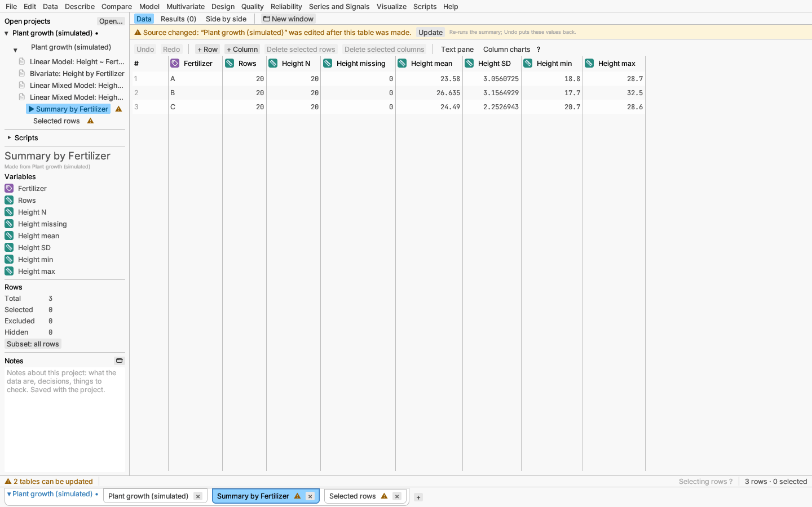
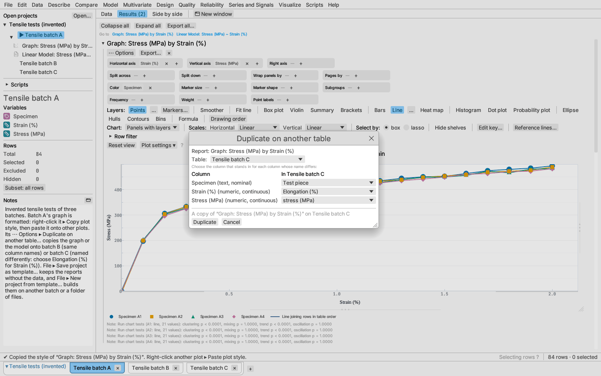
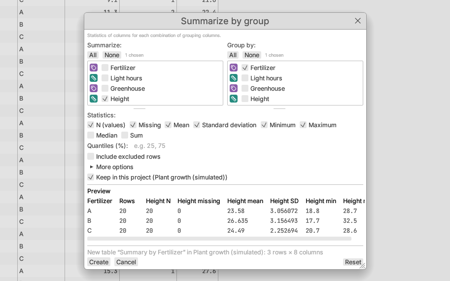
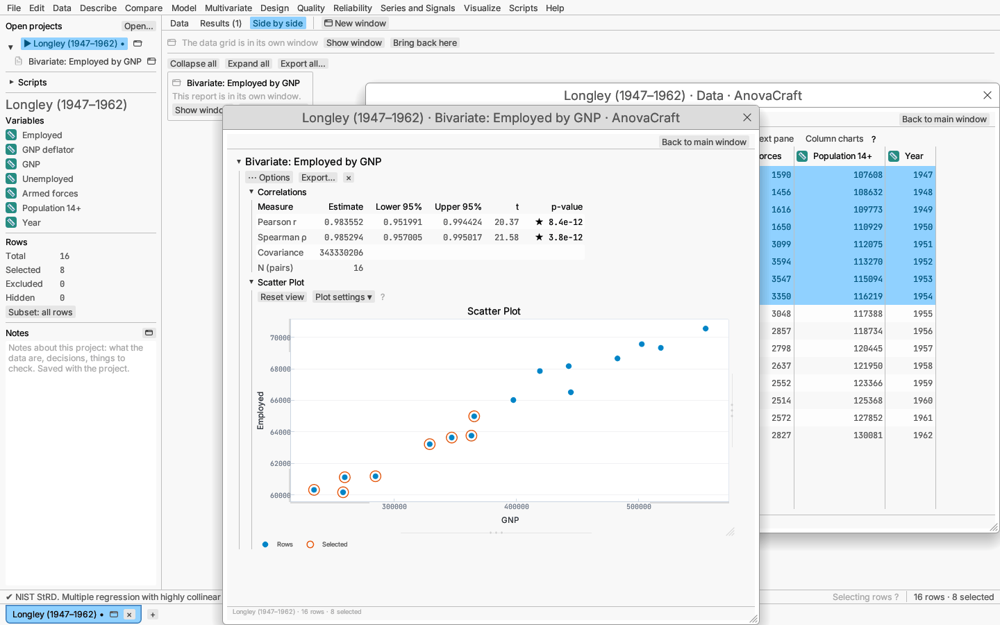
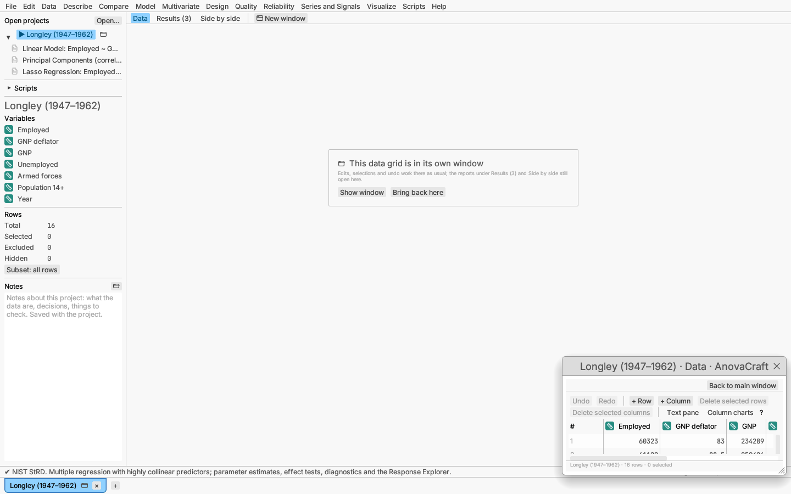

# Documents, files and projects

Each open table, together with its row states and reports, is a
**document**, and every document belongs to a **project**: one project file
holds one or more tables. Several projects can be open at once: they are
listed under *Open projects* in the sidebar and as tabs along the bottom of
the window. Opening a file or sample while another is open adds a new
project.

A project of one table is shown just as a dataset always was: one entry in
the list, one tab. A project of several tables is shown as a tree — the
project's name (click it, or its triangle, to fold its tables away), then
its tables, with each table made from another indented under it. Along the
bottom, its tabs (tables, then dashboards) sit together in a framed group
headed by the project's name, in the accent colour while it holds the view
on screen. Click the header (▾) to fold the group's tabs away behind it
(▸, with the number of tabs); the tab on screen stays visible, and a
second click shows them all again.
Right-click a table (in the sidebar or on its tab) to save its project,
export the table or close it; right-click a project's name to save or close
the whole project (its tab-bar header too). A project with unsaved changes shows a • after its name
(after the table's name for a one-table project), and the window title adds
"(edited)". Closing a project with unsaved changes asks once, and so does
quitting.

To rename a table, double-click its name in the sidebar or on its tab (or
right-click it and choose **Rename…**), type the new name and press Enter;
Escape keeps the old one. Renaming a table is an edit like any other, so
Edit ▸ Undo puts the old name back. Rename a project the same way from its
name in the sidebar or its tab-bar header: the window title follows, the
new name is saved in the project file and is the name offered when you
choose Save project as… (the file you then save names the project). A
blank name goes back to the file's name.

## Reports, canvases and folders in the project tree

Under each table in the sidebar its reports and graph canvases are listed,
newest last, with a page icon for a report and a scatter icon for a canvas.
Click one to show it: the table's results come into view, scrolled to the
report and opened, or the window holding it comes to the front.
Right-click it to open it in a window of its own (or bring it back) or to
move it to a folder. The ▾ before a table's name folds its reports away
(▸ shows them again). A project's notebooks are listed with its dashboards,
with a book icon; click one to open it.

**Folders** group what belongs together: a week's tables, the plots for a
paper, a dashboard and its sources. To make one, right-click the project's
name and choose **New folder**, or right-click any table, report,
dashboard or notebook and choose **Move to folder ▸ New folder**, which
makes the folder with that item in it. Either way the folder's name opens
for typing; press Enter to keep it. Then:

- **Drag** a table, report, canvas, dashboard or notebook onto a folder to
  file it there (the folder is framed while you hold it over it), or use
  **Move to folder ▸** and pick the folder. Drag it onto the project's name,
  or choose **Move to folder ▸ Out of folders**, to list it at the top of
  the project again.
- **Nest** folders by dragging one onto another, or with right-click ▸
  **New folder inside**. A folder cannot go into itself or a folder inside
  it.
- **Rename** a folder by double-clicking its name (or right-click ▸
  Rename…), and fold it with its triangle.
- **Click** a folder's name to bring the windows of everything in it to the
  front; when nothing in it has a window, the main window shows its first
  table (or dashboard). Right-click ▸ **Open each in a window** gives every
  table (its data grid), report, dashboard and notebook in it a window of
  its own.
- **Delete folder** removes only the folder: what it held, folders
  included, moves up a level and stays in the project.

A folder only groups. A table in a folder lists its reports with it; a
report filed in a folder on its own names its table in its tooltip and
still belongs to that table, re-running when its data change. Closing a
table or a report takes it out of its folder. Folders are saved with the
project.

## Opening data

File ▸ Open… (or the + on the document tabs, or dropping files on the window)
reads:

- **CSV, TSV and other delimited text.** The delimiter is detected (for
  `.csv` files too, so a file saved with semicolons where the decimal mark
  is a comma opens correctly); `.tsv` and `.tab` files use tabs. Quoted
  fields may contain the delimiter and line breaks. UTF-8, UTF-16 and
  Windows-1252 text are read.
- **JSON:** an array of row objects, such as `[{"x": 1, "y": "a"}, …]`.
- **Spreadsheet workbooks:** `.xlsx`, `.xlsm`, `.xlsb`, `.xls` and `.ods`.
  A workbook opens as one project named after the file, with one table per
  chosen sheet (or one table of the sheets stacked).

Text files and workbooks first show the [Open Data dialog](open-data.md):
a preview of the cells where you say which row holds the column names,
where the values start and end and which columns to read. It starts from
what it detects, so for most files pressing Enter is enough.

A newly opened or imported table (a data file, a workbook sheet, a table
from the clipboard, the web or a database) opens on the **Data** tab with no
reports: nothing is analysed until you choose an analysis from a menu.
Projects and samples open with the reports they hold.

Column names that are blank become `Column N` (N is the column's position)
and a repeated name gets ` (2)`, ` (3)`, …, in every format; the import
note lists the names that were changed.
- **Projects** (`.acraft`), described below.
- **Scripts** (`.rhai`) open in the Script window.

File ▸ Open recent lists the last ten files you opened or saved, newest
first; the start page shown when nothing is open lists them too, with when
each was last used and what it holds. A file that can no longer be opened is
dropped from the list.

Column types (number, text, date) are inferred from the values; see
[Dates and times](dates.md) for how dates are recognised.

Empty cells are missing values. So are the usual missing-value markers that
other programs write: `NA`, `N/A`, `#N/A`, `#NA`, `<NA>`, `NaN`, `nan`,
`-NaN`, `-nan`, `NULL`, `null`, `None`, `n/a`, `#N/A N/A` and the
`1.#IND` / `1.#QNAN` forms (the same list pandas uses; spelled exactly so,
apart from surrounding spaces). They count as missing only when deciding
that a column holds numbers or dates: a column of numbers with some `NA`
cells opens as a number column with those cells missing, and the import notes
say how many were read that way. A text column, such as country codes that
include `NA` for North America, keeps them as text. `inf` and `-inf` are not
numbers here, so a column containing them opens as text.

Other ways to start a table:

- File ▸ New data table (⌘N / Ctrl+N): an empty table to type into.

The app starts on the start page, with no table open. When a file, sample,
design or other table opens, an empty Untitled table nobody has typed into
closes by itself, so it does not linger beside your data.
- File ▸ New table from clipboard: cells copied from a spreadsheet or other
  tab- or comma-separated text, through the [Open Data dialog](open-data.md);
  a first line of names becomes the column names.
- Design menu: a generated experimental design (see [Design](../analyses/design.md)).
- Table operations, which make new tables from existing ones (see
  [Table operations](table-operations.md)); the new table joins its
  source's project unless you choose otherwise (see
  [Tables made from other tables](#tables-made-from-other-tables)).

## Exporting data

Export data as (in the File menu and a document's right-click menu) writes
**CSV**, **TSV**, **JSON** or **`.xlsx`**. Text and JSON export write dates
in ISO 8601; `.xlsx` export writes real date cells with number formats.
With **Write value labels** ticked in the submenu, a column with value
labels is written as its labels (see
[Value labels](editing.md#value-labels)).

**Export reports…**, in the same menus, saves the document's reports as a
PDF, Word, PowerPoint, HTML, Markdown or Excel file (see
[Saving plots and results](../reports/exporting.md#whole-reports-as-documents)).

## Projects

A project file (`.acraft`) saves everything about its tables:

- each table's data, column types and measurement levels, and formula
  columns;
- row states (selected, excluded, hidden, colours);
- every report's request and display options; reopening the project re-runs
  each report, so it reproduces exactly;
- for a table made by a table operation, the operation, which tables of the
  project it was made from, and a fingerprint of what they held then;
- scripts kept with the project (see below);
- the project's notes (the sidebar's Notes; see
  [A tour of the window](../getting-started/tour.md));
- its [dashboards](../reports/dashboards.md): tiles, filters and names;
- its folders: their names, how they nest and what each holds;
- the window layout: the table or dashboard shown, each table's view (Data,
  Results or Side by side) and the views and dashboards shown in windows of
  their own, with where they were on screen.

Use Save project / Save project as… from the File menu or a table's
right-click menu; both save the whole project, every table in it. Project
files are documented JSON, so other programs can read and write them. A
project of one table with nothing to remember about its layout is written
in the one-table form (format version 1 or 2, version 2 when it has date
columns) that older versions of AnovaCraft open; a project of several
tables, or one whose layout is saved, is written as format version 3.
Older files still open.

A report that cannot be restored (for example one naming a column the
table no longer has, in a file edited by hand) is left out, and a note at
the bottom of the window says which; the table and its other reports open.
Formula columns whose formulas cannot be computed (one that refers to
itself through other formula columns, or one that does not compile) keep
their saved values, also with a note.

To add a table to the project you are working in, rather than start a new
project, use File ▸ **Add to this project** ▸ **Empty table**, **Table from
clipboard** or **Data file…**. Files opened any other way can join it too:
the Open Data dialog has a box, *Add to the open project “…”*, cleared unless
you came from Add to this project. (Data from a database or the web always
starts a project of its own, since it keeps its source to refresh from.)

Closing a table that belongs to a project of several tables (its × or
Close) takes it out of the project; save the project to keep the change.
If other tables of the project were made from it, the app asks first: they
keep their data but can no longer be updated from it. Right-click the
project's name and choose **Close project** to close all its tables.

### Reusing reports on other data

A report's ⋯ Options ▸ **Duplicate on another table…** copies it, with its
display options, row filter, column picker and plot styles, to another
open table (in this project or another). Graph canvases have it too. Choose
the table; every column the report reads that has a column of the same name
there is matched at once, a name differing only in case, spaces,
underscores or dots is offered, and for the rest a list of the table's
columns asks which one stands in. A note warns when a chosen column holds
another kind of values (text for numbers). Duplicate adds the copy at the
top of that table's results.

File ▸ **Save project as template…** writes a `.acrafttemplate` file: the
project's reports, graph canvases, dashboards, scripts, notes and plot
styles, and for each table only the columns they read (names, kinds and
measurement levels) and the formula columns they use, with no data, row
states or window layout. Tables made from other tables are left out (the
status line says so). File ▸ **New project from template…** asks for a
template, then for each of its tables an open table or a **Data file…**
(a one-table template starts on the table shown when it fits), with the same
column lists as Duplicate for names that differ. For a one-table template,
**Each data file in a folder** makes one project with a table per file: the
choices made on the first file apply to all, and a file they do not fit is
matched by name or left out with a note. The template's formula columns are
computed again on the new data, renamed columns are followed in formulas,
reports and dashboard filters, and the new project starts unsaved.

Scripts and notebooks are copied as they are; ones that name columns by
their old names need editing. The sample project **Tensile tests
(invented)** (File ▸ Open sample data ▸ Projects) has three batches to
try this on; batch C names its columns differently.

### Tables made from other tables

The Data menu's table operations (Summarize by group, Subset and sample,
Stack, Unstack, Transpose, Combine rows, Join, and Sort or Remove
duplicates into a new table), Design ▸ Augment design… and **Save as data
table** on a report's table make a new table from the current one. Their
dialogs have a **Keep in this project (project name)** box, ticked at
first: the new table joins the current table's project and is listed under
it. Clear the box to open the new table as a separate project, as before.
(For a report table, choose **Save as data table** to keep it in the
project or **Save as data table in a new tab** for a separate one.)

New tables get short names that say what they hold, such as "Summary by
Fertilizer", "Fertilizer A only" or "Stacked Employed, GNP", numbered if
the name is taken.

**When the source changes.** A table made by a table operation and kept in
its source's project remembers what its source held. When the source is
edited afterwards (its values, its columns, or the rows the operation reads,
such as excluded rows for a summary), the made table is marked with ⚠ in the
sidebar and on its tab, the status bar says how many tables can be updated,
and a banner above its grid says "Source changed: *source* was edited after
this table was made." Nothing changes by itself: choose **Update** in the
banner to run the operation again on the source's current data. The update
is one step in the table's undo history, so Edit ▸ Undo puts the previous
values back (and the mark with them). Formula columns you added to the made
table are kept and recomputed; a report on the made table that uses a column
the update would remove stops the update with a message. Augmented designs
and report tables are copies: they join the project but are not updated.

### Scripts in a project

A project can carry Rhai scripts (Script window ▸ Keep in project). They are
listed under **Scripts** in the File menu and the document's right-click
menu, where each can be run, opened in the Script window, set to run when the
project opens, or removed. A script set to run on opening never runs
silently: the app asks first (Run, Don't run, or Show in Script window).
The sidebar's *Scripts* section lists them too, beside the scripts in your
scripts folder; right-click a folder script there and choose **Keep in
project** to copy it into the active project.

### Notebooks in a project

A project can also carry script notebooks (Scripts ▸ New notebook): pages of
text and code cells with the outputs of their last run. Scripts ▸ Notebooks
lists them; saving the project saves them with their outputs, so reopening
the project shows the results without running anything. See
[Scripting and recording](../reference/scripting.md#notebooks).

## Views in windows of their own

A document's **data grid**, its **results** (every report, with the Go to
outline) or a **single report** — a graph canvas, a model with its Response
Explorer, a 3-D surface — can each be shown in a window of its own, for
example to keep the grid on one screen and the reports on another.

- **New window**, beside the Data / Results / Side by side tabs, moves the
  data grid into its own window when Data is shown, and the results when
  Results or Side by side is shown.
- **Open in new window**, in a report's ⋯ Options menu and in the menu you
  get by right-clicking the report's title, moves that one report.

Each window is titled with the dataset and what it shows, such as
"Longley · Data · AnovaCraft" or "Longley · Linear Model: Employed ~ GNP ·
AnovaCraft", and has a **Back to main window** button at its top right. Its
foot gives the dataset's row counts.

A view is in one place at a time. Where it would be in the main window, a
panel says that it is in its own window, with **Show window** (bring the
window to the front) and **Bring back here**. A report in its own window
leaves the same panel in the results. In **Side by side**, a view in its
own window leaves the other one across the whole width, under a one-line
note ("The results are in their own window", with the same two buttons). The dataset stays in *Open datasets*
and on its tab, marked with a small window symbol; point at it to see which
views have windows. Clicking a dataset that is already selected brings its
windows to the front.

Closing a view's window — its close button, ⌘W / Ctrl+W while it is in
front, or Back to main window — puts the view back in the main window, which
switches to that dataset; nothing is closed. Closing a dataset closes its
windows (after asking about unsaved changes), and quitting closes them all.
A table whose source changed shows the Source changed banner with Update at
the top of its data grid's window too.

**Which dataset commands act on.** The menus, dialogs and the sidebar act on
the dataset of the window you used last. Clicking in a window of another
dataset makes that dataset the one the menus act on without changing what the
main window shows; the sidebar then names it ("From the window you used
last") and the status bar puts its name before the row counts. Clicking in
the main window's grid or results (or choosing a dataset in the list or the
tabs) makes the main window's dataset the target again, and so does editing
a cell there; using the menu bar does not. Dialogs always open in the main window, which comes to the front.

**Shortcuts** work in every window and act on that window's dataset: undo
and redo, copy, cut and paste, Find, Select all, Save, and ⌘W / Ctrl+W, which
closes the window it is pressed in. Quit (⌘Q / Ctrl+Q) works from any window.

**Selections are shared.** Selecting points in a plot in any window
highlights the same rows in every window at once, as in a single window.

**Graph canvas.** Columns cannot be dragged from one window to another, so a
graph canvas in its own window (or a results window holding one) lists the
dataset's columns at its left: drag them from there onto the shelves.

**Saved with the project.** Saving a project saves which views are in
windows of their own and where each window was, with the table shown and
each table's view. Reopening the project puts the windows back. A window
saved on a screen this computer does not have (a second monitor, say) is
moved onto the main window's screen, and made smaller if it would not fit.
Changing the layout alone does not count as an unsaved change. Recorded
scripts do not record windows, since they change how things are shown, not
the analysis.
