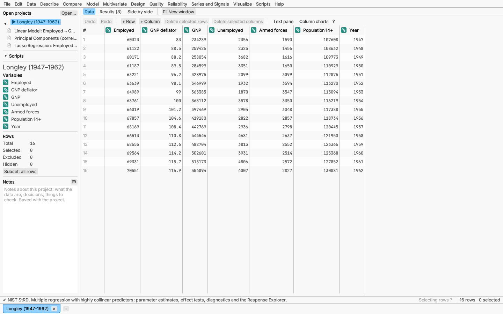
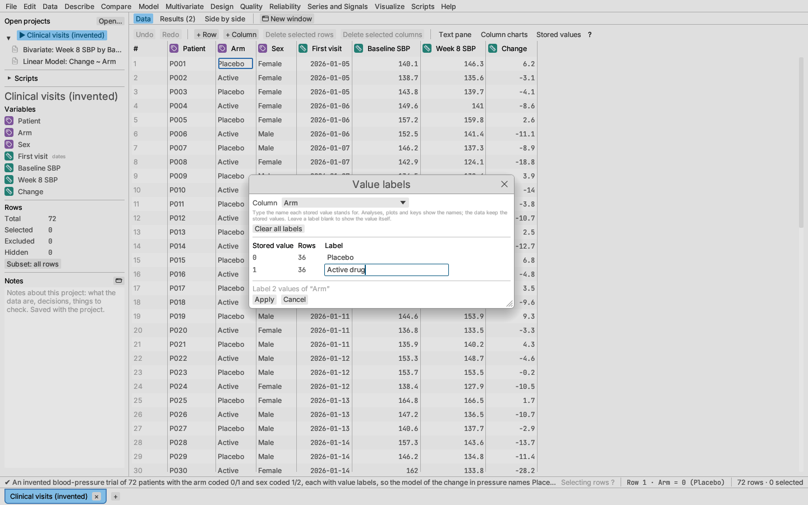
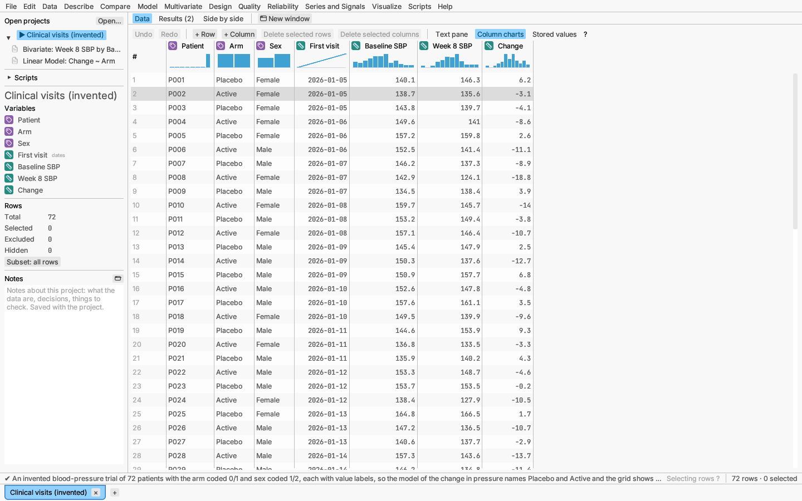
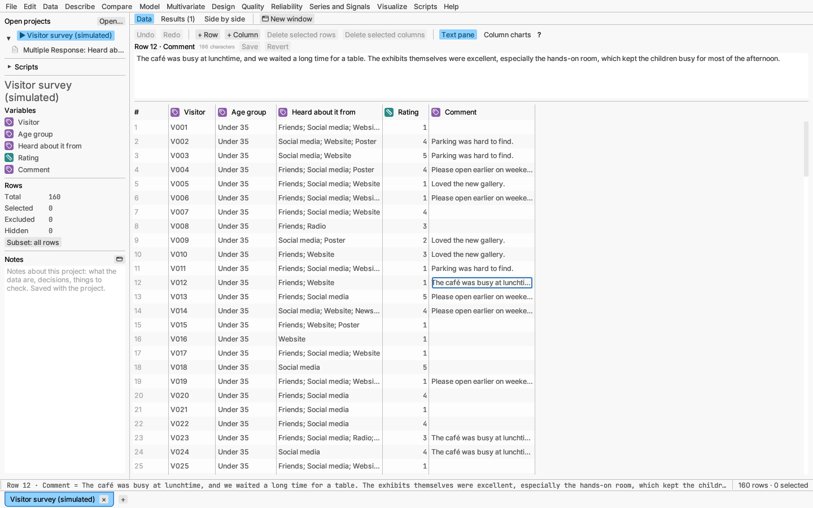

# Editing the data grid

The **Data** tab shows the active table as a grid that works like a
spreadsheet. It scrolls smoothly through large tables because only the
visible rows are drawn. The first column shows row numbers, followed by ×
for an excluded row and ◌ for a row hidden in plots. Each column heading
shows the column's measurement level as a coloured icon (a ruler for
continuous, a tag for nominal, a numbered list for ordinal) and its name;
hover over either for the level and the data type (numbers, text, dates).
Columns open wide enough for their whole name and their first values, up to
a limit; drag a column's edge to resize it. Numbers and dates are
right-aligned so their digits line up; a missing number or date shows as a
faint dot. A computed number with more than ten significant digits (a group
mean, say) is shown to eight; whole numbers, such as identifiers, are always
shown in full. Hover over a shortened number for the full value, which is also
what editing, copying and saving use. Hover over the **?** in the toolbar for a summary of the mouse
and keyboard controls.

## Entering values

- Click a cell to move the cell cursor there. Clicking a cell ends any
  selection of rows or columns.
- Move with the arrow keys; ⌘/Ctrl with an arrow key jumps to the first or
  last row or column; Home and End go to the first and last column (with
  ⌘/Ctrl, the first and last cell); Page Up and Page Down move 20 rows.
- Double-click, press Enter or F2, or just start typing to edit the cell.
  When the value is wider than the cell, or holds more than one line, it is
  edited in a larger box that opens over the cell and shows the whole text
  (scrolling when it is long). Enter commits as usual; in a text column,
  Shift+Enter starts a new line.
- Typing in the main window's grid always edits the table that grid shows,
  even if you last used a window of another dataset.
- Enter or Tab commits the value and moves down or right (Shift reverses);
  Escape cancels. Enter on the last row adds an empty row and moves to it,
  so a column can be typed in without stopping.
- Entry is type-checked: a numeric column accepts numbers, a date column
  accepts dates, and a value that does not fit is refused with a message.
  A column shown as **Date** keeps only the day: a time typed or pasted
  with it (`2026-03-04 10:00`) is dropped, so the cell equals the others
  showing 2026-03-04 when grouping, sorting or joining. Show the column as
  **Date and time** to keep times.
  Typing `NA` (or another missing-value marker listed under
  [Opening data](documents.md#opening-data)) into a number or date cell
  makes it missing, as a blank does.

Formula column cells cannot be typed into; edit the formula instead (see
[Formula columns](../reference/formulas.md)).

## Selecting cells, columns and rows

- **A block of cells:** drag across the cells, Shift-click a second cell, or
  hold Shift with the movement keys. ⌘A / Ctrl+A (Edit ▸ Select all cells)
  selects every cell.
- **Columns:** click a column heading to select the whole column.
  Shift-click another heading to select every column between the two,
  ⌘/Ctrl-click to add or remove one, or drag across headings.
- **Rows:** click a row number to select the row. Shift-click another row
  number to select every row between the two (add ⌘/Ctrl to keep the rows
  already selected), ⌘/Ctrl-click to add or remove one row, ⌥/Alt-click to
  remove one, or drag down the row numbers. Row selection is shared with
  every plot (see [Row states](row-states.md)).

Selecting rows ends a selection of columns, and selecting columns (in the
grid or the sidebar) ends a selection of rows, so only one kind is selected
at a time.

Dragging past the top or bottom edge of the grid keeps extending the block
or the rows, scrolling as it goes.

Clicking a variable in the sidebar also selects its column and scrolls the
grid to it, which helps in wide tables.

## Finding and replacing

Edit ▸ Find… (⌘F / Ctrl+F) opens a Find bar above the grid. Type some text,
then press **Next** (or Enter) to move the cell cursor to the next cell that
contains it, reading across each row and then down, and wrapping round at
the end. Cells match on the text the grid shows, so numbers match as
displayed. **Match case** makes upper and lower case letters count.

**Select matching rows** selects every row with a match, in the selected
columns if any are selected and otherwise in any column. The selection is
shared with every plot, so this is a quick way to find, say, every row for
one supplier. Escape or × closes the bar.

**Replace…** shows a second row. **Replace** changes the found text in the
cell at the cursor (if it matches) and moves on to the next match; **Replace
all** changes every match, in the selected columns or in every column, as
one undoable step. The new text must still be a valid value for its column:
replacing digits with letters in a numeric column leaves those cells alone,
and the bar says how many were skipped. Formula cells are never changed.

## Value labels

Data from surveys and case-report forms often store a category as a code:
1 for female and 2 for male, 0 for placebo and 1 for the active drug.
**Data ▸ Value labels…** (or *Value labels…* in the column heading's
right-click menu, which shows how many labels the column has) names each
code. The dialog lists every value the column holds, plus any value that
has a label but no rows now, each with a *Label for …* field. A blank field
removes that label; two values cannot share a label. **Apply** changes the
labels as one undoable edit, and every report that uses the column re-runs.

With labels set:

- The grid shows each labelled cell's label; hovering it shows the stored
  value. **Stored values** on the grid toolbar (shown when any column has
  labels) switches the grid to the codes and back. The status bar shows
  both, as "1 (Active)".
- Typing a label into a cell stores its code; typing a code still works.
- Analyses, plots, keys, summaries and saved predictions name the levels by
  their labels. Levels sort by their names, so labels change the order in
  which levels appear. A level chosen in a report before the labels were
  added (an event level, say) is stored by its code and may need choosing
  again.
- **File ▸ Export data as ▸ Write value labels** (a tick, remembered between
  sessions) writes labels in place of the codes; untick it to write the
  codes. Projects always keep both.
- Scripts read and set labels with `t.value_labels`, `t.set_value_labels`
  and `t.clear_value_labels`.

## Columns shown on hover

Tick **Show on hover in plots** in a column heading's right-click menu to
add that column's value (by its label) to the tooltip of every point in
report plots and on the graph canvas, for example a patient or batch
identifier. Several columns can be shown; the tick is undoable and saved in
projects.

## Column charts

**Column charts** on the grid toolbar draws a small chart under each
column heading, over the rows analyses use (excluded rows and rows outside
the active subset are left out):

- a continuous column: a 12-bin histogram;
- a nominal or ordinal column: a bar per level, at most eight, the most
  frequent kept and the rest pooled into one "other levels" bar;
- a date column: the values in row order, as a line.

Hover a bar for its range or level and count (and the column's missing
values); click it to select its rows, with the usual Shift, ⌘/Ctrl and
⌥/Alt modifiers. The charts are recomputed only when the data or the
excluded rows change.

A column heading's level badge can also be dragged onto a dialog's column
list or a graph canvas shelf.

## Recoding values

Right-click a column heading (or a variable in the sidebar) and choose
**Recode values…**, or use Data ▸ Recode values…, to give each distinct
value of a column a new one. The dialog lists every value with how many rows
hold it (· marks a space, so stray spaces show), and a box for its new value.

- Give several values the same new value to merge them, for example
  "north", " North" and "N" into "North".
- Leave a new value blank to make those cells missing.
- **Trim spaces**, **lower case**, **UPPER CASE** and **Title Case** tidy
  every new value at once; **Reset** puts the current values back.

The result goes **into a new column** (named "… recoded" unless you change
it, placed right after the original), or **replaces the values in this
column** as one undoable step. A new column holds numbers if every new value
is a number, and text otherwise. Recoding numbers into labels (2 → "low")
needs a new column, since a numeric column cannot hold text. The line at the
dialog's foot says how many values and rows will change; **Recode** stays
unavailable, with a note saying why, until a value has a new one (in place)
or the new column has an unused name.

## Random columns

Data ▸ New random column… (also Edit ▸ Add column ▸ Random values…) adds a column of random draws, one per row, from
any distribution of the [distribution calculator](../analyses/describe.md#distribution-calculator).
Choose the distribution and its parameters, the column's name and a **seed**:
the same seed always gives the same values, so a random column can be
recreated exactly. The column is added at the end of the table as one
undoable step. (Formula columns also have seeded random-number functions for
values that should follow the rows.) Gamma and beta draws with very small
shapes (down to about 0.005) are formed on the log scale, so they are never
missing; a gamma draw is 0 only when its true value is below the smallest
number a computer can store.

## Rank columns

Data ▸ New rank column… adds a formula column of the ranks of a numeric
column, 1 at the smallest value, optionally restarting in each group of
another column (**Rank within groups of**). **Tied values** chooses how
equal values are ranked:

| Rule | Ties in 10, 20, 20, 30 get | Formula |
|---|---|---|
| Average | 1, 2.5, 2.5, 4 | `rank_ties("x", "average")` (same as `rank("x")`) |
| Minimum | 1, 2, 2, 4 | `rank_ties("x", "min")` |
| Maximum | 1, 3, 3, 4 | `rank_ties("x", "max")` |
| Dense | 1, 2, 2, 3 | `rank_ties("x", "dense")` |
| First | 1, 2, 3, 4 (row order) | `rank_ties("x", "first")` |

Missing values get no rank and are not counted. Because the column is a
formula, the ranks follow later edits; Convert formula to values freezes
them. Scripts rank an array with `ranks(values, "min")`.

## Clearing and filling

- **Delete** (or Backspace, or Edit ▸ Clear cells) makes the selected
  cells, or the cell at the cursor, missing.
- **Cut** (⌘X / Ctrl+X) copies the selection and then clears it.
- **Fill down** (⌘D / Ctrl+D, or Edit ▸ Fill down) copies the first row of
  the selected block into the rows below it, in each selected column.

Each of these undoes as one step. Cells of formula columns are computed, so
they are left as they are.

## Rows and columns

The **Edit** menu adds rows at the end (**Add rows ▸**, with **How many**),
deletes selected rows or selected columns (one undoable step; a column used
by an open report cannot be deleted until that report is closed), and adds columns at the end (**Add column ▸**
Numbers, Text, Dates, Formula… or Random values…; the first four are the
toolbar's choices). The toolbar's **+ Row** opens a menu with **How many**
and **Insert rows above**, **Insert rows below** or **Add rows at the end**.
Above and below are relative to the selected rows (above the first, below
the last) or, with no rows selected, the cell cursor's row; the menu says
which, and the two are greyed out when there is neither. With several rows
selected, **How many** starts at their number. **+ Column** works the same
way for columns, with a **Type** (Numbers, Text or Dates) and a **Name**:
**Insert columns to the left**, **to the right** (of the selected columns,
or the cell cursor's column) or **Add columns at the end**, and the same
three places for one formula column (**Insert formula column to the
left…**, **to the right…**, **Add formula column at the end…**). Opening either menu ends a cell edit in
progress, keeping what was typed.

Every add or insert action except Formula… has a **How many** field
(starting at 1; up to 100,000 rows or 1,000 columns), and the menu items
say what they will do ("Insert 3 columns to the right"). The number is
remembered for the rest of the session, separately for rows and columns.
When the action applies to a selection (a row number among several
selected rows, or a heading among several selected headings), **How many**
starts at the selection's size and the new rows or columns go beside the
whole selection: above its first row or below its last, left of its first
column or right of its last.

Column inserts also have a **Name** field. Left empty, new columns are named
Column 1, Column 2, …; a name is used as typed for one column and numbered
for several (**Rep** gives Rep 1, Rep 2, …). Names already in use are
skipped. The name is cleared once used.

**⌘⇧I / Ctrl+Shift+I** inserts without a menu: with column headings
selected, as many number columns to their left; otherwise as many empty
rows as the cell block spans (one for just the cell cursor), above it.

Everything one action adds undoes as one step, and when it adds more than
one row or column the status bar says so ("Added 5 rows. Undo removes
them.").

Right-click a **row** for insert above or below (as many as **How many** says), delete, and to select,
exclude, include, hide or show it (or the selected rows).

Right-click a **column heading** for:

- **Rename…** (formulas that use the column are rewritten to the new name).
  Double-clicking the heading renames it too.
- **Sort rows ascending / descending** by this column (missing values last;
  one undoable step). Data ▸ Rows ▸ Sort… sorts by several columns.
- **Recode values…** (see [Recoding values](#recoding-values)).
- **Insert column to the left / right**: as many as **How many** says, of
  the type picked above them (Numbers, Text or Dates, remembered for the
  session), with the **Name** given. **Insert formula column to the
  left… / right…**
- **Delete column**, or **Delete N selected columns** when the heading is one
  of several selected. The toolbar's **Delete selected columns** does the
  same.
- **Data type:** numbers, text or date. Converting text to numbers or dates
  makes blanks and missing-value markers such as `NA` missing; any other
  value that cannot be read is also made missing, and a message says how
  many. An ordinal column stays ordinal (so ratings typed as text keep their
  order); a nominal text column becomes continuous.
- **Measurement level:** continuous, nominal or ordinal. The level decides
  how an analysis treats the column (for example, a nominal predictor in a
  linear model is fitted as a categorical effect). Text columns cannot be
  continuous.
- **Date display** for date columns (see [Dates and times](dates.md)).
- **Compute with a formula…**, **Edit formula…** and **Convert formula to
  values** (see [Formula columns](../reference/formulas.md)).

A column that a report uses, or that a formula uses, cannot be deleted until
that report is closed or that formula changed. Asking to delete a column a
report uses brings up a box, *Column not deleted*, that names the reports
using it; **Show the reports** goes to them so you can close them (× on a
report's heading), and **OK** keeps everything as it was. A column used by a
dashboard tile is refused the same way.

Inserting or deleting a column (or undoing either) in front of other columns
closes any open analysis dialog for that table, so that it never runs on
columns that have moved; open it again to choose the columns afresh. Adding
a column at the end leaves open dialogs alone. An open Recode dialog stays
on its column, and closes if that column is deleted.

## Long text: the text pane

A grid cell shows only one line. To read or edit a long value, such as a
comment or a description, turn on **Text pane** in the grid's toolbar. A
pane above the grid then shows the cursor cell's whole value in a
multi-line editor, with its row, column and length in characters.

- Type in the pane, then **Save** (or ⌘/Ctrl + Enter) to store the text.
  Moving the cell cursor to another cell stores it too; **Revert** puts back
  the cell's value.
- The edit is one cell edit: Edit ▸ Undo reverses it, and reports re-run as
  for any edit. The text is checked against the column's type, so a numeric
  column still takes only numbers (the reason shows above the pane).
- Cells of a formula column are shown but cannot be edited.

## Entry errors

A value the column cannot hold (letters in a numeric column, an unreadable
date) keeps the cell open, outlined in red, with the reason just below it.
Correct it, press Escape to cancel, or change the column's data type.

## Undo and redo

Edit ▸ Undo and Redo (⌘Z / Ctrl+Z and the usual redo shortcut) step through
the last 500 edits. Edits that replace whole columns of a large table take a
lot of memory, so the history also stops at about 512 MB, forgetting the
oldest edits first (the latest edit can always be undone). The menu names
the edit, for example "Undo Paste".
Pastes, sorts and formula changes each undo as one step.

## Reports follow your edits

When you change the data, every report that depends on it re-runs, so
results always reflect the current table.
