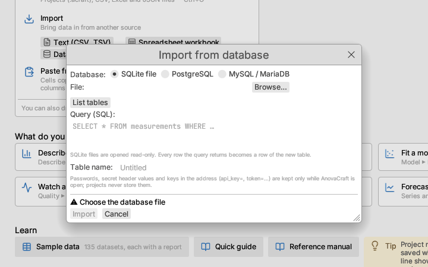
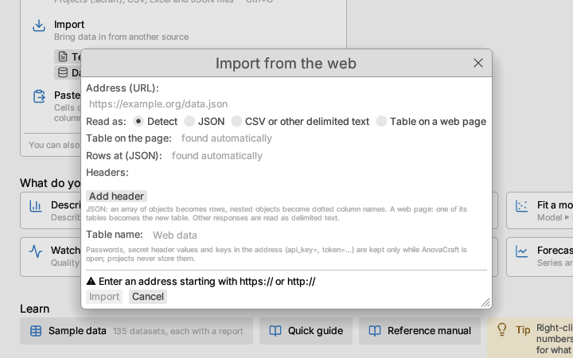

# Data from databases and the web

Besides files, a table can come from an SQL database or from an address on
the web. **File ▸ Import from database…** and **File ▸ Import from the web…**
read the rows into a new table; **Data ▸ Refresh from source** reads them
again later.



## Databases

Choose the kind of database at the top of the dialog:

| Kind | What you give |
|---|---|
| **SQLite file** | The database file (**Browse…** or type its path). It is opened read-only. |
| **PostgreSQL** | Server, port (5432), database name, user and password. |
| **MySQL / MariaDB** | Server, port (3306), database name, user and password. |
| **ODBC data source** | A data source name or connection string (`DSN=plant;UID=ann`, or `Driver={…};Server=…`) and the password. Only in builds made with ODBC support (see below). |

For a server, **Encryption** chooses whether the connection is encrypted:
*If offered* (the default) encrypts when the server supports it (a MySQL
connection is retried unencrypted only when encryption itself could not be
set up, never after a refused login), *Required*
refuses an unencrypted connection, and *Off* never encrypts. Encrypted
connections trust the usual public certificate authorities.

**List tables** connects and lists the tables and views; click one to read it
whole, or write any query in **Query (SQL)**. Every row the query returns
becomes a row of the table, and the last result set is used when a query
returns several. **Table name** defaults to the queried table's name.

Values arrive as text and are typed the way a CSV file is: a column of
numbers becomes numeric, a column of dates or times becomes a date column,
anything else is text. SQL `NULL` is a missing value. Errors from the
database (a wrong password, a misspelt table) appear in the dialog, which
stays open so you can correct the settings.

## The web

Give the **Address (URL)** of a JSON or CSV document, or of a web page that
shows its data in a table. The request is a plain HTTP GET; add **Headers** for services that need them, such as `Accept` or an
API key. Tick **Secret** for a header holding a credential (it is ticked for
you when the name looks like one: `Authorization`, `Cookie`, or a name
mentioning a key, token, secret or password).

**Read as** is normally *Detect*: JSON when the server says so or the text
starts with `[` or `{`, a table on a web page when the server sends HTML,
otherwise delimited text with the delimiter detected. In a JSON document the rows are an array of objects: the document
itself, the array at **Rows at** (a dotted path such as `data.items`), or,
when that is left empty, the one member of the top-level object that holds
such an array. Nested objects become dotted column names (`site.name`,
`site.location.lat`); arrays inside a row are kept as their JSON text.

A web page (HTML) is read from one of its tables. Leave **Table on the page**
empty to take the table the address's `#section` points to (for
`https://example.org/specs#daily`, the first table after the heading with id
`daily`), or the largest table when the address has no `#section`; or give a
table's number (1 for the first table on the page) or its `id`. Heading rows
become column names (a heading spanning several columns is repeated over
them, so `Power` above `Min` and `Max` gives `Power Min` and `Power Max`),
and cells that span rows or columns are repeated into each place they cover.
The import note says which table was read and how many the page has.
A table on a web page and delimited text then show the
[Open Data dialog](open-data.md), where you choose the row of names, the
rows of values and the columns; **Refresh from source** reads the same
block again. Pages
that fill in their tables with JavaScript after they open cannot be read
this way; look on the page for a download link or a data address instead.

When the import fails, the message says why in words. AnovaCraft identifies
itself to web sites the way a desktop browser does, since many sites close the
connection on other programs; a **User-Agent** header you give replaces it.
On macOS and Windows, when a site drops the secure connection, AnovaCraft
tries once more through the operating system's own secure connection, as the
system's browser makes it.
*Closed the connection without answering* means the site still turned the
request away: check that the address opens in your browser, and look on the
site for a download link or a data address.



## Refreshing

A table read from a database or the web remembers where it came from (its
tab's tooltip says so). **Data ▸ Refresh from source** reads it again and
replaces its rows as one step that **Undo** reverses:

- columns keep their position, measurement level and formulas; new columns
  are added at the end; a column the source no longer has is removed,
  unless a report uses it (close that report first);
- row states (selection, exclusion, colours) are cleared, because the rows
  are new;
- every report re-runs on the new rows.

## Passwords are never saved

Saving the project keeps the connection settings and the query, or the
address and the headers, so the table can be refreshed after the project is
reopened. It never keeps a password or a secret header's value: those stay
in memory while AnovaCraft is open, and **Refresh from source** asks for
them again in a new session. An ODBC connection string is saved without its
`PWD=` part, and an address is saved without any password written into it
(`https://user:password@…`) and with the values of query parameters that
name a credential blanked (`?city=Oslo&api_key=…` is saved as
`?city=Oslo&api_key=`; names containing `key`, `token`, `secret`,
`password` or `auth`). **Refresh from source** asks for each of those again,
as *name (in the address)*, in a new session.

## Scripts

Scripts read the same sources with `read_database`, `database_tables` and
`read_url`; see [Scripting and recording](../reference/scripting.md).

## ODBC support

ODBC needs the operating system's ODBC driver manager (unixODBC or iODBC on
macOS and Linux) and a driver for the database, so it is not part of the
standard build. To build with it:

```sh
cargo run --release -p app-gui --features odbc
```

(on macOS, `brew install unixodbc` first).
