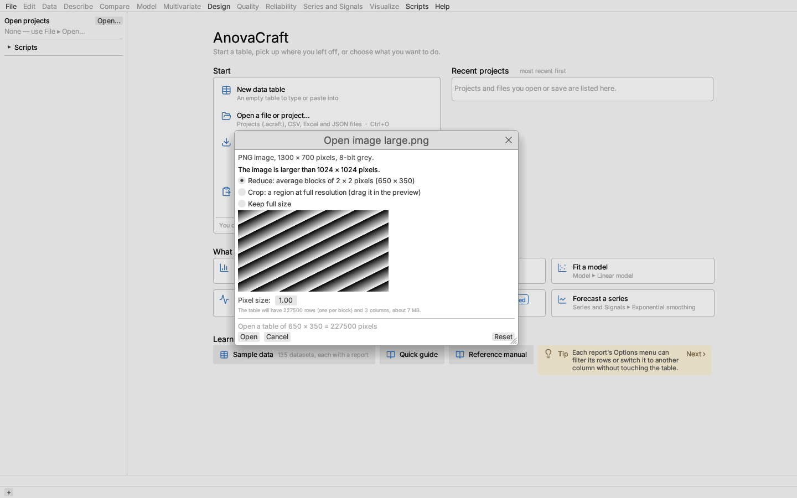
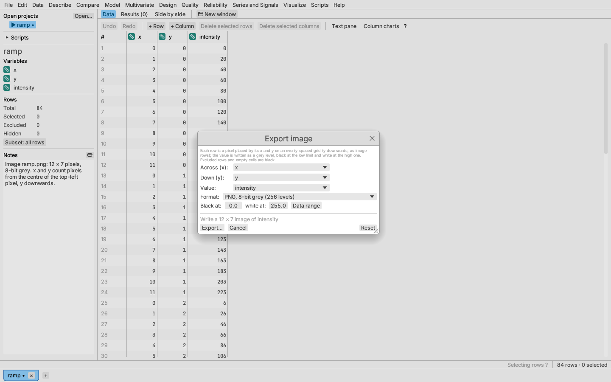

# Images as tables

An image file opens as an ordinary table with **one row per pixel**, so
every analysis, formula column and plot can use it. Pixels are listed row
by row from the top of the picture, left to right.

| Column | What it holds |
|---|---|
| `x` | The pixel's column: the position of its centre, counted from the centre of the top-left pixel, times the pixel size. |
| `y` | The pixel's row, counted the same way, **downwards** as in image files. |
| `intensity` | For a grey image, the grey level in the file's own units (0–255 for 8-bit files, 0–65535 for 16-bit ones, the stored number for floating-point TIFF). |
| `red`, `green`, `blue`, `luminance` | For a colour image read as colour: the three channels, and the luminance 0.2126 R + 0.7152 G + 0.0722 B (the Rec. 709 weights, applied to the stored values with no gamma correction). |

PNG (8- or 16-bit grey or colour, and palette images), JPEG, TIFF (8- or
16-bit, or 32-bit floating point) and BMP files are read. Transparency is not
read; the dialog and the note say so when a file has it.

## The Open image dialog

**File ▸ Open…** (or dropping a file on the window) shows the **Open image**
dialog for an image: the file's format, size and pixel type, a preview, and
these choices.

- **Columns** (colour images only): **Grey (intensity)** gives one
  `intensity` column, the luminance; **Red, green, blue and luminance** gives
  all four.
- **Pixel size**: the length of one pixel in the units `x` and `y` should be
  in (micrometres per pixel, say). With 1, `x` and `y` count pixels.

An image larger than 1024 pixels on a side would make a very long table (a
4000 × 3000 photograph is twelve million rows), so the dialog asks what to do:

- **Reduce** averages blocks of *k* × *k* pixels, with *k* the smallest
  whole number that brings both sides within 1024 (⌈side ÷ 1024⌉). Each
  row is one block, placed at the block's centre **in the original pixel
  units**, so distances and frequencies measured on the reduced table keep
  their meaning. Pixels at the right and bottom edges that do not fill a
  whole block are left out (the note says how many).
- **Crop** keeps a region at full resolution: drag in the preview to place
  it, or type its left, top, width and height. `x` and `y` keep the
  original pixel numbers, so a crop at column 138 starts at `x` = 138.
- **Keep full size** opens every pixel, for images up to 4096 × 4096.

Under the choices the dialog gives the size of the table and the memory it
needs, marked with ⚠ when it is over 200 MB. What was done (the file, its
size, the reduction or crop, the pixel size) is shown in the status line and
added to the project's **Notes**, so the table's origin stays with it.

With **Settings ▸ Open files directly when the table starts in the top-left
cell** on,
a grey image within 1024 × 1024 pixels opens without the dialog. Scripts open
images with `open_table(path)`, which reads a colour image as its luminance
and reduces a large image as **Reduce** does.

## Exporting an image

**File ▸ Export data as ▸ Image (PNG or 16-bit TIFF)…** writes a value
column as a grey picture. Choose the **Across (x)** and **Down (y)**
columns, which must place the rows on an evenly spaced grid (any table made
from an image does, and so do results computed from one), the **Value**
column, and the format:

- **PNG, 8-bit grey** (256 levels) or **TIFF, 16-bit grey** (65,536 levels,
  for measurements that need the finer steps).
- **Black at** and **white at**: the values written as black and white;
  values between are spaced evenly in grey level, and values outside are
  clipped. **Data range** sets them to the least and greatest values.

Rows run downwards from the least `y`, as in the image they came from.
Excluded rows and cells no row fills are written black. Two rows that fall
in the same cell, or values that are not on an even grid, stop the export
with a message naming them.

See [Image plots](../reports/image-plot.md) to look at the table as a
picture.
