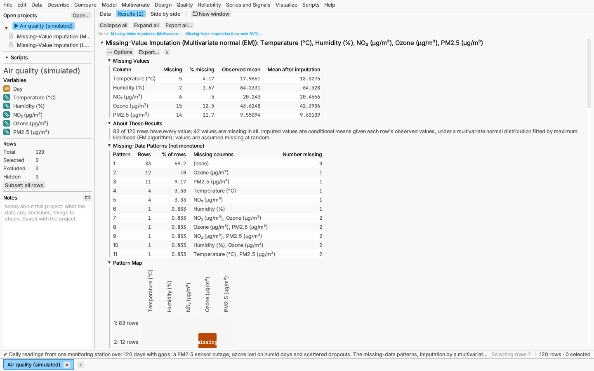

# Missing values and imputation

**Data ▸ Impute missing values…** shows where a set of numeric columns has
missing values and fills them in from what each row does have. The completed
columns are saved as new columns, so the original data stay as they were.
The [Air quality sample](../getting-started/sample-data.md) (File ▸ Open sample
data ▸ Multivariate) has monitoring data with gaps and opens with two imputation reports.

## Missing and excluded rows in reports

Reports that count rows (Missing, N used, and so on) count a row with a
missing value as **missing** before they look at whether it is excluded:
an excluded row whose value is missing adds to the missing count, not to
the excluded count. Either way the row takes no part in the statistics.
Every analysis follows the same order.

## The dialog

Tick the **Columns** to impute; each is filled in using the others. Then
choose a **Method**:

| Method | How values are filled in | When it suits |
|---|---|---|
| **Multivariate normal (EM)** | Fits a multivariate normal distribution to the columns by maximum likelihood with the EM algorithm (Dempster, Laird & Rubin 1977), then fills each missing value with its expected value given the row's observed values. | Continuous columns that are roughly normal and related to each other. |
| **Low-rank SVD** | Fits the table as column means plus a few principal directions (a rank-*k* singular value decomposition) and refits until the filled-in values settle (Troyanskaya et al. 2001), shrinking the directions by the estimated noise so the refitting does not drift (regularized iterative PCA, Josse & Husson 2012). | Many related columns, or data that are not normal. |
| **Column mean** / **Column median** | The column's observed mean or median. | A baseline. It keeps the column's centre but understates its spread and its correlations. |
| **Multiple imputation: chained equations** / **Multiple imputation: multivariate normal** | Several completed copies drawn from the values' predictive distribution, for analyses pooled across them: see [Multiple imputation](multiple-imputation.md). | Standard errors and tests that allow for the missing values. |

For **Low-rank SVD**, **Rank** is either chosen for you (*Choose on held-out
values* hides 10% of the observed values, imputes them at ranks 1 to 10 and
keeps the rank that predicts them best) or fixed. **More options** holds
*Regularize the fit (recommended)*, on by default: each kept singular value
σ becomes σ − nσ̂²/σ, where σ̂² is the noise variance estimated from the
discarded directions. Without it, refitting with more than one direction
can chase its own filled-in values and drift far outside the data. It also
holds the shrinkage λ (above 0 the singular values are soft-thresholded,
the soft-impute method of Mazumder, Hastie & Tibshirani 2010, in place of
the regularization), whether columns are standardized first, the seed for the held-out values, and the iteration
limit and convergence tolerance of both iterative methods.

Rows excluded from analyses take no part, and their missing values are left
missing. Values are assumed **missing at random**: whether a value is
missing may depend on the row's other observed values, but not on the
missing value itself. Imputed values are best guesses, not data; analyses of
completed columns treat them as observed and so overstate precision. For
honest standard errors, use [multiple imputation](multiple-imputation.md).

## The report

- **Missing Values:** for each column, how many values are missing, the mean
  of the observed values and the mean after imputation.
- **About These Results:** how many rows are complete, and what the method
  assumes.
- **Missing-Data Patterns:** each distinct set of missing columns with its
  number of rows. The title says whether the pattern is *monotone* (columns
  can be ordered so that a row missing one also misses every later one, as
  when people drop out of a study).
- **Pattern Map:** the patterns as rows of cells, one column per variable,
  with *missing* written in each missing cell (the 40 most frequent
  patterns).
- **Estimates:** the values filled in (mean and median), or the
  maximum-likelihood means, standard deviations and correlations (EM).
- **Rank Choice** (low-rank, rank chosen): the held-out error at each rank.
- **Warning: Not Converged** (first, only when it applies): the iteration
  limit was reached before the values settled, with what to try.
- **Convergence** and **Convergence Plot:** iterations, whether the method
  converged, whether the low-rank fit was regularized and its noise
  variance σ̂², and the log-likelihood (EM) or the relative change (low-rank)
  at each iteration.
- **Imputed Values:** row, column and value of each imputed cell (the first
  500).
- **Scatter plot** of the first two columns with every row's completed
  values, marked by which of the two values were imputed (colour and marker
  shape). Selecting points selects the rows everywhere.

## Saving the results

From the report's **⋯** options menu:

- **Save *column* with imputed values** adds the column with its missing
  values filled in, named *column* imputed.
- **Save number of imputed values per row** adds a column counting the
  imputed values in each row (0 for complete rows), to flag or select the
  rows that were filled in.

Scripts do the same with `report.save_columns(...)`, using the keys
`imputed1`, `imputed2`, … and `count`.
